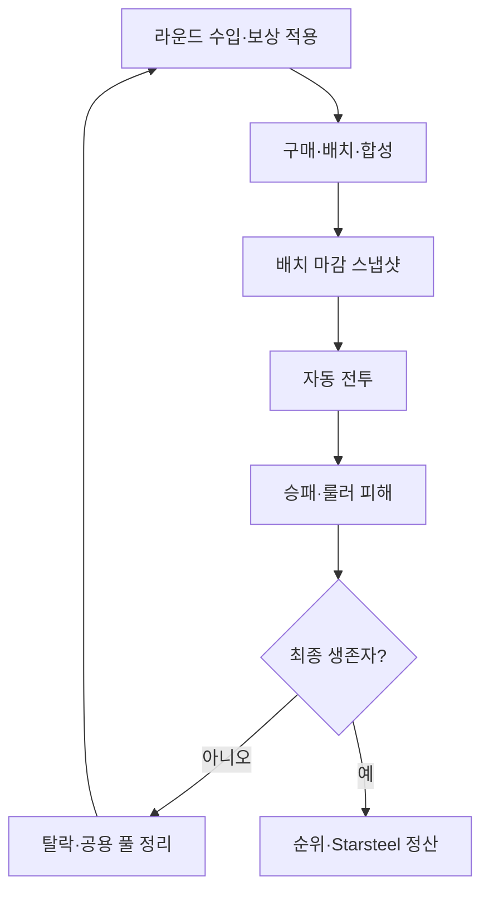

# 16. Merge Tactics: 별도 라운드형 자동전투 모드

> 조사 기준: 2026-11-13 · 핵심 기준: Season 11, 2026-10-27 November Changes.
> **[확인]** 공식 공개 규칙 · **[분석]** 기획적 해석 · **[재현 설계]** 구현 제안 · **[검증 필요]** 현재 값이 충돌하거나 자료가 부족한 부분.

## 1. 본편과 분리해서 이해해야 하는 이유

**[확인]** Merge Tactics는 4명이 참가하고 배치 단계와 자동 전투 단계를 반복하는 모드다. 사전 8장 덱보다 전투 중 유닛 구매·합성·특성 조합이 중심이며 최후 생존을 목표로 한다. 출시 공지는 5~8분을 목표 전투 길이로 설명했다. 이는 현재 모든 경기의 실측 길이를 뜻하지 않는다. [M24](https://supercell.com/en/games/clashroyale/blog/release-notes/new-game-mode-merge-tactics/)

| 구분 | 본편 1v1 | Merge Tactics |
| --- | --- | --- |
| 핵심 결정 | 실시간 카드 사용 위치·시점 | 라운드별 구매·판매·합성·배치 |
| 전력 구성 | 준비한 덱과 순환 손패 | 해당 시즌 공용 풀·상점·룰러 |
| 자원 리듬 | 시간에 따른 엘릭서 재생 | 라운드 수입과 거래 |
| 직접 조작 | 전투 중 카드 배치 | 배치 후 자동전투 중심 |
| 패배 누적 | 타워 파괴·시간 종료 | 룰러 HP 감소·탈락 |
| 성장 단위 | 카드 레벨·폼 | 카드 기반 전력과 경기 내 별수·룰러 |

이 비교는 공개 규칙을 바탕으로 한 **[분석]**이다. 같은 카드 이름을 사용해도 비용·능력·전력 계산을 공유한다고 가정하지 않는다.

## 2. 먼저 고정할 최신 버전 규칙

**[확인]** Season 11은 9월 1일~12월 1일의 3개월이며 월별 Starsteel 초기화가 없다. Diamond 진입점은 4,000으로 확장했다. 대신 월별 유닛 풀과 변형 규칙을 교체한다. [M26](https://supercell.com/en/games/clashroyale/blog/release-notes/merge-tactics-season-11/)

| 항목 | 과거·잔존 문구 | 채택하는 기준 |
| --- | --- | --- |
| 기본 라운드 수입 | 일반 지원 페이지의 4 Golden Elixir | 10/27 공지의 **5** |
| 공용 풀 | 출시 시 카드별4장 | 10/27: 비용2 유닛8장, 비용3 유닛6장 |
| 장비 배정 | 과거 자동 배정 안내 | Season11부터 배치 단계에서 수동 장착 |
| 특성 수치 | 일반 지원 페이지와 밸런스 공지에 차이 | 최신 패치·현재 인게임 확인 필요 |
| 시즌 초기화 | 과거 월간 리셋 | Season11 기간 중 월간 리셋 없음 |

**[확인]** 라운드 수입·공용 풀 변경은 10월 27일 공지가 명시한다. 일반 지원 페이지의 4엘릭서 문장을 그대로 현재 규칙으로 사용하지 않는다. [M27](https://supercell.com/en/games/clashroyale/blog/release-notes/merge-tactics-season-11-november-changes/) [M25](https://support.clashroyale.com/hc/en-us/articles/49484923863067-Merge-Tactics)

## 3. 라운드의 두 단계

**[확인]** 배치 단계에서 구매·판매·이동·합성한다. 전투 중 거래는 벤치와 상점 사이로 제한되며 중복 구매의 합성은 다음 배치 단계에 적용된다. 상대 벤치는 수량만 공개한다. [M25](https://support.clashroyale.com/hc/en-us/articles/49484923863067-Merge-Tactics)

**[재현 설계]** 단계 전환은 화면 타이머가 아니라 서버 확정 시점으로 잠근다. 다음 흐름은 재현용 모델이다.



상점 구매는 전투 스냅샷과 별도로 기록하되, 전투 중 생성된 유닛이 현재 전장에 바로 들어가지 않게 구분한다. 타이머 마지막 프레임의 이동·판매와 전투 시작의 순서를 고정해야 한다.

## 4. 상점·공용 풀·판매

**[확인]** 상점은 구매할 때 3개 선택지를 갱신한다. 비용은 본편과 다르다. 합성은 엘릭서1을 주며 되돌릴 수 없다. 판매는 일반적으로 투입비용-1 환급이고 유닛별 예외가 있다. [M25](https://support.clashroyale.com/hc/en-us/articles/49484923863067-Merge-Tactics)

**[확인]** 유닛은 공용 풀에서 공급된다. 같은 유닛을 다른 플레이어가 많이 확보하면 획득 기회가 달라진다는 원리를 출시 공지가 설명했다. 현재 비용별 풀 수량은 이후 패치를 적용해야 한다. [M24](https://supercell.com/en/games/clashroyale/blog/release-notes/new-game-mode-merge-tactics/) [M27](https://supercell.com/en/games/clashroyale/blog/release-notes/merge-tactics-season-11-november-changes/)

**[분석]** 공용 풀은 상점의 무작위성을 경쟁 정보로 바꾼다. 특정 특성을 세 명이 동시에 모으면 카드 희소성이 생기고, 상대가 덜 쓰는 조합으로 전환할 이유가 생긴다. 낮은 비용 유닛 풀 확대는 초반 합성의 안정성을 높이지만, 장기적으로 특정 저비용 조합의 반복 빈도를 늘릴 수도 있다.

**[재현 설계]** `remainingCopies[unitId]`와 각 플레이어의 구매·벤치·전장 상태를 연결한다. 다음은 모두 별도 규칙으로 정의해야 한다.

- 상점에 표시만 된 유닛을 이미 풀에서 예약하는가.
- 판매·탈락 시 기본 사본 몇 장을 반환하는가.
- 룰러 보상·변형 규칙으로 생긴 사본도 풀을 소비하는가.
- 상점 재추첨 중 동일 유닛 중복 표시를 허용하는가.
- 특수 Supers와 일반 유닛이 어떤 풀 항목을 공유하는가.

이 항목은 **미공개 내부 정책**이다. 정확한 확률이나 풀 반환 시점을 실제 규칙이라고 단정하지 않는다.

## 5. 합성의 의사결정

**[확인]** 중복 유닛을 합성해 별수를 높이고 1성에서 최대 4성까지의 경기 내 성장을 만든다. 카드의 장기 레벨과 별수는 다른 축이다. 출시 당시 장기 카드 레벨당 약 2% 스탯 증분을 소개했지만, 이를 2026년 모든 유닛의 현재 공식으로 재사용하지 않는다. [M24](https://supercell.com/en/games/clashroyale/blog/release-notes/new-game-mode-merge-tactics/)

**[분석]** 합성은 공간 효율과 개별 전력을 높이는 대신 유닛 수·배치 폭·특성 구성의 선택을 바꾼다. “별수가 높으면 항상 좋다”만으로는 유닛 한 기를 여러 방향에서 공격받게 하는 위험을 설명하지 못한다. 공격 횟수 기반 능력은 별수에 따른 공격 속도·발동 조건과 함께 평가한다.

**[재현 설계·가상 모델]** 동일 유닛·동일 별수 2개를 다음 별수 1개로 합치는 모델이라면 기본 사본 환산량은 `copies(star)=2^(star-1)`이다. 1/2/3/4성은 1/2/4/8사본이 된다. 이 수식은 재현 모델이며 현재 게임의 자동 합성 위치·연쇄 우선순위·예외 폼은 실제 플레이로 확인해야 한다.

자동 합성 시 장비를 어느 유닛에서 이어받는지, 전장의 어느 칸에 결과물이 남는지, 벤치가 가득 찼을 때 구매가 먼저 실패하는지 합성이 먼저 해결되는지에 따라 전략 결과가 바뀐다.

## 6. 룰러와 퀘스트

**[확인]** 룰러는 패시브·퀘스트를 갖고 패배로 HP가0이 되면 탈락한다. 룰러 카드로 해금·성장한다. [M25](https://support.clashroyale.com/hc/en-us/articles/49484923863067-Merge-Tactics)

**[확인]** 10월 27일 기준 퀘스트 Orb의 핵심 구성은 다음과 같다. 장비 풀 세부 목록은 공지 원문을 기준으로 별도 설정한다. [M27](https://supercell.com/en/games/clashroyale/blog/release-notes/merge-tactics-season-11-november-changes/)

| 퀘스트 단계 | 공통 보상 | 추가 구성 |
| --- | --- | --- |
| 1 | 엘릭서3 | 장비 또는 비용2의 2성 유닛 |
| 2 | 엘릭서6 | 장비 또는 비용3의 2성 유닛 |
| 3 | 팀 규모+1 | 비용4~5의 3성 유닛 |

**[분석]** 룰러 선택은 단순 초기 능력 선택을 넘어 경기 중 어떤 행동을 해야 성장 보상을 받는지 지정한다. 퀘스트를 빠르게 완료하기 위해 당장의 최적 배치를 희생할 수 있고, 보상이 늦게 나오는 룰러는 후반 전력을 보여 주기 전에 탈락할 수 있다.

**[재현 설계]** 퀘스트 진척은 `OnUnitMerged`, `OnRoundWon`, `OnEnemyKnockedOut` 같은 명확한 이벤트로 처리한다. 소환된 유닛·복제된 유닛·동시 처치가 각각 진척으로 인정되는지 데이터에 명시한다. 한 이벤트로 여러 단계를 동시에 완료했을 때 Orb를 순서대로 지급할지도 정한다.

## 7. 특성·Supers·장비·건물

**[확인]** 특성은 전장 유닛 수로 활성화하며 벤치는 제외한다. Supers는 비용5·능력2개의 강화 유닛이다. [M25](https://support.clashroyale.com/hc/en-us/articles/49484923863067-Merge-Tactics) 11월 안내 조합은 Super Mini P.E.K.K.A·Super Mega Knight·Super Dark Prince·Super Hog Rider다. [M28](https://support.clashroyale.com/hc/en-us/articles/50816352380443-What-s-New-Merge-Tactics)

**[확인]** Season11부터 장비는 배치 단계에 수동으로 장착해야 하며 벤치에 남긴 장비를 자동 배정하지 않는다. [M26](https://supercell.com/en/games/clashroyale/blog/release-notes/merge-tactics-season-11/)

| 요소 | 전력에 미치는 방식 | 재현 설계에서 분리할 값 |
| --- | --- | --- |
| 특성 | 편성 수량에 따른 팀 효과 | 임계 수량·적용 대상·중복 정책 |
| Super | 강한 조건부 능력 | 활성 조건·상태·자원 비용 |
| 장비 | 특정 유닛의 공격·생존·특성 변경 | 소유자·사용 횟수·파괴 조건 |
| 변형 규칙 | 전체 참가자에 공통인 경기 조건 | 시작 시 선택·라운드 효과 |
| 특수 칸 | 위치에 따른 버프·이동 변화 | 칸 좌표·점유 시점·효과 수명 |
| 건물 | 유닛과 다른 고정 자산 | 이동·판매·팀 규모 산정 예외 |

**[확인]** 건물은 배치 후 이동·판매·자연 HP감소가 없고 팀 규모·룰러 피해 산정에서 제외한다. [M25](https://support.clashroyale.com/hc/en-us/articles/49484923863067-Merge-Tactics)

**[검증 필요]** 일반 지원 페이지의 Clan/Rider 특성 수치는 날짜가 있는 밸런스 문서와 일치하지 않는 부분이 있다. 이 문서는 확정 수치를 반복하지 않는다. 특성 표를 구현 데이터로 옮기기 전 인게임 수치와 최신 패치 적용 여부를 확인해야 한다.

## 8. 밸런스 변경에서 읽을 수 있는 설계 의도

**[확인]** 10월 27일 밸런스 공지는 Battle Machine 건물과 Boss 특성의 과도한 내구·제어력을 줄이고, Superstar Ring을 무작위 재발동 대신 전투 시작 1회 발동으로 변경했다고 설명한다. [M29](https://supercell.com/en/games/clashroyale/blog/release-notes/merge-tactics-season-11-balance-changes/)

**[분석]** 이는 단순 승률 조정 외에 라운드 길이와 결과의 이해 가능성도 조정한다. 강한 제어와 높은 피해가 한 유닛에 겹치면 상대가 대응 배치를 해도 결과가 바뀌지 않을 수 있다. 무작위 다중 발동을 시작 1회로 제한하면 예측 가능한 포지셔닝과 카운터 선택의 비중이 커진다.

## 9. 배치와 자동전투의 재현 모델

**[재현 설계]** 전장을 hex 좌표로 표현하고 각 유닛에 `tile`, `facing`, `targetId`, `abilityCharge`, `statusEffects`를 둔다. 실제 맵의 행·열 수, 장애물, 타겟 선택의 동률 규칙은 실측 필요다. 보이는 유닛 모델과 논리적 점유 칸을 분리하면 점프·끌어오기·장비 효과를 처리하기 쉽다.

```text
전투 시작:
  배치 고정 → 특성 집계 → 장비 적용 → 시작 능력 → 타겟 탐색
전투 진행:
  이동 → 공격·능력 → 피해 → 사망·소환 → 재탐색
라운드 끝:
  결과 판정 → 룰러 피해 → 퀘스트 → 보상 → 다음 배치 준비
```

위 순서는 제안이다. 실제 게임의 동시 이벤트 우선순위를 주장하는 것이 아니다. 특히 시작 능력으로 즉시 처치된 유닛의 시작 효과가 발동하는지, 공포·끌어오기·점프가 겹칠 때 어느 효과를 우선하는지 테스트가 필요하다.

## 10. 순위·보상·모드 간 연결

**[확인]** 상위1·2위를 승자로 취급하며 Starsteel 변화는 순위·참가자 점수 차를 참고한다. [M25](https://support.clashroyale.com/hc/en-us/articles/49484923863067-Merge-Tactics) 승리 라운드에는 크라운이 연결된다. [M24](https://supercell.com/en/games/clashroyale/blog/release-notes/new-game-mode-merge-tactics/)

**[분석]** 1위만 보상하는 구조보다 2위도 승리로 처리하면 중간 성적의 성취를 만든다. 하지만 현재 2위를 안전하게 지키는 행동과 1위를 노리는 위험한 행동의 기대값을 비교해야 한다. 최하위 탈락을 피하려는 운영과 높은 별수 완성을 노리는 운영이 모두 유효하려면 룰러 피해·라운드 수입·잔여 상대 전력을 함께 조정해야 한다.

## 11. 데이터와 검증

**[재현 설계]** 필수 설정은 `seasonId`, `rotationId`, `troopPool`, `copyCounts`, `rulerDefinitions`, `traitDefinitions`, `equipmentPool`, `modifierPool`, `roundIncome`, `placementRewards`다. 정규1v1 카드 정의에 모드별 수치를 덮어쓰지 말고 별도 프로필로 참조한다.

| 테스트 | 확인할 결과 |
| --- | --- |
| 배치 마감과 합성 동시 | 둘 다 같은 서버 순서로 처리 |
| 전투 중 중복 구매 | 현재 전장 강화와 다음 라운드 합성 분리 |
| 공용 풀 마지막 사본 동시 구매 | 한 명만 획득 |
| 장비 소유 유닛 연쇄 합성 | 장비 소실·중복 없음 |
| 벤치 만석 상태의 구매 | 합성·예약·실패 순서 일관 |
| 두 룰러 동시 HP0 | 최종 순위 규칙으로 정산 |
| 장비 미장착 | 자동 배정이 되지 않는 최신 정책 |
| 건물 판매·이동 시도 | 유닛과 다른 규칙 적용 |
| 10월→11월 풀 교체 | 진행 중 경기에는 기존 rotation 고정 |
| Season11 월 경계 | Starsteel의 잘못된 월간 리셋 없음 |

**[분석]** 지표는 순위 분포뿐 아니라 구매 선택 편중, 3성 도달 라운드, 특정 룰러의 퀘스트 완료 시점, 전투 시간, 최초 탈락 라운드, 특성별 상위2위율을 본다. 카드·룰러·변형 규칙 조합을 무시한 전체 승률은 어느 계층이 문제인지 감춘다.

## 12. 출처

열람일: 2026-11-13. 지원 문서는 발행일 미표기.

- **M24** Supercell, [New Game Mode: Merge Tactics!](https://supercell.com/en/games/clashroyale/blog/release-notes/new-game-mode-merge-tactics/), 2025-06-29; 출시 기준과 모드 구조.
- **M25** Supercell Support, [Merge Tactics](https://support.clashroyale.com/hc/en-us/articles/49484923863067-Merge-Tactics); 일부 수치가 패치와 충돌함.
- **M26** Supercell, [Merge Tactics: Season 11](https://supercell.com/en/games/clashroyale/blog/release-notes/merge-tactics-season-11/), 2026-08-28.
- **M27** Supercell, [Merge Tactics: Season 11 — November Changes](https://supercell.com/en/games/clashroyale/blog/release-notes/merge-tactics-season-11-november-changes/), 2026-10-27.
- **M28** Supercell Support, [What's New? — Merge Tactics](https://support.clashroyale.com/hc/en-us/articles/50816352380443-What-s-New-Merge-Tactics).
- **M29** Supercell, [Merge Tactics: Season 11 Balance Changes](https://supercell.com/en/games/clashroyale/blog/release-notes/merge-tactics-season-11-balance-changes/), 2026-10-27 갱신; 9월·10월 변경도 함께 기록.

관련 문서: [11 게임 모드](11_matchmaking_and_game_modes.md) · [13 시즌 운영](13_seasons_events_and_retention.md).
