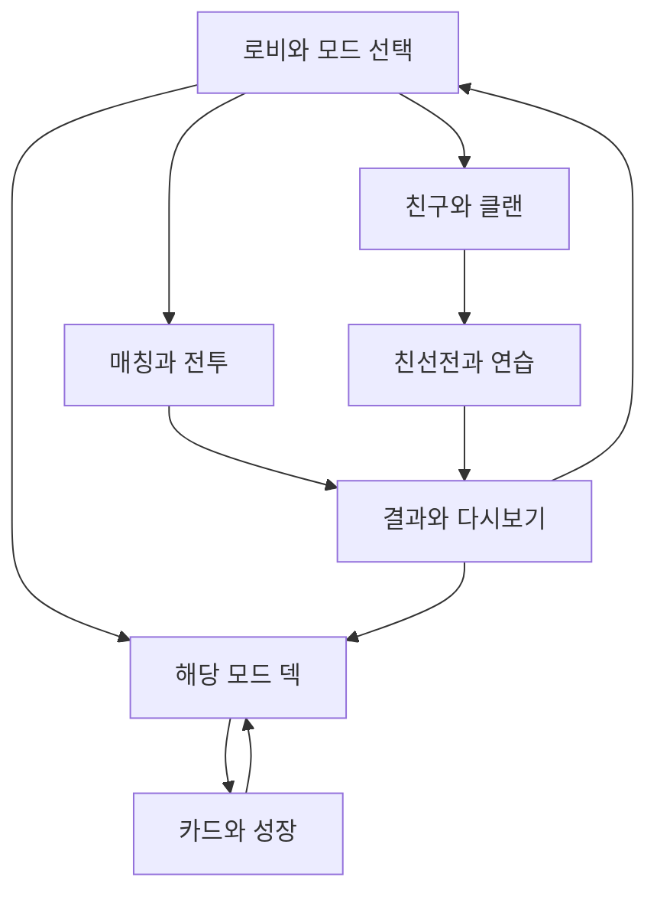
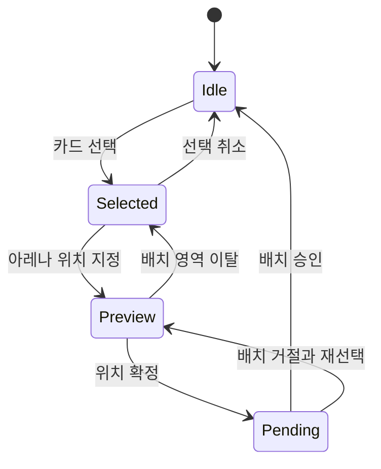

# 17. UI·UX와 학습 설계

> 기준일: 2026-11-13 · 대상: 정규 전투, 덱 관리, 성장 화면, 소셜 진입 · [확인]은 공개 자료의 기능, [분석]은 UX 해석, [재현 설계]는 구현용 제안이다. 이 문서는 실제 단말의 화면 좌표·터치 임계값을 측정한 결과가 아니다.

## 1. 이 시스템이 해결하는 문제

**[분석]** 전투의 복잡함을 화면에 모두 노출하면 카드 한 장을 배치하는 데도 시간이 오래 걸린다. 반대로 정보를 지나치게 줄이면 패배 원인을 알 수 없다. 클래시 로얄의 인터페이스는 전투 중에는 현재 행동의 비용과 위치를 읽게 하고, 전투 밖에서는 덱·레벨·전적을 통해 다음 행동을 준비하게 하는 구조로 해석할 수 있다.

| 사용 맥락 | 플레이어가 해결해야 할 질문 | 우선 정보 | 피해야 할 혼동 |
|---|---|---|---|
| 전투 직전 | 어떤 규칙과 덱으로 싸우는가? | 모드, 덱, 레벨 규칙 | 이전 모드의 덱을 사용한다고 착각 |
| 카드 선택 | 지금 이 카드를 쓸 수 있는가? | 손패, 비용, 엘릭서 | 선택과 실제 사용 완료의 혼동 |
| 배치 미리보기 | 이 위치에서 어떤 결과가 나오는가? | 유효 영역, 범위, 소환 위치 | 연출 크기와 실제 판정 범위의 혼동 |
| 교전 관찰 | 무엇이 위험하고 무엇을 살릴 것인가? | 타워 HP, 타겟, 주요 상태 | 작은 효과음에 핵심 판정이 묻힘 |
| 결과 | 왜 졌고 무엇을 바꿀 것인가? | 결과, 덱, 다시보기 진입 | 성장 부족과 운용 실수의 혼합 |
| 성장 | 어떤 자원이 얼마 부족한가? | 현재·필요 수량, 실효 레벨 | 컬렉션 레벨과 킹 타워 레벨의 혼동 |

## 2. 확인된 기능과 정보 구조

**[확인]** 모드 선택과 덱의 관계를 공식 카드·덱 안내가 설명한다. 최신 소셜 화면은 친구·클랜·친선전의 진입점을 모으고, Quickplay는 QR 기반 친선전 진입을 지원한다. **11월 Deck Wizard는 점진적 테스트 배포로 안내되므로 모든 계정에 동일한 버튼이 있다고 가정하면 안 된다.** [R03](https://supercell.com/en/games/clashroyale/blog/release-notes/march-update-2026/), [R06](https://supercell.com/en/games/clashroyale/blog/release-notes/new-season-king-vs-king/), [R13](https://support.clashroyale.com/hc/en-us/articles/49484924205595-Cards-Decks)

**[재현 설계]** 아래는 실제 탭 위치의 복제도가 아니라 기능 간 이동 관계다.

덱은 화면 이름만으로 식별하지 않고 `modeId + deckSlotId`로 식별한다. 사용자가 모드를 바꾸면 덱 목록, 특수 슬롯, 카드 제한, 레벨 정책을 함께 갱신해야 한다. 선택된 모드 배지와 실제 전투 요청의 모드가 서로 다르면 가장 기본적인 신뢰가 무너진다.

## 3. 전투 HUD의 정보 우선순위

**[분석]** 정보의 중요도는 항상 고정되어 있지 않다. 전투 초반에는 손패와 상대 카드 관찰이 중요하지만 종료 직전에는 시간, 타워 체력, 주문의 도달 시간이 우선한다.

| 우선순위 | 정보 묶음 | 인지 목적 | 표시 요구사항 |
|---|---|---|---|
| 1 | 아레나, 타워, 유닛 | 지금 발생하는 위협 파악 | 주요 교전 영역을 가리지 않음 |
| 2 | 4장 손패, 다음 카드, 엘릭서 | 다음 행동 결정 | 사용 가능·부족·잠김 상태 구분 |
| 3 | 남은 시간, 연장, 생성 배율 | 공격·수비 전략 전환 | 국면 변경을 텍스트와 연출로 함께 전달 |
| 4 | 능력·진화 상태 | 추가 행동 가능성 판단 | 소유 개체와 버튼의 대응을 명확히 함 |
| 5 | 이름, 감정표현, 관전 정보 | 사회적 맥락 | 중요한 공격 위치를 덮지 않음 |

**[재현 설계]** 타워 체력 표시가 숫자·게이지 중 무엇이든, 실제 피해량과 갱신 주기는 전투 상태에서 파생해야 한다. 체력 애니메이션을 천천히 보간하더라도 승패 판정은 애니메이션 완료를 기다리지 않는다. 같은 이유로 엘릭서 게이지의 시각적 보간과 사용 가능 판정을 별개로 구현한다.

## 4. 배치 입력의 상태 머신

**[재현 설계]** 카드 선택은 자원을 소비하는 행위가 아니다. 카드·위치·방향·플레이어 상태가 모두 유효한 명령으로 확정될 때 소비한다. 서버 구조는 [19번 문서](19_network_replay_and_architecture.md)와 연결한다.

| 상태 | 보여줄 것 | 허용 입력 | 자원 처리 |
|---|---|---|---|
| Idle | 현재 손패 | 카드 선택 | 없음 |
| Selected | 선택 카드 강조 | 위치 이동, 다른 카드 선택, 취소 | 없음 |
| Preview | 유효·무효 위치와 범위 | 위치 수정, 확정 | 없음 |
| Pending | 접수 중인 행동의 표시 | 다른 행동은 큐 정책에 따름 | 낙관 표시와 확정 원장을 분리 |
| 승인 | 배치 연출, 새 손패 | 다음 선택 | 승인된 한 번만 차감 |
| 거절 | 짧은 이유와 복구 상태 | 재선택 | 확정 차감 없음 |

빠른 연속 입력은 모두 같은 카드의 중복 배치가 되어서는 안 된다. 첫 입력 이후 손패가 바뀌었을 때 두 번째 입력은 화면 위치보다 `cardInstanceId`와 입력 시점의 손패 버전에 묶는 편이 안전하다. 단, 이 방식은 재현 제안이며 실제 제품의 입력 프로토콜은 공개되지 않았다.

### 4.1 대표 오류 시나리오

1. 손가락을 놓는 순간 아군 공격이 상대 측면 타워를 파괴해 배치 가능 영역이 확장된다: 확정 시점의 유효 영역으로 재검증한다.
2. 선택 중 능력 사용으로 엘릭서가 줄어든다: 미리보기는 유지하되 사용 불가 상태를 즉시 표시한다.
3. 연결 지연 중 동일 카드를 두 번 누른다: 명령 ID로 중복 사용을 방지한다.
4. 화면 회전·노치·안전 영역이 변한다: 화면 좌표를 아레나 좌표로 변환하는 단계에서 처리한다.
5. 전투 종료와 입력이 겹친다: 종료가 확정된 매치에 새 명령을 추가하지 않는다.

## 5. 카드와 특수 슬롯 편집

**[분석]** 덱 화면은 카드 8장을 채우는 편집기이면서 성장 투자와 전략을 연결하는 도구다. 평균 비용 하나만 보여주면 대공 부재, 건물 대응 부재, 승리 수단 부재를 알아보기 어렵다. 따라서 정보 구조는 비용·역할·특수 슬롯·실효 레벨의 네 축으로 나눠 해석하는 것이 유용하다.

**[재현 설계]** 아래 검증을 저장 시점과 전투 시작 시점에 모두 실행한다.

| 검증 | 실패 예 | 적절한 안내 |
|---|---|---|
| 카드 수 | 슬롯이 비어 있음 | 비어 있는 위치 강조 |
| 중복 | 같은 기본 카드가 여러 슬롯 점유 | 충돌 카드 표시 |
| 보유 조건 | 모드가 보유 카드만 허용 | 사용 가능한 대체 카드 제안 |
| 특수 슬롯 | 형상은 해금했지만 적용 슬롯이 다름 | 실제 전투에서 적용되는 형상 표시 |
| 모드 제한 | 이벤트 금지 카드 포함 | 제한 근거와 해제 시점 표시 |
| 듀얼 덱 | 다른 덱에 같은 카드 사용 | 충돌하는 덱 번호 함께 표시 |
| 레벨 정책 | 보유 레벨과 적용 레벨이 다름 | 실제 적용 수치 사전 확인 |

Deck Wizard의 알고리즘·학습 방식·정확도는 공식 공개 범위 밖이다. 추천 결과는 신규 덱 생성의 진입을 낮추는 기능으로 분석할 수 있지만, 특정 승률을 보장하거나 실시간 메타를 반드시 학습한다고 서술하지 않는다.

## 6. 성장·보상 화면의 상태 처리

**[확인]** 2026년 성장 개편은 Collection Level과 King Tower Level을 구별한다. UX에서도 둘을 단순히 같은 ‘플레이어 레벨’로 취급하면 안 된다. 상세 공식은 [09번](09_collection_and_card_progression.md), [10번](10_player_progression_trophy_and_ranked.md)에 정리했다. [R07](https://supercell.com/en/games/clashroyale/blog/news/new-collection-levels-and-mastery-changes/)

**[재현 설계]** 업그레이드 상세 화면에는 다음을 한 묶음으로 표시한다.

- 현재 카드 레벨 → 다음 카드 레벨, 실제 증가하는 능력치.
- 필요한 복제 카드·와일드카드·골드와 각각의 부족량.
- 업그레이드 후 Collection Level의 변화.
- 킹 타워 성장 조건에 포함되는지 여부.
- 현재 선택 모드에서 상한 때문에 실효 수치가 달라지는지 여부.

보상 화면의 닫기와 수령 확정도 분리한다. 애니메이션 도중 앱을 종료했더라도 이미 확정된 보상은 사라지면 안 되고, 다시 들어왔다고 한 번 더 지급되어도 안 된다. 화면의 ‘받기’ 상태는 서버의 `claimId`와 수령 상태에서 파생하도록 설계한다.

## 7. 학습 구조: 조작에서 예측으로

**[분석]** 처음에는 카드를 쓸 줄 아는지, 다음에는 상대 공격을 막을 줄 아는지, 이후에는 다음 공격까지 계산하는지를 나눠 가르치는 것이 이 게임의 학습 구조에 맞는다.

| 단계 | 학습 목표 | 성공을 관찰할 수 있는 과제 | 다음 단계로 넘어갈 조건 |
|---|---|---|---|
| 1 | 비용과 배치 | 충분한 엘릭서로 유효 위치 배치 | 거절 없이 배치 완료 |
| 2 | 타겟 구분 | 공중 유닛을 공격 가능한 카드로 방어 | 무효 대응을 스스로 설명 |
| 3 | 수비 위치 | 중앙 유도로 여러 방어 자원 활용 | 동일 비용으로 피해 감소 |
| 4 | 반격 | 생존 수비 유닛 앞에 전열 추가 | 새 투자량과 생존 자산 구분 |
| 5 | 회전 | 상대 핵심 수비 카드 복귀 예상 | 카드 사용 이력으로 선택 |
| 6 | 시간·승패 | 종료 전 공격과 수비 중 선택 | 타워 체력과 남은 시간 반영 |

위 표는 **제안하는 교육 순서**다. 실제 튜토리얼의 모든 단계가 이 순서라고 주장하지 않는다.

**[확인]** 11월 Daily Puzzles는 정해진 전투 상황을 반복해서 풀도록 발표되었다. 이를 분석하면 실시간 래더의 다양한 실패 원인을 제한된 문제로 분해하는 학습 장치다. 이 문서에서는 공식 퍼즐의 해답이나 실시간 제공 여부를 실측하지 않았다. [R14](https://support.clashroyale.com/hc/en-us/articles/57579150651419-What-s-New-November-2026)

## 8. 시인성·접근성 평가 기준

**[재현 설계]** 다음은 실제 게임에 모두 구현되어 있다는 뜻이 아니라 유사 시스템을 검토할 체크리스트다.

- 색상만으로 아군·적군·배치 금지·능력 사용 불가를 표현하지 않는다.
- 손가락이 가리는 위치의 배치 결과는 별도 기준점·범위선으로 읽을 수 있어야 한다.
- 큰 소환 연출이나 이모트가 주요 투사체·타워 HP를 장시간 가리지 않아야 한다.
- 체력 회복·보호막·피해 감소·무적을 같은 시각 효과로 표현하지 않는다.
- 전투 효과음을 꺼도 중요한 상태를 알 수 있고, 시각 효과가 많아도 능력 사용 결과를 추적할 수 있어야 한다.
- 번역 문자열 길이가 늘어도 엘릭서 수치, 버튼, 시즌 종료 시간이 잘리지 않아야 한다.

## 9. UX QA와 계측 제안

| ID | 검증 항목 | 성공 기준 |
|---|---|---|
| UX-01 | 모드 전환 후 바로 전투 | 덱·레벨·슬롯 정책이 같은 모드를 가리킴 |
| UX-02 | 배치 취소 | 카드·자원이 바뀌지 않음 |
| UX-03 | 연속 입력과 손패 회전 | 승인된 카드와 표시된 카드의 대응 일치 |
| UX-04 | 지연 후 거절 | 유령 유닛·음수 엘릭서 없이 복구 |
| UX-05 | 같은 종류 능력 소유자 교체 | 버튼과 대상 개체 대응 갱신 |
| UX-06 | 듀얼 덱 중복 | 충돌 위치를 사용자가 찾을 수 있음 |
| UX-07 | 점진 배포 기능 미노출 계정 | 기능 부재를 계정 오류로 안내하지 않음 |
| UX-08 | 보상 연출 중 종료·재접속 | 수령 상태 유지, 중복 지급 없음 |
| UX-09 | 타워 파괴 순간 배치 | 미리보기와 확정의 차이가 설명 가능 |
| UX-10 | 언어·안전 영역 변경 | 핵심 정보가 가려지지 않음 |

제안 지표는 첫 전투 진입 시간, 무효 배치 비율, 덱 저장 실패 사유, 모드 전환 직후 취소율, 다시보기 후 덱 변경률이다. 이는 실제 Supercell 내부 지표가 아니라 UX 가설을 확인하기 위한 측정안이다.

## 출처

- R03. Supercell, March Update 2026, 게시 2026-02-23 — 소셜·Quickplay.
- R06. Supercell, New Season: King vs. King!, 게시 2026-10-27 — Deck Wizard와 점진 배포.
- R07. Supercell, New Collection Levels & Mastery Changes, 게시 2026-05-13 — 성장 개념 구분.
- R13. Supercell Support, Cards & Decks, 열람 2026-11-13 — 모드별 덱 관계.
- R14. Supercell Support, What's New? - November 2026, 열람 2026-11-13 — 퍼즐의 학습 맥락.

이전: [16. Merge Tactics](16_merge_tactics.md) · 다음: [18. 밸런스와 운영 지표](18_live_balance_and_analytics.md) · [전체 목차](00_README.md)
