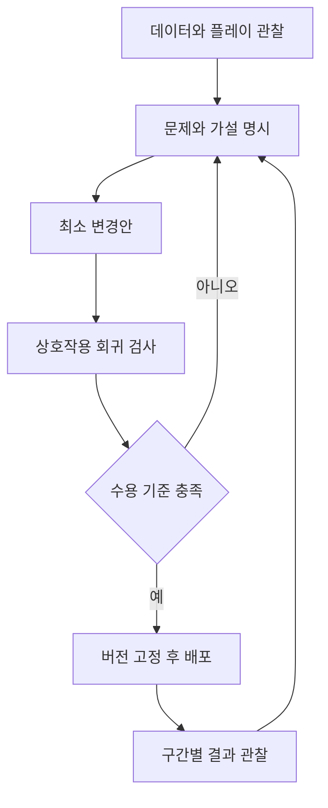

# 18. 라이브 밸런스·메타·운영 지표

> 기준일: 2026-11-13 · [확인] 공개 패치와 운영 설명 · [분석] 그로부터 도출한 설계 해석 · [재현 설계] 제안 지표·실험·출시 절차. 실제 내부 대시보드나 현재 카드 승률을 입수한 문서가 아니다.

## 1. 밸런스의 목표

**[확인]** 공식 시즌 안내는 사용률·승률·플레이어 피드백을 함께 참고한다고 설명한다. 이 문서의 상세 통계 정의와 조치 기준은 이를 그대로 복원한 내부 규정이 아니라 별도로 설계한 분석안이다. [R02](https://support.clashroyale.com/hc/en-us/articles/49484919911451-Seasons)

**[분석]** 모든 카드의 승률을 50%에 맞추는 것만으로 좋은 밸런스가 되지는 않는다. 특정 카드가 너무 많은 역할을 동시에 수행하거나, 한 번의 실수가 이후 모든 교환을 결정하거나, 상대에게 선택지가 없는 상호작용이 반복될 수 있다. 이 게임에서는 다음 다섯 기준을 함께 봐야 한다.

| 기준 | 질문 | 잘못된 단일 지표 해석 |
|---|---|---|
| 경쟁 공정성 | 같은 숙련도·레벨에서 대응할 수 있는가? | 전체 승률만으로 카드 강도 판단 |
| 전략 다양성 | 여러 승리 수단과 덱 구조가 살아 있는가? | 카드 수가 많으면 다양하다고 판단 |
| 상호작용 | 배치·타이밍·타겟 선택이 결과를 바꾸는가? | 딜량이 낮으면 공정하다고 판단 |
| 학습 가능성 | 왜 성공·실패했는지 읽을 수 있는가? | 고수의 대응 가능성을 초보에게 일반화 |
| 투자 지속성 | 성장 자산이 계속 활용 가능한가? | 한 덱의 너프를 단일 카드만의 문제로 판단 |

## 2. 실제 변경 사례에서 읽는 문제 정의

**[확인]** 2025년 10월 공지는 챔피언의 특수 회전 구조를 바꾸었고, 2026년 8월 공지는 대부분 능력의 반복 사용 구조를 단순화했다. 두 변경은 카드 공격력 조절만으로 해결하기 어려운 시스템 차원의 문제를 다룬 사례다. [R12](https://supercell.com/en/games/clashroyale/blog/release-notes/october-update-2025/), [R05](https://supercell.com/en/games/clashroyale/blog/news/final-august-balance-changes-826/)

**[분석]** 역기획에서 중요한 것은 ‘너프했다’보다 **무슨 선택 구조를 바꾸었는가**이다.

| 변화 범주 | 전투에 직접 바뀌는 것 | 2차 영향 | 확인해야 할 부작용 |
|---|---|---|---|
| HP·피해 | 생존 타수, 주문 제거 여부 | 방어 비용, 반격 생존율 | 레벨 차에서 임계점 급변 |
| 첫 공격·공격 간격 | 첫 교환과 지속 DPS | 보호막·기절의 가치 | 애니메이션과 판정 불일치 |
| 사거리·이동 | 먼저 공격하는 쪽, 유도 가능성 | 배치 정답과 레인 선택 | 기존 위치 지식의 붕괴 |
| 비용 | 투자 위험, 회전 비용 | 평균 덱 비용과 템포 | 같은 역할 카드의 대체 가능성 |
| 회전·능력 | 행동 기회의 빈도 | 저비용 카드의 간접 가치 | 초보·고수 간 효율 차이 |
| 타워 정책 | 기본 수비 효율 | 모든 공격 덱의 성과 | 카운터 관계 전체 변경 |

## 3. 카드 역할의 중복과 독점

**[재현 설계]** 각 카드를 단일 역할로 분류하지 않고 역할 벡터로 기록한다. 예: `antiAir, antiSwarm, tankKill, buildingPressure, displacement, cycle, spellBait`.

역할을 많이 가진 카드가 반드시 문제는 아니다. 비용, 사거리, 배치 시간, 취약 구간에 충분한 대가가 있는지 봐야 한다. 반대로 비용이 낮은 카드가 회전·탱킹·광역 제어·타워 압박을 동시에 높은 수준으로 수행하면, 그 카드의 승률보다 **다른 카드들이 덱에서 빠지는 현상**이 먼저 나타날 수 있다.

다음 질문으로 기획 리뷰를 진행한다.

1. 이 카드를 넣은 이유가 특정 전술인가, 거의 모든 덱에 유리해서인가?
2. 상대는 엘릭서·위치·시간 중 하나를 투자해 대응할 수 있는가?
3. 대응 카드가 손에 없을 때도 피해를 줄일 수 있는가?
4. 카드를 제외한 덱이 합리적인 다른 이점을 얻는가?
5. 상위권에서만 강한가, 레벨 차가 있는 구간에서만 강한가?

## 4. 수치보다 타수: 가상 임계점 계산

**[재현 설계·가상 예시]** 실제 카드 수치가 아닌 설명용 모델이다.

- 대상 HP = 210.
- 기존 공격력 = 100 → 처치에 `ceil(210 / 100) = 3회` 필요.
- 변경 공격력 = 108 → 처치에 `ceil(210 / 108) = 2회` 필요.

공격력이 8% 늘었지만 필요한 공격 횟수는 3회에서 2회로 줄었다. 공격 간격이 1초, 첫 타가 0.4초라면 단순 모델의 처치 시간은 2.4초에서 1.4초로 줄어든다. 투사체 도달·보호막·피해 분할·기절은 이 계산에 별도로 넣어야 한다.

따라서 패치 도구는 단순 DPS 비교와 함께 아래를 출력해야 한다.

| 분석 항목 | 출력 예 | 용도 |
|---|---|---|
| 처치 타수 차이 | 3→2 | 작은 수치 변경의 큰 상호작용 탐지 |
| 주문 제거 경계 | 생존→즉사 | 덱의 주문 조합 변화 예측 |
| 타워 접촉 횟수 | 0→1 | 소형 유닛의 압박 역할 변화 |
| 보호막 교환 | 과잉 피해 흡수/이월 | 한 방 피해의 가치 확인 |
| 능력 자원 | 비용 대비 방어·공격 동시 이득 | 버튼 사용의 무조건 이득 여부 |

## 5. 제안하는 통계 정의

**[재현 설계]** 모든 지표는 `mode, season, rulesetVersion, levelPolicy, skillBucket, region/timeWindow`를 함께 저장한다. 글로벌 통합 수치만 저장하면 상반된 현상을 합쳐 잘못된 결론을 내릴 수 있다.

| 지표 | 정의 | 해석 주의 |
|---|---|---|
| 카드 채용률 | 카드 포함 플레이어 덱 수 / 대상 플레이어 덱 수 | 한 매치에 양쪽 모두 포함될 수 있음 |
| 비미러 승률 | 양쪽에 같은 카드가 있는 매치를 제외한 승률 | 비교집단이 바뀌므로 일반 승률과 함께 표시 |
| 덱 상성 승률 | 덱군 A가 B를 만난 결과 | 덱군 정의와 표본 수 필요 |
| 능력 사용률 | 사용 가능한 배치 중 실제 사용한 비율 | 사용 기회 이전 사망은 별도 분모 |
| 카드 첫 사용 시점 | 시작 후 최초 배치까지 시간 | 손패 순서와 전략적 대기 구분 |
| 타워 피해 효율 | 특정 교환 구간의 유효 피해 / 투자 비용 | 수비·유도 가치가 누락될 수 있음 |
| 엘릭서 누수 | 저장 한도에서 버린 생성량 | 고의 대기와 실수를 모두 포함 |
| 덱 전환율 | 패치 전후 주력 덱이 바뀐 계정 비율 | 단기 이벤트·부스트를 분리 |
| 패배 후 재대전 | 패배 뒤 일정 시간 내 다음 전투 비율 | 단순 승률과 다른 경험 지표 |

### 5.1 승률 데이터의 흔한 함정

- 미러 매치가 많으면 강한 카드라도 전체 승률이 50% 부근으로 끌려간다.
- 숙련자가 즐겨 쓰는 카드의 승률을 카드 자체 성능으로만 해석하면 안 된다.
- 카드 레벨이 높은 이용자 집단과 특정 덱의 이용자 집단이 겹칠 수 있다.
- 새 카드 출시 직후에는 배우는 사람과 준비된 고수가 섞여 시간별 결과가 달라진다.
- 같은 이용자의 여러 경기를 완전히 독립 표본으로 취급하면 확신을 과장할 수 있다.
- 공개 API·외부 집계는 전체 게임 모집단과 동일하다고 보장할 수 없다.

**[재현 설계]** 신뢰구간·최소 표본·변화량을 함께 표시하고, 내부 실험을 설계한다면 이용자 단위 상관도 고려한다. 이 문서는 실제 운영에 사용하는 통계 검정·임계값을 추정하지 않는다.

## 6. 패치 검토와 출시 흐름

**[재현 설계]** 가설은 ‘카드 A가 세다’가 아니라 ‘같은 비용의 수비를 한 뒤 남는 전력 때문에 A를 포함한 덱이 반격을 지나치게 쉽게 시작한다’처럼 작성한다. 변경안도 ‘전체 피해 감소’와 ‘첫 공격 지연’ 중 어느 것이 문제 원인에 가까운지를 비교한다.

출시 전에 필요한 조건은 다음과 같다.

1. 규칙 버전과 카드 데이터 버전을 한 묶음으로 고정한다.
2. 이미 시작한 전투는 이전 묶음으로 끝까지 진행한다.
3. 진행 중 이벤트가 새 패치의 레벨·카드 조건과 충돌하지 않는지 검사한다.
4. 리플레이를 어떤 버전으로 재생할지 명시한다.
5. 수치 롤백과 보상 정산 롤백을 별개로 다룬다.

## 7. 운영·경제와의 연결

**[분석]** 특정 카드의 사용률 증가는 전투 성능 외에도 해금, 부스트, 보상 지급, 추천 덱, 챌린지 조건의 영향을 받는다. 카드 밸런스를 평가할 때 성장 정책을 제외하면 이벤트 참여 증가를 성능 문제로 오해할 수 있다.

| 동시 변화 | 왜 혼동되는가? | 필요한 분리 |
|---|---|---|
| 신규 카드 대량 지급 | 보유율 상승으로 채용률 증가 | 보유자 중 채용률 |
| 특정 카드 부스트 | 평소보다 높은 실효 레벨 | 부스트 구간·레벨별 결과 |
| 미션 카드 사용 요구 | 승리 목적 외 사용 증가 | 미션 활성 여부 |
| 덱 추천 기능 배포 | 추천된 덱의 시도 증가 | 추천 노출 코호트 |
| 랭크 시즌 초기화 | 서로 다른 실력대 일시 혼합 | 시즌 경과일·이전 성적 |

**[재현 설계]** 경제 변경의 평가는 지급량뿐 아니라 ‘사용자가 목표 덱의 다음 업그레이드까지 얼마나 가까워졌는가’를 추적한다. 평균 계정 잔액이 늘어도 필요한 재화가 다른 곳에 쌓이면 체감 성장은 낮을 수 있다. 상세 자원 흐름은 [12번 문서](12_economy_rewards_and_monetization.md)를 참조한다.

## 8. 실무 리뷰 산출물

제안하는 밸런스 검토 한 건의 최소 내용은 다음과 같다.

| 항목 | 작성 예의 형식 |
|---|---|
| 문제 | 어느 모드·레벨·숙련도에서 어떤 선택이 사라지는가 |
| 근거 | 기간, 표본, 재현 영상, 비교 덱군 |
| 목표 | 회복시키려는 대응 선택지 |
| 변경 | 정확한 필드와 이전/이후 값 |
| 예상 영향 | 직접 상성 3개, 간접 영향 3개 |
| 회귀 | 타수·스턴·보호막·소환 등 경계 조건 |
| 추적 | 배포 이후 확인할 지표와 판단 시점 |
| 되돌리기 | 데이터 버전과 적용 범위 |

이는 실제 Supercell 문서 양식이 아니라 본 역기획서를 구현·운영 검토에 활용하기 위한 제안이다.

## 9. 참고 자료의 범위

- R02. [Supercell Support: Seasons](https://support.clashroyale.com/hc/en-us/articles/49484919911451-Seasons), 열람 2026-11-13 — 운영이 참고하는 자료 유형.
- R05. [August Balance Changes](https://supercell.com/en/games/clashroyale/blog/news/final-august-balance-changes-826/), 게시 2026-08-04 및 문서 내 후속 변경 — 시스템 차원의 변경 사례.
- R12. [October Update 2025](https://supercell.com/en/games/clashroyale/blog/release-notes/october-update-2025/), 게시 2025-09-25 — 챔피언 회전 개편.
- R09. [GDC 2017: Quest for the Healthy Metagame](https://www.gdcvault.com/play/1024272/Quest-for-the-Healthy-Metagame), Stefan Engblom, Supercell — 추가 학습용 개발자 발표. 본 작업은 발표 소개 페이지를 확인했으며 전체 영상의 발언을 전사·인용하지 않았다.

[전체 목차](00_README.md) · [19. 네트워크와 재현 구조](19_network_replay_and_architecture.md)
