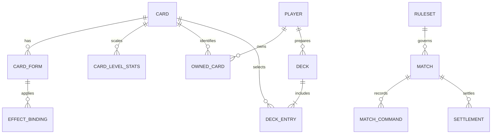

# 20. 데이터 모델·규칙 설정·콘텐츠 제작 계약

> 기준일: 2026-11-13 · **전체 스키마·필드명·JSON·가상 데이터는 [재현 설계]**이다. 실제 게임 API나 클라이언트에서 추출한 원본 데이터가 아니다. 확인된 규칙을 구현 가능한 단위로 옮기기 위한 제안이다.

## 1. 설계 원칙

게임의 변화 속도가 서로 다르므로 데이터도 나눠야 한다. 카드의 식별자는 안정적이어야 하지만 피해량은 패치마다 바뀔 수 있다. 사용자의 보유 레벨은 계정에 저장되지만 특정 모드의 실제 전투 레벨은 입장 규칙에 따라 달라진다. 카드 진화·히어로 해금과 전투에서의 형상 활성화도 같은 상태가 아니다.

핵심 분리는 다음과 같다.

1. **정의:** 카드·유닛·효과가 무엇인지 설명하는 콘텐츠.
2. **규칙:** 현재 모드에서 무엇을 허용하고 어떻게 계산하는지 설명하는 설정.
3. **소유:** 계정이 보유한 카드·형상·재화.
4. **실행:** 한 경기에서 현재 손패·유닛·효과가 어떤 상태인지 설명하는 데이터.
5. **원장:** 결과와 지급이 언제 한 번 확정되었는지 기록하는 데이터.

## 2. 도메인 관계



실제 데이터베이스 정규화 수준을 강제하는 도식이 아니다. 중요한 것은 같은 카드의 레벨·형상·소유·한 경기 인스턴스를 서로 다른 식별자로 다루는 것이다.

## 3. 카드와 유닛 정의

| 테이블·구조 | 주요 필드 | 필요성 |
|---|---|---|
| CardDefinition | `cardId, localizationKey, rarity, cardKind, baseCostPolicy` | 카드의 안정적 정체성 |
| CardFormDefinition | `formId, baseCardId, formKind, unlockPolicyId, abilityId` | 기본·진화·히어로 구별 |
| SpawnPattern | `spawnPatternId, entityType, count, offsets, delays` | 다중 유닛·분산 소환 |
| UnitDefinition | `unitId, movementProfile, targetMask, attackProfile` | 카드와 실제 개체 분리 |
| BuildingDefinition | `buildingId, lifetimePolicy, targetingProfile` | 건물의 수명·기능 구별 |
| SpellDefinition | `spellId, areaShape, deliveryProfile, effectList` | 범위·지연·다중 효과 |
| CardLevelStats | `cardId/formId, level, statProfileId` | 성장 수치 테이블 |
| TowerDefinition | `towerId, towerRole, activationPolicy, attackProfile` | 킹·측면 타워 차이 |

한 카드가 항상 한 유닛만 소환한다고 가정하지 않는다. 한 카드에 서로 다른 종류의 개체가 연결될 수 있고, 건물 파괴·능력 사용·주문 적중이 추가 개체를 만들 수도 있다. `Card → Entity`를 1:1로 고정하면 복합 카드에서 예외 코드가 급격히 늘어난다.

## 4. 전투 수치의 단위와 정책

| 필드 묶음 | 예시 필드 | 단위·검증 |
|---|---|---|
| 시간 | `firstHitDelay, hitInterval, deployDelay, duration` | 시뮬레이션 정수 시간 또는 tick |
| 거리 | `range, sightRange, splashRadius, collisionRadius` | 동일한 아레나 논리 단위 |
| 이동 | `speed, accelerationPolicy, lanePreference` | 논리 거리/시간 |
| 피해 | `baseDamage, hitCount, targetMultipliers` | 레벨 적용 후 정수·반올림 규칙 명시 |
| 대상 | `canTargetAir, canTargetGround, buildingsOnly` | 상충 조합 정적 검증 |
| 행동 | `retargetPolicy, attackCancelPolicy, deathPolicy` | 열거형 또는 정책 참조 |
| 상태 | `effectTags, immunityTags, stackingPolicy` | 태그와 우선순위 검증 |

`hitSpeed`라는 이름만 사용하면 ‘초당 공격 수’와 ‘공격 사이 초’가 혼동된다. 재현 데이터에는 `hitIntervalMs`처럼 의미가 드러나는 이름을 사용하고, 화면의 DPS는 별도 파생 값으로 만든다. 첫 공격 시간과 반복 간격도 하나의 필드로 합치지 않는다.

### 4.1 크라운 피해 배율

모든 주문에 공통된 단일 배율을 하드코딩하지 않는다. 다음과 같이 개별 효과가 대상 유형별 정책을 참조하게 한다.

```json
{
  "effectId": "example_area_hit",
  "damageProfileId": "example_damage_by_level",
  "targetPolicy": "ground_and_air",
  "targetMultipliers": {
    "troop": "regular_damage_rule",
    "building": "regular_damage_rule",
    "crownTower": "spell_specific_crown_rule"
  },
  "shieldPolicy": "configured_shield_overflow_policy",
  "roundingPolicy": "configured_integer_rule"
}
```

문자열 정책은 가상 예시다. 실제 배율은 카드·효과·패치별 근거를 확보해 입력해야 한다. 본 문서의 JSON은 실게임 카드 수치표를 대체하지 않는다.

## 5. 덱과 형상 선택

| 구조 | 주요 필드 | 불변 조건 |
|---|---|---|
| Deck | `deckId, playerId, modeFamilyId, revision` | 저장 덱과 전투 시작 덱의 버전 일치 |
| DeckEntry | `slotIndex, cardId, requestedFormId` | 카드 중복 정책 충족 |
| SlotPolicy | `slotKind, unlockCondition, allowedFormKinds` | 직접 덱 선택의 슬롯 자격 검증; 효과의 임시 생성은 별도 정책 |
| DuelDeckSet | `setId, deckIds, crossDeckUniquenessPolicy` | 덱 간 카드 중복 정책 충족 |
| DeckValidationResult | `valid, reasonCodes, conflictingSlots` | UI와 전투 요청이 같은 검증 사용 |

같은 기본 카드의 진화형·히어로형을 별도 카드 ID처럼 세면 중복 제한을 잘못 우회할 수 있다. 중복 판정의 기준은 `baseCardId`인지 `formId`인지 모드 정책에서 명확히 정한다. 덱에 저장된 요청 형상과 실제 전투 적용 형상도 분리해, 슬롯이나 모드가 바뀌었을 때의 폴백을 설명할 수 있어야 한다.

## 6. 계정 성장과 재화

| 구조 | 주요 필드 | 설명 |
|---|---|---|
| OwnedCard | `playerId, cardId, ownedLevel, copies` | 카드 소유·성장 |
| OwnedForm | `playerId, formId, unlockedAt` | 진화·히어로 해금 |
| CollectionProgress | `derivedLevel, claimedMilestoneIds` | 계산값과 보상 수령 이력 분리 |
| KingTowerProgress | `level, qualificationSnapshot` | 카드 컬렉션과 다른 성장 조건 |
| Wallet | `currencyId, balance, revision` | 재화별 잔액 |
| CurrencyPolicy | `cap, overflowRule, expirationRule` | 한도·초과·기한 정책 |
| InventoryItem | `itemTypeId, quantity, source` | 와일드카드·조각 등 |
| UpgradeRecipe | `cardId/rarity, fromLevel, costs` | 희귀도·구간별 비용 |

Collection Level처럼 컬렉션에서 파생되는 값은 임의로 증감시키는 원장만으로 관리하지 말고, 소유 데이터로 다시 계산할 수 있어야 한다. 성능을 위해 캐시하더라도 캐시 버전과 재계산 경로를 둔다. 킹 타워 성장의 이전 계정 보호 정책이 있다면 단순 재계산으로 기존 레벨이 내려가지 않도록 전환 규칙을 따로 둔다.

## 7. 모드 설정을 단일 계약으로 만들기

```json
{
  "rulesetId": "example_standard_v1",
  "modeFamily": "standard_1v1",
  "teamSize": 1,
  "deckSize": 8,
  "handSize": 4,
  "levelPolicyId": "example_owned_with_mode_cap",
  "deploymentPolicyId": "example_standard_territory",
  "victoryPolicyId": "example_crowns_and_overtime",
  "elixirScheduleId": "example_standard_schedule",
  "allowedCardPolicyId": "example_owned_cards",
  "rewardPolicyId": "example_reward_policy",
  "matchmakingPolicyId": "example_queue_policy"
}
```

`standard_1v1`은 가상 내부 ID다. 모드 설정의 목적은 2v2·이벤트·퍼즐·Merge Tactics를 기본 1v1에 무리하게 끼워 넣지 않는 데 있다. 특히 Merge Tactics는 손패 회전과 실시간 카드 배치를 동일하게 사용하지 않으므로 별도 전투 실행기와 공용 콘텐츠 참조를 분리하는 편이 낫다.

### 7.1 레벨 계산 순서

다음은 설계 예시이며 모든 실게임 모드에 하나로 강제하지 않는다.

1. 모드별 소유 요구 또는 제공 카드 풀과 사용할 형상 확인.
2. 이벤트의 고정·부스트·상한 정책 적용.
3. 모드가 지정한 타워 레벨 정책 적용.
4. 전투 중 레벨 변경 효과 적용 가능 여부 계산.
5. 최종 수치 프로파일과 설명 문자열 생성.

친선전의 상향 보정과 보유 킹 타워 기반 상한은 모드에 따라 분기하며, 보정 뒤 보유 상한을 무조건 다시 적용하지 않는다. 일반 1v1 전투 형식과 Trophy Road 모드도 같은 식별자가 아니다.

‘레벨 11로 고정’과 ‘최대 11로 제한’은 다르다. 낮은 레벨 카드가 올라가는지 내려가기만 하는지 `FixedLevel`과 `MaxLevelCap`으로 별도 표현한다.

## 8. 한 경기의 실행 상태

| 구조 | 최소 포함 정보 |
|---|---|
| MatchState | 시간, 국면, 규칙 버전, RNG 상태, 종료 상태 |
| PlayerBattleState | 엘릭서, 손패, 대기열, 진화 카운터, 능력 소유자 |
| EntityState | 위치, HP, 보호막, 타겟, 공격 예약, 이동 상태 |
| StatusInstance | 출처, 대상, 시작·종료, 중첩 그룹, 해제 정책 |
| ProjectileState | 출발·목표·도달 정책, 효과 ID, 적중 상태 |
| ScheduledEvent | 실행 시점, 안정적 순서, 취소 조건 |
| TowerState | HP, 활성화, 공격 상태, 소유 진영 |
| VictoryState | 크라운, 종료 이유, 타이브레이커 정보 |

리플레이 체크포인트는 화면에 보이는 데이터만으로 충분하지 않다. 공격 쿨다운이나 소환 예약이 빠지면 다음 프레임부터 결과가 달라질 수 있다. 스냅샷의 완전성 기준은 ‘그 시점에서 재실행해 동일 결과가 나오는가’다.

## 9. 보상·상점·패스의 거래

| 구조 | 주요 필드 | 검증 |
|---|---|---|
| RewardDefinition | `rewardId, entries, eligibility, choicePolicy` | 선택형 보상은 한 선택만 확정 |
| RewardClaim | `claimId, playerId, state, grantedEntries` | 중복 수령 금지 |
| DropTableVersion | `tableId, eligibilityFilter, weights, guaranteeState` | 확률 합·보정 순서 검증 |
| ShopOffer | `offerId, price, contents, limits, activeWindow` | 지역·계정·기간 조건 |
| PassProgress | `seasonId, progress, premiumEntitlement` | 진행과 구매 권한 분리 |
| Transaction | `transactionId, sourceId, deltas, status` | 재시도와 지급 이력 보존 |

확률형 보상은 자격 필터, 가중치, 보장 규칙, 초과 변환을 구분한다. ‘받을 수 없는 카드 제거 후 확률 정규화’와 ‘추첨 후 대체 보상 지급’은 서로 다른 분포를 만든다. 공식 자료에서 순서가 명확하지 않으면 [검증 필요]로 남겨야 하며 임의 확률을 실게임 값으로 넣지 않는다.

## 10. 버전·환경·증거를 함께 기록하기

| 필드 | 목적 |
|---|---|
| `publishedAt` | 공식 문서가 발표된 시각 |
| `effectiveFrom` | 실제 적용 시작으로 안내된 시각 |
| `effectiveTo` | 종료·교체 시점 |
| `observedAt` | 실제 계정에서 확인한 시각, 없으면 null |
| `sourceUrl` | 규칙의 근거 |
| `evidenceType` | 공식 발표·지원 설명·관찰·추정 |
| `rolloutPolicyId` | 일부 계정 테스트 여부 |
| `conflictNote` | 상충 자료와 채택 이유 |

출시일·발표일·관측일을 하나의 날짜로 덮으면 미래 공지를 현재 규칙으로 읽거나, 과거 지원 문서를 최신 규칙으로 오해하기 쉽다. 이 패키지에서 확인한 출처 충돌은 [22번 문서](22_sources_versions_and_open_questions.md)에 별도 정리한다.

## 11. 제작 도구와 정적 검증 제안

- 카드·효과·소환 패턴 참조가 모두 존재하는지 검사한다.
- 시간·비용·수량의 음수, HP 0, 공격 간격 0 같은 잘못된 기본값을 차단한다.
- 무한 소환·죽음 효과 순환을 탐지하고 의도된 순환은 종료 조건을 명시한다.
- 레벨 수치의 단조성은 경고로 검사하되, 의도된 비단조 변화는 승인 이력을 둔다.
- 슬롯 정책 변경이 기존 저장 덱을 무효화할 때 마이그레이션 또는 안내 정책을 요구한다.
- 종료된 시즌 재화가 새 시즌 보상 조건을 충족시키지 않도록 ID를 분리한다.
- 테스트 설정과 운영 설정이 섞이지 않도록 빌드에 허용된 버전 목록을 포함한다.

## 12. 구현자가 먼저 합의해야 할 질문

1. 같은 시각의 피해·치유·보호막 제거는 어떤 순서인가?
2. 능력 발동 중 소유 개체가 바뀌면 어떤 사건이 남는가?
3. 배치 불가로 실패한 명령은 회전·진화 카운터에 영향을 주는가?
4. 고정 레벨 모드에서 전투 중 레벨 상승 효과는 어떻게 계산하는가?
5. 만료 직전 수령 요청과 시즌 전환의 권위 시각은 무엇인가?
6. 부분 실패한 보상 거래를 어떻게 재시도하고 표시하는가?

관련 규칙: [03. 엘릭서·회전](03_elixir_hand_and_cycle.md), [06. 피해·상태](06_damage_and_status_effects.md), [08. 특수 카드](08_evolutions_champions_heroes_towers.md), [12. 경제](12_economy_rewards_and_monetization.md), [19. 실행 구조](19_network_replay_and_architecture.md).

[전체 목차](00_README.md)
