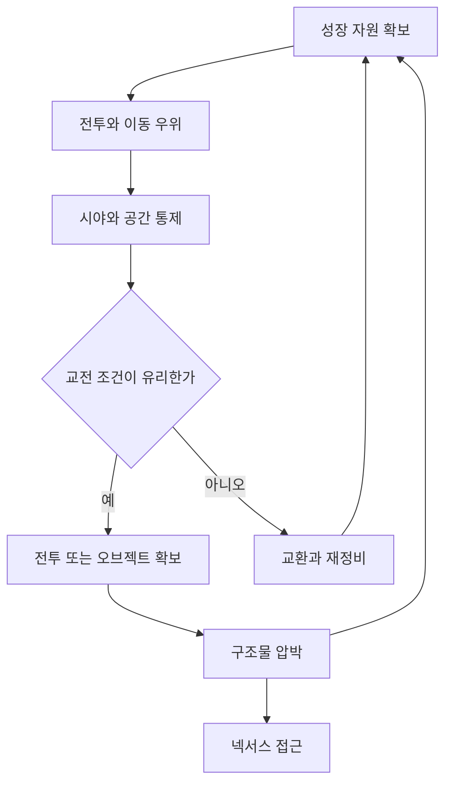
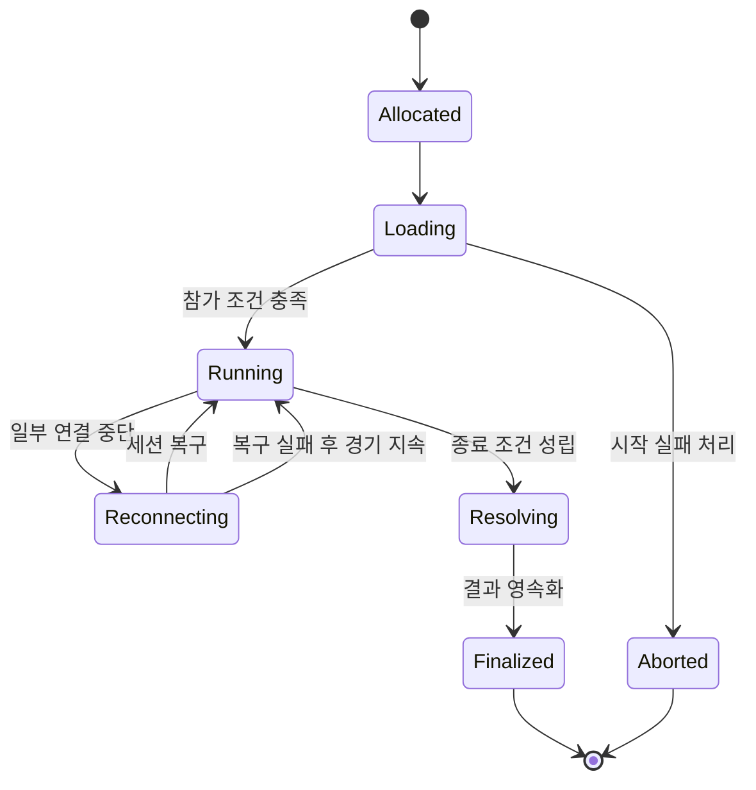

# 01. 게임 구조와 매치 핵심 루프

[문서 목록](00_README.md) · [시스템 연결](22_system_dependency_scenarios.md) · [버전과 근거](90_sources_version_ledger.md)

## 1. 범위와 근거

- 대상: PC판 League of Legends의 소환사의 협곡 5대5 일반 구조.
- 조사 기준일: 2026-11-13. 확인한 최신 공식 패치 노트는 26.22이며, 서버별 실배포 상태를 직접 접속해 측정하지 않았다.[R02][R03]
- [공식]은 공개 문서가 직접 뒷받침하는 내용, [분석]은 플레이 구조에 대한 해석, [제안]은 재현용 모델이다.
- 타 모드, 지역 정책, 특정 챔피언의 예외는 해당 시스템 문서에서 별도로 다룬다.
- 이 문서는 공식 내부 기획서가 아니라 공개 자료를 바탕으로 재구성한 역기획서다.

## 2. 제품을 한 문장으로 정의

[공식] 두 팀의 플레이어가 각각 챔피언을 조종하고 상대 넥서스를 파괴하는 팀 기반 전략 게임이다.[R01]

[분석] 플레이어는 제한된 정보 아래에서 **개인 전투 능력, 시간, 맵 공간, 성장 자원**을 서로 교환한다. 이 교환으로 얻은 우위를 상대가 회복하기 전에 구조물 파괴로 전환하는 것이 한 경기의 핵심이다.

따라서 킬은 유력한 수단이지만 그 자체로 일반적인 협곡 매치의 종료 조건은 아니다. 킬 이후 귀환, 웨이브 처리, 오브젝트 획득, 구조물 공격 중 무엇을 선택하느냐가 전투의 실제 가치를 결정한다.

## 3. 경험 목표와 시스템의 역할 [분석]

| 경험 목표 | 이를 만드는 장치 | 잘못 설계했을 때의 증상 |
| --- | --- | --- |
| 내가 조작을 잘하면 결과가 달라진다 | 이동, 사거리, 스킬 적중, 반응, 자원 관리 | 입력과 결과의 관계를 이해하지 못함 |
| 동료와 조합하면 혼자보다 강해진다 | 역할 분업, 연계, 시야 공유, 공동 목표 | 다섯 명이 독립된 게임을 하는 느낌 |
| 불리해도 할 일이 남는다 | 안전한 성장, 교환, 상대 실수, 방어 선택 | 패배가 확정됐다고 느끼고 이탈 |
| 같은 맵에서도 매번 다른 판단을 한다 | 챔피언 조합, 드래프트, 아이템, 상대 행동 | 최적 동선 하나가 모든 상황을 대체 |
| 승패를 다음 경기의 학습으로 바꾼다 | 결과 화면, 리플레이, 숙련도, 랭크 | 결과만 남고 개선 방향이 없음 |

## 4. 세 층의 반복 구조 [분석]

### 4.1 순간 루프: 전투와 조작

적 위치와 사거리 확인 → 이동 또는 행동 결정 → 명령 입력 → 판정과 피드백 → 다음 행동.

플레이어가 관리하는 것은 체력만이 아니다. 스킬 재사용 대기시간, 마나 등 챔피언 자원, 미니언 위치, 다음 이동 방향까지 동시에 판단한다. 같은 공격이라도 상대의 핵심 스킬이 준비돼 있는지에 따라 안전성이 달라진다.

### 4.2 전술 루프: 웨이브와 재정비

자원 확보 → 상대 압박 → 웨이브 정리 또는 이동 → 귀환과 구매 → 다시 맵에 진입.

보유 골드는 사용 전에는 전투력을 전부 제공하지 못한다. 구매를 위해 전장을 떠나는 동안 경험치, 포탑 체력, 시야 주도권을 잃을 수 있으므로 귀환은 성장과 시간 사이의 교환이다.

### 4.3 전략 루프: 맵 통제와 종료

성장 우위 → 이동 우선권 → 안전한 시야와 진입 경로 → 유리한 전투 또는 목표 교환 → 구조물 압박 → 다음 공간 확보.

전투에서 패배해도 반대편 공간을 이용한 교환이 가능하다. 반대로 전투에서 승리했어도 웨이브, 체력, 위치가 맞지 않으면 큰 목표를 얻지 못할 수 있다.



도식은 의사결정의 재구성이다. 실제 게임 엔진의 실행 순서나 필수 행동 순서를 의미하지 않는다.

## 5. 경기의 시작과 끝

### 5.1 외부 매치 흐름 [분석]

| 단계 | 플레이어가 결정하는 것 | 다음 단계에 넘기는 것 |
| --- | --- | --- |
| 플레이 준비 | 모드, 파티, 선호 포지션 | 참가 조건과 선호 |
| 매치 탐색 | 기다리기, 취소 | 매치 후보 수락 |
| 챔피언 선택 | 챔피언, 밴, 룬, 주문 등 모드별 선택 | 확정된 구성 |
| 로딩과 초기화 | 연결 상태 확인 | 매치에 참가할 세션 |
| 경기 진행 | 성장, 전투, 이동, 협력 | 누적 경기 상태 |
| 종료 | 결과 확인, 명예·신고 등 후속 선택 | 확정 결과와 계정 반영 |
| 학습과 재진입 | 빌드 수정, 리플레이, 다음 경기 | 다음 선택의 개선 |

모든 모드가 동일한 밴·픽 단계를 사용하는 것은 아니다. 구체적인 선택 규칙은 [챔피언·드래프트](02_champions_draft_roles.md), 매치 조건은 [매칭·랭크](15_matchmaking_ranked_social.md)에 둔다.

### 5.2 매치 생명주기 모델 [제안]



`Reconnecting`은 설명을 위한 외부 세션 상태다. 실제 진행 중인 매치 전체가 멈춘다는 뜻이 아니다. 개별 참가자의 연결 상태와 매치 진행 상태를 별도 축으로 관리하는 것이 적절하다.

### 5.3 종료 결과를 구분하는 이유 [제안]

| 결과 종류 | 구분해야 하는 데이터 | 설계상 이유 |
| --- | --- | --- |
| 정상 승패 | 승리 팀, 종료 원인, 최종 시간 | 전적과 보상 계산 |
| 항복에 의한 종료 | 투표 결과, 유효 시점 | 넥서스 파괴와 다른 원인 보존 |
| 리메이크 등 특수 종료 | 적용 규칙, 책임 대상 | 일반 패배와 같은 정산을 피함 |
| 서버 또는 운영 오류 | 장애 코드, 복구 가능성 | 잘못된 결과 확정 방지 |
| 시작 이전 취소 | 로비 상태, 참가 이력 | 진행 경기 통계에서 제외 |

항복과 리메이크의 실제 조건은 [행동·공정성](16_behavior_integrity_surrender.md)을 기준으로 읽는다. 위 표는 결과 저장 구조의 제안이다.

## 6. 시간대별 의사결정의 변화 [분석]

단계를 고정된 분 수로 나누면 조합과 경기 상황의 차이를 놓친다. 이 문서는 구조물 상태, 성장 단계, 중립 목표, 부활 대기 시간으로 국면을 판단한다.

| 국면 | 주요 관심사 | 실패 비용 | 다음 국면으로 이어지는 변화 |
| --- | --- | --- | --- |
| 초기 배치 | 경로, 첫 자원, 초반 정보 | 초기 성장 손실 | 라인과 정글 역할 확정 |
| 라인 중심 성장 | 막타, 교환, 귀환, 갱킹 대응 | 성장 차이와 포탑 압박 | 이동 자유 확대 |
| 공간 재배치 | 외곽 구조물, 시야선, 사이드 배치 | 고립과 수적 열세 | 팀 단위 목표 집중 |
| 승리 조건 실행 | 교전 개시, 보호, 분할 압박 | 큰 목표 또는 기지 손실 | 상대 복구 능력 약화 |
| 종료 시도 | 웨이브, 부활, 남은 체력, 경로 | 역전 또는 종료 실패 | 넥서스 파괴 또는 재정비 |

초반 강한 조합은 이동과 전투 우위를 즉시 자산으로 바꿔야 한다. 후반 성장에 강점이 있는 조합은 당장 얻을 목표와 안전하게 남길 성장 기회를 함께 평가한다. 어느 쪽도 단순히 시간을 보내는 것만으로 목표가 달성되지는 않는다.

## 7. 매치 안과 밖의 성장 분리

[공식] 공식 입문 안내는 경기 중 경험치 획득과 아이템 구매를 챔피언 성장의 핵심으로 설명한다.[R01]

[분석] 경기마다 다시 시작하는 성장은 상대에게도 다시 경쟁할 기회를 준다. 계정의 수집·숙련·랭크 성장은 경기 사이의 동기를 만든다. 이 두 층을 혼합하면 장기간 플레이한 계정이 신규 계정과의 경기에서 직접적인 누적 능력치 우위를 갖는 문제가 생긴다.

| 상태 | 수명 | 다음 경기로 넘길 대상 |
| --- | --- | --- |
| 이번 경기의 체력·위치 | 경기 세션 | 통계·리플레이 기록 |
| 이번 경기의 골드·경험치·아이템 | 경기 세션 | 결과 분석용 요약 |
| 설정·키 배치 | 사용자 설정 | 같은 사용자의 다음 실행 |
| 보유 챔피언·외형·계정 진행 | 계정 | 다음 선택 가능성 |
| 랭크와 매치 평가 | 경쟁 시즌·큐 정책 | 후속 매치와 표시 등급 |

계정 보유 여부가 선택 가능한 콘텐츠에 미치는 영향은 [계정·수집](17_account_progression_collection.md)에서 다룬다. 경쟁적 힘과 구매 상품의 경계는 [수익화](18_monetization_live_service.md)에 정리한다.

## 8. 기본 승리 조건을 시스템으로 읽기 [분석]

넥서스를 최종 목표로 두면 맵의 여러 시스템에 공통 방향이 생긴다. 구조물은 진입 제한을 만들고, 미니언은 반복적인 공격 기회를 제공하며, 중립 목표는 공격 기회를 더 강하게 만든다.

상대 챔피언 처치의 주된 전략적 효과는 상대의 행동 가능한 인원과 시간을 줄이는 것이다. 같은 1킬이라도 적이 기지에서 가까운 상황과 큰 목표 앞에서 사라진 상황은 가치가 다르다.

종료 판단은 다음 질문을 함께 요구한다.

1. 실제로 공격할 수 있는 구조물 경로가 열렸는가?
2. 현재 웨이브와 살아 있는 인원이 공격을 지속할 수 있는가?
3. 상대가 다시 개입하기 전까지 필요한 이동·공격 시간이 있는가?
4. 실패하면 빼앗길 반대편 목표는 무엇인가?

위 질문은 원작의 승리 판정 코드가 아니라 플레이어가 승리 조건을 실행하기 위한 분석 틀이다.

## 9. 구체적인 플레이 사례 [분석·가상 상황]

### 사례 A: 킬을 만들고도 손해를 보는 상황

봇 지역에서 적 한 명을 처치했지만 아군 둘의 체력이 낮고 웨이브가 불리하다. 바로 중립 목표에 진입하면 이동 중 적 정글러에게 노출되거나, 목표를 공격하는 동안 적 미드가 먼저 합류할 수 있다.

이때 선택지는 승리 직후의 감정과 분리해야 한다. 웨이브를 밀어 넣고 귀환하면 즉시 획득하는 목표는 적어도 다음 구매와 위치 복귀가 안정적일 수 있다. 반대로 상대 주요 인원이 모두 멀리 보인다면 남은 체력을 이용한 빠른 목표 획득이 가능하다.

같은 킬 결과라도 **다음 행동의 안전성**에 따라 최종 이득이 달라진다.

### 사례 B: 교전을 피해서 만드는 이득

적 다섯 명이 한쪽 목표로 모인다. 아군은 진입로가 어둡고 주요 스킬이 준비되지 않았다. 정면 진입 대신 반대편 웨이브와 구조물을 압박하면 적에게 목표 획득과 수비 중 선택을 강요할 수 있다.

교환 가능한 목표가 없거나 적의 다음 공격을 막을 수 없다면 같은 선택은 방관이 된다. 분할 압박의 가치는 다른 위치의 압력이 실제 시간을 벌거나 자산을 얻는지로 판단한다.

### 사례 C: 구매 직후의 우위 활용

두 팀의 누적 골드가 비슷해도 한 팀만 주요 아이템을 완성하고 복귀했다면 해당 순간의 사용 가능한 전투력이 다르다. 이때의 짧은 우위를 시야 확보와 목표 준비에 사용하면 다음 교전의 조건도 개선된다.

## 10. 재현용 매치 데이터 계약 [제안]

```yaml
match:
  match_id: unique_id
  ruleset_id: sr_5v5_example
  ruleset_revision: explicit_version
  phase: running
  simulation_time: authoritative_time
  participants: []
  teams: []
  world_state_ref: runtime_state
  end_condition: null
  result_revision: 0

participant:
  participant_id: match_scoped_id
  account_ref: private_reference
  team_id: team_reference
  assigned_position: position_policy
  champion_definition_id: content_reference
  loadout_revision: locked_revision
  connection_state: connected
```

필드는 LoL 내부 자료구조를 뜻하지 않는다. 모드 규칙, 선택 결과, 실시간 상태, 계정 정산을 서로 분리하기 위한 최소한의 제안이다.

### 핵심 이벤트

| 이벤트 | 발생 조건 | 소비 시스템 | 중복 방지 기준 |
| --- | --- | --- | --- |
| `MatchStarted` | 유효한 경기 시작 | 시간, 생성, 통계 | match_id |
| `ParticipantEliminated` | 처치 확정 | 경제, 부활, UI | 처치 이벤트 ID |
| `StructureDestroyed` | 파괴 확정 | 맵, 목표, 승리 판정 | 구조물 생명주기 ID |
| `ObjectiveClaimed` | 소유 팀 결정 | 버프, 경제, 안내 | 목표 개체 ID |
| `MatchEnded` | 유효한 종료 원인 | 입력 제한, 정산, 전적 | 결과 revision |

## 11. 시스템 소유권과 연결 [제안]

경기 진행 관리자는 모든 게임 규칙을 직접 계산하지 않는다. 전투 시스템에서 처치가 확정되면 경제 시스템이 보상을 계산하고, 부활 시스템이 대기 상태를 만들며, UI가 허용된 정보를 표시한다.

이 구분은 이벤트 하나가 여러 효과를 만드는 LoL형 구조에서 중복 보상과 누락을 줄인다. 포탑 파괴가 경제 이득, 시야 변경, 이동 압력, 종료 가능성에 동시에 영향을 주므로 각 효과의 책임자를 명확히 해야 한다.

## 12. 예외와 경계 조건 [제안]

- 두 팀의 종료 관련 이벤트가 같은 처리 구간에 들어오면 순서·우선권 정책으로 결과를 하나만 확정한다.
- 경기 종료 후 도착한 지연 입력이 구조물·골드·승패를 다시 변경하지 않도록 한다.
- 재접속 시 사용자의 오래된 로컬 상태보다 현재 서버 상태를 우선한다.
- 참가자 한 명의 연결 복구와 전체 경기의 재시작을 혼동하지 않는다.
- 결과 저장 실패는 경기 진행을 계속하는 상태가 아니라 결과 전달 재시도로 분리한다.
- 특수 모드의 승리 조건을 협곡 넥서스 규칙에 억지로 포함하지 않는다.

## 13. 검증 시나리오

아래는 재현 시스템을 위한 수용 기준이며, 이번 문서 작성 중 원작 클라이언트에서 실행한 테스트가 아니다.

| ID | 준비와 행동 | 기대 결과 |
| --- | --- | --- |
| CORE-01 | 같은 match_id의 종료 이벤트 두 번 전달 | 전적·보상 한 번만 반영 |
| CORE-02 | 경기 중 한 명 재접속 | 현재 시간·아이템·상태로 복원 |
| CORE-03 | 핵심 구조물 파괴 후 늦은 공격 입력 도착 | 확정 결과 유지 |
| CORE-04 | 계정 경험치는 높고 새 경기 시작 | 매치 상태는 규칙에 따른 초기값 |
| CORE-05 | 리메이크 종료 | 일반 종료와 다른 분류 보존 |
| CORE-06 | 모드 설정 변경 | 해당 모드의 종료·정산 정책 적용 |
| CORE-07 | 처치와 구조물 파괴가 연속 발생 | 경제·지도·UI 이벤트 누락 없음 |
| CORE-08 | 서버 결과 응답이 중복 수신됨 | 결과 화면은 최신 확정 결과 유지 |

## 14. 설계 평가 질문 [분석]

이 게임의 깊이는 시스템의 수보다 **하나의 행동이 다음 선택에 미치는 영향**에서 나온다. 이동은 공격을 피하는 조작이면서 성장 자원을 포기하는 선택이고, 와드 설치는 안전을 얻는 행동이면서 다른 위치에서 쓸 자원을 쓰는 선택이다.

역기획을 다른 게임에 적용할 때에는 단순히 챔피언·포탑·아이템을 복제하기보다, 행동의 기회비용이 플레이어에게 보이고 상대가 대응할 방법이 남는지부터 확인해야 한다.

## 15. 출처

- [R01] Riot Games, [League of Legends How to Play](https://www.leagueoflegends.com/en-us/how-to-play/). 기본 팀 구조, 넥서스 목표, 경기 중 성장. 열람 2026-11-13.
- [R02] Riot Games, [League of Legends Patch 26.22 Notes](https://www.leagueoflegends.com/en-us/news/game-updates/league-of-legends-patch-26-22-notes/). 2026-11-03 게시 노트의 존재와 범위. 개별 수치를 전수 추출한 자료가 아님. 열람 2026-11-13.
- [R03] Riot Support, [Patch Schedule – League of Legends](https://support.riotgames.com/en-us/league-of-legends/gameplay/patch-schedule-league-of-legends). 조사일과 예정 패치의 구분. 일정은 변경 가능. 열람 2026-11-13.
