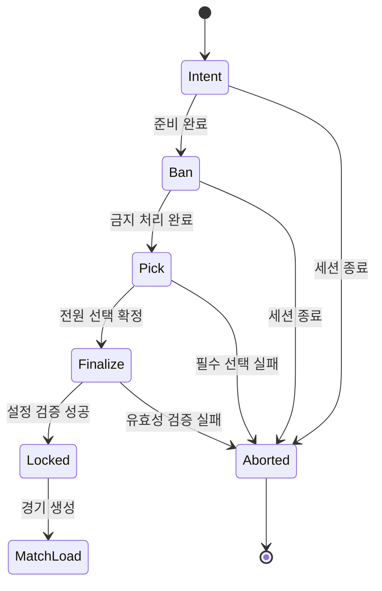

# 02. 챔피언·포지션·팀 조합·챔피언 선택 역기획

[문서 목록](00_README.md)

> 범위: PC판 소환사의 협곡 5대5. 조사일: 2026-11-13. 확인한 최신 공식 패치 본문은 26.22(2026-11-03 게시)다. 개별 과거 패치의 도입 사실을 현재의 모든 세부 규칙으로 확장하지 않는다.
> 표기: **[공식]** 공개 자료로 확인한 사실, **[분석]** 사실에서 도출한 설계 해석과 플레이 사례, **[제안]** 재현 프로젝트용 명세, **[확인 필요]** 특정 빌드·큐에서 추가 검증할 사항.

## 1. 시스템의 역할

[분석] 챔피언 선택은 캐릭터 외형을 고르는 화면 이상의 기능을 한다. 플레이어가 한 경기 동안 사용할 조작 문법, 자원 소비 방식, 전투 거리, 성장 시점, 팀 내 책임을 확정하는 단계다. 동일한 맵이 반복되어도 서로 다른 챔피언 조합 때문에 필요한 이동·교전·성장 판단이 달라진다.

핵심 산출물은 다음 다섯 가지다.

| 산출물 | 결정되는 내용 | 경기 중 영향 |
|---|---|---|
| 챔피언 | 기본 능력치, 스킬, 고유 자원, 공격 방식 | 실행 가능한 행동의 집합 |
| 포지션 | 초반 활동 구역과 자원 획득 책임 | 라인 배분, 정글 동선, 포지션 퀘스트 |
| 사전 설정 | 룬·소환사 주문 | 교환·생존·합류 방식 |
| 팀 조합 | 진입·보호·지속 피해·공성의 조합 | 승리하기 쉬운 교전 조건 |
| 드래프트 결과 | 금지·선택·공개 정보의 순서 | 상성 위험과 정보의 비대칭 |

[공식] Riot의 챔피언 선택 안내는 한 챔피언이 여러 역할을 수행할 수 있고 아이템 구성으로 성격이 달라질 수 있다고 설명한다. 따라서 챔피언에 붙은 분류 태그를 플레이 가능한 포지션의 강제 제한으로 취급하면 안 된다. [CD01]

## 2. 포지션과 전투 역할을 구분한다

### 2.1 포지션: 자원과 공간의 분담

[공식] 기본 안내가 제시하는 포지션은 탑, 정글, 미드, 바텀, 서포터다. [CD02]

[분석] 아래 표는 그 구분을 경제·공간 관점으로 해석한 것이다. 모든 챔피언과 메타에 적용되는 직업 제한은 아니다.

| 포지션 | 주로 관리하는 자원·공간 | 반복 판단 | 팀에 전달하는 결과 |
|---|---|---|---|
| 탑 | 긴 단독 라인, 측면 공간 | 장기 교환, 웨이브 위치, 측면 압박 | 분산 압박 또는 전방 전투력 |
| 정글 | 캠프·강·적 정글 진입로 | 사냥 순서, 갱킹 비용, 역갱 | 인원 우세와 중립 목표 접근권 |
| 미드 | 중앙 라인과 양쪽 강 진입 | 웨이브 정리 후 이동 여부 | 빠른 합류, 광역 영향력 |
| 바텀 | 보호받으며 축적하는 라인 골드 | 안전한 막타, 귀환, 딜링 위치 | 아이템 성장에 따른 반복 피해 |
| 서포터 | 동료 생존, 라인 교환, 시야 공간 | 보호와 진입 중 우선순위 | 적의 행동 제한과 아군 행동 보장 |

같은 포지션에서도 팀이 요구하는 기능은 달라진다. 탑에 전투 지속력이 좋은 챔피언을 배치해 측면을 맡길 수도 있고, 강력한 진입 기능을 가진 챔피언으로 중앙 교전을 설계할 수도 있다. 바텀 역시 ‘포지션’과 ‘원거리 기본 공격 중심 챔피언’이라는 전투 속성을 동일한 필드로 저장하지 않는 편이 맞다.

### 2.2 전투 역할: 승리 조건의 분담

[분석] 역기획에서는 공식 태그를 그대로 데이터 모델 전체로 삼기보다 실제 행동을 추가 축으로 분해한다.

| 축 | 낮은 쪽 | 높은 쪽 | 구분의 목적 |
|---|---|---|---|
| 유효 사거리 | 근접 접근 필요 | 먼 거리에서 기여 | 안전 공간·접근 수단 분석 |
| 피해 발생 시간 | 장시간 누적 | 짧은 순간 폭발 | 교전 길이와 대응 창 분석 |
| 자원 의존도 | 기본 공격 중심 | 자원·재사용 대기 의존 | 교환 후 재진입 시점 분석 |
| 보호 의존도 | 스스로 생존 | 동료 보호가 중요 | 팀 조합과 위치 선정 분석 |
| 진입 능력 | 상대 접근을 기다림 | 교전을 직접 시작 | 교전 주도권 분석 |
| 지형 영향력 | 열린 공간 선호 | 좁은 통로 선호 | 오브젝트 주변 진형 분석 |
| 성장 방식 | 초기 기본 성능 | 레벨·아이템 누적 | 경기 시간별 위험 분석 |

‘탱커·전사·마법사·암살자·원거리 딜러·서포터’라는 태그는 검색에 유용하지만, 위 축을 대체하지는 못한다. 두 챔피언이 모두 마법사여도 한쪽은 장거리 견제, 다른 쪽은 짧은 거리의 폭발과 제어에 특화될 수 있다.

## 3. 챔피언 키트를 분석하는 단위

[공식] 대부분의 챔피언은 지속 효과와 Q/W/E 기본 스킬, R 궁극기로 구성된다. [CD02]

[분석] 챔피언 하나의 역기획은 스킬 다섯 개의 설명을 나열하는 데서 끝나면 부족하다. 무엇을 반복하도록 만드는지, 그 반복을 상대가 어디서 끊을 수 있는지를 묶어서 읽어야 한다.

| 분석 항목 | 질문 | 산출 예시 |
|---|---|---|
| 반복 행동 | 이 챔피언은 무엇을 성공시키려 하는가? | 견제 명중 후 사거리 안에서 후속타 |
| 기회 생성 | 스스로 교전을 시작하는가? | 이동기, 강제 이동, 원거리 제어 |
| 전환 조건 | 언제 약한 상태에서 강한 상태로 바뀌는가? | 스택 준비, 레벨 상승, 스킬 복구 |
| 리스크 | 실패하면 무엇을 잃는가? | 자원, 퇴로, 주요 재사용 대기시간 |
| 상대 대응 | 상대가 읽고 대응할 표시는 무엇인가? | 투사체, 준비 모션, 스택 UI |
| 팀 연계 | 동료가 무엇을 보완해야 하는가? | 접근, 보호, 추가 제어, 지속 피해 |

### 사례 A: 애니의 준비된 제어

[공식] 애니의 지속 효과는 주문 사용으로 다음 공격 주문의 기절을 준비하는 구조이며, 공식 소개는 경기 시작 및 부활 시 준비된 상태를 설명한다. [CD03]

[분석] 이 구조의 핵심은 스킬 피해량보다 ‘다음 행동의 의미가 현재 스택에 의해 달라진다’는 데 있다. 상대는 애니의 위치뿐 아니라 준비 상태를 읽는다. 애니는 일반 스킬로 자원을 소모할지, 기절 위협을 유지해 상대 접근을 억제할지 선택한다. 따라서 스택은 단순 강화 수치와 정보 공개 기능을 함께 가진다.

### 사례 B: 럭스의 원거리 적중과 후속 행동

[공식] 럭스의 공식 소개는 피해 주문으로 표식을 남기고 후속 기본 공격으로 추가 마법 피해를 내는 지속 효과를 설명한다. [CD04]

[분석] 표식은 긴 사거리의 견제만으로 끝내지 않고 더 가까운 거리로 접근할 유인을 만든다. 같은 명중 뒤에도 안전하게 물러나는 선택과 추가 보상을 위해 접근하는 선택이 갈린다. ‘스킬 적중 성공’과 ‘최대 보상 획득’ 사이에 별도 위험 구간이 있다는 점이 핵심이다.

### 사례 C: 가렌의 전투와 이탈 주기

[공식] 가렌의 공식 소개에는 적의 피해·스킬을 일정 시간 받지 않은 뒤 회복하는 지속 효과가 있다. [CD05]

[분석] 이 효과는 한 번의 장기 교전뿐 아니라 짧게 싸우고 빠지는 주기를 만든다. 체력 교환을 즉시 승패로 판단하기보다 다음 교환까지의 대기 시간을 함께 평가하게 한다. 반대편은 작은 피해를 계속 연결해 회복 기회를 늦추려 한다.

## 4. 드래프트의 정보 구조

[분석] 챔피언 선택의 정보는 세 단계로 나눌 수 있다.

1. 개인이 선호 챔피언과 포지션을 알고 있는 상태.
2. 아군이 서로의 의도와 이미 선택된 챔피언을 보는 상태.
3. 상대 선택이 공개되어 상성·조합을 수정할 수 있는 상태.

각 단계에서 취소 가능한 선택과 확정 선택을 구분해야 한다. 호버는 의도 표현이고, 확정은 해당 참가자의 챔피언 할당이다. 금지는 선택 가능 집합을 줄인다. 순서 교환은 ‘누가 먼저 정보를 공개하는가’를 바꾸지만, 챔피언 교환은 확정된 캐릭터의 소유자를 바꾼다.

[공식] Riot는 일반 플레이의 10밴 설계를 설명하면서 각 플레이어에게 금지 선택권을 주는 목적을 제시했다. 이는 도입 당시의 설계 근거이며, 특정 현재 큐의 모든 시간 제한을 보증하는 자료는 아니다. [CD06]

### 4.1 일반 드래프트와 대회 드래프트

| 구분 | 역기획 시 별도 관리할 이유 |
|---|---|
| 일반 드래프트 | 개인의 빠른 의사 표현, 중복 금지 처리, 대기시간이 중요 |
| 조직된 팀의 드래프트 | 상대 전략을 단계적으로 차단하고 조합을 보호하는 의사결정이 중요 |
| 대회 전용 규정 | 밴·픽 순서, 선수 교체, 시리즈 제한이 운영 규정에 종속 |
| 챔피언 선택을 생략하는 큐 | 로비에서 확정한 설정을 매치에 전달하는 유효성 검사가 중요 |

[확인 필요] 피어리스 등 특정 대회 규칙을 소환사의 협곡 일반 랭크의 공통 규칙으로 포함하지 않는다. 전체 챔피언 소유 조건, 동일 챔피언 제한, 밴·픽 단계별 초 수 역시 큐별 계약으로 확인해야 한다.

### 4.2 선택 순서 교환

[공식] 12.23 패치는 챔피언 선택 중 픽 순서를 교환하는 기능을 추가했다. [CD07]

[분석] 순서 교환은 챔피언 소유권 때문에 발생하던 협력 비용을 줄이는 의미가 있다. 카운터 선택 가치가 큰 포지션을 뒤로 미루고 범용 선택이 가능한 플레이어를 앞으로 보내는 협상이 짧아진다. 단, 상대 조합을 더 많이 보고 고르는 이득은 먼저 특정 챔피언을 확보하지 못하는 위험과 교환된다.

## 5. 2026 포지션 퀘스트와 선택 단계의 결합

[공식·도입 시점] 26.1은 배정 포지션에 포지션 퀘스트를 연결하고 포지션 교환을 챔피언 선택 단계에서 처리하도록 설명한다. [CD08]

### 5.1 도입 당시 보상의 구조 예시

아래는 **26.1 도입 시점**의 핵심 구조만 요약한 표다. 이후 변경을 전부 합성한 26.22 보상표가 아니다. [CD08]

| 포지션 | 26.1에서 제시한 대표 보상 | 설계 해석 |
|---|---|---|
| 탑 | 완료 후 레벨 상한 20 | 단독 성장의 후반 가치를 확장 |
| 미드 | 장화 업그레이드 | 중앙 포지션의 기동·전투 선택 강화 |
| 바텀 | 신발의 포지션 퀘스트 칸 이동 | 골드를 장기 전투력으로 전환할 여유 확대 |

[공식·후속 변경] 26.16에서는 사슬끈 분쇄자와 주문투척자의 신발 등 장화 성능이 다시 조정되었다. 역할 보상과 연결된 아이템의 상세 값도 별도 패치 이력으로 추적해야 한다. [CD09]

### 5.2 교환과 경기 생성 데이터

[분석] 이에 따라 ‘대화로 포지션을 바꿨다’와 ‘시스템의 포지션 상태가 바뀌었다’를 분리해야 한다. 팀원끼리 이동 구역만 바꾸면 자원 성장·퀘스트와 의도가 어긋날 수 있다. UI의 교환 수락이 경기 생성 데이터까지 원자적으로 반영되어야 한다.

| 교환 종류 | 바뀌는 것 | 함께 확인할 것 |
|---|---|---|
| 픽 순서 | 선택 차례 | 현재 단계와 남은 시간 |
| 챔피언 | 캐릭터 할당 | 사용 권한, 룬·주문 재확인 |
| 포지션 | 역할 식별자 | 퀘스트·주문 제약·팀 내 중복 |

‘교환’이라는 하나의 버튼 안에 여러 행동이 있더라도 내부 요청은 분리하는 편이 명확하다. 역할을 바꿨다고 챔피언까지 자동 교환되는 모델은 플레이어 의도와 다를 수 있다.

## 6. 팀 조합 평가의 논리

[분석] 조합은 개별 챔피언 점수의 합이 아니다. 최소한 다음 기능을 누가 언제 제공하는지 본다.

| 기능 | 기능이 부족할 때 나타나는 현상 | 보완 판단 |
|---|---|---|
| 교전 개시 | 유리해도 상대가 싸우지 않으면 성과 없음 | 이동기·원거리 제어·측면 시야 |
| 후방 보호 | 딜러가 살아서 공격할 시간이 짧음 | 밀어내기·보호막·제어 배치 |
| 지속 피해 | 첫 스킬 교환 뒤 탱커나 목표를 처리하지 못함 | 반복 공격원·자원 유지 |
| 폭발 피해 | 짧은 노출을 처치로 전환하기 어려움 | 집중 공격과 후속 제어 |
| 웨이브 처리 | 수비 중 체력·시간을 과소비 | 범위 피해와 안전 사거리 |
| 측면 압박 | 적 전체가 중앙에 모이기 쉬움 | 1대1 능력과 합류 수단 |
| 혼합 피해 | 상대의 방어 구매가 단순해짐 | 피해 유형 또는 다른 승리 경로 |

가령 보호 기능이 좋은 조합도 시야 없이 좁은 입구에 들어가면 장점이 사라질 수 있다. 조합의 ‘좋음’은 진입 경로와 교전 형태를 포함하는 조건문이다. 후반 전투력이 좋다는 평가도 그 시점까지 구조물·시야·경제를 유지할 수 있다는 전제가 필요하다.

### 조합 사고 실험

[분석] 양 팀의 총 골드가 같다는 가정에서 다음을 비교한다.

- 팀 A는 장거리 견제와 빠른 웨이브 정리가 강하지만 정면 진입이 약하다.
- 팀 B는 순간 진입과 후속 광역 제어가 강하지만 장시간 견제에 손해를 본다.
- A의 과제는 목표가 등장하기 전에 먼저 지역을 점유하고 B의 접근 체력을 낮추는 것이다.
- B의 과제는 시야가 차단된 측면 또는 A의 핵심 견제 스킬이 빗나간 순간에 접촉하는 것이다.
- 따라서 단순 ‘5대5 정면 승률’보다 목표 전 접근 시간·시야 확보·핵심 스킬 적중률이 조합 성능을 설명한다.

## 7. 상태·절차 명세

아래 상태 모델은 **[제안]**이며 실제 Riot 클라이언트의 클래스 구조를 뜻하지 않는다.



| 단계 | 입력 | 출력 | 검증 책임 |
|---|---|---|---|
| 의도 표시 | 챔피언 호버, 포지션 요청 | 팀 표시용 임시 의도 | 선택 가능 목록과 구분 |
| 금지 | 금지 후보·확정 | 금지 집합 | 큐 규칙, 중복 처리 |
| 선택 | 캐릭터·확정 | 참가자별 할당 | 소유·사용 허용·팀 제한 |
| 교환 | 쌍방 수락 | 변경된 할당 버전 | 동시 요청과 단계 경계 |
| 최종 검증 | 챔피언·룬·주문·역할 | 경기 시작 설정 | 누락·불법 조합·시간 초과 |

## 8. 재현용 데이터 모델

```text
ChampionDefinition [제안]
  champion_id
  display_name_key
  combat_tags[]
  recommended_positions[]
  resource_model_id
  base_stat_profile_id
  ability_set_id
  attack_profile_id
  exception_tags[]

PlayerDraftState [제안]
  participant_id
  assigned_position
  pick_order
  hover_champion_id
  locked_champion_id
  rune_page_revision
  summoner_spell_ids[]
  pending_swap_id
  state_revision

DraftRuleSet [제안]
  queue_id
  ban_policy
  pick_sequence[]
  champion_access_policy
  swap_policies[]
  phase_deadlines
  role_quest_rule_set_id
```

[분석] 추천 포지션은 안내 데이터이고 배정 포지션은 한 경기의 상태다. 둘을 동일 값으로 강제하면 비주류 전략을 막거나, 챔피언 선택만으로 포지션 퀘스트가 잘못 바뀔 수 있다. 소유 권한 또한 경기 중 전투 능력치와 분리해야 한다.

## 9. 실패·경계 상황

| 상황 | 재현 명세에서 요구할 처리 |
|---|---|
| 두 플레이어가 동시에 같은 교환 대상에 요청 | 먼저 승인된 요청만 적용; 나머지는 명시적 만료 |
| 순서 교환 도중 현재 픽 단계 종료 | 단계 버전 확인 후 재검증 |
| 챔피언 변경 뒤 이전 룬이 남음 | 유효성은 유지하되 변경 사실을 명확히 표시 |
| 역할 교환 수락 직후 연결 종료 | 서버의 확정 버전을 복구하고 UI만 낙관적으로 적용하지 않음 |
| 금지 예정 챔피언을 아군이 호버 | 의도 충돌을 알리되 실제 정책은 큐별 정의 |
| 시한 마지막 순간 선택·교환 요청 경합 | 서버 수신 순서와 마감 기준을 일관되게 적용 |
| 사용할 수 없는 챔피언이 즐겨찾기에 남음 | 선택 불가 이유와 대체 선택 경로 제공 |

## 10. 검증 시나리오와 지표

아래는 **[제안]**된 검증이며 이번 조사에서 클라이언트로 실행한 결과가 아니다.

| ID | 시나리오 | 기대 확인 |
|---|---|---|
| CD-T01 | 픽 순서 교환 후 각자 챔피언 확정 | 순서만 교환되고 참가자 설정은 보존 |
| CD-T02 | 챔피언 교환과 역할 교환을 각각 실행 | 서로 다른 변경 범위가 정확히 표시 |
| CD-T03 | 마감 직전 동시에 두 교환 승인 | 한 가지 일관된 최종 상태로 수렴 |
| CD-T04 | 역할 교환 후 경기 진입 | 배정 포지션과 퀘스트 매핑 일치 |
| CD-T05 | 같은 캐릭터로 서로 다른 룬·아이템 전략 | 추천 태그가 전략 선택을 금지하지 않음 |
| CD-T06 | 모든 선택을 완료한 뒤 재접속 | 확정된 캐릭터·룬·주문 복구 |

운영 지표는 선택 완료율, 선택 시간, 의도치 않은 미확정 종료, 교환 성공률, 역할 불일치 신고, 챔피언별 선택 집중도를 함께 본다. 밴율만으로 불균형을 판정하면 실제 성능과 상대하기 불쾌한 경험을 혼동할 수 있다. 승률은 포지션·숙련도·상대 조합·패치를 조건으로 분석해야 한다.

## 11. 다른 문서와의 연결

- [전투·능력치·피해](03_combat_stats_damage.md): 선택한 키트가 실제 전투 결과로 바뀌는 규칙.
- [스킬·상태 이상](04_abilities_status_effects.md): 스킬의 공통 실행 문법과 챔피언 예외.
- [아이템·상점](06_items_shop_builds.md): 챔피언의 약점을 보완하거나 강점을 확대하는 경기 중 선택.
- [룬·소환사 주문](07_runes_summoner_spells.md): 챔피언 선택에서 확정하는 사전 전투 설정.
- [조작·이동·대상 선택](13_controls_movement_targeting.md): 같은 챔피언을 서로 다른 입력 방식으로 다루는 방법.
- [경제·경험치](05_economy_experience.md): 포지션별 자원 배분과 성장.
- [팀 운영](12_team_macro_strategy.md): 조합의 강점을 실제 맵 운영으로 전환.
- [매칭·랭크·소셜](15_matchmaking_ranked_social.md): 포지션 배정과 큐별 선택 환경.

## 12. 출처와 적용 범위

모든 출처의 접근일은 2026-11-13이다. 오래된 공식 글은 도입 의도와 이력의 근거로만 사용했다. 현재 큐의 세부 초 수·사용 가능 챔피언 조건을 과거 자료에서 복사하지 않았다.

| ID | 공식 자료 | 이 문서에서 확인한 범위 |
|---|---|---|
| CD01 | [Choosing the Right Champion](https://support-leagueoflegends.riotgames.com/hc/en-us/articles/201752864-Choosing-the-Right-Champion) | 챔피언 역할의 유연성, 아이템에 따른 플레이 성격 |
| CD02 | [How to Play](https://www.leagueoflegends.com/en-us/how-to-play/) | 다섯 포지션, 일반적인 스킬 구성 |
| CD03 | [Annie](https://www.leagueoflegends.com/en-us/champions/annie/) | 지속 효과의 기절 준비 구조 |
| CD04 | [Lux](https://www.leagueoflegends.com/en-us/champions/lux/) | 주문 표식과 후속 기본 공격 |
| CD05 | [Garen](https://www.leagueoflegends.com/en-us/champions/garen/) | 전투 이탈 후 회복 구조 |
| CD06 | [Ask Riot: Three refunds; 10 bans](https://nexus.leagueoflegends.com/en-us/2017/01/ask-riot-three-refunds-10-bans/) | 개인 금지권을 주는 설계 목적, 도입 논의 |
| CD07 | [Patch 12.23 notes](https://www.leagueoflegends.com/en-us/news/game-updates/patch-12-23-notes/) | 픽 순서 교환 기능 도입 |
| CD08 | [Patch 26.1 Notes](https://www.leagueoflegends.com/en-us/news/game-updates/patch-26-1-notes/) | 배정 포지션과 포지션 퀘스트의 연결; 도입 시점 |
| CD09 | [26.16 패치 노트](https://www.leagueoflegends.com/ko-kr/news/game-updates/league-of-legends-patch-26-16-notes/) | 장화 성능의 후속 조정; 현재 보상 전수 검증을 뜻하지 않음 |

이 문서는 모든 챔피언의 수치 목록이나 현재의 최적 조합 순위표가 아니다. 챔피언과 선택 시스템이 어떤 판단을 만들고, 구현·검증에서 무엇을 분리해야 하는지 정리한 역기획이다.
