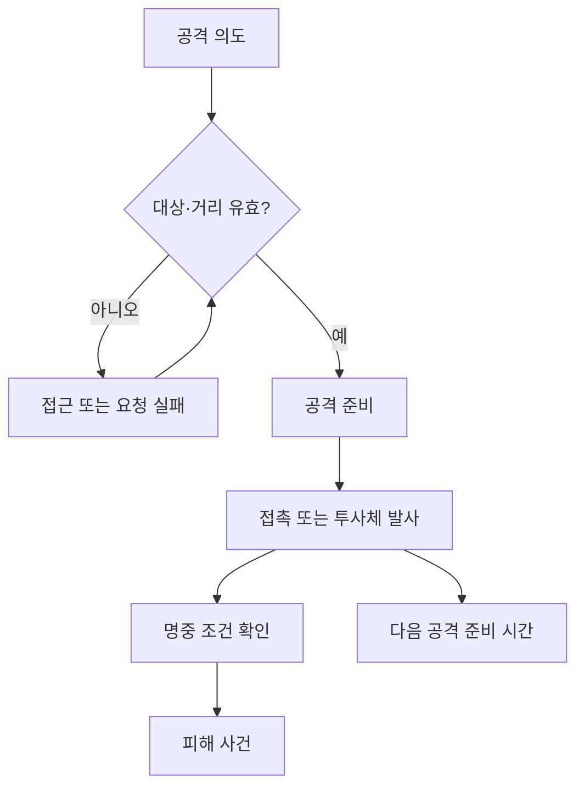

# 03. 전투·능력치·피해·생존 역기획

[문서 목록](00_README.md)

> 범위: PC 소환사의 협곡 5대5. 조사일: 2026-11-13. 최신 확인 공식 노트: 26.22. 모든 챔피언 수치와 숨은 처리 순서를 26.22 기준으로 실측한 문서는 아니다.
> **[공식]**은 확인한 공개 규칙, **[분석]**은 전투 경험에 대한 해석, **[제안]**은 재현 프로젝트를 위한 모델이다. 수식의 가정과 검증 범위를 함께 표시한다.

## 1. 전투 시스템이 해결하는 문제

[분석] 리그 오브 레전드의 전투는 ‘같은 시간 동안 누가 더 많은 피해를 주는가’만으로 설명되지 않는다. 공격할 수 있는 시간, 대상에게 접근하는 비용, 반격을 견디는 시간, 주요 스킬을 다시 사용할 수 있는 시점이 함께 승패를 결정한다. 이 문서는 수치가 그 판단을 어떻게 만드는지 분석한다.

| 플레이어의 질문 | 대응하는 시스템 |
|---|---|
| 지금 공격하면 상대가 먼저 죽는가? | 피해량·방어·보호막·회복 |
| 반격을 받기 전에 빠질 수 있는가? | 사거리·이동·제어·공격 준비 시간 |
| 짧게 교환할까, 끝까지 싸울까? | 재사용 대기·지속 피해·자원 소모 |
| 같은 골드로 공격과 방어 중 무엇을 살까? | 능력치 곱연산과 생존 시간 |
| 누구를 먼저 공격해야 하는가? | 접근 가능성·위협도·처치 후 보상 |
| 지금 진입하면 아군이 따라올 수 있는가? | 팀 거리·연계 스킬·정보 공유 |

## 2. 능력치의 기능 분해

아래는 **[분석]**용 범주다. 실제 클라이언트 필드명이나 내부 저장 타입을 그대로 옮긴 것이 아니다.

| 범주 | 대표 값 | 전투에서 만드는 선택 |
|---|---|---|
| 생존량 | 현재·최대 체력, 보호막 | 진입 가능한 위험량, 퇴각 시점 |
| 피해 생산 | 공격력, 주문력 | 기본 공격·스킬의 성장 경로 |
| 피해 방어 | 방어력, 마법 저항력 | 상대 피해 구성에 대한 구매 대응 |
| 빈도 | 공격 속도, 스킬 가속 | 같은 기회 안에서 행동하는 횟수 |
| 공간 | 이동 속도, 사거리 | 공격 가능 거리와 추격·이탈 |
| 자원 | 마나·기력·전용 자원 | 지금 쓰는 행동과 다음 행동의 교환 |
| 확률·증폭 | 치명타 확률·피해, 조건부 증폭 | 반복 공격의 기대값과 순간 변동 |
| 지속성 | 회복, 흡혈, 재생 | 전투 사이의 복구와 장기 교전 |
| 제어 대응 | 강인함, 둔화 대응 등 | 행동을 잃는 시간과 재진입 |
| 방어 우회 | 방어 감소·관통 계열 | 상대 방어 투자에 대한 대응 |

최대 체력이 큰 캐릭터도 공격에 노출되는 시간이 길면 쉽게 쓰러질 수 있다. 반대로 체력이 작아도 사거리·이동·무적 타이밍으로 피해를 받지 않으면 오랫동안 기여할 수 있다. 따라서 능력치 비교와 전투 성능 비교는 구분해야 한다.

### 2.1 기본값·성장값·추가값

[분석] 스킬 설명에서 총 공격력과 추가 공격력의 구분은 성장 원천을 제한하는 장치다. 총 공격력 계수는 기본 성장과 아이템을 함께 참조하고, 추가 공격력 계수는 주로 추가 투자에 반응한다. 최대 체력·추가 체력·잃은 체력·대상 최대 체력 또한 의미가 다르다.

[제안] 재현 데이터는 단순한 `damage = A + B * attack`만 저장하지 말고, 어떤 주체의 어떤 능력치를 참조하는지 선언해야 한다.

```text
ScalingTerm [제안]
  subject: caster | target
  stat: total_ad | bonus_ad | ap | max_health | missing_health | ...
  coefficient
  level_curve_id?
  target_class_cap?
```

### 2.2 시간에 따라 달라지는 값

레벨·아이템·버프가 바뀌는 순간과 이미 발사된 공격의 판정 순간이 다를 수 있다. **[확인 필요]** 각 효과가 시전 시점 수치를 고정하는지, 명중 때 다시 읽는지는 스킬별로 확인해야 한다. 전부 하나의 규칙으로 통일하면 실제 행동을 재현하기 어렵다.

## 3. 피해 유형과 전달 방식은 별개다

[분석] 피해를 다룰 때 다음 축을 혼합하지 않는다.

| 축 | 예시 | 잘못 섞었을 때의 오류 |
|---|---|---|
| 방어 대응 유형 | 물리·마법·고정 피해 | 기본 공격은 언제나 물리라는 잘못된 단정 |
| 발생 원천 | 기본 공격·스킬·아이템·룬·소환물 | 효과 발동 조건을 잘못 적용 |
| 대상 범위 | 단일·범위·지속 장판 | 회복·추가 효과를 과도하게 중복 적용 |
| 전달 방식 | 즉시·투사체·연결·지속 틱 | 회피·차단·무적과의 상호작용 누락 |
| 대상 종류 | 챔피언·미니언·몬스터·구조물 | 대형 몬스터 제한이나 구조물 예외 누락 |
| 사건 구분 | 공격 시도·명중·피해 적용·처치 | 피격을 취소했는데도 후속 효과 발생 |

예를 들어 기본 공격에 별도의 마법 피해 효과가 붙었다면 한 번의 입력으로 여러 피해 묶음이 생길 수 있다. 이들을 무조건 하나의 숫자로 합치면 방어 적용과 후속 발동 조건을 표현하기 어렵다. 반대로 UI는 묶어서 보여 줄 수 있으므로 표시 단위와 판정 단위도 구분할 필요가 있다.

## 4. 기본 공격의 시간 구조

[분석] 기본 공격을 관찰하는 핵심 단위는 공격 명령, 공격 준비, 발사 또는 접촉, 회복 구간이다. 원거리 공격에서는 투사체가 날아가는 시간이 추가된다. 화면에 공격 모션이 시작되었다고 즉시 피해가 확정되는 모델은 이동과 공격의 교차 조작을 설명하지 못한다.



위 그림은 **[제안]**된 공통 분해다. 취소 가능 지점은 입력 방식과 챔피언 예외에 따라 다를 수 있다. 특히 WASD를 기존 Point & Click의 공격 취소 모델과 동일하게 취급하지 않는다. 상세 내용은 [조작 문서](13_controls_movement_targeting.md)를 참조한다.

### 4.1 카이팅을 만드는 제약

[분석] 공격 사이 빈 시간을 이동에 사용할 수 있으면 공격 속도는 피해량과 함께 이동할 수 있는 시간의 배분에도 영향을 준다. 공격을 너무 일찍 취소하면 피해가 나오지 않고, 너무 오래 서 있으면 불필요한 반격을 받는다. 단순 DPS가 같은 두 챔피언도 공격 준비 비율·사거리·투사체 때문에 실제 안전한 피해량은 달라질 수 있다.

### 4.2 공격 사거리와 실효 사거리

실효 사거리는 표기 사거리만으로 정해지지 않는다. 상대가 이동하는 방향, 서로의 충돌 크기, 공격 준비 시간, 스킬 위협, 미니언 배치가 함께 작용한다. **[제안]** 자동 검증은 정지 표적뿐 아니라 접근·후퇴·횡이동 표적을 따로 사용해야 한다.

## 5. 피해 계산을 역설계하는 방법

### 5.1 공개 자료로 확인할 수 있는 부분

[공식·도입 시점] 26.1은 대부분 챔피언의 기본 치명타 피해를 200%로 조정했다고 설명한다. 이 문장은 챔피언별 예외와 이후 변경까지 동일하다는 의미가 아니다. [CB01]

[분석] 치명타 수치를 하나의 전역 상수로만 구현하면 챔피언 고유 규칙·스킬별 치명타 계수·아이템과의 조합을 처리하기 어렵다. 전역 기본값 위에 챔피언 또는 공격별 수정 규칙을 두는 설계가 필요하다.

### 5.2 재현용 판정 단계

다음은 **[제안]**이며 실제 Riot 엔진의 정확한 적용 순서가 아니다.

1. 공격 주체·피격 대상·효과 정의·게임 버전을 고정한다.
2. 대상이 해당 효과를 받을 수 있는지 확인한다.
3. 기본 피해와 능력치 계수로 원시 피해를 만든다.
4. 대상 분류에 따른 제한·상한·추가 보정을 적용한다.
5. 피해 종류에 맞는 방어와 우회 규칙을 적용한다.
6. 피해 증감·보호막·체력 변화 규칙을 정의된 순서로 처리한다.
7. 후속 효과와 처치 판정을 독립 사건으로 발생시킨다.
8. 전투 로그와 관전자·플레이어별 피드백을 만든다.

이 순서를 정답으로 선언하는 대신 재현 프로젝트의 명세로 고정하고, 실제 게임과 비교할 때 다른 지점을 찾는 기준으로 사용한다. 특히 피해 무효·회복 차단·체력 비용·처형·죽음 방지 효과는 일반 피해 규칙의 예외로 점검한다.

### 5.3 방어 검산 예제

**[제안: 단순 검산 모델]** 방어 수치 `R ≥ 0`인 구간만 다음 식을 사용한다고 가정한다.

```text
받는 피해 = 원시 피해 × 100 / (100 + R)
단일 피해 유형에 대한 유효 체력 = 최대 체력 × (1 + R / 100)
```

이는 방어 투자의 상대 효과를 설명하는 제한된 모델이다. 음수 방어, 감소와 관통의 순서, 혼합 피해, 반올림, 보호막, 특수 스킬을 포함한 현재 게임의 완전한 계산식으로 제시하지 않는다.

| 가정 조건 | 계산 | 해석 |
|---|---|---|
| 원시 피해 300, 방어 0 | 300 | 방어 감소 없음 |
| 원시 피해 300, 방어 50 | 200 | 같은 피해를 더 오래 견딤 |
| 원시 피해 300, 방어 100 | 150 | 이 모델에서 원시 피해의 절반 |
| 체력 2,000, 방어 100 | 유효 체력 4,000 | 해당 유형만 받는 단순 상황 |

[분석] 방어 50을 추가할 때 ‘감소율’ 상승폭은 줄어들어 보일 수 있지만, 위 모델의 유효 체력 증가는 체력에 비례한다. 그렇다고 언제나 방어만 사는 것이 정답은 아니다. 상대의 피해 유형 혼합, 방어 우회, 현재 체력 총량과 구매 가격을 동시에 고려해야 한다.

### 5.4 치명타 기대값과 실제 교전

**[제안: 독립 시행 단순 모델]** 기본 공격 피해를 `D`, 치명타 확률을 `p`, 치명타 배율을 `m`이라 할 때:

```text
공격 1회 기대 피해 = D × ((1 - p) + p × m)
```

실제 게임의 난수 보정·연속 치명타 보정 방식은 이 문서에서 확인하지 않았다. 위 식은 장기 평균을 직관적으로 비교하는 계산이며 개별 공격의 실제 확률 알고리즘을 명세하지 않는다.

예시로 `D = 100`, `p = 0.5`, `m = 2`를 가정하면 기대값은 150이다. 그러나 상대를 공격할 기회가 한 번뿐인 상황에서 150이 보장되는 것은 아니다. 짧은 폭발 전투와 오랜 지속 전투에서 같은 기대값의 체감이 달라지는 이유다.

## 6. 스킬 가속과 행동 빈도

[공식] 10.23의 도입 설명은 스킬 가속이 주문 사용 빈도를 선형적으로 높이는 능력치라고 설명한다. [CB02]

그 정의로부터 다음의 단순 쿨다운 환산식을 얻는다. 이는 **[분석: 공식 정의의 대수적 환산]**이며 충전·시전 시간·개별 예외를 제외한다.

```text
유효 재사용 대기시간 = 기본 재사용 대기시간 / (1 + 스킬 가속 / 100)
```

| 기본 쿨다운 10초 가정 | 유효 쿨다운 | 장시간 사용 빈도 배율 |
|---|---|---|
| 스킬 가속 0 | 10.00초 | 1.00배 |
| 스킬 가속 25 | 8.00초 | 1.25배 |
| 스킬 가속 50 | 약 6.67초 | 1.50배 |
| 스킬 가속 100 | 5.00초 | 2.00배 |

[분석] 스킬 가속 25는 ‘쿨다운 25% 감소’와 같은 문장이 아니다. 또한 7초짜리 교전에서 첫 사용만 가능한 스킬이라면 가속을 더해도 즉시 두 번째 사용으로 이어지지 않을 수 있다. 팀의 진입 주기·자원 공급·실제 공격 가능 시간을 함께 보아야 한다.

일반 스킬 가속, 궁극기 전용 가속, 소환사 주문 가속, 아이템 가속은 같은 수치 필드에 합산하지 않는다. **[확인 필요]** 각 효과의 적용 대상·합산·특수 재사용 대기시간 규칙은 현재 데이터와 개별 설명을 검사해야 한다.

## 7. 보호막·회복·피해 방지

[분석] 생존 효과는 체력 증가처럼 보이더라도 시간 조건과 대응 방식이 다르다.

| 효과 유형 | 전략적 의미 | 재현에서 필요한 분리 |
|---|---|---|
| 최대 체력 증가 | 여러 번의 피해를 버틸 총량 | 현재 체력 동반 변화 정책 |
| 즉시 회복 | 이미 잃은 체력을 복구 | 과치유·회복 감소·대상 제한 |
| 지속 재생 | 전투 간 회복으로 재진입 | 전투 상태와 틱 간격 |
| 일반 보호막 | 짧은 시간의 피해 흡수 | 만료·중첩·소모 우선순위 |
| 피해 유형 전용 보호막 | 특정 공격에 대한 대응 | 물리·마법·기타 효과와의 관계 |
| 피해 감소 | 같은 체력으로 더 오래 버팀 | 중첩과 적용 순서 |
| 무적 | 일정 시간 체력 피해 무효 | 제어·대상 지정과 별도 축 |
| 대상으로 지정 불가 | 특정 방식의 공격을 받지 않음 | 이미 적용된 효과와의 관계 |
| 죽음 방지·부활 | 처치가 확정되는 과정을 바꿈 | 발동 조건과 반복 방지 |

[분석] 적의 폭발 피해 직전에 사용하는 보호막은 비전투 중 체력을 채우는 회복과 가치가 다르다. 보호막의 총 흡수량만 집계하면 이미 안전한 대상에게 사용된 보호막과 치명적 공격을 막은 보호막이 같은 것으로 보인다. 생존 기여는 ‘발동하지 않았다면 발생했을 결과’를 근사하는 분석이 필요하다.

## 8. 한 번의 전투를 설명하는 예시

### 사례 1: 체력 교환에서 손해를 봤지만 라인 이득을 얻는 경우

[분석] 원거리 챔피언 A가 근접 챔피언 B에게 기본 공격을 넣어 체력을 낮춘다. 그러나 A가 공격에 집중하는 동안 미니언 막타를 놓치거나 위험한 위치로 이동하면 골드·정글 노출 측면에서 손해가 날 수 있다. B가 자원을 아끼고 주요 스킬을 유지했다면 다음 웨이브에서 위협이 더 커질 수도 있다. 피해량만으로 교환의 승자를 판단하면 이 상황을 설명하지 못한다.

### 사례 2: 공격력 구매보다 방어 구매가 실효 피해를 늘리는 경우

[제안: 수치 사고 실험] A의 공격 가능한 시간이 2초이고 초당 피해가 200이면 기대 기여는 400이다. 공격 아이템으로 초당 피해가 240이 되어도 2초만 생존하면 480이다. 방어 구매로 4초 동안 같은 피해를 낼 수 있다면 800이 된다. 이는 실제 특정 아이템 비교가 아니라 생존 시간과 피해 생산이 곱해지는 구조를 보여 주는 예시다.

### 사례 3: 후방 딜러보다 전방을 먼저 공격하는 경우

[분석] 최우선 위협인 적 딜러가 공격 범위 밖에 있고 접근 경로를 적 제어기가 막고 있다면 무리한 진입은 전체 피해를 줄일 수 있다. 당장 안전하게 공격 가능한 전방을 처리하면서 아군이 공간을 확보하는 전략이 합리적이다. ‘위협도가 높은 적’과 ‘현재 안전하게 공격할 대상’은 같은 값이 아니다.

## 9. 데이터·이벤트 계약

다음은 **[제안]**된 구조이며 Riot의 실제 구현 공개를 주장하지 않는다.

```text
DamageEvent [제안]
  event_id, parent_event_id
  source_entity_id, owner_player_id, target_entity_id
  source_effect_id, source_rank
  damage_type, delivery_tags[], trigger_tags[]
  sampled_stats_revision
  raw_amount, post_mitigation_amount, health_delta
  shield_delta, prevented_amount
  target_class, rule_set_id
  resolved_time

CombatState [제안]
  current_health, max_health
  resource_state
  stat_modifiers[]
  shields[]
  action_restrictions[]
  life_state
```

사건의 실제 발생 주체와 보상 귀속 플레이어를 분리하면 소환물·지속 효과·죽은 뒤 남는 투사체의 처치를 처리하기 쉽다. `parent_event_id`는 하나의 공격에서 파생된 아이템·룬 피해를 추적하고 같은 발동이 순환하지 않도록 검사하는 데 쓰인다.

## 10. 경계 조건과 검증

아래는 **[제안]**된 테스트 목록이다. 실행 여부나 실제 결과를 주장하지 않는다.

| ID | 상황 | 점검 내용 |
|---|---|---|
| CB-T01 | 투사체 발사 뒤 공격자가 사망 | 투사체 지속 여부, 피해·보상 귀속 |
| CB-T02 | 명중 직전 대상이 비대상화 | 피해·제어·후속 효과의 일관성 |
| CB-T03 | 같은 순간 피해와 보호막 적용 | 재현 가능한 처리 순서 |
| CB-T04 | 물리·마법 피해가 같은 공격에 포함 | 각 방어와 보호막의 올바른 분기 |
| CB-T05 | 피해량이 체력과 정확히 일치 | 죽음·살아남음 경계, 반올림 |
| CB-T06 | 원시 피해 0의 효과 | 제어·피격 반응·추가 발동 정책 |
| CB-T07 | 여러 추가 피해가 서로를 발동 | 재귀 발동 제한과 중복 방지 |
| CB-T08 | 방어 감소·관통·음수 방어 조합 | 단계별 계산을 실측과 대조 |
| CB-T09 | 가속 변경 중 재사용 대기 진행 | 기존 타이머 재계산 정책 |
| CB-T10 | 여러 플레이어가 거의 동시에 마무리 | 처치·도움·보상 중복 없음 |
| CB-T11 | 입력 방식 변경 후 같은 공격 반복 | 공격 빈도·취소 규칙의 일관성 |
| CB-T12 | 레벨·아이템 획득 직전후 스킬 명중 | 수치 고정 시점의 일관성 |

### 재현 비교에서 수집할 것

챔피언·레벨·스킬 랭크·아이템·룬·대상 방어·맵·모드·패치·입력 방식을 함께 기록한다. 대상 더미만으로 검증한 결과를 구조물·대형 몬스터·상대 챔피언에 그대로 확장하지 않는다. 화면 표시 피해가 반올림되었을 가능성도 로그 또는 반복 실험으로 구분한다.

### 지표 해석

[분석] 전투 균형은 평균 피해와 평균 생존 시간 외에도 첫 피해 후 사망까지의 시간, 대응 행동이 가능한 시간, 주요 스킬 한 번의 적중으로 결정되는 비중, 팀 내 피해 분산, 아이템별 교전 지속 시간 변화를 함께 봐야 한다. 매우 높은 피해라도 긴 준비와 명확한 대응 창이 있다면 즉시·확정 피해와 경험이 다르다.

## 11. 다른 시스템과의 연결

- [챔피언·드래프트](02_champions_draft_roles.md): 능력치와 스킬의 조합이 만드는 전투 역할.
- [스킬·상태 이상](04_abilities_status_effects.md): 피해 전후에 행동 가능 시간을 바꾸는 효과.
- [아이템·상점](06_items_shop_builds.md): 피해와 생존 투자의 가격·타이밍.
- [룬·소환사 주문](07_runes_summoner_spells.md): 추가 발동과 생존·진입 수단.
- [조작·이동](13_controls_movement_targeting.md): 수치상의 피해를 실제 적중으로 전환하는 입력.

## 12. 출처·확인 한계

| ID | 자료 | 확인한 사실과 한계 |
|---|---|---|
| CB01 | [Patch 26.1 Notes](https://www.leagueoflegends.com/en-us/news/game-updates/patch-26-1-notes/) | 26.1 도입 당시 대부분 챔피언 기본 치명타 피해 변경; 전원 공통·최신 불변값으로 쓰지 않음 |
| CB02 | [Patch 10.23 notes](https://www.leagueoflegends.com/en-au/news/game-updates/patch-10-23-notes/) | 스킬 가속의 선형 빈도 정의; 당시 흡혈·아이템 수치를 현행으로 사용하지 않음 |
| CB03 | [Riot Developer Portal — League of Legends](https://developer.riotgames.com/docs/lol) | 추가 수치 검증용 공식 정적 데이터 접근 경로; 이 문서에서 전체 데이터를 내려받아 실측하지는 않음 |

접근일: 2026-11-13. 정확한 방어·관통 적용 순서, 난수 보정, 특수 피해 예외, 현재 챔피언별 성장 곡선은 추가 실측 범위다. 이 문서의 단순 수치 예제는 그 빈칸을 임의로 확정하기 위한 것이 아니라 설계 비교를 위한 제한된 모델이다.
