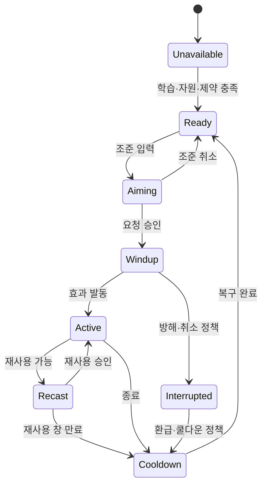

# 04. 스킬·자원·재사용 대기·상태 이상 역기획

[문서 목록](00_README.md)

> 범위: PC 소환사의 협곡 5대5. 조사일: 2026-11-13. 확인 최신 공식 노트: 26.22. 개별 스킬의 수치 전체를 현재 빌드에서 실측하지 않았다.
> 표기: **[공식]** 공식 설명, **[보조 확인]** 커뮤니티 규칙 정리, **[분석]** 설계 해석, **[제안]** 재현용 명세. 상태 이상 표는 일반적인 구분이며 챔피언별 예외가 우선한다.

## 1. 스킬이 만드는 의사결정

[분석] 스킬은 피해·보호·이동·정보·제어를 시간과 공간에 배치하는 시스템이다. 플레이어는 효과의 크기와 함께 사용 기회, 실패 비용, 상대의 대응 창을 관리한다. 같은 피해량도 확정 대상 지정인지, 피할 수 있는 투사체인지, 긴 준비가 필요한 광역 효과인지에 따라 가치가 달라진다.

| 설계 축 | 핵심 질문 | 플레이어가 관리하는 것 |
|---|---|---|
| 조준 | 누구 또는 어디를 지정하는가? | 정확도와 예측 |
| 시간 | 언제 효과가 실제로 발생하는가? | 반응·연계·회피 |
| 비용 | 사용하면 무엇을 소모하는가? | 마나·기력·체력·충전 |
| 빈도 | 다음 사용까지 얼마나 기다리는가? | 교전 간격 |
| 위험 | 시전 중 무엇을 할 수 없는가? | 노출·이동 제한 |
| 대응 | 상대가 어떻게 무력화하는가? | 지형·회피·제어·보호 |
| 성장 | 레벨과 아이템이 무엇을 강화하는가? | 스킬 투자 순서·빌드 |

## 2. 스킬 슬롯과 실제 능력 구조

[공식] 기본 안내는 대부분 챔피언의 지속 효과·기본 스킬·궁극기 구성을 소개한다. ‘대부분’이라는 표현은 모든 캐릭터가 동일한 내부 구조라는 뜻이 아니다. [AB01]

[분석] 화면의 Q/W/E/R은 입력 슬롯이고, 실제 능력은 해당 슬롯에 연결된 상태에 따라 달라질 수 있다. 재사용 시 다른 효과가 나오는 스킬, 형태에 따라 바뀌는 스킬, 여러 선택지로 나뉘는 스킬을 한 개의 고정 공격 함수로 표현하기 어렵다.

| 계층 | 책임 | 예시 |
|---|---|---|
| 입력 슬롯 | 어떤 키로 요청하는가 | Q 슬롯, 궁극기 슬롯 |
| 현재 행동 정의 | 지금 실행 가능한 변형은 무엇인가 | 최초 사용, 재사용, 강화 버전 |
| 실행 인스턴스 | 이번 사용에 필요한 상태 | 대상, 시전 위치, 준비 시간 |
| 효과 | 무엇을 변경하는가 | 피해, 표식, 이동, 소환 |
| 지속 상태 | 이후 행동에 남는 것은 무엇인가 | 스택, 제약, 타이머, 충전 |

## 3. 대상 지정 방식

아래 표는 **[분석]**을 위한 공통 문법이다. 모든 스킬이 한 종류에만 속하지는 않는다.

| 방식 | 입력 | 설계상 장점 | 주요 대응·실패 조건 |
|---|---|---|---|
| 자기 자신 | 사용 요청 | 낮은 조준 부담 | 사용 타이밍 오류 |
| 단일 대상 | 대상 식별자 | 결과 예측이 쉬움 | 사거리·시야·대상 유효성 |
| 지점 지정 | 월드 좌표 | 공간을 미리 통제 | 상대의 이동·지형 제약 |
| 방향 지정 | 방향 벡터 | 직관적인 스킬샷 | 회피·중간 충돌 |
| 선분·벡터 지정 | 시작점과 방향 | 공격 각도 조절 | 입력 복잡도·가독성 |
| 주변 자동 선택 | 범위·우선순위 | 조작 부담 절감 | 의도와 다른 대상 선택 |
| 연결 대상 유지 | 대상과 최대 거리 | 유지·이탈의 긴장 | 거리 이탈·상태 변화 |
| 재사용 지정 | 최초 사용의 문맥 | 복합 동작 | 문맥 만료·소환체 소멸 |

### 사거리 밖 요청

[분석] 사거리 밖에서 버튼을 눌렀을 때 접근한 뒤 시전할지, 최대 사거리에서 시전할지, 입력을 거절할지는 체감에 큰 영향을 준다. 이를 모든 스킬에 같은 규칙으로 강제하기보다 능력 정의와 입력 설정의 결합으로 다루어야 한다. 구체적인 입력 설정은 [조작 문서](13_controls_movement_targeting.md)에 분리한다.

### 대상과 위치의 시간 차이

대상 지정 스킬도 최초 선택한 대상의 현재 위치를 계속 추적하는지, 시전 순간의 위치만 사용하는지에 따라 결과가 다르다. 이동기 도중 대상이 사라졌을 때, 투사체 비행 중 대상이 죽었을 때, 지점 지정 후 시전자가 밀려났을 때를 각각 정의해야 한다.

## 4. 시간 구조와 상태 전이

아래는 **[제안]**된 공통 상태 모델이다. 실제 엔진 내부 상태 머신의 공개를 뜻하지 않는다.



| 단계 | 확인할 상태 | 화면에 필요한 피드백 |
|---|---|---|
| 사용 가능 | 학습·자원·제약·충전 | 사용 가능/불가 이유 |
| 조준 | 사거리·범위·대상 | 조준 표시와 취소 방법 |
| 준비 | 시전 잠금·방해 가능 여부 | 준비 모션·소리 |
| 발동 | 투사체·돌진·즉시 효과 | 실제 효과와 방향 |
| 유지 | 채널링·장판·소환물 | 남은 시간·해제 조건 |
| 재사용 | 다음 입력의 의미 | 아이콘 변형·만료 표시 |
| 복구 | 대기시간·충전 회복 | 남은 시간과 충전 수 |

자원 차감 시점과 쿨다운 시작 시점은 별도 필드로 둔다. 준비 단계가 중단되었을 때 비용을 전부 돌려주는지, 일부만 돌려주는지, 쿨다운을 그대로 적용하는지는 개별 능력 규칙이다.

## 5. 자원·충전·지속 사용

### 5.1 자원 모델의 전략적 차이

[분석] 마나를 쓰는 챔피언은 여러 번의 교환과 귀환까지의 지속 가능성을 관리한다. 빠르게 복구되는 자원은 짧은 전투 안에서 행동 순서와 재진입 간격을 강하게 제한한다. 체력을 쓰는 스킬은 공격 행동과 생존량을 직접 교환한다. 전용 게이지는 강화 상태에 도달하거나 유지하는 순서를 만든다.

| 자원 모델 | 주요 시간 범위 | 실패 패턴 |
|---|---|---|
| 큰 저장량·느린 회복 | 라인 체류 전체 | 핵심 교전에 자원 부족 |
| 작은 저장량·빠른 회복 | 짧은 교전 | 순서 오류로 연계 중단 |
| 체력 비용 | 즉시 생존 위험 | 공격 후 반격을 견딜 체력 부족 |
| 축적 게이지 | 준비와 폭발 구간 | 강화 직전 이탈 또는 기회 낭비 |
| 일반 자원 없음 | 주로 쿨다운 | 대기시간을 무시한 무리한 진입 |

일반 자원이 없더라도 아무 제약이 없는 것은 아니다. 거리, 시전 시간, 재사용 대기, 체력, 상대의 반격이 남는다.

### 5.2 충전과 쿨다운의 차이

[분석] 여러 충전을 저장할 수 있으면 ‘오랫동안 아껴서 한꺼번에 사용한다’는 선택이 생긴다. 최대 충전 상태에서 기다리는 시간은 다음 충전 생산을 잃는 기회비용이 될 수 있다. 반대로 모든 충전을 쓴 뒤에는 장시간 취약해질 수 있다.

[제안] `current_charges`, `max_charges`, `recharge_timer`, `cast_lockout`, `cooldown_policy`를 나누어 저장한다. 마지막 충전의 복구만 추적하는 구현은 여러 충전이 순차 복구되는 규칙과 일괄 복구되는 규칙을 혼동하기 쉽다.

### 5.3 정신 집중과 충전 시전

정신 집중은 유지하는 동안 행동 제약과 효과 진행이 함께 존재한다. 충전 시전은 얼마나 오래 준비했는지에 따라 사거리·피해·속도가 달라질 수 있다. 둘 다 키를 누르고 기다릴 수 있지만 중단·최대 시간·비용 처리·이동 허용이 같지는 않다.

## 6. 상태 이상의 기능 구분

[보조 확인] 커뮤니티 위키는 군중 제어를 이동·공격·스킬·정신 집중·소환사 주문에 미치는 영향으로 나누어 정리한다. 아래는 그 핵심 차이를 짧게 요약한 것이며 세부 예외는 별도 검증 대상이다. [AB02]

| 범주 | 주로 제한되는 것 | 상대가 느끼는 효과 |
|---|---|---|
| 둔화 | 이동 속도 | 도망·추격·회피가 어려움 |
| 속박 | 일반 이동·다수 이동기 | 제자리에 묶이지만 일부 행동 가능 |
| 기절 | 이동·공격·일반 스킬 | 짧은 시간 전반적 행동 상실 |
| 침묵 | 일반 스킬 사용 | 이동·기본 공격과 구별되는 제한 |
| 강제 행동 | 이동 방향 또는 행동 선택 | 의도한 진형 이탈 |
| 공중에 띄움·밀어냄 | 위치·이동 통제 | 공간을 강제로 바꿈 |
| 제압 | 폭넓은 행동 제한 | 별도 해제 수단 판단 필요 |
| 실명 | 기본 공격의 유효성 | 공격 명령과 피해 성공이 분리 |
| 시야 제한 | 정보 접근 | 공격 가능한 대상과 상황 판단 축소 |

[분석] ‘행동 불가’라는 불리언 하나로 구현하면 속박 중 가능한 행동이나 침묵 중 기본 공격 같은 차이를 잃는다. 이동·공격·일반 스킬·주문·아이템·대상 선택을 개별 권한으로 합성하는 편이 설명력이 높다.

### 6.1 강인함·해제·면역을 혼동하지 않는다

- 강인함은 적용 대상이 되는 제어의 지속 시간을 줄이는 성격이다.
- 해제는 이미 걸린 상태를 제거하는 행동이다.
- 면역은 특정 상태의 적용을 막는 성격이다.
- 주문 방어와 피해 보호막은 차단 대상과 소모 조건이 다르다.
- 강제 이동을 막는 효과와 모든 제어를 막는 효과도 별도로 봐야 한다.

[보조 확인] 공중에 뜸이나 제압 등에는 일반 강인함과 다른 처리가 있으므로 모든 제어 시간을 같은 비율로 줄이는 규칙은 정확하지 않다. [AB03]

[확인 필요] 정화, 수은 계열, 아군 해제, 저지 불가 등은 각각 제거·차단 가능한 상태가 다르다. 특정 스킬 조합을 재현하려면 효과별 허용표와 최신 클라이언트 실험이 필요하다. 이 문서는 ‘제어 해제 효과는 모두 같은 함수’라는 가정을 사용하지 않는다.

## 7. 스킬 사례로 보는 상태 설계

### 7.1 모르가나: 연결을 유지하면 결과가 바뀌는 스킬

[공식] 모르가나의 궁극기는 주변 적에게 연결을 만들고, 이를 끊지 못한 적에게 지연 후 기절을 적용하는 구조로 소개된다. [AB04]

[분석] 단순 즉시 광역 기절과 달리 양쪽 모두에게 이동 판단을 준다. 시전자는 연결을 유지하려고 가까이 머물고, 대상은 위험 지역을 떠나려 한다. 후속 기절이 발생하지 않아도 대상이 강제로 자리를 비우면 공간 제어의 성과가 생긴다. 따라서 스킬 성공 지표를 최종 기절 수만으로 제한하면 가치를 과소평가한다.

### 7.2 진: 탄약과 공격 간격으로 읽히는 위협

[공식] 진의 기본 공격은 고정된 발사 주기와 네 발의 탄약을 사용하며 마지막 탄에 별도 강화가 있다. [AB05]

[분석] 탄약은 공격 횟수 제한과 예고 정보를 동시에 만든다. 상대는 다음 공격의 위협을 읽고 거리를 조절할 수 있다. 진은 마지막 탄을 즉시 쓰거나 위협으로 유지할 수 있지만, 너무 오래 아끼면 재장전과 다음 공격 주기가 지연된다. 일반 공격 속도 공식을 전원에게 그대로 적용하면 이 특성을 잃는다.

### 7.3 레오나: 동료가 완성하는 추가 보상

[공식] 레오나의 지속 효과는 피해 스킬로 표식을 남기고 아군 챔피언의 후속 피해가 이를 소모하는 구조다. [AB06]

[분석] 동일한 스킬 명중도 동료가 따라올 수 있는 거리인지에 따라 성과가 달라진다. 이 규칙은 혼자 최적화하는 콤보와 팀의 실제 피해 전환 사이에 차이를 만든다. UI에서 아군이 공격해야 할 대상을 읽을 수 있어야 표식의 협력 목적이 살아난다.

## 8. 제어 연계의 수치 사고 실험

**[제안: 가상 예시]** 아군 A와 B가 각각 1.5초의 제어기를 갖고 있고, 두 효과는 동일하게 행동을 제한한다고 가정한다.

| 사용 방식 | A 적용 | B 적용 | 총 연속 제한 시간 |
|---|---|---|---|
| 완전 동시 | 0.0~1.5초 | 0.0~1.5초 | 1.5초 |
| 0.5초 지연 | 0.0~1.5초 | 0.5~2.0초 | 2.0초 |
| 1.4초 지연 | 0.0~1.5초 | 1.4~2.9초 | 2.9초 |

[분석] 이상적인 순차 사용은 시간을 늘리지만 후속 스킬이 빗나가거나 상대 해제·보호가 개입할 위험이 있다. 즉시 중첩은 시간 효율이 낮아도 짧은 폭발 피해를 확실히 넣는 데 유리할 수 있다. 제어 시간을 길게 만드는 것과 교전 승리를 높이는 것이 항상 같지는 않다.

**[제안: 조건부 지속시간 모델]** 강인함을 적용할 수 있는 효과에만 `최종 지속시간 = 기본 지속시간 × (1 - 적용 감소율)`을 사용한다고 가정한다. 감소율 합산 방식·최소 지속시간·비대상 제어는 별도 규칙이다. 현재 게임 전체의 확정 강인함 공식으로 사용하지 않는다.

## 9. 연계·후속 효과·중복 방지

[분석] 스킬 하나가 피해, 표식, 둔화, 소환, 아이템 발동을 동시에 일으킬 수 있다. 효과를 호출한 순서만으로 모든 규칙을 해결하면 소환물 소유자, 중복 타격, 지속 틱과 첫 명중을 구분하기 어렵다.

| 트리거 | 구분해야 할 이유 |
|---|---|
| 사용 요청 | 승인 전 실패 가능 |
| 시전 확정 | 자원과 대기시간이 시작될 수 있음 |
| 첫 명중 | 한 스킬당 한 번만 발동할 효과 |
| 각 대상 명중 | 다중 대상 효과 |
| 각 피해 틱 | 지속 피해와 재발동 간격 |
| 처치 | 초기화·추가 충전·보상 |
| 지속 종료 | 자연 만료와 해제의 구분 |

[제안] `cast_id`, `effect_instance_id`, `target_id`, `proc_group_id`를 이용해 한 시전에서 대상별 발동 횟수를 기록한다. 같은 공격이 룬을 발동하고 그 룬이 다시 원래 효과를 발동하는 순환은 명시적 제한이 필요하다.

## 10. 재현용 데이터 모델

```text
AbilityDefinition [제안]
  ability_id, slot_id, variant_id
  target_policy_id
  cost_policy_id
  windup_policy_id
  channel_policy_id?
  cooldown_policy_id
  charge_policy_id?
  recast_policy_id?
  effects[]
  movement_permissions
  cancel_permissions
  source_version

StatusEffectDefinition [제안]
  status_id, tags[]
  blocked_actions[]
  duration_policy
  stacking_policy
  refresh_policy
  dispel_tags[]
  immunity_tags[]
  visibility_policy
  on_apply, on_tick, on_expire

AbilityInstance [제안]
  cast_id, caster_id, target_ref
  start_position, intended_position
  sampled_stats_revision
  current_phase, phase_end_time
  linked_entities[]
  proc_history
```

[분석] 정의 데이터와 이번 시전의 상태를 분리하면 같은 스킬이 동시에 여러 대상에게 남긴 표식, 재사용 입력의 남은 시간, 소환물 소멸을 개별 관리할 수 있다. 모드별 수치 수정은 원본 정의를 덮어쓰는 대신 규칙 집합의 오버라이드로 기록하는 것이 검증에 유리하다.

## 11. 실패·경계 상황

| 상황 | 확인해야 할 질문 |
|---|---|
| 자원이 정확히 비용과 같음 | 승인과 차감이 같은 판정 시점을 쓰는가? |
| 준비 중 침묵·기절 | 어떤 단계가 취소되고 무엇이 환급되는가? |
| 발사 후 시전자가 사망 | 효과가 남는가, 소유·처치 귀속은 유지되는가? |
| 재사용 대상 소환물이 파괴됨 | 슬롯이 즉시 복구되는가, 재사용이 거절되는가? |
| 연결 대상이 잠깐 시야에서 사라짐 | 거리 판정과 시야 판정은 어떻게 구분되는가? |
| 지형이 생기거나 사라짐 | 이미 시작된 이동의 경로를 다시 계산하는가? |
| 제어가 동시에 만료·갱신 | 한 프레임만 행동 가능해지는 누수가 있는가? |
| 서로 다른 면역이 겹침 | 피해와 제어의 일부만 차단되는가? |
| 버프 제거 후 다른 동일 버프가 남음 | 전체 능력치를 잘못 복구하지 않는가? |
| 변신·복사·강탈 계열 | 원본 소유자와 현재 시전자 수치의 사용 범위는 무엇인가? |

## 12. 검증 계획

아래는 **[제안]**이며 이번 작성에서 실행한 테스트가 아니다.

| ID | 검증 시나리오 | 확인 목표 |
|---|---|---|
| AB-T01 | 같은 스킬을 정상·빠른 시전으로 사용 | 입력 차이와 실제 효과 차이를 분리 |
| AB-T02 | 단일·범위·지속 피해로 같은 룬 발동 | 발동 횟수·대상별 제한 확인 |
| AB-T03 | 모든 행동 제약을 각각 적용 | 이동·공격·스킬·주문 권한 검증 |
| AB-T04 | 강인함·해제·면역을 각각 사용 | 지속 단축·제거·적용 차단 구분 |
| AB-T05 | 충전 최대·한 개·없음에서 연속 입력 | 충전 소비와 복구 타이머 일관성 |
| AB-T06 | 연결 스킬의 경계 거리 반복 통과 | 오차·지연으로 부당한 유지/해제 방지 |
| AB-T07 | 재사용 마지막 시각에 입력 | 서버 기준 시간과 UI 문구 일치 |
| AB-T08 | 동일 상태를 서로 다른 소스가 적용 | 중첩·갱신·개별 해제 정책 검증 |
| AB-T09 | 스킬 도중 레벨·능력치 변경 | 수치 고정 시점 확인 |
| AB-T10 | 게임 모드 변경 | 모드별 예외가 일반 협곡으로 누출되지 않음 |

운영 측정에서는 적중률 외에 시전 후 노출 시간, 적의 대응 성공률, 사용하지 않고 유지한 위협 시간, 아군 후속 행동률을 함께 보아야 한다. 이 값들은 자동으로 측정 가능한 항목과 리플레이 분석이 필요한 항목으로 나누어 정의한다.

## 13. 연관 문서

- [챔피언·드래프트](02_champions_draft_roles.md): 스킬들이 하나의 캐릭터 정체성을 만드는 방식.
- [전투·피해](03_combat_stats_damage.md): 스킬 효과가 실제 체력 변화로 이어지는 과정.
- [룬·소환사 주문](07_runes_summoner_spells.md): 스킬 밖에서 추가하는 발동·방어 수단.
- [맵·지형·경로](08_map_terrain_navigation.md): 이동기·지형 생성·도착 위치의 공간 제약.
- [시야·정보](09_vision_fog_information.md): 대상 선택과 효과 공개 범위.
- [조작·이동](13_controls_movement_targeting.md): 조준·재사용·입력 취소.

## 14. 출처

접근일은 모두 2026-11-13이다. 위키의 분류는 검색 결과에 노출된 본문을 통한 보조 확인이며 페이지 전체를 직접 읽은 것으로 취급하지 않았다. 엔진 내부 구조의 근거로 쓰지 않았다.

| ID | 유형 | 자료 | 확인 범위 |
|---|---|---|---|
| AB01 | 공식 안내 | [How to Play](https://www.leagueoflegends.com/en-us/how-to-play/) | 일반적인 스킬 슬롯 구성 |
| AB02 | 커뮤니티 보조 | [Crowd control](https://wiki.leagueoflegends.com/en-us/Crowd_control) | 군중 제어의 행동별 차이 |
| AB03 | 커뮤니티 보조 | [Tenacity](https://wiki.leagueoflegends.com/en-us/Tenacity) | 강인함이 모든 제어에 동일 적용되지 않음 |
| AB04 | 공식 챔피언 | [Morgana](https://www.leagueoflegends.com/en-us/champions/morgana/) | 연결 유지 후 기절을 주는 궁극기 |
| AB05 | 공식 챔피언 | [Jhin](https://www.leagueoflegends.com/en-us/champions/jhin/) | 탄약·고정 공격 주기·마지막 탄 강화 |
| AB06 | 공식 챔피언 | [Leona](https://www.leagueoflegends.com/en-us/champions/leona/) | 동료의 후속 피해로 소모되는 표식 |
