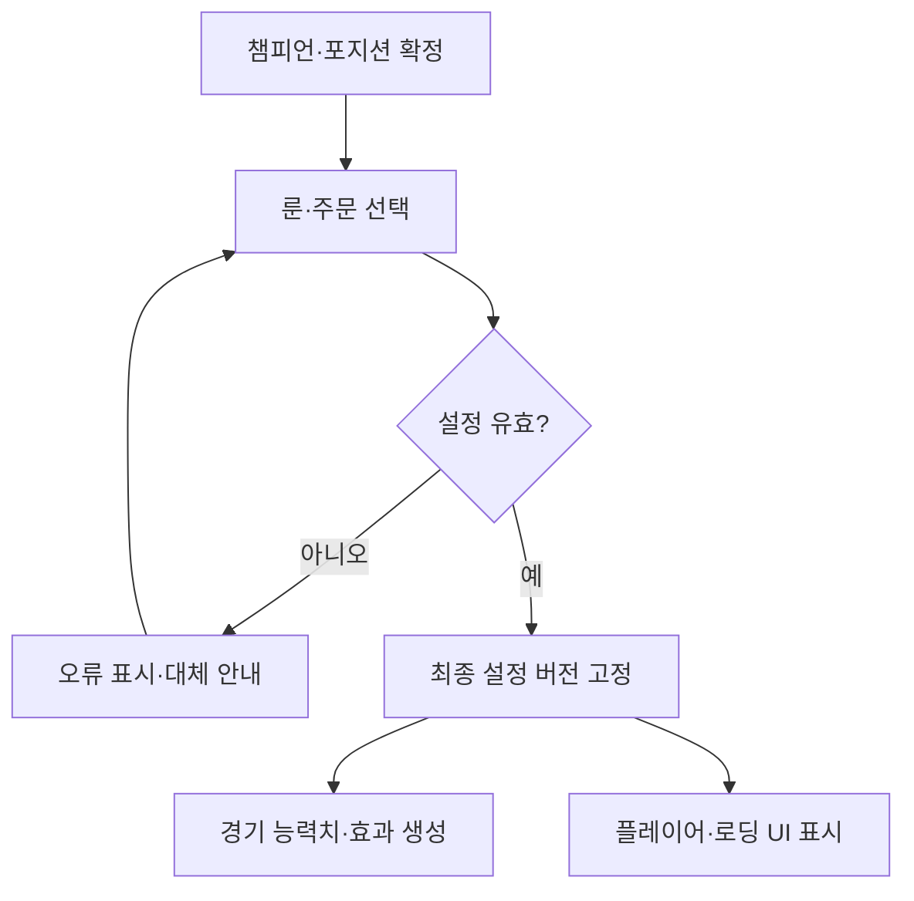

# 07. 룬·소환사 주문·사전 전투 설정 역기획

[문서 목록](00_README.md)

> 범위: 현대 PC 소환사의 협곡 5대5. 조사일: 2026-11-13. 확인 최신 공식 패치: 26.22. League Classic 등 별도 모드의 과거 룬·특성 체계와 구분한다.
> **[공식]** 공개 자료 확인, **[보조 확인]** 커뮤니티 설명 확인, **[분석]** 독자 해석, **[제안]** 재현 모델, **[확인 필요]** 특정 패치 실측이 필요한 항목.

## 1. 사전 설정의 목적

[분석] 챔피언이 제공하는 기본 행동은 경기 도중 쉽게 바뀌지 않는다. 룬과 소환사 주문은 같은 챔피언 안에서도 초반 교환, 긴 교전, 방어, 이동, 팀 합류의 우선순위를 다르게 만드는 사전 선택이다. 아이템이 경기 중 대응이라면 이 설정은 경기 시작 전에 감수할 약점과 노릴 강점을 고르는 단계다.

| 설정 | 변경하는 것 | 주된 비용 |
|---|---|---|
| 핵심 룬 | 반복 행동의 보상 구조 | 다른 핵심 효과를 포기 |
| 보조 룬 | 자원·성장·방어·기회 보완 | 같은 슬롯의 다른 선택을 포기 |
| 능력치 파편 | 초기 교환 또는 성장 성격 | 범용성·특화의 교환 |
| 소환사 주문 | 추가 진입·생존·합류 수단 | 제한된 주문 칸과 긴 대기시간 |
| 추천 설정 | 선택 탐색 시간 | 상황에 맞게 수정할 책임 |

룬과 주문을 고르는 행위는 어떤 상대를 이길지뿐 아니라 어떤 위험을 감수할지를 정한다. 강력한 공격 선택은 상대 갱킹을 버티기 어렵게 할 수 있고, 방어 선택은 라인에서 처치 기회를 줄일 수 있다.

## 2. 룬의 구조

[공식·설계 이력] 룬 재구성은 주 경로와 보조 경로를 골라 플레이 스타일을 설정하는 체계로 소개되었고, 정밀·지배·마법·결의·영감의 다섯 경로를 제시했다. 당시의 룬 총개수는 현재 목록으로 사용하지 않는다. [RU01]

[보조 확인] 현대 룬 페이지의 기본 구성은 주 경로에서 핵심 룬과 일반 룬 세 개, 보조 경로에서 일반 룬 두 개, 별도의 능력치 파편 세 칸으로 정리된다. 구체적인 룬 목록·교체·효과 수치는 패치별로 확인해야 한다. [RU02]

### 2.1 경로별 설계 성격

다음의 사용 판단은 **[분석]**이다. 경로 하나가 특정 포지션에만 허용되는 것은 아니다.

| 경로 | 분석할 중심 기능 | 플레이어의 질문 |
|---|---|---|
| 정밀 | 반복 공격·장기 교전 | 계속 공격할 시간을 확보할 수 있는가? |
| 지배 | 짧은 교환·접근·기회 보상 | 짧은 노출을 큰 이득으로 바꿀 수 있는가? |
| 마법 | 스킬 활용·자원·기동 | 스킬을 반복해서 적중·활용할 수 있는가? |
| 결의 | 생존·보호·장기 버티기 | 상대의 압박을 넘기고 다음 행동을 할 수 있는가? |
| 영감 | 경제·도구·행동 규칙 변화 | 기본 흐름을 바꾸어 시간·골드 이득을 얻는가? |

이 분류는 경로의 경향을 이해하기 위한 것이다. 해당 경로의 모든 룬이 같은 목표를 갖거나, 이름만으로 최적 선택을 판단할 수 있는 것은 아니다.

### 2.2 핵심 룬이 만드는 반복 행동

[분석] 핵심 룬은 효과량만이 아니라 발동 조건으로 플레이를 유도한다.

| 발동 방식 | 유도하는 행동 | 상대의 대응 |
|---|---|---|
| 여러 번의 공격·스킬 적중 | 짧은 시간에 연속 적중 | 거리를 벌려 연속 행동 차단 |
| 장시간 교전·스택 축적 | 교전을 오래 유지 | 준비 전 폭발 또는 이탈 |
| 일정 간격의 강화 공격 | 준비된 순간의 교환 | 강화 상태가 끝날 때까지 회피 |
| 제어 성공 | 제어 후 후속 공격·보호 | 제어 회피·해제·즉시 반격 |
| 이동·충전 | 이동과 공격의 리듬 | 충전된 접근 시점 예측 |
| 특정 시간·처치 조건 | 미래 보상을 위한 성장 | 보상 이전에 압박 |

모든 행에 해당하는 현행 룬이 항상 존재한다는 목록은 아니다. 실제 룬을 역설계할 때 효과가 어느 행동을 보상하는지 기록하는 분류표다.

### 2.3 실제 핵심 룬: 발동 조건에서 플레이로

아래의 발동·보상은 **[공식]** 자료에 나온 구조이며, 유도 행동과 상대 대응은 **[분석]**이다. 집중 공격은 **14.10 변경 당시**, 기민한 발놀림은 **룬 재구성 공식 소개 당시** 설명을 기준으로 한다. 피해량·회복량·증폭률·대기시간을 26.22의 확정값으로 옮기지 않는다. [RU11][RU12]

| 핵심 룬 | 발동 조건 | 보상 | 유도 행동 | 상대 대응 |
|---|---|---|---|---|
| 집중 공격 | 같은 적 챔피언에게 기본 공격을 연속 세 번 적중 | 추가 피해와 전투 이탈까지 자신의 피해 증폭 | 세 번째 공격까지 연결하고 이후에도 안전하게 피해를 누적 | 세 번째 적중 전 거리·제어로 연결을 끊거나 강화된 교전에서 이탈 |
| 기민한 발놀림 | 공격·이동으로 충전한 뒤 강화 기본 공격 사용 | 회복과 일시적인 이동 속도 증가 | 준비된 공격으로 체력을 보충하고 이동 보상을 거리 조절에 활용 | 충전 공격의 접근을 견제하고 이동 보상이 끝난 시점에 재접근 |

[분석] 예를 들어 원거리 챔피언이 상대에게 두 번 공격한 뒤 상대가 물러난 상황을 보자. 집중 공격 사용자는 세 번째 공격의 보상을 얻으려고 추격할 유인이 있지만, 그 한 번을 위해 적 미니언이나 포탑 쪽으로 너무 깊게 들어가면 이득보다 손실이 커진다. 기민한 발놀림 사용자는 준비된 공격으로 회복한 뒤 이동 속도를 이용해 짧게 교환하고 빠지는 선택을 할 수 있다. 두 룬은 같은 기본 공격을 보상하면서도 **공격을 더 이어갈지, 한 번의 준비된 공격 뒤 위치를 바꿀지**에 다른 가치를 준다.

[확인 필요] 현재의 충전량 계산, 대상 종류별 회복 보정, 효과가 유지되는 전투 판정과 재발동 제한은 룬별 최신 설명·실험으로 확인한다. 위 사례는 수치를 생략한 공식 구조 분석이며 숨은 발동 알고리즘을 확정한 명세가 아니다.

### 2.4 파편과 경로 효과의 구분

[분석] 능력치 파편은 짧은 설명으로 비교하기 쉽지만, 그 선택이 스킬 계수·공격 간격·체력 교환에 미치는 영향은 챔피언에 따라 다르다. 적응형 능력치는 어떤 경우에 공격력과 주문력 중 무엇을 제공하는지 별도 규칙이 필요하다. 현재 파편의 값과 조건은 이 문서에서 임의로 확정하지 않는다.

## 3. 룬 선택의 절차

[분석] 실용적인 선택 흐름은 ‘인기 페이지 복사’에서 끝나지 않고 다음 질문으로 이어진다.

1. 이 챔피언이 자주 성공시키는 행동은 무엇인가?
2. 상대와 짧게 교환하는가, 긴 전투를 반복하는가?
3. 라인에서 버티는 것이 중요한가, 먼저 주도권을 얻는 것이 중요한가?
4. 팀 조합에 이미 있는 기능과 부족한 기능은 무엇인가?
5. 핵심 룬의 조건을 실제로 발동할 수 있는가?
6. 보조 경로는 장점을 강화하는가, 치명적인 약점을 메우는가?
7. 소환사 주문·아이템 계획과 같은 행동을 요구하는가?

### 사례 A: 같은 챔피언의 두 경기

[분석] 가까이 다가오는 근접 상대와 반복 교환하는 경기에서는 지속 교전 보상이 자주 작동할 수 있다. 긴 사거리의 상대를 따라다녀야 하는 경기에서는 같은 조건을 충분히 채우지 못할 수 있다. 그 경우 접근·버티기·짧은 교환에 가치를 주는 선택이 더 실용적일 수 있다. 이름이 같은 챔피언이라고 항상 같은 발동 빈도를 갖지 않는다.

### 사례 B: 보조 경로의 기회비용

[분석] 미래 성장 보상을 선택하면 초반의 자원 회복이나 피해 감소를 포기할 수 있다. 초반에 반복해서 복귀해야 한다면 예상했던 미래 성장에 도달하는 시간 자체가 늦어진다. 반대로 불필요한 방어를 과하게 선택하면 실제로 위협받지 않는 상황에서 성장 보상을 잃는다.

## 4. 추천 룬의 기능

[공식·도입 이력] 12.23은 챔피언·포지션에 맞춘 룬 추천과 선택 가능한 소환사 주문 추천을 추가했다. [RU03]

[분석] 추천은 학습 비용을 줄이는 기능이다. 추천이 있다는 이유로 룬 선택의 전략적 의미가 사라지지는 않는다. 플레이어는 추천 페이지를 출발점으로 쓰고 상대·팀·자신의 행동 방식에 맞춰 수정한다.

| 추천 시스템의 책임 | 이유 |
|---|---|
| 챔피언·포지션·패치 문맥 표시 | 다른 역할의 표본을 잘못 적용하지 않음 |
| 추천 변경 후 실제 선택 반영 표시 | 미리보기와 저장 상태의 혼동 방지 |
| 룬과 주문의 변경 범위 분리 | 룬만 바꾸려다 주문도 바뀌는 실수 방지 |
| 사용 불가 항목 대체 안내 | 삭제·모드 제한·계정 상태 대응 |
| 수동 수정 보존 | 추천이 플레이어 의도를 덮어쓰지 않음 |

[제안] 추천 생성 알고리즘은 공개되어 있다고 가정하지 않는다. 재현 프로젝트라면 운영자가 관리하는 기본 페이지와 패치별 이용 통계를 섞는 방법 등을 선택할 수 있지만, 이는 Riot의 실제 알고리즘을 뜻하지 않는다.

## 5. 소환사 주문의 역할

[공식] 일반 안내는 챔피언 스킬과 별도로 두 개의 소환사 주문을 사용하는 구성을 설명한다. [RU04]

[분석] 주문은 챔피언 고유 키트에 외부 행동을 추가한다. 선택 수가 적고 재사용 대기가 비교적 길기 때문에, 한 번 사용한 사실이 다음 교전의 조건을 바꾸는 정보가 된다. 주문을 쓰지 않고 압박만 유지하는 선택도 가치가 있다.

### 5.1 주문별 판단 분류

아래는 일반적인 플레이 목적을 정리한 **[분석]** 표다. 주문 목록·변형은 보조 자료와 대조했으며, 점멸·유체화·회복·점화의 기능 설명도 개별 항목에서 확인했다. [RU06][RU07][RU08][RU09][RU10] 정확한 지속시간·거리·수치·모드별 사용 가능 여부는 현재 툴팁의 검증 대상이다.

| 주문 | 주로 노리는 기능 | 사용 전에 따질 것 |
|---|---|---|
| 점멸 | 짧은 위치 변화로 진입·회피 | 도착 지형, 적의 후속 수단 |
| 유체화 | 일정 구간의 추격·거리 유지 | 충분한 이동 시간이 있는가 |
| 순간이동 | 장거리 복귀·합류 | 대상 위치, 이동 시간, 원래 라인의 손실 |
| 점화 | 처치 압박과 회복 대응 | 대상이 이미 죽는지, 탈출할 수 있는지 |
| 탈진 | 상대의 강한 피해 구간 억제 | 누구의 어떤 구간을 막을지 |
| 회복 | 자신·아군의 생존 보조 | 유효 대상과 겹치는 사용의 효율 |
| 방어막 | 짧은 피해 집중을 버팀 | 너무 일찍 써서 끝나지 않는지 |
| 정화 | 적용 가능한 제어에서 벗어남 | 제거 가능한 효과인지 |
| 강타 | 정글 성장·중립 목표 마무리 | 사용 가능 상태, 대상, 확보 타이밍 |

일부 주문은 역할·모드·계정 조건과 연결된다. 칼바람 등의 모드 전용 주문을 현대 협곡의 공통 선택으로 포함하지 않는다. 구체적인 해제 범위는 [스킬·상태 이상](04_abilities_status_effects.md)과 함께 검증한다.

### 5.2 순간이동의 이름과 실제 동작

[공식·변경 이력] 2025.S1.1은 순간이동을 정신 집중 직후의 즉시 위치 이동에서 실제 이동 시간이 있는 방식으로 변경했다. [RU05]

[분석] 따라서 재현할 때 이름만 보고 `위치 = 대상 위치` 한 번으로 구현하면 이동 중 상태와 상대가 대응할 시간을 잃는다. 주문의 준비·여행·도착 효과를 나누어 설명해야 한다. 해당 패치의 초 수·이동 속도가 현재도 전부 같다고 여기지는 않는다.

### 5.3 강타의 전략적 책임

[분석] 강타는 개인 전투 주문을 넘어 중립 목표를 확정하는 역할과 연결된다. 그러나 목표 체력의 마지막 숫자만 보는 것보다 상대 정글러의 접근, 아군 화력의 순간 변화, 시야, 제어에 걸릴 가능성이 먼저 중요하다. ‘강타 싸움’은 순수 반응 속도 비교가 아니라 목표 지역을 통제하지 못했을 때 발생하는 고위험 상황으로 볼 수 있다.

## 6. 주문의 보유와 사용은 다른 가치다

[분석] 점멸이 있는 적은 더 넓은 거리를 위협한다. 점멸을 사용한 뒤에는 같은 위치에서도 안전 공간이 달라진다. 반대로 주문을 사용해 죽음을 피하면 골드·경험치·맵 압박을 유지할 수 있어, 긴 대기시간을 치르더라도 이득일 수 있다.

### 가상 의사결정 예시

**[제안: 수치 사고 실험]** 실제 주문 쿨다운이나 죽음 비용을 뜻하지 않는다.

- 주문을 쓰지 않으면 죽을 확률을 70%, 죽음의 자원·시간 손실을 500의 효용 단위로 가정한다.
- 주문을 쓰면 그 확률이 10%가 되고, 다음 주요 전투에서 주문이 없는 비용을 120으로 가정한다.
- 단순 기대 손실은 미사용 350, 사용 50+120=170이다.
- 이 모델에서는 생존용 사용이 낫지만, 실제 확률과 미래 전투 비용은 플레이어가 정확히 알 수 없다.

이 예시는 무조건 주문을 아끼는 습관보다 현재 손실과 미래 비용을 함께 평가해야 한다는 점을 설명한다. 실제 승률 계산 공식이나 추천 봇의 정답 정책으로 사용하지 않는다.

## 7. 사전 설정 확정·경기 초기화

아래는 **[제안]**된 처리 계약이다.



| 단계 | 입력 | 출력 | 실패 시 처리 |
|---|---|---|---|
| 페이지 편집 | 경로·룬·파편 | 임시 페이지 | 슬롯 충돌 표시 |
| 추천 적용 | 추천 ID·버전 | 선택된 페이지 | 수동 수정 덮어쓰기 안내 |
| 챔피언 변경 | 새 캐릭터 | 재검증 상태 | 비유효 효과 대체 또는 안내 |
| 역할 교환 | 새 역할 | 주문·퀘스트 재검증 | 제한 위반을 시작 전에 해소 |
| 최종 확정 | 페이지와 주문 | 불변 로드아웃 | 누락 정책 적용 |
| 경기 생성 | 확정 데이터 | 능력치·지속 효과 | 클라이언트 표시와 대조 |

## 8. 룬 효과의 재현용 모델

```text
RunePage [제안]
  page_id, revision
  primary_path_id
  keystone_id
  primary_minor_ids[]
  secondary_path_id
  secondary_minor_ids[]
  shard_ids[]
  mode_rule_set_id

RuneEffect [제안]
  effect_id
  trigger_event_tags[]
  eligible_target_tags[]
  stacking_rule
  per_target_cooldown?
  global_cooldown?
  effect_payload
  expiration_policy

SummonerSpellDefinition [제안]
  spell_id
  availability_policy_id
  targeting_policy_id
  channel_policy_id?
  travel_policy_id?
  cooldown_policy_id
  charge_policy_id?
  effect_ids[]
```

[분석] 룬은 수치 보너스와 이벤트 반응이 혼재한다. 보조 룬을 ‘능력치 더하기’만으로 표현하면 대상별 발동 제한·경기 시간 조건·처치 스택·쿨다운을 처리할 수 없다. 주문은 일반 챔피언 스킬과 실행 기반을 공유할 수 있어도 적용 가능한 가속과 행동 제약을 별도로 둘 필요가 있다.

## 9. 상호작용에서 생기는 오류

| 상황 | 재현 시 위험 |
|---|---|
| 여러 피해 틱이 한 번의 스킬에서 나옴 | 핵심 룬이 의도보다 빨리 발동 |
| 소환물이 공격함 | 소유자 룬의 대상·원천 규칙 혼동 |
| 표식과 추가 피해가 서로 반응 | 무한 또는 과도한 연쇄 발동 |
| 챔피언 교환 후 룬 변경 누락 | 선택 화면과 경기 초기화 불일치 |
| 포지션 교환 후 주문 검증 누락 | 역할 정책과 로드아웃 충돌 |
| 삭제된 룬이 저장 페이지에 남음 | 시작 실패 또는 잘못된 대체 |
| 모드 변경 후 페이지 재사용 | 사용 불가 룬·주문이 남음 |
| 순간이동 중 대상 소멸·상태 변화 | 도착·취소·쿨다운 정책 모순 |
| 정화 사용과 제어 적용이 같은 시각 | 판정 순서에 따른 재현 불일치 |
| 주문 충전과 재사용 대기가 겹침 | UI 표시와 실제 사용 가능성 불일치 |

## 10. 검증 계획

아래는 실제 실행 결과가 아닌 **[제안]**이다.

| ID | 시나리오 | 검증 목표 |
|---|---|---|
| RU-T01 | 같은 경로를 주·보조로 설정 시도 | 허용된 페이지 구조만 확정 |
| RU-T02 | 동일 슬롯의 룬을 여러 개 선택 | 하나만 적용되고 UI와 데이터 일치 |
| RU-T03 | 추천 적용 뒤 일부 룬만 수동 변경 | 수동 값 보존과 저장 버전 일치 |
| RU-T04 | 챔피언·역할 교환을 연속 처리 | 주문·룬·포지션 퀘스트 재검증 |
| RU-T05 | 다른 피해 원천으로 같은 룬 발동 | 원천·대상·반복 제한 적용 |
| RU-T06 | 주문 시전 직후 재접속 | 쿨다운·충전·여행 상태 복구 |
| RU-T07 | 정화와 제어를 시간차로 반복 | 제거 대상과 동시 판정 규칙 확인 |
| RU-T08 | 순간이동 대상·출발지·도착지 변화 | 준비·이동·도착 단계 분리 |
| RU-T09 | 페이지 저장 후 패치 변경 | 삭제·수정 룬의 안전한 이전 |
| RU-T10 | 모드 전환 후 동일 페이지 사용 | 현대 협곡과 별도 규칙 혼합 방지 |

## 11. 밸런스 분석 시 확인할 것

[분석] 룬의 승률은 룬 자체의 강함과 사용자의 숙련도·챔피언·상대·포지션이 섞인 결과다. 비주류 룬이 높은 승률을 보이더라도 숙련자만 사용하는 선택 편향일 수 있다. 인기 페이지와 대체 페이지를 비교하려면 최소한 같은 챔피언·포지션·패치·상대 구도를 묶어야 한다.

유용한 지표는 발동 기회 대비 발동률, 발동하기까지 걸린 시간, 발동 후 추가 행동 가능성, 주문을 쓰고도 사망한 비율, 주문 미사용 사망의 상황, 추천에서 수동으로 바뀐 항목이다. 수치가 높다고 언제나 좋은 것은 아니다. 피해 룬이 많은 피해를 냈어도 중요한 시점에 생존하지 못하면 팀의 승리 조건을 만족하지 못할 수 있다.

## 12. 연결 문서와 출처

- [챔피언·드래프트](02_champions_draft_roles.md): 사전 설정을 확정하는 화면과 역할 교환.
- [전투·능력치](03_combat_stats_damage.md): 추가 능력치와 발동 피해의 계산.
- [스킬·상태 이상](04_abilities_status_effects.md): 해제·이동·채널링 상호작용.
- [아이템·상점](06_items_shop_builds.md): 룬 선택과 일관된 성장 계획.
- [게임 모드](19_modes_practice_custom.md): 모드별 룬·주문 사용 범위.

접근일: 2026-11-13. 커뮤니티 보조 자료는 검색 결과에 노출된 본문으로 확인했으며 RU02·RU06의 직접 페이지 열기는 제한되었다. 룬·주문의 최신 세부 수치 전수 검증으로 취급하지 않는다.

| ID | 유형 | 자료 | 확인 범위 |
|---|---|---|---|
| RU01 | 공식 도입 안내 | [Preseason Update — Runes Reforged](https://na.leagueoflegends.com/en/featured/preseason-update) | 다섯 경로·주/보조 경로의 설계 구조 |
| RU02 | 커뮤니티 보조 | [Runes Reforged](https://wiki.leagueoflegends.com/en-us/Runes_Reforged) | 현대 룬 페이지의 슬롯 구성 |
| RU03 | 공식 패치 이력 | [Patch 12.23 notes](https://www.leagueoflegends.com/en-us/news/game-updates/patch-12-23-notes/) | 챔피언·포지션별 추천과 주문 추천 도입 |
| RU04 | 공식 안내 | [How to Play](https://www.leagueoflegends.com/en-us/how-to-play/) | 챔피언 스킬과 별도의 두 소환사 주문 |
| RU05 | 공식 패치 이력 | [2025.S1.1 패치 노트](https://www.leagueoflegends.com/ko-kr/news/game-updates/patch-25-s1-1-notes/) | 순간이동의 이동 시간 도입; 당시 수치를 현재 불변값으로 사용하지 않음 |
| RU06 | 커뮤니티 보조 | [Summoner spell](https://wiki.leagueoflegends.com/en-us/Summoner_spell) | 주문 목록·모드 조건·변형의 구분 |
| RU07 | 커뮤니티 보조 | [Flash](https://wiki.leagueoflegends.com/en-us/Flash) | 짧은 위치 이동의 기능 |
| RU08 | 커뮤니티 보조 | [Ghost](https://wiki.leagueoflegends.com/en-us/Ghost) | 이동 속도 기반 추격·이탈 |
| RU09 | 커뮤니티 보조 | [Heal](https://wiki.leagueoflegends.com/en-us/Heal) | 자신과 아군의 회복 기능 |
| RU10 | 커뮤니티 보조 | [Ignite](https://wiki.leagueoflegends.com/en-us/Ignite) | 지속 피해·회복 감소 기능 |
| RU11 | 공식 패치 이력 | [Patch 14.10 Notes](https://www.leagueoflegends.com/en-us/news/game-updates/patch-14-10-notes/) | 집중 공격의 연속 기본 공격 발동·자신의 피해 증폭 구조; 변경 당시 기준 |
| RU12 | 공식 룬 소개 | [Runes Reforged — Fleet Footwork](https://na.leagueoflegends.com/en/featured/preseason-update/8000-8021?build=02000123) | 이동·공격 충전 후 회복·이동 속도 보상; 공식 검색 본문 확인, 직접 열기는 503으로 제한 |
