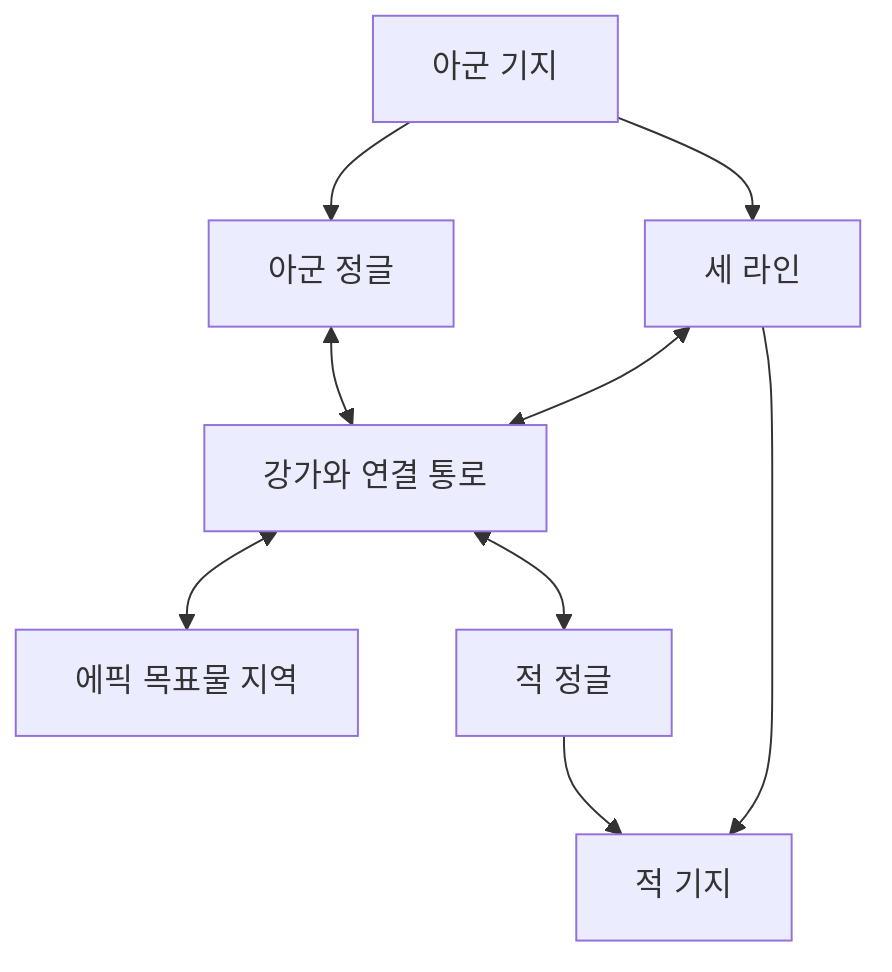

# 08. 맵·지형·이동 경로와 공간 설계

[문서 목록](00_README.md) · [시야](09_vision_fog_information.md) · [미니언·구조물](10_lanes_minions_structures.md) · [입력·이동](13_controls_movement_targeting.md)

## 1. 범위와 읽는 방법

- 대상은 PC 소환사의 협곡이다. 와일드 리프트의 맵·이동 규칙을 섞지 않는다.
- 조사일은 2026-11-13이다. 맵 스킨, 시즌 지형, 목표물 생성 규칙은 따로 버전 관리한다.
- **[공식]**은 공개 설명, **[분석]**은 공간이 만드는 선택의 해석, **[제안]**은 재현용 모델이다.
- 본 문서의 관계도는 실제 축척 지도나 Riot의 내비게이션 자료가 아니다.

## 2. 공간 설계의 핵심

**[분석]** 협곡은 여러 장소를 돌아다니는 배경이 아니라, 플레이어가 **안전·시간·정보·자원 중 무엇을 포기할지** 고르는 규칙이다. 같은 두 지점 사이에도 가장 짧은 길, 가장 안전한 길, 상대에게 보이지 않는 길이 다를 수 있다.

**[공식]** 공식 안내는 세 라인의 방어 구조물, 라인 사이의 정글과 중립 목표물을 기본 공간 단위로 설명한다. [W-M01]

| 공간 | 반복 행동 | 주요 위험 | 설계상 역할 |
| --- | --- | --- | --- |
| 라인 | 미니언 회수·견제·포탑 공격 | 정면 교전과 측면 개입 | 안정적 수입과 진행 방향 제공 |
| 정글 | 캠프 회수·우회·매복 | 시야 부족과 좁은 진입로 | 경로 선택과 정보 비대칭 형성 |
| 강가 | 지역 간 이동·시야 경쟁 | 여러 입구에서의 합류 | 분산된 라인을 하나의 전장으로 연결 |
| 목표물 주변 | 사전 배치·처치·진입 차단 | 퇴로 제한과 적 개입 | 팀 결정을 강제하는 집결 지점 |
| 기지 | 회복·구매·최종 수비 | 복귀 시간과 구조물 손실 | 자원 전환과 승패의 종착점 |

## 3. 맵의 연결 관계

**[분석 관계도]** 아래는 이동과 압박의 관계다. 실제 지역의 좌표나 통로 수를 표현하지 않는다.



라인은 적 기지로 이어지는 명확한 방향을 만든다. 정글과 강가는 그 직선을 가로질러 다른 라인에 개입할 선택권을 만든다. 따라서 로밍은 길 찾기뿐 아니라, 원래 라인에서 포기하는 자원과 상대에게 제공하는 정보를 계산하는 행동이다.

## 4. 대칭성과 실제 공정성

**[공식·역사 자료]** 2024 맵 개편 개발 글은 진영별 갱킹 접근 차이를 줄이고, 특히 솔로 라인을 외부 개입에서 더 보호하려는 목표를 설명했다. 이는 당시 개편 의도이며 2026의 모든 지형을 설명하는 자료는 아니다. [W-M02]

**[분석]** 외형이 대각선 대칭처럼 보여도 전술적으로 완전히 같은 맵이 되지는 않는다.

- 카메라와 화면 인터페이스 때문에 접근 방향별로 읽기 쉬운 거리가 다를 수 있다.
- 목표물 입구를 향한 이동 방향과 퇴로가 다르면 같은 이동시간이라도 위험이 다르다.
- 챔피언의 벽 넘기·원거리 공격·돌진 방식이 지형의 이점을 바꾼다.
- 한 지역의 접근성을 고치면 다른 지역으로의 로밍 시간이 함께 바뀔 수 있다.

그러므로 지도 검토는 좌표를 뒤집은 외형 비교에 그치지 않아야 한다. 양 진영에서 같은 상태·같은 챔피언·같은 정보 조건으로 행동을 비교해야 한다.

## 5. 지형을 네 가지 규칙으로 분리하기

다음 분류는 **[제안]**이다. 실제 LoL의 내부 자산 구조는 공개 확인하지 않았다.

| 층 | 결정하는 것 | 예시 질문 |
| --- | --- | --- |
| 이동 가능 영역 | 일반 이동으로 통과할 수 있는가? | 클릭한 위치까지 우회 경로가 있는가? |
| 충돌·능력 판정 | 어떤 공격과 이동 능력이 벽에 막히는가? | 돌진과 투사체가 같은 장애물을 공유하는가? |
| 가시성 영역 | 무엇을 어느 조건에서 볼 수 있는가? | 수풀 안의 적과 벽 뒤 적의 공개 조건이 같은가? |
| 표현 영역 | 플레이어가 경계를 어떻게 읽는가? | 바닥 장식이 통과 가능한 길처럼 보이지 않는가? |

이 네 층을 하나로 가정하면 수풀을 벽처럼 막거나, 시각적인 절벽을 모든 투사체의 차단물로 처리하는 오류가 생긴다. 구체적 능력 예외는 [스킬·상태이상](04_abilities_status_effects.md)의 능력별 규칙이 최종 결정한다.

## 6. 수풀의 공간적 역할

**[분석]** 수풀은 지나갈 수 있는 장소를 정보가 불완전한 장소로 바꾼다. 따라서 적이 반드시 숨어 있어야 가치가 생기는 것은 아니다. **숨어 있을 수 있다는 가능성**만으로도 상대의 전진을 늦출 수 있다.

### 라인 수풀을 차지한 경우

1. 상대는 수풀에서 나올 견제나 돌진의 시작 시점을 정확히 알기 어려워진다.
2. 상대가 확인하려고 이동하면 원래 막타 위치를 포기할 수 있다.
3. 상대가 확인 수단을 쓰면 그 자원의 재사용 대기시간이 발생한다.
4. 수풀을 차지한 쪽은 공격하거나 계속 보이지 않는 상태로 압박할지 선택한다.

수풀의 가치를 단순한 방어 보너스로 만들면 이런 정보 선택이 사라진다. 수풀은 위치·시야·공격 노출 조건이 연결된 시스템으로 다뤄야 한다.

## 7. 좁은 통로와 열린 공간

| 지형 조건 | 유리해지는 능력 | 플레이어의 대응 선택 |
| --- | --- | --- |
| 좁은 입구 | 범위 제어·전방 차단 | 다른 입구, 장거리 확인, 선행 시야 |
| 넓은 교전 공간 | 회피·측면 접근·거리 유지 | 일렬 진입을 피하고 진형 분산 |
| 벽이 많은 지역 | 특정 벽 이동·매복·각도 공격 | 이동기의 사용 여부 추적 |
| 긴 도주 경로 | 지속 추격·이동 방해 | 교전 시작 위치를 더 보수적으로 선택 |
| 포탑 인접 구역 | 수비와 짧은 후퇴 | 미니언 파동과 다이브 조건 확인 |

**[분석]** 동일한 팀 조합이라도 교전 위치가 달라지면 이니시에이팅의 성공 조건이 바뀐다. 맵을 밸런스의 바깥에 두고 챔피언 수치만 조정하면 특정 지형에서의 과도한 강함을 해결하지 못할 수 있다.

## 8. 일반 이동과 능력 이동의 계약

**[제안]** 다음 계약을 구분하면 구현과 테스트가 명확해진다.

- **일반 이동:** 도달 가능한 목적지와 우회 경로를 계산한다.
- **돌진:** 능력이 허용하는 충돌·대상·도착 규칙을 적용한다.
- **순간이동형 이동:** 시작과 도착의 유효성을 검사하되 중간 경로 적용 여부는 능력 정의에 둔다.
- **강제 이동:** 시전자 의도보다 대상의 충돌·밀림 규칙을 우선할 수 있다.
- **전역 이동:** 도착 가능 대상, 준비시간, 취소 조건이 이동 거리보다 중요하다.

이 구분은 능력마다 실제 규칙을 확인하기 위한 틀이다. “벽을 넘는 능력은 모두 같은 알고리즘”이라는 원본 구현 주장을 뜻하지 않는다.

## 9. 짧은 길과 안전한 길

### 사례: 강가로 바로 갈 것인가, 아군 정글로 우회할 것인가

**[분석 사례]** 미드 라인에서 목표물 지역으로 이동하는 상황을 생각한다.

| 선택 | 얻는 것 | 잃는 것 | 선택이 합리적인 조건 |
| --- | --- | --- | --- |
| 강가 직행 | 빠른 합류 | 매복 위험, 이동 경로 노출 | 적 위치가 충분히 확인됨 |
| 아군 정글 우회 | 수비 지역과 연결 | 늦은 도착 | 확인 수단과 호위가 부족함 |
| 라인 압박 유지 | 상대 합류 지연, 자원 | 직접 전투 숫자 | 목표물이 즉시 확정되지 않음 |
| 귀환 후 합류 | 회복·구매 | 초기 자리 선점 | 다음 교전 시점에 도착 가능 |

경로 선택은 단순 거리 문제로 환원되지 않는다. 가장 빠른 길을 쓰다가 죽으면 도착 시간 자체가 무의미해지고, 안전한 길만 쓰면 중요한 지역을 항상 상대에게 먼저 내줄 수 있다.

## 10. 동적 지형과 시즌 변형

**[분석]** 원소 협곡이나 특정 목표물에 연동되는 맵 변화는 같은 경기를 새로운 공간 조건으로 전환한다. 정확한 생성 조건·형태·수치는 규칙 버전별 자료가 필요하다.

**[제안]** 동적 변화는 다음 순서로 정의한다.

1. 변화를 발생시키는 사건과 확정 시점을 정한다.
2. 영향을 받는 이동·가시성·충돌 영역을 식별한다.
3. 변화 위치에 서 있는 유닛·와드·투사체의 처리 규칙을 정한다.
4. 기존 이동 명령을 유지할지 재계산할지 결정한다.
5. 미니맵과 실제 화면에 같은 변화가 표현되도록 한다.
6. 관전자와 재접속 클라이언트도 같은 지형 상태를 재구성한다.

지도 테마의 시각 변경과 플레이 규칙 변경은 분리해야 한다. 눈·꽃·문양이 추가되었다는 이유만으로 이동 가능 영역이나 시야가 바뀌었다고 해석하면 안 된다.

## 11. 전선과 안전 영역은 이동한다

**[분석]** 포탑이 사라져도 지형의 벽은 남지만, 플레이어가 안전하다고 판단하는 영역은 크게 달라진다.

- 외곽 포탑이 있는 동안에는 그 주변이 라인 복귀의 중간 기착점이 된다.
- 포탑을 잃으면 같은 웨이브를 받으러 가는 동선이 더 길고 위험해질 수 있다.
- 적이 깊은 와드를 설치하면 정글의 이동 경로도 통제받기 쉽다.
- 아군이 다른 라인을 밀면 상대 인원이 이동하므로 잠시 회수 가능한 지역이 늘어난다.

따라서 안전도를 맵 자산에 영구 태그로 박아두기보다, 구조물·시야·아군·적의 최근 위치로 계속 해석해야 한다.

## 12. 재구성 데이터 모델

다음은 **[제안]**이며 실제 Riot 데이터 포맷이 아니다.

```yaml
MapDefinition:
  map_id: summoners_rift_reference
  gameplay_version: pinned_ruleset
  presentation_theme: independent_theme
  regions: []
  connections: []
  brush_regions: []
  objective_sites: []
  structure_sites: []

RegionConnection:
  from_region: region_id
  to_region: region_id
  traversal_policy: normal_or_ability_specific
  visibility_policy: region_visibility_rule
  active_condition: static_or_map_state

TerrainChangeEvent:
  event_id: unique_id
  rule_id: terrain_variant
  activation_time: authoritative_match_time
  affected_regions: []
  displaced_entity_policy: explicit_policy
```

`presentation_theme`과 `gameplay_version`을 나누면 외형 이벤트로 생기는 경로 불일치를 줄이고, 같은 경기 규칙을 여러 시즌 아트로 표현할 수 있다.

## 13. 경로 비용의 분석용 모델

**[제안·설명용]** 다음 식은 LoL의 실제 길찾기 비용 함수가 아니다. 리플레이 분석이나 봇 설계에서 판단 요소를 분리하는 예다.

```text
경로 평가 비용 = 이동시간
               + 정보 부족에 따른 노출 위험
               + 포기하는 자원
               + 목표 지역에 늦게 도착하는 비용
```

여기서 위험 항은 실제 적 좌표를 몰래 읽어 계산해서는 안 된다. 해당 팀이 볼 수 있는 정보와 마지막 확인 시점만 사용해야 사람과 비슷한 정보 조건을 재현할 수 있다.

## 14. 검증 시나리오

| ID | 조건 | 확인할 결과 |
| --- | --- | --- |
| MAP-01 | 벽 너머를 일반 이동으로 클릭 | 허용된 우회 또는 도달 불가 규칙을 적용 |
| MAP-02 | 매우 얇은 지형 끝을 통과 | 화면 경계와 실제 이동 경계가 일치 |
| MAP-03 | 수풀 안팎을 반복 이동 | 이동 가능 상태와 시야 상태가 혼동되지 않음 |
| MAP-04 | 이동 중 지형 변화 발생 | 경로 재계산과 유닛 위치가 안정적으로 복구 |
| MAP-05 | 진영만 바꾼 동일 상황 | 이동시간·경고 시간·갱킹 입구 차이 측정 |
| MAP-06 | 벽 근처 돌진·밀치기 조합 | 능력별 최종 위치 정책을 일관되게 적용 |
| MAP-07 | 포탑 파괴 후 기존 경로 이용 | 지형·시야·안전 판단이 각 규칙에 맞게 변경 |
| MAP-08 | 시즌 테마만 교체 | 충돌·판정 경계가 의도 없이 바뀌지 않음 |
| MAP-09 | 재접속·관전 시점 이동 | 현재 지형 변형을 완전히 복원 |
| MAP-10 | 화면 밖에서 이동 명령 입력 | 카메라 이동과 실제 월드 좌표 해석이 분리 |

## 15. 설계 검토 지표

**[분석]** 승률 차이 하나로 맵의 문제를 진단하지 않는다. 진영별 첫 위험 노출 시각, 특정 지역의 사망 위치, 경로별 시야 확보 비용, 같은 챔피언의 양 진영 행동 가능성을 함께 보아야 한다.

새 통로가 생기면 공격 팀의 접근이 쉬워지는 동시에 수비 팀의 도주도 쉬워질 수 있다. 변경 효과는 단일 방향으로 가정하지 말고, 갱킹·퇴각·합류·시야 설치 네 행동에서 각각 평가한다.

## 16. 출처와 확인 한계

모든 출처 열람일은 2026-11-13이다.

- **[W-M01]** Riot Games, [League of Legends How to Play](https://www.leagueoflegends.com/en-us/how-to-play/). 근거: 라인·정글·기지·구조물의 기본 관계.
- **[W-M02]** Riot Games, [/dev: Season 2024 Map Changes](https://www.leagueoflegends.com/en-us/news/dev/dev-season-2024-map-changes/), 2023-11-23. 근거: 2024년 진영 공정성·갱킹 접근 설계 의도. 현재 맵의 완전한 명세로 사용하지 않음.

**미확인:** 26.22 실제 내비게이션 메시, 충돌 반경, 시야 차단 데이터, 능력별 벽 판정의 전수 목록. 이 문서는 해당 비공개 데이터를 추출하거나 확인한 보고서가 아니다.
