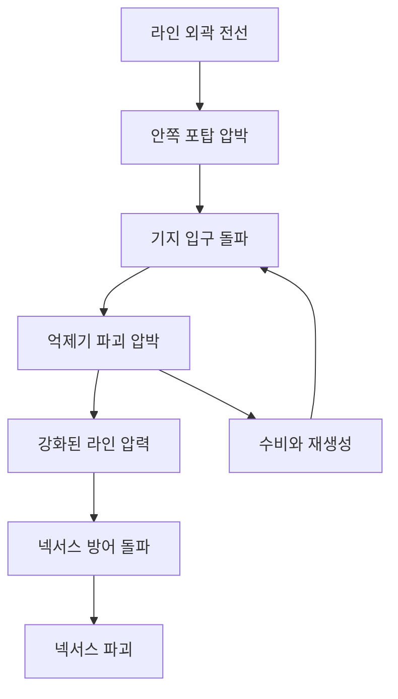

# 10. 라인·미니언·포탑·억제기와 공성 진행

[문서 목록](00_README.md) · [경제](05_economy_experience.md) · [맵](08_map_terrain_navigation.md) · [팀 운영](12_team_macro_strategy.md)

## 1. 범위와 근거 수준

- 대상은 PC 소환사의 협곡이다. 조사일은 2026-11-13이다.
- **[공식]**은 인용 자료의 규칙 또는 변경, **[분석]**은 플레이 선택의 해석, **[제안]**은 재현용 명세다.
- 2026에 바뀐 포탑 방패·미니언 주기·어그로 규칙을 과거 시즌과 섞지 않는다.
- 수치가 필요하면 `ruleset_id`를 먼저 고정한다. 본 문서는 26.22의 모든 상수표를 복원하지 않았다.

## 2. 시스템의 목적

**[공식]** 적 넥서스에 접근하려면 라인의 방어 구조물을 돌파해야 하며, 미니언과 함께 포탑을 공격하는 것이 기본 진행이다. [W-L01]

**[분석]** 미니언은 네 역할을 동시에 수행한다.

| 역할 | 설계 효과 |
| --- | --- |
| 반복 자원 | 상대와 계속 같은 장소에서 만나게 만듦 |
| 자동 이동 전력 | 플레이어가 없어도 전선이 움직임 |
| 공성 지원 | 구조물을 공격할 시간과 조건을 제공 |
| 정보 전달 | 라인의 현재 압박과 상대 등장 위치를 보여줌 |

포탑은 단순 체력벽이 아니다. 위험 지역의 경계이면서 반복 자원을 회수할 수 있는 안전 거점이고, 파괴되면 다음 지역의 시야와 이동을 바꾸는 지도 단계다.

## 3. 라인 진행의 논리

**[분석]** 각 라인의 진행은 외곽 방어, 안쪽 방어, 기지 입구, 억제기 압박, 넥서스 방어 돌파로 이해할 수 있다. 단, 아래 상태도는 정확한 원본 취약성 코드가 아니라 진행 의존성을 설명하는 **[제안]**이다.



일부 방어 구조물이 회복하거나 재생성되므로 진행도를 오직 일방향 정수로만 저장하면 안 된다. 파괴 이벤트, 현재 생존 여부, 해당 단계의 보상 지급 이력을 따로 다루어야 한다.

## 4. 미니언 파동의 역할 분화

다음 표는 **[분석]**이다. 종류별 수량·등장 주기·보상값은 패치 데이터로 분리한다.

| 유형 | 웨이브 안에서 읽을 정보 | 운영상의 의미 |
| --- | --- | --- |
| 근접 미니언 | 앞에서 받는 피해와 생존 수 | 충돌 위치와 웨이브 유지시간 |
| 원거리 미니언 | 뒤에서 지속하는 피해 | 작은 수 차이도 장기 파동에 영향 |
| 공성 미니언 | 상대적으로 오래 남는 공성 압력 | 귀환·포탑 공격 시간대의 기준 |
| 슈퍼 미니언 | 억제기 상태와 연동한 강한 압력 | 수비 인원과 다른 지역 시간 확보 |

미니언 하나를 제거한 즉시 골드만 계산하지 않고, **누가 더 오래 살아남아 다음 웨이브와 합쳐지는가**까지 보아야 한다.

## 5. 웨이브 상태는 위치와 수량의 조합

**[분석]** “라인을 밀고 있다”는 말에는 서로 다른 상태가 섞일 수 있다.

- 아군 미니언 수가 많아 자연스럽게 전진할 상태.
- 플레이어가 빠르게 공격해 현재 적 웨이브를 지우는 행동.
- 이미 적 포탑 아래에 도달한 파동.
- 가까운 다음 웨이브 때문에 곧 반대 방향으로 밀릴 상태.

**[제안]** 리플레이 분석용 웨이브 상태는 다음처럼 분리한다.

```yaml
WaveObservation:
  lane_id: top_or_mid_or_bot
  clash_position: region_or_position
  allied_units_by_type: {}
  enemy_units_by_type: {}
  relative_health: aggregate_state
  next_allied_arrival: estimated_time
  next_enemy_arrival: estimated_time
  turret_interaction: none_or_crashing_or_clearing
  confidence: based_on_visible_information
```

이 상태로 자연 진행을 추정할 수 있지만, 상대가 웨이브를 공격하거나 끌어가면 즉시 갱신해야 한다.

## 6. 프리징: 위치를 자원 통제에 사용

**[분석]** 프리징의 목표는 웨이브를 아군에게 상대적으로 안전한 위치에 유지하면서 상대가 자원을 회수하려면 전진하도록 만드는 것이다.

### 실행 논리

1. 현재 파동과 다음 파동의 도착을 확인한다.
2. 적 미니언을 전부 즉시 지우지 않고 필요한 생존량을 남긴다.
3. 아군 포탑이 파동을 정리해 버리는 위치로 들어가지 않도록 조절한다.
4. 상대가 자원을 얻으러 접근하면 견제·교전·정글 개입의 위협을 건다.
5. 상대가 로밍했거나 다음 목표물에 먼저 가야 한다면 프리징 유지 여부를 재평가한다.

몇 마리를 남기면 무조건 프리징된다는 고정 숫자는 제시하지 않는다. 미니언 체력, 도착 거리, 주변 챔피언 피해, 패치별 주기 때문에 같은 수량도 다른 결과를 만든다.

### 비용

프리징을 유지하는 동안 다른 지역에 먼저 합류하기 어려울 수 있다. 상대의 자원을 제한하는 이득과 팀이 다른 곳에서 감수하는 위험을 함께 평가해야 한다.

## 7. 슬로우 푸시: 미래의 행동 시간을 축적

**[분석]** 슬로우 푸시는 작은 전력 차이를 유지해 여러 파동을 큰 압력으로 합치는 선택이다.

- 큰 파동이 도착하면 수비자는 많은 자원을 지키려 머물 유인이 생긴다.
- 공격자는 그 시간에 귀환·시야 설치·목표물 이동을 선택할 수 있다.
- 파동이 너무 일찍 정리되면 예상한 행동 시간이 사라진다.
- 상대가 파동을 자신의 안전한 위치에 멈추면 오히려 아군의 장기 손실이 될 수 있다.

슬로우 푸시의 성공을 “큰 웨이브를 만들었는가”만으로 평가하지 않는다. 그 웨이브가 도착하는 시점에 팀이 무엇을 했는지가 핵심이다.

## 8. 패스트 푸시·충돌·반등

**[분석]** 빠르게 미는 행동은 당장의 상대 미니언을 제거해 우선 행동권을 얻는 데 적합하다.

| 행동 | 의도 | 실패 조건 |
| --- | --- | --- |
| 패스트 푸시 | 먼저 귀환·합류 | 마나를 소진했는데 웨이브를 끝내지 못함 |
| 포탑에 충돌시키기 | 상대에게 정리 시간을 요구 | 다음 적 파동에 가로막힘 |
| 충돌 후 이탈 | 구매·정찰·로밍 | 상대의 즉시 추격을 무시 |
| 반등하는 파동 받기 | 복귀 후 안전한 자원 회수 | 부재가 길어 새 파동까지 잃음 |

### 사례: 이긴 교환을 귀환 이득으로 바꾸기

상대의 체력을 낮췄더라도 웨이브를 애매하게 남겨두고 귀환하면 상대가 이를 고정할 수 있다. 반대로 파동을 충분히 밀어 넣고 떠나면 상대는 자신을 추격할지 자원을 회수할지 선택해야 한다. 전투의 이득이 웨이브 상태를 통해 경제 이득으로 바뀌는 것이다.

## 9. 미니언 어그로와 견제의 비용

**[공식·26.10 변경]** 챔피언이 적 미니언을 공격했다는 이유로 적 미니언의 우선순위 목록에 들어가던 동작이 제거되었다. 예전 어그로 설명을 그대로 현재 규칙으로 사용하지 않는다. [W-L03]

**[분석]** 미니언의 공격 대상 변화는 챔피언 간 견제의 실제 손익을 바꾼다. 상대에게 입힌 피해만 보고 좋은 교환이라 판단하면 미니언에게 받는 피해, 위치 이탈, 다음 막타 손실을 빠뜨릴 수 있다.

**[제안]** 어그로 명세는 다음을 능력 유형별로 검증한다.

- 챔피언 공격이 도움 요청을 발생시키는 조건.
- 일반 공격·대상 지정 능력·방향성 능력의 차이.
- 이미 포탑을 공격 중인 상태의 예외.
- 유효 목표를 잃었을 때의 재탐색 시점.
- 동일 우선순위 목표 사이의 전환 기준.
- 시야 상실과 수풀 진입이 현재 목표에 미치는 영향.

이 목록을 단일한 “가장 가까운 적 공격”으로 축약하면 라인전 동작과 학습 가능한 견제 규칙이 달라진다.

## 10. 포탑: 안전 거점과 공격 위험

**[분석]** 포탑은 가까이 있다는 이유만으로 완전한 안전을 주지 않는다. 다이브 가능한 체력, 미니언 상태, 공격자 수, 탈출 능력에 따라 억제력이 달라진다.

### 공성의 기본 질문

1. 적을 밀어낼 전력이 있는가?
2. 포탑 앞에 미니언이 유지되는가?
3. 상대가 우회해 들어올 경로를 확인했는가?
4. 구조물에 몇 번의 공격을 할 시간을 얻는가?
5. 그 공격 뒤 안전하게 빠져나올 수 있는가?

### 다이브의 기본 질문

- 누가 먼저 포탑의 위험을 감수할 것인가?
- 수비자의 이동·무적·제어 능력이 남아 있는가?
- 공격을 중단해야 하는 시점은 언제인가?
- 한 명을 처치하더라도 아군 둘이 죽으면 다음 파동과 목표물 손실은 얼마인가?

포탑 표적 전환과 피해 누적의 실제 규칙은 별도로 검증해야 한다. 본 문서는 특정 챔피언의 타깃 초기화 예외를 보편 규칙으로 일반화하지 않는다.

## 11. 2026 공성 구조의 변화

**[공식·2026 사전 안내]** 개발 프리뷰는 라인 포탑 방패의 상시화와 안쪽 포탑으로의 확대, 중후반 미니언 파동 간격 단축, 넥서스 포탑 재생성 체력 축소를 설명했다. 현재 정확한 상수는 후속 패치와 함께 확인해야 한다. [W-L02]

**[공식·같은 프리뷰]** 수정 과잉성장(Crystalline Overgrowth)은 시간이 지나 포탑에 축적된 상태를 공격해 추가 피해로 전환하는 장치로 소개되었다. [W-L02]

**[분석]** 이 구조에서 포탑 공격은 완전 파괴에 성공해야만 가치 있는 행동이 되지 않는다. 짧은 공성에도 진척·보상을 주면, 목표물 주변에 전원이 집결하는 행동과 라인을 미는 행동 사이의 경쟁이 생긴다.

### 역설계 시 분리해야 할 규칙

| 규칙 | 이유 |
| --- | --- |
| 현재 포탑 체력 | 남은 파괴 노력 표시 |
| 구간별 보상 지급 이력 | 회복·재생성으로 같은 보상을 중복 획득하지 않게 함 |
| 시간 기반 방어력 변화 | 같은 체력도 시점별 위험이 달라질 수 있음 |
| 수정 성장량과 활성 조건 | 단순 공격력 증가와 다른 시간 기반 기회 제공 |
| 미니언 부재 보호 | 단독 침투와 정규 공성의 관계 유지 |
| 근접·원거리 공격 차이 | 접근 위험을 다르게 보상하는 규칙 가능 |

위 표는 데이터 책임의 분리 **[제안]**이다. 모든 항목의 현재 수치를 확정하는 표가 아니다.

## 12. 억제기와 지속 압박

**[분석]** 억제기 파괴의 가치는 즉시 수입보다 이후 파동이 상대의 행동을 제한하는 데 있다.

- 수비 인원이 해당 라인에 남으면 다른 목표물에서 숫자 차이를 만들 수 있다.
- 수비자가 강화 미니언을 빠르게 정리하면 기대한 압박이 작을 수 있다.
- 억제기 압박이 아직 목표물과 연결되지 않으면 상대에게 안전한 기지 자원 회수 시간을 줄 수도 있다.
- 여러 라인의 파동 도착을 맞추면 수비자의 선택이 더 어려워진다.

따라서 억제기 파괴는 무조건 즉시 경기 종료로 연결되는 버튼이 아니라, 일정 시간 동안 공간과 인원을 재배치하는 효과로 분석해야 한다.

## 13. 넥서스 포탑 재생성과 수비의 회복

**[공식·2025 도입]** 넥서스 포탑 재생성은 노출된 넥서스 때문에 끝없이 기지를 지켜야 하는 상황을 줄이려는 장치로 설명되었다. 당시 완전한 체력 복구 설명을 2026 현행 수치로 재사용하지 않는다. [W-L04]

**[분석]** 재생성은 수비 팀이 버틴 시간을 지도 행동 가능성으로 바꾼다. 공격 팀은 파괴 이후의 제한된 종료 기회를 활용해야 하고, 수비 팀은 그 시간을 견딘 뒤 다시 목표물에 참여할 수 있다.

## 14. 재구성 상태 모델

```yaml
# [제안] 문서 작성자가 정의한 예시. Riot 원본 포맷 아님.
LaneRules:
  wave_schedule: versioned_schedule
  composition_rules: versioned_composition
  super_minion_policy: inhibitor_state_rule

StructureState:
  structure_id: unique_id
  lane_id: optional_lane
  stage: outer_inner_inhibitor_or_nexus
  health: current_value
  targetable: derived_from_dependency_rules
  reward_segments_claimed: []
  temporary_defense_states: []
  growth_state: optional_crystalline_state
  destroyed_at: optional_time
  respawn_at: optional_time
```

건물 파괴, 보상 지급, 다음 건물 취약화, 미니언 생성 변화는 같은 원인 사건을 공유하게 한다. 서로 다른 업데이트 주기에서 어긋나면 공격 불가능한 건물이 공격되거나 보상이 두 번 지급될 수 있다.

## 15. 검증 시나리오

| ID | 조건 | 확인할 결과 |
| --- | --- | --- |
| LANE-01 | 파동 주기가 바뀌는 시각 | 중복·누락 없는 생성 일정 유지 |
| LANE-02 | 억제기 재생성 직전 파동 생성 | 해당 시점의 규칙으로 구성 확정 |
| LANE-03 | 미니언 공격 대상 소멸 | 유효한 새 목표로 일관되게 전환 |
| LANE-04 | 플레이어가 미니언을 때림 | 선택한 패치의 어그로 규칙 적용 |
| LANE-05 | 포탑 보상 경계를 한 번에 여러 개 넘음 | 각 보상 한 번만 지급 |
| LANE-06 | 보호 중인 구조물에 지속효과가 남음 | 취약성 변경과 피해 규칙이 충돌하지 않음 |
| LANE-07 | 수정 성장 활성 직전 공성 | 활성·억제·소비 시점의 정의대로 처리 |
| LANE-08 | 넥서스 포탑 재생성 | 체력·표적·보상·미니맵 상태 모두 복원 |
| LANE-09 | 양측 구조물이 거의 동시에 파괴 | 경기 종료 우선순위를 서버가 단일 확정 |
| LANE-10 | 관전 시간 이동·재접속 | 이미 받은 보상과 현재 구조물 상태 일치 |

## 16. 출처와 확인 한계

모든 출처 열람일은 2026-11-13이다.

- **[W-L01]** Riot Games, [League of Legends How to Play](https://www.leagueoflegends.com/en-us/how-to-play/). 근거: 방어 구조물과 미니언을 통한 기본 진행.
- **[W-L02]** Riot Games, [/dev: 2026 Season One Gameplay Preview](https://www.leagueoflegends.com/en-gb/news/dev/dev-2026-season-one-gameplay-preview/). 근거: 공성·파동·수정 과잉성장의 소개. 프리뷰 수치를 최종 현행값으로 사용하지 않음.
- **[W-L03]** Riot Games, [League of Legends Patch 26.10 Notes](https://www.leagueoflegends.com/en-us/news/game-updates/league-of-legends-patch-26-10-notes/), 2026-05-12. 근거: 미니언 공격 시 어그로 우선순위 변경.
- **[W-L04]** Riot Games, [/dev: 2025 Season One Gameplay Preview](https://www.leagueoflegends.com/en-gb/news/dev/dev-2025-season-one-gameplay-preview/). 근거: 넥서스 포탑 재생성 도입 의도. 역사적 규칙 자료.

**미확인:** 26.22의 포탑·미니언 전체 능력치, 보상표, 미니언 어그로 전체 우선순위, 모든 스킬의 구조물 상호작용. 프리징 사례의 숫자는 실제 측정 없이 고정하지 않았다.
