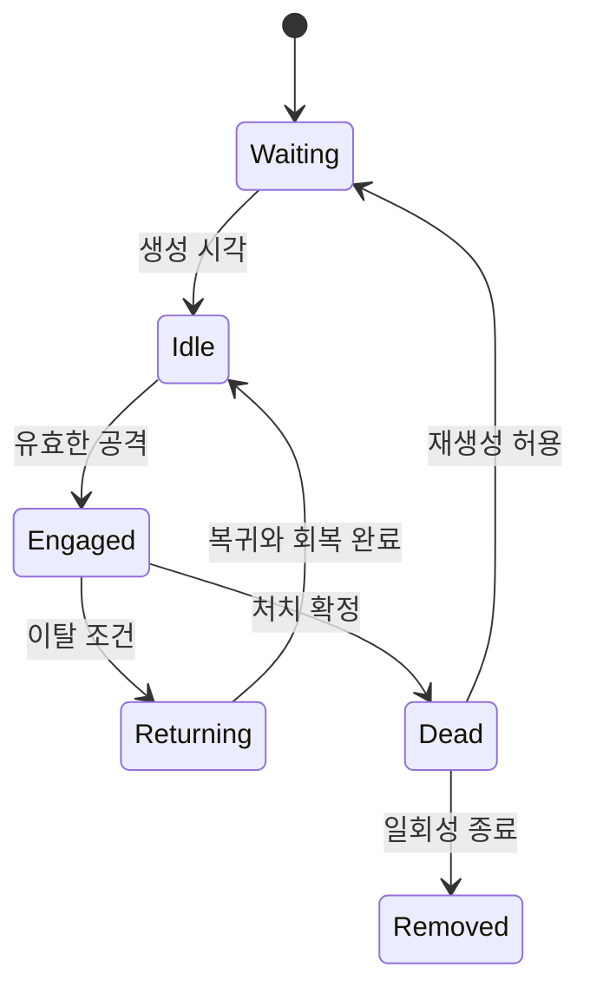

# 11. 정글·중립 몬스터·에픽 목표물

[문서 목록](00_README.md) · [경제](05_economy_experience.md) · [시야](09_vision_fog_information.md) · [팀 운영](12_team_macro_strategy.md)

## 1. 대상과 버전 경계

- PC의 일반적인 소환사의 협곡 5대5를 분석한다. **신속 대전(Swiftplay)의 목표물 규칙은 별도**다.
- 조사일: 2026-11-13. 확인한 최신 공식 패치노트는 26.22지만, 모든 몬스터 수치를 최종 패치로 합성한 데이터는 아니다.
- **[공식]**은 명시된 공개 자료, **[분석]**은 플레이 선택의 해석, **[제안]**은 재구성용 명세다.
- 과거 도입값은 규칙의 계보를 설명한다. 후속 패치 검증 없이 현재 확정값이라고 사용하지 않는다.

## 2. 시스템의 목적

**[분석]** 정글은 라인처럼 정해진 맞상대를 계속 만나는 장소가 아니다. 어떤 자원부터 회수하고 어느 라인에 모습을 보일지 선택함으로써, **경로 자체가 플레이어의 전략**이 된다.

에픽 목표물은 모든 팀원이 매번 모여야 하는 체크리스트로 읽기보다, 분산된 자원과 위치를 집단 이익으로 바꿀 수 있는 기회로 읽어야 한다. 목표물을 시작하면 상대에게 개입하거나 반대편을 차지할 시간이 생긴다.

| 설계 기능 | 정글 플레이에 생기는 결정 |
| --- | --- |
| 반복 자원 | 캠프 회수를 계속할지 라인에 개입할지 |
| 숨겨진 이동 | 어디에서 모습을 보이고 어디를 비워둘지 |
| 지역 경쟁 | 상대 캠프 침입과 아군 보호 중 무엇을 할지 |
| 팀 보상 | 누가 시간을 지불하고 누가 보상을 활용할지 |
| 경기 단계 전환 | 라인 압박·한타·공성 중 무엇을 강화할지 |

## 3. 목표물을 보상 성격으로 분류

다음 표의 기능 분류는 **[분석]**이며 정확한 금액·지속시간·피해량을 대신하지 않는다.

| 대상군 | 주된 보상 성격 | 이후 필요한 행동 |
| --- | --- | --- |
| 일반 캠프 | 개인 성장과 경로 유지 | 다음 캠프·갱킹·귀환 연결 |
| 버프 캠프 | 성장과 특정 전투·자원 기능 | 유효한 캐릭터가 버프를 활용 |
| 강가의 경쟁 자원 | 성장·정보·강가 접근 | 주변 라인의 이동권과 연결 |
| 공허 유충 | 구조물 공격 지원의 누적 효과 | 라인을 실제로 밀고 구조물을 공격 |
| 협곡의 전령 | 선택한 장소의 공성 진척 | 소환 시점과 웨이브를 맞춤 |
| 원소 드래곤 | 팀의 누적 성장과 영혼 목표 | 다음 드래곤의 선택 가치 계산 |
| 내셔 남작 | 제한 시간의 공성 강화 | 귀환·재배치·미니언과 전진 |
| 장로 드래곤 | 제한 시간의 큰 교전 압력 | 상대가 회피하기 어려운 전투·종료 기회 만들기 |

**[공식]** 공식 초보 안내는 내셔 남작의 보상이 주변 아군 미니언 강화와 연결된다고 설명한다. [W-J01]

## 4. 2025~2026 규칙 계보

실제 재현 프로젝트에서는 아래의 문서별 변경을 합성한 뒤 사용할 규칙 버전을 고정해야 한다.

| 공식 자료 | 확인한 변경 또는 도입 | 사용 범위 |
| --- | --- | --- |
| 25.09 | 공허 유충 첫 등장 8분·재생성 제거, 전령 15분 등장 | 당시 명시된 생성 규칙 [W-J02] |
| 26.1 | 아타칸·피의 장미·무력행사 제거, 내셔 남작 첫 등장 20분 | 일반 협곡의 시즌 전환 [W-J03] |
| 26.11 | 유충 보상과 소환되는 공허 진드기 강화 | 26.1 수치만으로 끝낼 수 없는 후속 변경 [W-J04] |
| 9.23 | 먼저 원소 드래곤 네 마리를 처치한 팀의 영혼, 이후 장로로 이어지는 구조 | 드래곤 계보의 역사적 근거 [W-J05] |
| 14.3 | 첫 장로 생성 간격의 오류 수정 | 타이머도 버그 수정으로 달라질 수 있는 사례 [W-J06] |

**주의:** 신속 대전 섹션의 유충·전령 제거 또는 더 빠른 내셔 남작 규칙을 위 표에 섞지 않는다. 같은 패치노트에 여러 모드가 함께 실려 있어 검색 발췌만 읽으면 오인하기 쉽다.

## 5. 캠프 경로의 기본 구조

**[분석]** 좋은 정글 경로는 캠프를 가장 빨리 잡는 순서와 항상 같지 않다.

1. 출발 전에 다음에 영향력을 줄 라인과 상대 정글의 가능 경로를 생각한다.
2. 첫 캠프와 주변 경로에서 체력·스킬 자원을 관리한다.
3. 라인 상태를 갱신하면서 전부 회수할지 조기 개입할지 선택한다.
4. 모습을 보인 뒤 상대가 반대편 자원을 가져갈 가능성을 계산한다.
5. 귀환 구매와 캠프 재생성의 순서를 맞춘다.
6. 다음 중요한 목표물의 준비 지역에서 경로를 끝낼 수 있도록 조정한다.

같은 챔피언이라도 아군 라인이 먼저 움직일 수 있는지, 상대가 침입에 강한지, 소환사 주문이 빠졌는지에 따라 적절한 경로는 달라진다.

## 6. 파밍과 갱킹의 교환

| 선택 | 즉시 얻는 것 | 실패 또는 지연 비용 |
| --- | --- | --- |
| 캠프 회수 | 비교적 예측 가능한 성장 | 라인에서 발생하는 기회 상실 |
| 갱킹 | 처치·주문 소비·라인 압박 | 이동시간·보인 위치·반대편 캠프 |
| 역갱 대기 | 아군 보호와 상대 공격 처벌 | 적이 오지 않으면 빈 대기시간 |
| 침입 | 상대 자원 박탈과 경로 정보 | 적 라인의 먼저 합류하는 위험 |
| 목표물 시도 | 팀 보상과 단계 진척 | 체력·시간·진입로 통제 부담 |

**[분석]** 갱킹이 킬을 만들지 못했더라도 아군이 위험한 웨이브를 정리하고 귀환할 시간을 얻었다면 가치가 있다. 반대로 킬을 얻었어도 반대편 여러 자원과 목표물을 잃으면 팀 전체로는 손해일 수 있다.

## 7. 캠프 전투의 조건과 이탈

**[제안]** 몬스터 AI를 재현할 때 필요한 상태를 다음처럼 나눈다. 실제 Riot의 AI 클래스 이름은 아니다.



다음 항목은 캠프별로 명시해야 한다.

- 이동 가능한 영역과 원위치 복귀 조건.
- 여러 공격자 중 목표를 선택·전환하는 규칙.
- 적 팀끼리 공격권이 바뀌었을 때 체력·위협 상태의 유지.
- 한 캠프에서 일부 몬스터만 처치했을 때 재생성 조건.
- 위치·대상이 비정상 상태가 되었을 때의 복구.
- 레벨·게임 시간·평균 성장 중 어떤 입력으로 능력치를 결정하는지.

전투 도중 줄어드는 인내나 복귀 규칙의 구체 수치는 실측·패치 근거 없이 임의로 LoL의 공식값이라고 표기하지 않는다.

## 8. 목표물 통제는 처치 속도보다 먼저 시작

**[분석]** 목표물 확보 여부는 공격을 시작하기 전에 상당 부분 결정된다.

### 준비 단계

1. 인접 라인의 파동을 정리해 먼저 이동할 시간을 만든다.
2. 체력·마나·아이템·중요 스킬·강타 상태를 확인한다.
3. 적의 가장 위협적인 진입 경로를 파악한다.
4. 아군이 들어오는 길과 빠져나오는 길에 필요한 시야를 확보한다.
5. 적이 보이지 않을 때 추정 위치와 도착 가능 시간을 비교한다.
6. 목표물 공격, 적 차단, 시야 확보에 필요한 인원을 나눈다.

목표물 내부에 다섯 명이 있는 상태가 항상 최선은 아니다. 좁은 곳에 모여 상대 범위 공격의 기회를 주거나, 접근하는 적을 차단할 사람이 없어질 수 있기 때문이다.

## 9. 시작·전환·중단의 세 선택

| 행동 | 합리적인 조건 | 흔한 실패 |
| --- | --- | --- |
| 계속 처치 | 적 개입 전 끝낼 수 있음 | 상대 도착을 무시하고 체력을 낮춤 |
| 적에게 전환 | 상대가 불리한 진입 위치에 있음 | 팀 일부만 전환해 피해가 분산 |
| 중단·철수 | 자원·시야·숫자가 부족해짐 | 이미 쓴 시간 때문에 무리하게 지속 |

**[분석]** 목표물을 시작했다는 사실은 끝까지 처치해야 한다는 계약이 아니다. 상대를 좁은 입구로 불러내거나, 반대편의 압박이 완성될 때까지 주의를 끄는 행동일 수 있다.

## 10. 강타와 최종 확보

**[분석]** 마지막 순간의 강타는 중요한 확정 수단이지만, 모든 목표물 실패를 마지막 입력 문제로 해석하면 앞선 통제 실패를 놓친다.

- 적 정글이 자유롭게 목표물에 접근했다면 시야·진입 차단 문제일 수 있다.
- 팀의 폭발 피해와 강타 시점이 맞지 않으면 상대에게 개입 창을 줄 수 있다.
- 아군 강타 사용자의 군중 제어·사망·사거리 이탈을 고려하지 않으면 계획이 무너진다.
- 상대의 특수 처치 능력이 있다면 일반 강타 경쟁과 같은 체력 관리가 적합하지 않을 수 있다.

강타의 전략적 역할과 사전 설정은 [소환사 주문](07_runes_summoner_spells.md)에 연결한다. 현재 성장 단계별 정확한 피해량, 몬스터마다 다른 피해 면역·감소·피해원 예외는 별도 검증이 필요하다.

## 11. 공허 목표물의 공성 연결

**[분석]** 유충과 전령의 이익은 상대 건물의 체력을 줄이는 다음 행동으로 전환되어야 한다.

### 유충 보상을 얻은 팀

구조물에 접근할 수 있는 라인을 만들지 못하면 공성 보상의 실효 가치는 줄어든다. 따라서 이후 사이드 라인 압박, 웨이브 관리, 짧은 포탑 공격 기회와 연결해서 평가한다.

### 전령을 확보한 팀

소환 위치를 고르는 행위 자체가 자원 배분이다. 이미 파괴 직전인 포탑에 쓰는 것과, 팀의 이동 범위를 크게 넓히는 포탑에 쓰는 것은 다른 이익을 만든다. 적의 정리 능력과 아군 파동 도착을 고려하지 않으면 기대한 진척을 얻지 못할 수 있다.

## 12. 드래곤: 현재 이익과 미래 강제력

**[분석]** 첫 드래곤의 가치는 즉시 버프뿐 아니라 이후 상대가 무시하기 어려운 누적 목표를 만드는 데 있다. 그러나 매번 드래곤을 위해 전체 자원을 포기해야 한다는 뜻은 아니다.

| 팀 상태 | 고려할 선택 |
| --- | --- |
| 주변 라인이 먼저 움직일 수 있음 | 안전한 획득 또는 상대 진입 압박 |
| 라인 자원을 크게 잃을 위험 | 반대편 포탑·캠프 교환 |
| 상대가 영혼 획득에 가까움 | 다음 전투의 준비 우선순위를 높임 |
| 당장 싸우기 약하지만 이후 강함 | 시간을 벌고 불리한 교전을 피할 방법 검토 |
| 상대가 긴 처치 시간을 쓰는 중 | 다른 지역에서 확정 이익을 만들기 |

영혼의 원소별 수치와 장로의 구체 처형 조건은 현재 패치의 데이터 문제다. 본 문서는 특정 원소를 언제나 최상이라고 순위를 고정하지 않는다.

## 13. 내셔 남작: 획득 이후가 두 번째 문제

**[분석]** 내셔 남작을 처치한 직후의 선택은 다음 공성 기회의 크기를 결정한다.

1. 팀의 체력과 미사용 골드를 확인한다.
2. 즉시 싸울지, 귀환해 구매하고 여러 라인으로 배치할지 판단한다.
3. 각 라인의 파동이 포탑에 도착하는 시점을 맞춘다.
4. 상대의 정리 담당을 강제로 나누거나 한쪽에 집중시킨다.
5. 버프 보유자가 불필요하게 고립되지 않도록 한다.
6. 버프가 끝나기 전에 얻을 수 있는 구조물 진척을 계산한다.

버프 획득만을 성공 지표로 잡으면 처치 후 무리한 교전으로 모두 잃는 문제를 놓친다. 버프 기간 중 구조물·파동·영역 변화가 실제 산출물이다.

## 14. 장로와 종료 압력

**[공식·설계 역사]** 9.23 설명은 장로의 처형 효과를 후반 교전 보상으로 강화하는 의도를 명시했다. 정확한 현행 피해와 지속시간의 근거로 사용하지 않는다. [W-J05]

**[분석]** 큰 교전 버프는 상대에게 싸움을 피할 이유를 만든다. 따라서 획득 팀은 단순 추격보다 구조물·파동·넥서스 압박을 이용해 상대가 대응해야 하는 상황을 만드는 것이 중요하다.

## 15. 재구성 데이터와 이벤트 계약

```yaml
# [제안] 원본 구현과 무관한 분석용 구조
ObjectiveDefinition:
  objective_id: unique_kind
  ruleset_id: pinned_patch
  spawn_schedule: condition_or_time
  respawn_policy: none_or_delay_or_dependency
  combat_profile: versioned_profile
  reward_profile: versioned_profile
  replacement_policy: optional_next_objective

ObjectiveClaim:
  claim_id: unique_event
  objective_instance_id: unique_instance
  killer_entity: entity_id
  credited_team: team_id
  claim_time: authoritative_time
  reward_recipients: rule_derived_list
  buff_expiry_policy: explicit_rule
```

처치 판정과 팀 보상, 몬스터 제거, 다음 생성 일정은 하나의 확정 사건에서 파생한다. 처치 직전에 공격자가 사망하거나 동시에 여러 피해가 도달해도 결과가 두 팀에 중복 적용되지 않아야 한다.

## 16. 검증 시나리오

| ID | 조건 | 확인할 결과 |
| --- | --- | --- |
| JGL-01 | 캠프 일부만 제거 | 명시한 재생성 정책과 일치 |
| JGL-02 | 캠프를 범위 밖으로 유도 | 복귀·회복·목표 선택이 일관됨 |
| JGL-03 | 두 팀이 거의 동시에 마지막 피해 | 단일 처치·단일 보상 귀속 |
| JGL-04 | 처치와 챔피언 사망 동시 발생 | 버프 수령 조건을 일관되게 적용 |
| JGL-05 | 일회성 목표물이 다음 단계로 교체 | 전 단계가 중복 재생성되지 않음 |
| JGL-06 | 목표물 처치 후 접속 복구 | 팀 누적 보상과 남은 버프 복원 |
| JGL-07 | 연습 도구에서 시간을 변경 | 레벨·생성 상태·재생성 타이머가 서로 일치 |
| JGL-08 | 신속 대전과 일반 협곡 전환 | 모드별 일정·영혼 조건·버프 정책 분리 |
| JGL-09 | 시야 없이 목표물 상태 조회 | 해당 큐의 공개 정보 정책을 준수 |
| JGL-10 | 보상 이벤트 재처리 | 팀 누적 효과·골드·통계 중복 없음 |

## 17. 출처와 확인 한계

모든 출처 열람일은 2026-11-13이다.

- **[W-J01]** Riot Games, [League of Legends How to Play](https://www.leagueoflegends.com/en-us/how-to-play/). 근거: 내셔 남작과 미니언 강화의 연결.
- **[W-J02]** Riot Games, [Patch 25.09 Notes](https://www.leagueoflegends.com/en-us/news/game-updates/patch-25-09-notes/). 근거: 유충·전령의 생성 변경 계보.
- **[W-J03]** Riot Games, [Patch 26.1 Notes](https://www.leagueoflegends.com/en-us/news/game-updates/patch-26-1-notes/). 근거: 일반 협곡 시즌 기능 제거 및 남작 등장 변경.
- **[W-J04]** Riot Games, [League of Legends Patch 26.11 Notes](https://www.leagueoflegends.com/en-us/news/game-updates/league-of-legends-patch-26-11-notes/). 근거: 유충 보상 후속 변경.
- **[W-J05]** Riot Games, [Patch 9.23 Notes](https://www.leagueoflegends.com/en-us/news/game-updates/patch-9-23-notes/). 근거: 영혼·장로의 장기적인 설계 계보. 과거의 능력치표는 현재값으로 사용하지 않음.
- **[W-J06]** Riot Games, [Patch 14.3 Notes](https://www.leagueoflegends.com/en-us/news/game-updates/patch-14-3-notes/). 근거: 첫 장로 생성 타이머 버그 수정 사례.

**미확인:** 26.22 전체 몬스터 상수, 보상 수령 반경, 모든 캠프의 세부 인내 규칙, 최신 후속 패치를 합성한 타이머 전수표. 공식 공개 범위를 넘는 구현은 제안으로만 남긴다.
