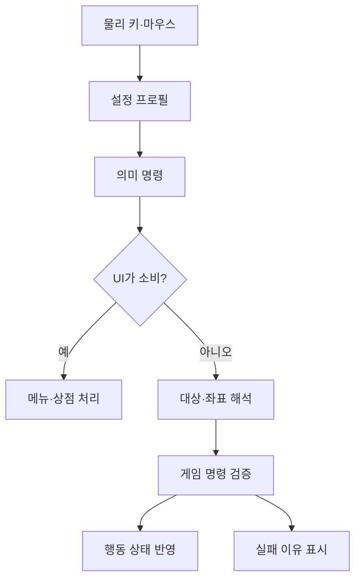

# 13. 조작·이동·카메라·대상 선택 역기획

[문서 목록](00_README.md)

> 범위: PC 소환사의 협곡 5대5. 조사일: 2026-11-13. 확인 최신 공식 노트: 26.22. 전통적인 Point & Click과 공식 WASD 입력을 함께 다룬다.
> **[공식]** 확인한 제품 동작, **[분석]** 설계 해석, **[제안]** 재현 구조, **[확인 필요]** 빌드·개별 스킬·설정에 따른 차이.

## 1. 입력 시스템의 역할

[분석] 입력 시스템은 플레이어가 의도한 이동·공격·스킬·카메라 행동을 실제 게임 명령으로 번역한다. 정확히 같은 챔피언 능력치라도 잘못된 대상 선택, 이동 중 공격 취소, 화면 밖 상황의 오판 때문에 전투 결과가 달라진다. 입력을 단순 키 목록으로만 기록하면 이 게임의 조작 난이도를 설명하기 어렵다.

| 플레이어 의도 | 실제로 필요한 해석 |
|---|---|
| 저곳으로 이동 | 화면 좌표→월드 위치→갈 수 있는 경로 |
| 저 적 공격 | 대상 식별→선택 정책→거리 확인 |
| 이 방향으로 스킬 | 현재 스킬의 조준 방식과 시전 설정 |
| 공격하면서 도망 | 공격 시간과 이동 시간의 배분 |
| 다른 라인 확인 | 카메라 이동과 챔피언 이동의 분리 |
| 위험해서 중지 | 현재 행동의 취소 가능 시점과 중지 범위 |

## 2. 2026의 입력 방식

[공식] 기본 입력은 Point & Click이며 WASD를 선택할 수 있다. 공식 지원 FAQ는 두 입력의 키 설정을 별도로 보존하고 경기 시작 후 10분 안에 사용할 방식을 정하도록 안내한다. [IN01]

[공식·이력] Riot는 WASD의 랭크 적용을 26.9로 발표했고, 챔피언별 키 설정을 두 입력 방식에 제공한다고 설명했다. [IN02]

[분석] 따라서 현재 PC판을 역기획하면서 ‘이동은 반드시 마우스 우클릭’ 또는 ‘WASD는 아직 연습용 실험 기능’으로 고정하면 범위가 맞지 않는다. 동시에 WASD의 존재가 기존 입력의 제거를 뜻하지도 않는다. 동일한 전장 규칙 아래 서로 다른 입력 해석이 공존하는 구조다.

### 2.1 최소 비교

| 항목 | Point & Click | WASD |
|---|---|---|
| 이동 의도 | 목표 지점을 선택 | 방향을 지속 입력 |
| 커서의 주 역할 | 이동 위치와 공격·조준을 번갈아 지정 | 공격·조준·상호작용 중심 |
| 경로 문제 | 먼 목적지까지 우회 경로 | 벽 근처 즉시 방향 처리 |
| 손의 반복 작업 | 이동과 공격 클릭의 교차 | 방향키 유지와 행동키 조합 |
| 카메라와의 결합 | 화면 가장자리·직접 이동 | 별도 카메라 보조와 조합 |
| 설정 저장 | 입력 방식별 프로필 | 입력 방식별 프로필 |

비교 표의 목적은 어느 방식이 더 강하다고 판정하는 것이 아니다. 두 방식에서 오류가 발생하는 위치와 학습 과제가 다르다는 점을 정리한다.

## 3. 키 바인딩은 슬롯 의미와 분리한다

[공식] 기본 안내의 전통적인 능력 슬롯은 Q/W/E/R이며 소환사 주문은 D/F다. WASD FAQ의 기본 능력 입력은 다른 키 배치를 사용한다. [IN03][IN01]

| 의미 | Point & Click의 대표 기본값 | WASD FAQ의 기본값 |
|---|---|---|
| 일반 능력 1 | Q | 마우스 오른쪽 버튼 |
| 일반 능력 2 | W | Shift |
| 일반 능력 3 | E | E |
| 궁극기 | R | R |
| 소환사 주문 1 | D | Q |
| 소환사 주문 2 | F | F |

이 표는 문서에 제시된 기본값이며 사용자의 실제 설정은 달라질 수 있다. ‘Q 스킬’이라는 관용적 이름을 실제 물리 키 코드로 저장하지 않고 `ability_slot_1` 같은 의미 식별자로 표현하는 것이 안전하다.

[공식] 일반 키 설정 FAQ는 게임 안과 클라이언트 설정에서 키를 조정하는 경로를 설명한다. 다만 일반 FAQ의 일부 키 제한 설명은 새로운 WASD 안내와 차이가 있으므로 이 문서에서 모든 키의 허용 여부를 하나의 표로 확정하지 않는다. [IN04]

## 4. Point & Click의 명령 구조

### 4.1 지점 이동

[분석] 지점 클릭은 ‘현재 방향으로 잠깐 걷기’보다 ‘저 위치에 도달하라’는 지속 목표에 가깝다. 목표 지점으로 직접 갈 수 없으면 경로를 우회한다. 다시 클릭하면 이전 목표를 바꾸므로 플레이어는 계속 명령을 갱신해 회피·거리 조절을 수행한다.

| 입력 상황 | 해석에서 필요한 것 | 실패 위험 |
|---|---|---|
| 빈 지면 클릭 | 월드 위치 선택 | UI를 뚫고 이동 명령 발생 |
| 적 유닛 클릭 | 공격 요청 또는 문맥 행동 | 작은 유닛 오클릭 |
| 벽 너머 클릭 | 접근 가능한 경로 | 예상보다 긴 우회 |
| 미니맵 클릭 | 맵 위치 변환 | 카메라 클릭과 이동 클릭 혼동 |
| 시야 밖 클릭 | 마지막 정보와 지형 | 보이지 않는 적 추격 오판 |

### 4.2 공격 이동과 직접 공격

[분석] 직접 공격은 특정 대상의 식별자를 고른다. 공격 이동은 이동과 주변 공격 대상 선택을 결합한 의도다. 주변에서 무엇을 우선할지, 커서 근처를 볼지, 챔피언과 가장 가까운 대상을 볼지는 설정·명령 종류에 따라 구분해야 한다.

**[확인 필요]** ‘챔피언만 대상 지정’ 설정을 켜면 공격 이동의 자동 선택에서도 미니언을 항상 제외한다고 가정하지 않는다. 직접 클릭, 공격 이동, 자동 기본 공격, 스킬의 대상 필터는 서로 다른 행동 경로다.

### 4.3 중지와 유지

[분석] 이동을 중지하는 명령, 현재 공격을 취소하는 명령, 제자리에서 이후 자동 행동을 허용하는 상태는 같지 않을 수 있다. 현재 시전이 취소 가능한지와 새로운 명령을 받을 수 있는지를 따로 보아야 한다. 취소 정책은 [스킬 문서](04_abilities_status_effects.md)의 실행 단계와 연결된다.

## 5. WASD의 방향 입력과 경로 처리

[공식] WASD 개발 글은 지점 이동이 미리 경로를 계획하는 것과 달리 방향 입력은 벽을 직접 향하는 상황을 자주 만든다고 설명한다. 또한 화면 밖 챔피언의 벽 우회 동작을 별도로 조정한 사례를 공개했다. [IN02]

[분석] 두 입력을 지원할 때 이동 속도를 같게 맞추는 것만으로 체감이 같아지지 않는다. 벽에 비스듬히 접근했을 때 미끄러지는지, 정면 벽 앞에 멈추는지, 좁은 틈을 통과하는지에 따라 회피와 동선이 달라진다.

| 지형 상황 | 필요한 판단 |
|---|---|
| 곡선 벽에 비스듬히 진입 | 접선 방향 이동과 정지의 경계 |
| 좁은 입구 | 실제 통과 가능 폭과 입력 방향 |
| 날카로운 모서리 | 작은 방향 변화로 탈출 가능한가 |
| 화면 밖 장거리 이동 | 사용자가 정체를 인식할 수 있는가 |
| 동적 지형 생성 | 현재 방향을 새 지형에 맞게 재평가하는가 |
| 다른 유닛과 밀집 | 충돌 회피가 의도치 않은 이동을 만드는가 |

### 5.1 지도 방향에 맞춘 입력 회전

[공식] 공식 안내에는 지도 방향에 맞춰 WASD 방향을 회전하는 옵션이 있다. [IN01]

[분석] 이 옵션은 소환사의 협곡 공격로가 화면에 대각선으로 놓인 점과 연결된다. 대각 이동을 위해 두 키를 오래 누르는 부담을 줄일 수 있지만, 사용자가 기억하는 화면 방향과 입력 방향을 바꾼다. 설정 변경은 단순 키 교체가 아니라 방향 변환 규칙의 변경이다.

### 5.2 공격 취소의 차이

[공식] WASD 개발 글은 WASD에서 시작된 공격을 취소할 수 없다는 차이와 스킬 뒤 자동 공격 연결을 챔피언별로 조정한 사례를 설명한다. [IN02]

[분석] 따라서 기존 입력의 ‘발사 직전 이동으로 공격을 취소할 수 있다’는 동작을 모든 입력에 공통 적용하면 안 된다. 전투의 기본 공격 상태는 공유하더라도 각 입력이 어떤 단계에서 이동을 요청할 수 있는지 별도 정책이 필요하다. 기존 숙련자의 근육 기억과 신규 입력의 조작 안정성을 함께 고려하는 부분이다.

## 6. 조준·일반 시전·빠른 시전

[분석] 다음은 조준 경험을 분해한 문법이다. 특정 스킬이 항상 같은 입력 방식을 따르는지는 현재 설정에서 확인한다.

| 방식 | 플레이어 흐름 | 장점 | 오류 위험 |
|---|---|---|---|
| 일반 시전 | 스킬 선택→조준 표시→확정 | 사거리·형태를 확인하기 쉬움 | 확정 입력이 하나 더 필요 |
| 빠른 시전 | 입력 순간 커서 방향·대상 사용 | 빠른 반복 입력 | 커서 오차를 즉시 실행 |
| 표시와 함께 빠른 시전 | 누르는 동안 확인→해제 등으로 확정 | 예측과 속도 절충 | 해제·다른 키 입력 정책 혼동 |
| 자기 자신 시전 | 자신을 명시 대상 | 급한 보호·회복 | 대상 없는 스킬과 충돌 |
| 재사용 | 이전 사용 문맥을 이어감 | 복합 스킬 단축 | 재사용 창 만료 시 다른 동작 |

[제안] 조준 UI와 서버 승인 시점을 구분한다. 클라이언트에서 사거리 표시가 보이는 것과 실제 시전이 승인된 것은 별개다. 자원 부족·침묵·시야 상실로 요청이 거절되었을 때 작은 음향·아이콘 피드백이 있어야 ‘키가 먹지 않았다’는 경험을 줄일 수 있다.

## 7. 카메라와 챔피언은 별도 상태다

[분석] 카메라를 다른 라인으로 이동해도 챔피언이 그 위치로 이동하지는 않는다. 이 분리는 동시에 여러 곳의 상황을 관찰하게 하지만, 자신의 이동 상태를 놓칠 위험도 만든다. 위치 고정, 자유 이동, 순간 재중심, 아군 위치 확인 등은 정보 수집과 조작 부담 사이의 선택이다.

| 카메라 기능 | 얻는 것 | 잃을 수 있는 것 |
|---|---|---|
| 챔피언 중심 유지 | 자기 위치를 쉽게 추적 | 먼 방향의 정보량 |
| 자유 이동 | 넓은 상황 파악 | 자기 캐릭터의 즉시 위치 확인 |
| 아군 위치 빠른 확인 | 교전 참여 가능성 판단 | 현재 라인 조작 집중 |
| 미니맵 이동 | 장거리 정보 탐색 | 잘못된 화면·월드 좌표 클릭 |
| 동적 카메라 | 진행 방향의 공간 확보 | 사용자에게 낯선 화면 이동 |

[공식] WASD FAQ는 최초 활성화 시 동적 카메라와 Scout Ahead 설정을 사용하고 이를 조정할 수 있다고 설명한다. [IN01]

[분석] 카메라를 옮기는 기능은 시야 규칙을 바꾸지 않는다. 보이지 않는 적의 실제 위치를 보여 주는 것과 이미 공개된 지역을 멀리서 보는 것은 다르다. [시야 문서](09_vision_fog_information.md)의 정보 권한을 모든 카메라 방식에 동일하게 적용해야 한다.

## 8. 대상 선택과 공간 표현

### 8.1 시각적 크기와 판정 크기

[분석] 캐릭터 모델의 장식이나 이펙트가 크다고 클릭 판정·공격 범위·충돌 반경이 같은 비율로 커지는 것은 아니다. 구현에서는 렌더링 경계, 선택 판정, 이동 충돌, 스킬 피격 판정을 분리해 정의해야 한다. 이 문서는 Riot의 실제 충돌 자료구조나 반경 수치를 공개 자료 없이 특정하지 않는다.

### 8.2 밀집 상황

큰 챔피언 옆의 작은 챔피언, 미니언 속의 챔피언, 구조물 앞의 유닛을 클릭하는 경우에는 우선순위와 선택 보조가 체감 공정성을 결정한다. 모델의 높이·카메라 각도·지형의 시각적 오차 때문에 화면에서 보이는 점과 실제 월드 위치가 달라 보일 수도 있다.

[제안] 선택 시스템은 최소한 다음 필터를 구분한다.

```text
SelectionPolicy [제안]
  relation: ally | enemy | neutral
  entity_types: champion | minion | monster | structure | interactable
  visibility_requirement
  targetable_requirement
  cursor_proximity_policy
  explicit_target_priority
  fallback_policy
```

## 9. 한 번의 입력에서 실행까지

다음 구조는 **[제안]**이며 실제 Riot의 입력 패킷·시뮬레이션 구조를 뜻하지 않는다.



| 경계 | 요구 사항 |
|---|---|
| 채팅 입력 중 게임키 | 텍스트 입력과 스킬 입력을 충돌시키지 않음 |
| 상점 클릭과 이동 클릭 | UI 위에서 발생한 클릭을 중복 처리하지 않음 |
| 키 유지와 키 누름 | 토글·반복·한 번 사용을 구분 |
| 설정 변경과 현재 입력 | 누른 키가 영구 유지된 것으로 남지 않음 |
| 카메라 이동 중 좌표 선택 | 화면 좌표를 올바른 시점의 카메라로 변환 |
| 네트워크 재전송 | 이미 처리한 시전이 중복 실행되지 않음 |

## 10. 입력 버퍼와 반응성

[분석] 제어가 끝나기 직전에 누른 스킬이 끝난 즉시 나오는지, 너무 이른 입력은 사라지는지에 따라 체감 반응성이 달라진다. 하지만 과도한 버퍼는 사용자가 이미 취소하고 싶은 행동을 나중에 실행할 수 있다. 어떤 명령을 얼마 동안 유지하며 새 명령이 이전 명령을 대체하는지 명시해야 한다.

[확인 필요] 실제 LoL의 전역 버퍼 시간·서버 틱 주기·예측 보정 값을 이 문서에서 확정하지 않는다. 공개 동작을 재현할 경우 스킬·입력 방식·상태별 실험으로 확인해야 한다.

**[제안: 비교 실험]** 동일한 제어 종료 시점에 대해 -150ms, -50ms, +0ms, +50ms에 명령을 넣어 실행 여부와 실제 발동 시각을 비교한다. 이 값들은 실험 샘플 간격이지 LoL의 알려진 내부 버퍼 수치가 아니다.

## 11. 재현용 설정·명령 모델

```text
InputProfile [제안]
  input_scheme
  global_bindings
  champion_overrides
  cast_modes_by_slot
  target_selection_options
  camera_preferences
  version

PlayerIntent [제안]
  command_sequence
  semantic_action
  world_position?
  target_entity_id?
  direction?
  ability_slot?
  input_scheme
  local_time

ResolvedAction [제안]
  command_sequence
  accepted
  failure_reason?
  authoritative_action_id?
  action_start_time?
```

[분석] 프로필에는 키 바인딩과 카메라 취향을 저장하고, 경기 판정 데이터에는 필요한 의미 명령만 전달하는 모델이 구분하기 쉽다. 서버가 클라이언트의 ‘피해를 주었다’는 결과를 신뢰하기보다 ‘이 행동을 요청한다’는 의도를 검증하는 설계는 경쟁 게임 재현의 기본 요구다. 실제 패킷 형식이나 상용 서버 구현은 [네트워크 문서](20_network_data_architecture.md)의 확인 범위와 함께 읽는다.

## 12. 접근성과 공정성

[분석] 접근성은 단순히 조작을 쉽게 만드는 것보다 동일한 의도를 수행할 수 있는 입력 수단을 넓히는 문제다. 필수 행동에 키가 없거나 손이 불편한 사용자가 동시에 눌러야 할 키가 너무 많으면 참여 자체가 어려워진다. 반면 한 입력 방식만 특정 스킬의 시간을 줄이거나 숨은 대상을 자동 선택한다면 전투 규칙의 차이가 된다.

| 확인 축 | 예시 |
|---|---|
| 동등한 결과 | 동일한 위치·대상 요청의 유효 범위 |
| 조작 부담 | 동시에 누르는 키 수, 반복 클릭 빈도 |
| 학습 가능성 | 입력 실패의 이유를 이해할 수 있는가 |
| 가독성 | 선택 대상·시전 범위·카메라 이동 표시 |
| 설정 회복 | 잘못된 키 설정을 되돌릴 수 있는가 |
| 경쟁적 예외 | 특정 챔피언·상태에서 한쪽만 유리한가 |

입력 방식별 전체 승률만으로 충분하지 않다. 사용자의 숙련도, 전환한 지 얼마나 되었는지, 챔피언과 포지션, 랭크 구간을 나누어 보아야 한다. 동일 사용자의 전환 전후도 학습과 챔피언 변화가 섞일 수 있다.

## 13. 검증 시나리오

다음은 **[제안]**이며 이번 조사에서 수행한 실험 결과가 아니다.

| ID | 상황 | 검증 목표 |
|---|---|---|
| IN-T01 | 같은 목적지를 두 입력으로 이동 | 도달 가능성과 속도 규칙 일치 |
| IN-T02 | 곡면·모서리·좁은 틈에 방향 입력 | 벽 미끄러짐·정지의 일관성 |
| IN-T03 | 화면 밖에서 장거리 이동 | 의도치 않은 정체를 구분 |
| IN-T04 | 공격 준비 중 이동 요청 | 입력별 취소 정책 일치 |
| IN-T05 | 스킬 뒤 자동 공격 | 챔피언별 후속 정책 검증 |
| IN-T06 | 챔피언만 대상·공격 이동 조합 | 직접 지정과 자동 선택 차이 확인 |
| IN-T07 | 미니언·챔피언·구조물이 겹침 | 대상 우선순위와 선택 보조 |
| IN-T08 | 키를 누른 채 입력 방식 변경 | 고정된 이동·중복 입력 방지 |
| IN-T09 | 10분 경계에서 방식 변경 | 안내된 입력 잠금과 실제 동작 일치 |
| IN-T10 | 챔피언별 설정을 바꾼 뒤 다른 챔피언 사용 | 전역 설정과 개별 덮어쓰기 분리 |
| IN-T11 | 채팅·상점·설정창 사용 중 키 입력 | UI와 게임 동시 동작 방지 |
| IN-T12 | 지연·손실 후 명령 재전송 | 중복 시전과 명령 순서 오류 방지 |
| IN-T13 | 스킨·모델 크기·해상도 변경 | 선택 판정과 시각적 안내 일관성 |
| IN-T14 | 카메라를 적 기지로 이동 | 시야 권한이 늘어나지 않음 |

## 14. 다른 문서와 출처

- [전투](03_combat_stats_damage.md): 공격 시간 구조와 실효 피해.
- [스킬](04_abilities_status_effects.md): 조준·재사용·취소·행동 제한.
- [맵·경로](08_map_terrain_navigation.md): 지형과 도달 가능성.
- [시야](09_vision_fog_information.md): 카메라와 정보 접근 권한.
- [UI·리플레이](14_ui_feedback_replays.md): 화면 피드백과 관찰 도구.
- [네트워크·데이터](20_network_data_architecture.md): 입력 의도와 권위 판정의 경계.

접근일: 2026-11-13.

| ID | 공식 자료 | 확인 범위 |
|---|---|---|
| IN01 | [Keyboard (WASD) Input FAQ](https://support.riotgames.com/en-us/league-of-legends/gameplay/league-of-legends-keyboard-wasd-input-faq) | 기본 입력, WASD 키, 10분 잠금, 입력별 설정, 카메라·방향 옵션 |
| IN02 | [/dev: WASD’s Ranked Release](https://www.leagueoflegends.com/en-us/news/dev/dev-wasds-ranked-release/) | 랭크 적용 이력, 챔피언별 키, 벽 경로 처리, 공격 취소·후속 공격 차이 |
| IN03 | [How to Play](https://www.leagueoflegends.com/en-us/how-to-play/) | 전통 입력의 스킬·주문 슬롯 설명 |
| IN04 | [Hotkeys (Keybindings) FAQ](https://support.riotgames.com/en-us/league-of-legends/performance/hotkeys-keybindings-faq) | 키 설정 경로; 일부 키 제한은 새 WASD 안내와 별도 확인 |

현재 공식 안내는 입력 선택을 설명하지만 모든 챔피언의 이동·입력 예외를 완전히 열거하지 않는다. 재현 프로젝트에서는 위 검증표를 실제 챔피언·스킬·설정별 행렬로 확장해야 한다.
