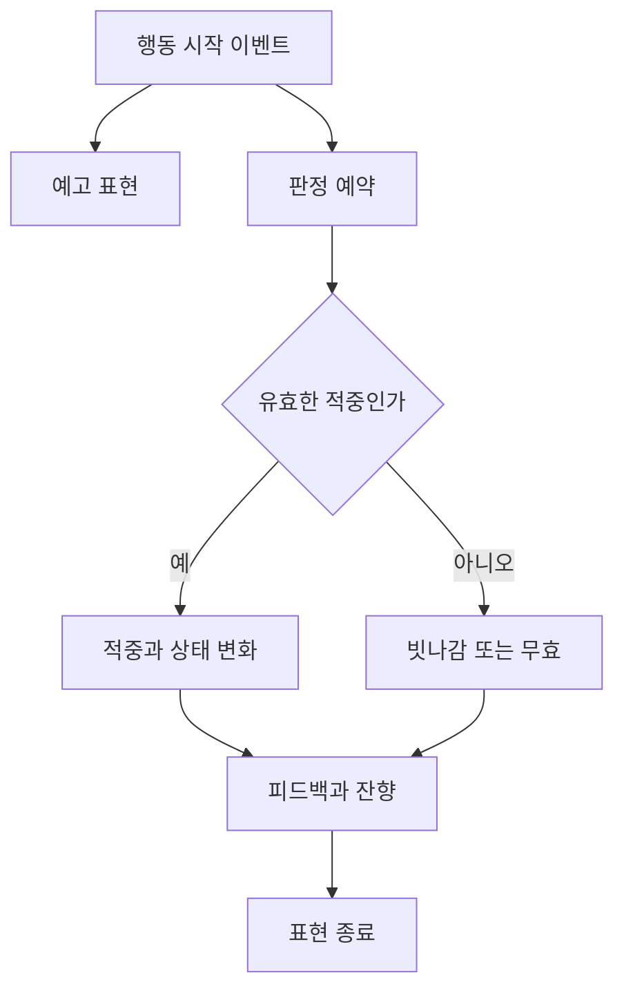
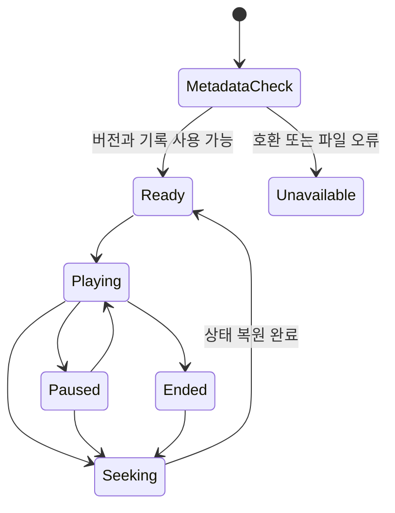

# 14. UI·전투 피드백·관전·리플레이

[문서 목록](00_README.md) · [입력 시스템](13_controls_movement_targeting.md) · [시야 시스템](09_vision_fog_information.md)

## 1. 범위와 근거

- 대상: 경기 HUD, 팀 정보 전달, 전투 가독성, 결과 화면, 관전과 리플레이.
- 기준일: 2026-11-13. 공개 안내와 개발 글을 분석했으며 모든 화면의 현재 배치를 직접 캡처한 UI 명세는 아니다.
- [공식] 표기 외의 화면 구성표·데이터 계약·검증 기준은 역기획상의 [분석] 또는 [제안]이다.
- 픽셀 좌표, 현재 버튼 문구, 색상 RGB, 지역별 번역은 확정하지 않는다.

## 2. UI의 핵심 문제 [분석]

LoL형 게임은 한 화면 안에서 서로 다른 시간 범위의 판단을 요구한다. 가까운 적 스킬에는 즉시 반응해야 하고, 미니맵에서는 다음 이동을 정해야 하며, 상점에서는 몇 번의 귀환 뒤 빌드까지 생각해야 한다.

UI의 목적은 모든 정보를 한꺼번에 보여주는 것이 아니라 **지금 결정에 필요한 정보에 먼저 도달하게 하는 것**이다. 같은 이벤트를 화면 중앙·미니맵·음향·로그에 반복해서 표시하더라도 각각의 목적과 정보량은 달라야 한다.

## 3. 정보의 층 [분석]

| 층 | 질문 | 대표 정보 | 표시 원칙 |
| --- | --- | --- | --- |
| 즉시 행동 | 지금 움직이거나 피해야 하는가 | 위험 범위, 투사체, 제어 상태 | 전장 가까이에 표시 |
| 개인 상태 | 지금 무엇을 할 수 있는가 | 체력, 자원, 스킬, 아이템 | 짧고 반복적인 시선 이동 |
| 팀 전술 | 누구와 어디서 움직일 것인가 | 아군 상태, 핑, 미니맵 | 행동을 중단하지 않아도 파악 |
| 전략 판단 | 무엇을 준비해야 하는가 | 성장 비교, 목표, 구조물 | 비교 가능한 표와 시간 정보 |
| 회고 | 왜 결과가 이렇게 되었는가 | 사망 정보, 결과 통계, 리플레이 | 원인과 시점에 접근 가능 |

정보량을 줄이는 것과 정보를 숨기는 것은 다르다. 기본 화면에는 핵심을 두고, 상세 열람에는 판단 근거를 남기는 방식이 적합하다.

## 4. 주요 화면의 책임 [분석·재구성]

| 화면 | 해결할 과제 | 입력 | 결과 |
| --- | --- | --- | --- |
| 경기 HUD | 생존과 즉시 행동 | 시선 확인, 스킬·아이템 입력 | 현재 상태와 가능 행동 |
| 미니맵 | 위치와 공간 판단 | 이동 명령, 핑, 카메라 확인 | 관측 가능한 맵 요약 |
| 점수판 | 상대와 아군의 진행 비교 | 열기·닫기, 상태 확인 | 공개된 비교 정보 |
| 상점 | 골드를 전투력으로 전환 | 검색·구매·판매·구매 계획 | 인벤토리와 골드 변경 |
| 사망 관련 화면 | 죽은 원인과 다음 행동 판단 | 내역 확인, 맵 관찰 | 반성·부활 준비 |
| 종료 화면 | 결과 확인과 다음 선택 | 통계·명예·신고·재진입 | 계정 진행과 피드백 |
| 리플레이 | 특정 상황의 원인 재검토 | 시점·속도·시야·카메라 변경 | 기록된 경기의 재생 |

실제 노출 항목은 모드와 업데이트에 따라 달라질 수 있다. 상대의 비공개 상태를 위 표 때문에 추가로 표시해서는 안 된다.

## 5. 전투 가독성의 공개 원칙

[공식] Riot은 가독성을 상황을 이해하고 대응할 수 있는 능력으로 설명하며, 주요 행동의 전달, 중요도에 따른 시청각 위계, 불필요한 노이즈 감소를 원칙으로 제시했다.[U01]

[분석] 이를 역기획에 적용하면 화려함은 독립된 목적이 아니다. 효과가 실제 위협보다 크게 보이면 플레이어는 잘못 피하고, 실제 위협보다 작게 보이면 반응할 기회를 잃는다.

### 5.1 전투 표현 검토표 [제안]

| 요소 | 알아야 하는 것 | 가독성을 해치는 사례 |
| --- | --- | --- |
| 챔피언 외형 | 누구이며 어느 방향을 향하는가 | 스킨으로 핵심 식별 형태가 사라짐 |
| 투사체 | 이동 방향과 도달 시점 | 머리·꼬리 구분이 어려움 |
| 범위 스킬 | 위험 구역과 적용 시점 | 장식이 판정 경계보다 강함 |
| 군중 제어 | 이동·공격·시전 중 무엇이 막혔는가 | 상태 설명이 모호함 |
| 무적·대상 불가 | 공격이 유효한가 | 체력바가 남아 있는데 이유 없이 무효 |
| 보호막·회복 | 남은 생존 여유가 얼마나 바뀌었는가 | 피해와 회복 숫자가 서로 가림 |
| 주요 목표 | 어떤 팀이 획득했는가 | 장식성 알림이 전장을 오래 가림 |

### 5.2 예고·판정·잔향을 분리하기 [제안]



예고 영역과 실제 피해 영역은 의도에 따라 다를 수 있으나 플레이어가 구분할 수 있어야 한다. 잔향 효과가 남아 있다고 계속 피해를 주는 것으로 오해하게 해서는 안 된다.

## 6. HUD 상태 규칙 [제안]

스킬 슬롯은 단순한 준비·대기 두 상태만으로 충분하지 않다. 자원 부족, 대상 없음, 군중 제어, 특정 조건 미충족, 재시전 가능 상태를 구별해야 한다.

| 상태 | 플레이어에게 전달할 것 | 잘못된 표현 |
| --- | --- | --- |
| 사용 가능 | 현재 입력이 유효할 가능성 | 비활성 색으로 표시 |
| 재사용 대기 | 다시 사용할 시점 | 자원 부족과 같은 아이콘 |
| 자원 부족 | 무엇이 얼마나 모자라는지 | 아무 반응 없이 입력 폐기 |
| 제어로 사용 불가 | 일시적으로 막힌 이유 | 대기시간이 시작된 것처럼 표시 |
| 대상·거리 조건 미충족 | 재시도할 수 있는 조건 | 성공 효과를 먼저 표시 |
| 재시전 단계 | 다음 입력의 역할과 만료 | 최초 시전 설명만 유지 |

실패 사유가 매 입력마다 화면을 덮으면 더 큰 혼란이 생긴다. 반복 입력에는 같은 사유를 묶어 표시하고, 상황이 바뀌었을 때 다시 갱신하는 것이 적절하다.

## 7. 미니맵과 정보 권한 [분석·제안]

미니맵은 월드를 축소한 그림이 아니라 관측 가능한 정보를 선별한 인터페이스다. 아군 정보, 현재 보이는 적, 마지막으로 관측한 정보, 시스템이 공개하는 정보는 서로 다른 종류다.

각 정보에는 위치뿐 아니라 **누가, 언제, 어떤 권한으로 알게 되었는가**가 필요하다. 미니맵에서 사라진 적의 마지막 좌표를 현재 좌표처럼 표시하면 UI가 잘못된 확신을 준다.

| 데이터 | 표시 조건 | 만료·변경 처리 |
| --- | --- | --- |
| 현재 아군 위치 | 팀 관측 권한 | 연결·사망 상태 별도 표기 |
| 현재 관측한 적 | 유효한 시야 또는 공개 효과 | 관측 상실 정책 적용 |
| 마지막 관측 단서 | 별도 허용 정책 | 현재 정보와 시각적으로 구분 |
| 아군 핑 | 수신 권한과 음소거 상태 | 수명 종료 후 삭제 |
| 중립 목표 상태 | 공개·관측 규칙 충족 | 관측되지 않은 상세 상태는 숨김 |

이 표는 구현 계약이다. 원작이 모든 종류의 마지막 관측 정보를 UI에 제공한다는 뜻이 아니다.

## 8. 핑과 비언어 커뮤니케이션

[공식] Smart Ping은 방사형 선택과 지도·미니맵 표시를 이용한 팀 전달 수단이다. 공식 안내는 위치 표시와 함께 음향 피드백을 제공한다고 설명한다.[U02]

[분석] 핑은 문장 대신 **의도와 위치**를 짧게 결합한다. 특히 이동 중이나 전투 직전에 채팅을 입력하는 비용을 줄여 준다. 그러나 의도만 있고 시점이나 조건이 없으므로 팀원이 같은 의미로 해석하리라는 보장은 없다.

### 전달 흐름 [제안]

1. 입력 위치와 의도 종류를 선택한다.
2. 사용 가능 여부와 반복 제한을 검사한다.
3. 팀 수신자와 개인 음소거 정책을 적용한다.
4. 지도·미니맵·음향으로 짧게 전달한다.
5. 기록을 남길 필요가 있는 채널만 제한적으로 유지한다.

반복 제한의 정확한 원작 수치와 현행 핑 종류는 고정 상수로 옮기지 않는다. 커뮤니케이션 정책 변경은 [행동 시스템](16_behavior_integrity_surrender.md)과 함께 갱신해야 한다.

## 9. 사망·결과 화면을 학습으로 연결하기 [분석]

사망 순간에는 피해량만으로 원인을 전부 설명할 수 없다. 시야 없이 진입했는지, 핵심 회피 스킬을 먼저 썼는지, 아군과 거리가 멀었는지까지 봐야 한다.

결과 통계는 플레이어가 어떤 질문을 해볼지 제안해야 한다. 높은 피해량이 항상 올바른 목표 선택을 뜻하지 않으며, 낮은 처치 수가 팀 기여 부족을 뜻하지도 않는다.

| 관측 지표 | 가능한 질문 | 지표만으로 결론 내리면 생기는 오류 |
| --- | --- | --- |
| 챔피언 대상 피해 | 유효한 교전에서 피해를 냈는가 | 회복되는 피해 누적을 과대평가 |
| 골드와 아이템 | 구매와 복귀 시점이 맞았는가 | 미사용 골드와 실제 전투력 혼동 |
| 사망 횟수 | 어떤 목표를 위해 위험을 감수했는가 | 희생과 불필요한 사망을 동일 취급 |
| 시야 관련 기록 | 팀이 실제로 사용할 정보를 제공했는가 | 설치 수만 높이면 좋다고 판단 |
| 목표 획득 | 어떤 사전 준비가 성공했는가 | 마지막 타격자만 공로자로 인식 |

## 10. 관전과 리플레이의 역할

[공식] 지원 안내는 경기 결과·전적에서 리플레이를 열고 `.rofl`을 재생하는 흐름, 패치 변경에 따른 재생 유효성, 별도 동영상 하이라이트를 설명한다.[U03]

[분석] 리플레이는 입력이 끝난 경기의 학습 도구이고, 실시간 관전은 아직 진행 중인 경기의 관찰 도구다. 후자는 정보가 참가자에게 역류할 수 있어 접근 권한과 지연 정책이 특히 중요하다.

| 항목 | 참가자 | 관전자 | 리플레이 사용자 |
| --- | --- | --- | --- |
| 상태 변경 입력 | 자신의 허용 행동 | 경기 행동 변경 불가 | 원본 경기 변경 불가 |
| 시야 범위 | 팀 규칙 적용 | 모드·권한 정책 적용 | 재생 정책에 따른 관점 선택 |
| 시간 제어 | 진행 경기 규칙 | 허용된 지연 범위 | 탐색·배속 등 재생 기능 |
| 주요 목적 | 경기 수행 | 이해·중계 | 복기·장면 기록 |

정확한 관전 지연을 모든 큐의 공통값으로 제시하지 않는다. 대회용 운영 환경과 일반 온라인 관전은 같은 정책이라고 가정할 수 없다.[U04]

### 10.1 재생 상태 모델 [제안]



되감기는 현재 값을 역으로 빼는 작업만으로 구현하기 어렵다. 시야, 파티클, 버프, 투사체, 음향 등 여러 상태의 생성·소멸을 일관되게 복구해야 한다. 이 문장의 구현 방향은 [네트워크·데이터](20_network_data_architecture.md)의 제안과 연결된다.

## 11. 접근성과 개인 설정 [제안]

화면 크기, 색각, 청각, 손의 조작 방식이 다르더라도 핵심 위험을 알아볼 수 있어야 한다. 색 하나만으로 팀·상태·위험을 구분하지 않고 형태, 아이콘, 위치, 명암을 함께 사용한다.

입력 체계의 차이는 UI 안내에도 반영해야 한다. 현재 선택한 입력 모드와 실제 바인딩을 바탕으로 안내 키를 출력하며, 특정 키를 문구에 고정하지 않는다. 현행 이동 입력 선택은 [입력 시스템](13_controls_movement_targeting.md)을 참조한다.

설정 변경 시에는 미니맵·HUD 크기, 카메라, 음량 채널, 시전 방식 등 서로 독립적인 선호를 보존한다. 새 패치에서 항목이 바뀌면 유효한 값은 유지하고 사라진 값만 명시적인 기본 정책으로 이행한다.

## 12. UI 데이터 구조 [제안]

```yaml
presentation_event:
  event_id: unique_id
  simulation_time: server_time
  category: combat_or_information
  subject_entity_id: optional_reference
  audience_policy: team_or_visible_or_public
  priority: gameplay_priority
  lifetime: configured_duration
  payload_ref: presentation_data

ability_view_state:
  slot_id: configured_slot
  availability: ready_or_blocked_or_cooldown
  blocked_reason: optional_reason
  remaining_time: authoritative_remaining
  resource_cost_preview: current_cost
  recast_stage: optional_stage
```

UI는 실제 골드·체력·스킬 상태를 소유하지 않고, 판정 결과를 사용자가 이해할 수 있는 표현으로 변환한다. 로컬 반응을 먼저 보여줄 때에도 확정되지 않은 성공과 확정된 결과를 혼동하지 않도록 한다.

## 13. 예외 처리와 검증

| ID | 시나리오 | 수용 기준 [제안] |
| --- | --- | --- |
| UI-01 | 군중 제어 중 시전 입력 | 현재 불가 사유와 상태가 일치 |
| UI-02 | 전장의 적이 시야에서 사라짐 | 미니맵과 전장에 숨겨야 할 현재 정보가 남지 않음 |
| UI-03 | 다수 광역기가 동시에 겹침 | 핵심 제어·위험 경계를 구분 가능 |
| UI-04 | 키 배치를 변경함 | 툴팁과 안내가 실제 바인딩을 반영 |
| UI-05 | 음소거된 사용자가 연속 핑 | 개인 수신 정책을 우회하지 않음 |
| UI-06 | 리플레이에서 과거 시점으로 이동 | 미래에 생성된 효과와 정보가 남지 않음 |
| UI-07 | 다른 패치의 리플레이 열기 | 지원 여부를 확인하고 명확한 결과 표시 |
| UI-08 | 매우 작거나 큰 화면 배율 | 주요 체력·스킬·위험 정보가 겹치지 않음 |
| UI-09 | 재접속 직후 HUD 갱신 | 현재 상태와 서버 상태 일치 |
| UI-10 | 결과 전달이 재시도됨 | 중복 보상 연출이나 다른 승패 표시 없음 |
| UI-11 | 색각 조건별 동일 장면 비교 | 색 외의 식별 단서 유지 |
| UI-12 | 관전자 입력을 전송함 | 참가자 행동 권한으로 처리되지 않음 |

가독성 검증은 이미지 한 장으로 끝나지 않는다. 배경·스킨·카메라·동시 효과가 바뀌는 실제 속도의 장면과 느린 재생을 함께 사용해야 한다.

## 14. 출처

- [U01] Riot Games, [Clarity in League](https://www.leagueoflegends.com/en-us/news/dev/clarity-in-league/), 2021-03-12. 공개 가독성 원칙의 근거이며 현행 내부 아트 규격 전체는 아님. 열람 2026-11-13.
- [U02] Riot Support, [Smart Ping](https://support.riotgames.com/zh-cn/league-of-legends/gameplay/smart-ping). 핑 선택·지도 전달의 공개 기능. 이번 조사에서 반환된 지역 경로를 유지했다. 열람 2026-11-13.
- [U03] Riot Support, [Replays FAQ & Pro-Tips](https://support.riotgames.com/en-us/league-of-legends/gameplay/replays-faq-pro-tips). 리플레이 진입, 형식, 패치 호환성과 하이라이트 구분. 열람 2026-11-13.
- [U04] Riot Games, [Engineering Esports: The Tech That Powers Worlds](https://www.riotgames.com/en/news/engineering-esports-tech-powers-worlds), 2019년 공개. 당시 대회 환경과 일반 관전의 차이. 2026 현재 구조를 확정하는 자료로 사용하지 않음. 열람 2026-11-13.
