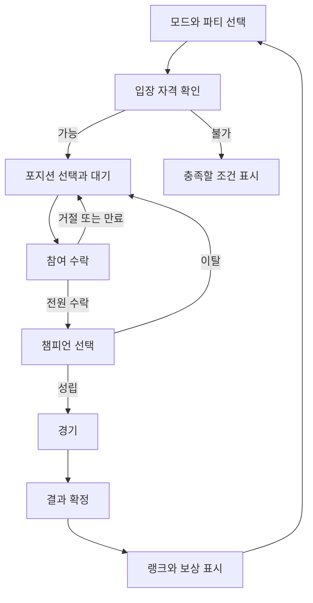

# 15. 매치메이킹·랭크·파티·소셜 역기획

[문서 목록](00_README.md)

> 대상: PC 리그 오브 레전드. 조사일: 2026-11-13. 본편 기준으로 확인한 최신 패치 노트: 26.22.
> `[공식]`은 Riot 공개 문서로 확인한 규칙, `[분석]`은 그 규칙의 설계 해석, `[제안]`은 동작을 재현하기 위한 설계안이다. 내부 MMR 산식과 매칭 가중치는 공개되지 않았다.

## 1. 시스템 목적과 경계

[분석] 매치메이킹은 실력이 비슷한 열 명을 모으는 기능과, 서로 다른 목적을 가진 이용자를 적절한 경기 형식에 배치하는 기능을 함께 수행한다.
랭크는 그 결과를 장기적인 목표로 바꾸고, 파티는 친구 관계를 유지하며 반복 플레이의 진입 비용을 낮춘다.
한 경기의 골드·레벨 성장과 계정의 랭크 성장은 분리되어야 한다. 지난 경기의 아이템을 다음 경기로 가져가는 방식으로 실력을 보정하지 않는다.

| 하위 시스템 | 입력 | 플레이어에게 보이는 출력 | 설계상 책임 |
|---|---|---|---|
| 대기열 | 모드, 파티, 포지션 선택 | 예상 대기·수락 알림 | 플레이 조건을 만족하는 후보 수집 |
| 매칭 | 실력 추정, 포지션 수급, 대기 시간 | 상대와 팀 구성 | 경쟁 품질과 대기 비용 절충 |
| 랭크 | 확정 경기 결과, 시즌 정책 | 티어·단계·LP | 지속적인 성취 표현 |
| 파티 | 초대, 수락, 공개 설정 | 공동 로비, 준비 상태 | 함께 경기할 단위 관리 |
| 소셜 | 친구·차단·채널 상태 | 메시지·음성·알림 | 관계와 의사소통 경로 제공 |

위 표의 책임 분리는 [제안]이며 Riot의 실제 서비스 경계나 데이터베이스 구성은 아니다.

## 2. 공개 확인한 핵심 규칙

| 항목 | 확인한 내용 | 출처 |
|---|---|---|
| MMR | 공개되지 않는 실력 추정값이며 승패가 영향을 준다 | [M15-01] |
| LP | 표시 랭크와 MMR의 관계에 따라 획득·손실량이 달라질 수 있다 | [M15-01] |
| 대기열 구분 | 일반·솔로/듀오·자유 랭크는 서로 다른 MMR을 사용한다 | [M15-01] |
| 매칭 목표 | 경기 공정성, 포지션 선호, 대기 시간의 균형을 추구한다 | [M15-02] |
| 솔로/듀오 | 혼자 또는 두 명으로 참여하는 경쟁 대기열이다 | [M15-03] |
| 자유 랭크 | 1·2·3·5인 파티가 가능하며 4인은 제외한다 | [M15-03] |
| 한국 고티어 | 지원 문서는 KR에서 마스터 이상과 듀오할 수 없다고 별도 명시한다 | [M15-03] |
| 배치 | 각 랭크 대기열에서 배치 5경기를 요구한다고 안내한다 | [M15-04] |
| 파티 음성 | 공개 지원 문서상 사전 구성 파티 내부 음성 기능이다 | [M15-05] |

이 규칙은 문서 열람 시점의 지원 안내다. 고티어 제한·보상·입장 요건을 모든 지역과 시즌에 공통 적용해서는 안 된다.

## 3. 플레이어 흐름



[제안] 수락 여부, 챔피언 선택 성립, 게임 서버 배정, 결과 정산을 서로 다른 상태로 보관한다.
수락 창이 뜬 시점에 이미 경기 결과 레코드를 확정하거나, 로비 이탈을 일반 경기 패배와 같은 이벤트로 저장하면 예외 처리가 복잡해진다.

## 4. 매치메이킹의 제약 모델

### 4.1 반드시 지켜야 하는 조건과 완화 가능한 조건

[제안] 후보를 찾기 전에는 강제 조건을 먼저 검사하고, 이후 품질 조건을 평가한다.

| 조건 | 분류 | 위반 시 처리 |
|---|---|---|
| 같은 경기 규칙·호환 버전 | 강제 | 후보에서 제외 |
| 파티 정원·지역 제한 | 강제 | 대기열 등록 거부 |
| 제재에 의한 이용 제한 | 강제 | 해제 조건 안내 |
| 적정 네트워크 환경 | 정책 조건 | 지역 선택 또는 연결 상태 점검 |
| 양 팀 실력 차이 | 품질 조건 | 허용 범위 내에서 탐색 확대 |
| 주·보조 포지션 충족 | 품질 조건 | 정책에 따라 자동 배정 고려 |
| 파티 규모 대칭 | 품질 조건 | 유사 구성을 우선 |
| 경과 대기 시간 | 품질 조건 | 다른 품질 조건과 교환 |

[분석] 같은 평균 실력만으로 충분하지 않다. 한 팀의 특정 라인이 크게 밀리는 구성은 평균이 같아도 초반 경험을 악화시킬 수 있다.
반대로 모든 포지션을 완벽하게 대칭시키면 이용자가 적은 시간대의 대기가 크게 길어진다.
매칭 품질은 승률 예측 정확도뿐 아니라 역할 불만·수락 취소·챔피언 선택 이탈까지 포함해서 보아야 한다.

### 4.2 재현용 목적함수

다음은 [제안]이며 실제 Riot 계산식이 아니다.

```text
CandidateCost =
    TeamSkillGapCost
  + RoleMismatchCost
  + PremadeAsymmetryCost
  + ConnectionQualityCost
  + WaitingCost

선택 조건:
  모든 강제 조건 통과
  정책 버전이 허용하는 품질 상한 통과
  상한을 넘는 후보는 오래 기다렸다는 이유만으로 즉시 허용하지 않음
```

각 항목은 같은 단위가 아니므로 정규화가 필요하다. 가중치와 허용 상한은 실서비스에서 계측·검증할 대상이다.
문서의 함수명은 설명을 위한 이름이며 LoL 코드의 API 이름이 아니다.

## 5. 포지션 선택과 자동 배정

[공식] 랭크에서는 주·보조 포지션을 선택하거나 채우기를 선택한다. 부족한 포지션과 대기 상황에 따라 자동 배정이 발생할 수 있다. [M15-02]

[분석] 포지션 선택은 개인의 선호를 표현하지만, 역할별 공급 부족은 팀 단위로 해결해야 하는 문제다.
정글을 선호하지 않는 이용자가 정글을 맡으면 라인 대결보다 맵 전체에 영향이 퍼질 수 있어, 동일한 자동 배정 수라도 체감 차이가 생긴다.
따라서 자동 배정을 단순한 벌칙으로 경험하게 두면 회피·이탈이 다시 대기 시간을 늘리는 순환이 생긴다.

### 5.1 자동 배정 보상에서 주의할 버전 차이

[공식] 현재 지원 문서는 Aegis of Valor가 적용되는 자동 배정 경기의 승리 LP 증가를 설명하며, 모든 자동 배정에 보장되는 보너스는 아니라고 안내한다. [M15-02]
[미확인] 초기 개발 예고의 숙련도 조건·패배 LP 보호 문구와 이후 지원 안내를 합쳐 하나의 현행 규칙으로 확정하지 않는다.

재구현 시에는 다음 필드를 정책 데이터로 둔다.

- 보상 대상 대기열과 지역.
- 적용 여부가 결정되는 시점.
- 포지션 교환에 따른 자격 변화.
- 승패별 보상 종류와 중복 적용 제한.
- 리메이크·제재·경기 중단에서의 소모 또는 복원 규칙.

## 6. MMR·LP·표시 랭크의 분리

[분석] MMR은 다음 상대를 고르는 추정값, 표시 랭크는 성취를 전달하는 표현, LP는 그 둘을 연결하는 진행 표시로 이해할 수 있다.
셋을 하나로 합치면 불확실한 신규 계정의 빠른 보정과 기존 이용자의 안정적인 성장 표현을 동시에 다루기 어렵다.

| 상황 | 가능한 해석 | 단정하면 안 되는 것 |
|---|---|---|
| 승리 LP가 손실 LP보다 큼 | 표시 랭크와 실력 추정에 차이가 있을 수 있음 | 매 경기 고정 비율로 오를 것 |
| 연패 뒤 LP 변화가 달라짐 | 결과 누적에 따른 추정 조정 가능 | 특정 패배가 숨은 징벌을 발동했다는 주장 |
| 다른 큐의 랭크가 크게 다름 | 평가 집단과 경험이 다름 | 같은 계정은 항상 같은 MMR일 것 |
| 좋은 KDA로 패배 | 팀 승리로 전환하지 못한 경기 | KDA만으로 LP를 계산한다는 주장 |
| 복귀 후 실력 차이 발생 | 추정의 신뢰도와 현재 실력에 간극 가능 | 비공개 복귀 보정식을 임의로 확정 |

[공식] 일반 티어 내 승급은 LP 경계로 이루어지고, 다이아몬드 이상에는 휴면 강등 정책이 존재한다. [M15-04]
[제안] 배치 진행, 일반 승강급, 최상위 순위 경쟁, 휴면 강등을 각각의 정책으로 분리한다.
이렇게 해야 시즌 리셋으로 표시 랭크를 조정하면서도 게임 결과의 역사와 감사 기록은 유지할 수 있다.

## 7. 파티와 소셜의 역할

[공식] 파티는 열린 로비와 닫힌 로비를 제공하며, 사전 구성 파티 내 음성 소통을 지원한다. [M15-05]
[분석] 파티의 핵심 기능은 초대 그 자체보다 다음 경기를 함께 시작할 수 있는 상태를 유지하는 것이다.
경기 후 한 명이 상점을 보고 다른 사람이 챔피언을 고르는 동안에도 파티는 공통 목적을 보존한다.

| 상호작용 | 기대되는 UX | 실패 방지 제안 |
|---|---|---|
| 친구 초대 | 참여할 큐와 인원을 미리 이해 | 이미 다른 경기에 들어간 초대는 만료 |
| 파티장 변경 | 다음 경기 설정의 책임자가 명확 | 파티장 종료 시 소유권 이전 |
| 큐 변경 | 전원이 새 자격 조건을 확인 | 일부 멤버만 가능한 큐로 몰래 등록 금지 |
| 공개 로비 | 친구 관계를 통한 자연스러운 합류 | 정원·진행 상태를 서버에서 재검증 |
| 음성 사용 | 참여와 음소거 상태가 구분 | 연결 실패를 경기 서버 실패와 혼동하지 않음 |
| 차단 | 원치 않는 상호작용의 경로를 제한 | 차단의 범위와 매칭 효과를 과장하지 않음 |

소셜 차단을 '앞으로 같은 경기에 절대 만나지 않음'으로 표현하면 작은 상위권 집단에서 매칭 조작 수단이 될 수 있다.
이는 [분석]이며 현재 LoL 차단 정책의 모든 내부 효과를 설명한 것은 아니다.

## 8. 데이터와 인터페이스 재구성안

아래 구조는 [제안]이다.

```yaml
QueueTicket:
  ticket_id: opaque_id
  queue_policy_id: ranked_solo_kr_revision
  party_id: optional_party
  member_ids: [player_a, player_b]
  preferences: per_player_role_preferences
  eligibility_snapshot: server_verified
  entered_at: server_time
  state: searching
  policy_version: immutable_revision

RankProgress:
  player_id: player_a
  queue_id: ranked_solo
  season_id: yearly_ranked_period
  placement_progress: completed_count
  visible_rank: tier_division_lp
  last_applied_result_id: match_result_id

MatchResultApplication:
  result_id: globally_unique
  match_id: authoritative_match
  status: pending_or_applied_or_corrected
  adjustments: ordinary_result_and_later_corrections
```

서비스가 실제 MMR을 이 구조 안에 저장한다는 뜻은 아니다. 공개 표시 데이터와 비공개 평가 데이터를 구분해야 한다는 요구사항을 표현한다.
결과 정산은 같은 경기 결과가 두 번 도착해도 한 번만 반영되어야 한다.
후속 보상·제재·오류 수정은 최초 결과를 덮어쓰는 대신 별도 수정 사유를 추적하도록 설계한다.

## 9. 구체적인 플레이 사례

### 사례 A. 실력 차이가 큰 친구 둘

1. 이용자 A는 주로 서포터, B는 처음으로 원거리 딜러를 연습한다.
2. 자유 랭크나 일반 게임에서 함께 플레이하려 한다.
3. 시스템은 계정 최고 티어만으로 입장을 판단하지 않고 선택 큐의 정책을 확인해야 한다.
4. 매칭은 단순 평균 외에도 파티의 협업 이점과 역할별 편차를 고려할 여지가 있다.
5. 결과 화면은 일반 성장과 랭크 변화를 구분해 보여준다.

[분석] 친구와 하는 이유는 개인 승률 최적화와 다를 수 있으므로 모든 큐를 같은 경쟁 강도로 설계할 필요가 없다.

### 사례 B. 수락 뒤 한 명이 접속을 잃음

1. 수락은 완료했지만 챔피언 선택 진입에 실패한다.
2. 다른 아홉 명에게는 취소·재검색 상태를 일관되게 보여줘야 한다.
3. 실패 원인이 서버 장애인지 개별 이탈인지에 따라 제재 정책이 달라질 수 있다.
4. 이탈자가 재접속했다고 기존 매치와 새로운 매치에 동시에 속해서는 안 된다.

## 10. 검증 시나리오

| ID | 조건 | 확인할 결과 |
|---|---|---|
| MM-01 | 자유 랭크 4인 파티 | 입장 차단 이유가 정확히 표시됨 |
| MM-02 | 한국 고티어 듀오 | KR 정책이 글로벌 일반 규칙보다 우선함 |
| MM-03 | 수락 순간 파티원이 탈퇴 | 정원과 수락 상태가 원자적으로 갱신됨 |
| MM-04 | 결과 메시지 중복 수신 | LP가 한 번만 반영됨 |
| MM-05 | 배치 중 경기 종료 | 배치 진행과 표시 LP가 해당 정책을 따름 |
| MM-06 | 자동 배정 후 교환 | 보상 자격을 정책 기준으로 다시 판단함 |
| MM-07 | 시즌 경계에서 경기 종료 | 적용 시즌을 서버 기준으로 일관되게 결정 |
| MM-08 | 표시 랭크 조회 지연 | 경기 결과와 프로필의 임시 불일치를 안내 |
| MM-09 | 파티장 연결 종료 | 로비 전체가 무조건 소멸하지 않도록 처리 |
| MM-10 | 뒤늦은 결과 정정 | 원래 결과와 정정 내역을 추적 가능 |

## 11. 평가 지표와 다른 시스템 연결

[제안] 주요 지표는 매칭 대기 시간의 중앙값·상위 구간, 포지션 충족률, 수락 실패율, 로비 이탈률, 실력 집단별 예측 오차다.
경기 승패가 정확히 반반이라는 하나의 수치만 최적화하면 포지션 불만과 비정상적인 대기 시간을 놓칠 수 있다.
파티 규모·지역·시간대·고티어 여부를 나눠 관찰해야 작은 이용자 집단의 문제를 발견할 수 있다.

- [챔피언·드래프트·역할](02_champions_draft_roles.md): 매칭이 확정한 포지션을 실제 조합으로 전환.
- [행동·공정성·중단](16_behavior_integrity_surrender.md): 닷지·AFK·리메이크·후속 보상 처리.
- [계정 성장·수집](17_account_progression_collection.md): 입장 자격과 지속 보상.
- [모드·연습·사용자 설정](19_modes_practice_custom.md): 큐별 규칙 분기.

## 12. 출처와 남은 확인 항목

모든 출처의 열람일은 2026-11-13이다.

- [M15-01] Riot Support, [MMR, Rank, and LP](https://support.riotgames.com/en-us/league-of-legends/gameplay/mmr-rank-and-lp): MMR 비공개, LP 관계, 큐별 분리.
- [M15-02] Riot Support, [Matchmaking and Autofill](https://support.riotgames.com/en-us/league-of-legends/gameplay/matchmaking-and-autofill/): 세 목표, 선호 포지션, 자동 배정, Aegis 안내.
- [M15-03] Riot Support, [Ranked Tiers, Divisions, and Queues](https://support.riotgames.com/en-us/league-of-legends/gameplay/ranked-tiers-divisions-and-queues): 큐·파티 제한과 KR 예외.
- [M15-04] Riot Support, [Placements, Promotions, Series, Demotions, and Decay](https://support.riotgames.com/en-us/league-of-legends/gameplay/placements-promotions-series-demotions-and-decay): 배치·승강급·휴면 정책.
- [M15-05] Riot Support, [Parties and Voice Chat FAQ](https://support.riotgames.com/en-us/league-of-legends/gameplay/parties-and-voice-chat-faq): 파티 공개 설정과 파티 음성.

[미확인] 정확한 MMR 업데이트 공식, 실력 불확실성 모델, 대기 시간별 탐색 범위, 지역별 실제 서비스 설정은 공개 자료로 재현할 수 없다.
고티어 지원 페이지에는 구형 설명이 섞일 수 있으므로 구체적인 입장 가능 여부는 지역·모드·티어를 고정하고 클라이언트에서도 확인해야 한다.
