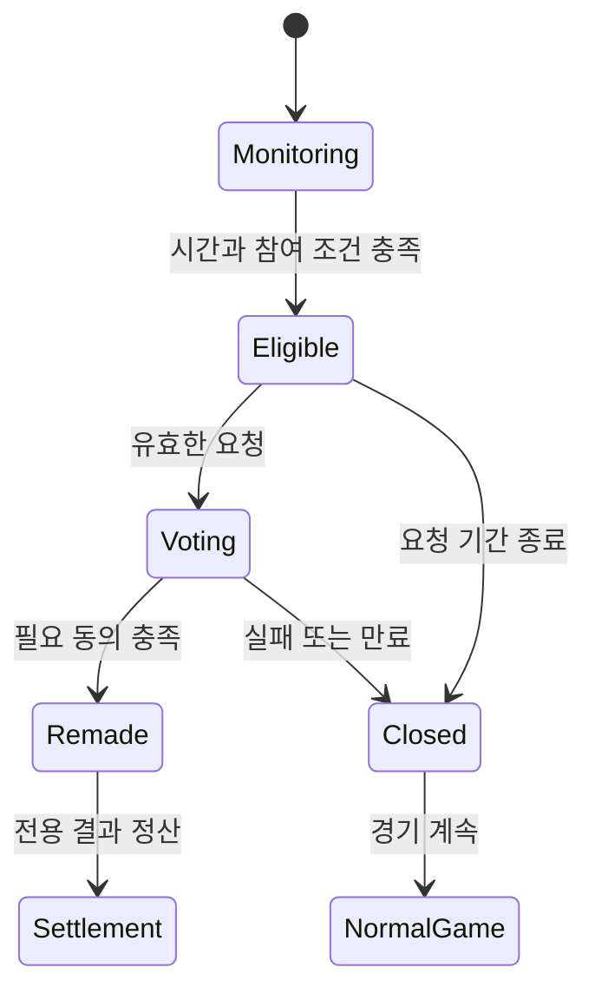

# 16. 행동·경쟁 공정성·항복·리메이크 역기획

[문서 목록](00_README.md)

> 대상: PC판 소환사의 협곡을 중심으로 한 경기 참여·제재·중단 정책. 조사일: 2026-11-13. 확인 최신 본편 노트: 26.22.
> `[공식]` 공개 규칙, `[분석]` 설계 해석, `[제안]` 재구성안, `[미확인]` 공개 자료로 확정할 수 없는 항목을 구분한다.

## 1. 시스템 목적

[분석] 한 명의 비참여나 악의적인 행동은 팀원뿐 아니라 상대팀의 경기 경험에도 영향을 준다.
행동 시스템은 이미 일어난 피해를 완전히 되돌릴 수 없으므로 예방, 현재 경기의 완화, 이후 재발 억제, 피해 보상을 함께 다뤄야 한다.
항복과 리메이크는 모두 경기를 끝내지만 의미가 다르다. 전자는 진행 중인 경기의 패배를 수용하는 선택이고, 후자는 정상적인 시작이 무너진 경기를 조기에 종료하는 절차다.

| 문제 | 즉시 완화 수단 | 사후 처리 | 설계 위험 |
|---|---|---|---|
| 공격적인 채팅·핑 | 음소거·채널 제한 | 신고 검토·제재 | 정상적인 소통까지 위축 |
| 연결 종료·비활동 | 재접속·초기 종료 투표 | 참여 위반 처리 | 네트워크 장애와 악의를 혼동 |
| 고의적인 경기 방해 | 신고·증거 수집 | 검증 후 제재·보상 | 서투른 플레이를 고의로 오판 |
| 로비 반복 이탈 | 재검색 | 대기·랭크 정책 적용 | 접속 장애에 과도한 벌칙 |
| 치팅 | 보안 상태 검사 | 적발·제재·결과 조정 | 오탐과 호환성 문제 |
| 회복하기 어려운 경기 | 팀 항복 투표 | 정상 패배 정산 | 쉽게 포기하게 만드는 유인 |

위 분류는 [분석]이다. 모든 문제에 같은 탐지기나 동일한 벌점을 적용한다는 뜻은 아니다.

## 2. 공개 확인한 규칙

| 주제 | 확인한 범위 | 근거 |
|---|---|---|
| AFK 제재 | 반복 위반에 대기 지연·대기열 잠금 등이 단계적으로 적용될 수 있다 | [M16-01] |
| 연습·사용자 설정 | 해당 모드 이탈에는 일반 AFK 제재를 부과하지 않는다고 안내한다 | [M16-01] |
| 닷지 | 챔피언 선택 이탈·선택 미확정이 대기열별 제재 대상이다 | [M16-02] |
| 리메이크 | 정상 시작에 문제가 있는 경기의 조기 종료 절차다 | [M16-03] |
| 피해 보상 | 검증된 이탈·고의적 방해에 대한 자동 보상 정책이 있다 | [M16-04] |
| 명예 | 행동 상태에 따라 소통 기능·보상 자격이 달라진다 | [M16-05] |
| Vanguard | 공개 설명상 게임 보안 클라이언트와 커널 모드 드라이버를 포함한다 | [M16-06] |

보상과 제재는 신고 버튼을 누르는 즉시 무조건 발생하는 거래가 아니다. 확인 조건과 중복·기간 제한을 별도로 둔다. [M16-04]

## 3. 참여 상태를 구분하는 이유

[제안] 연결 상태와 게임 참여 상태는 서로 다른 축으로 모델링한다.
네트워크가 연결되어 있어도 참여하지 않을 수 있고, 잠깐 연결이 끊겨도 복귀하여 정상적으로 경기할 수 있다.

| 연결 상태 | 참여 상태 | 가능한 상황 | 처리 원칙 |
|---|---|---|---|
| 연결됨 | 활동 중 | 정상 경기 | 일반 기록 |
| 연결됨 | 비활동 의심 | 클라이언트를 켠 채 자리 비움 | 정책 시간·증거를 종합 |
| 끊김 | 최근까지 활동 | 순간적인 통신 장애 | 복구 경로 우선 |
| 끊김 | 장기 비활동 | 이탈 | 경기 종료 정책·제재 검토 |
| 복구 중 | 판정 대기 | 재접속 화면 | 중복 세션 방지 |

[미확인] LoL의 실제 AFK 판정 신호, 가중치, 허용 지연, 예외 목록은 공개 자료만으로 알 수 없다.
따라서 '몇 초마다 이동 명령을 넣으면 정상 참여로 인정된다'와 같은 우회 추정은 설계 사양에 넣지 않는다.

## 4. 리메이크

### 4.1 확인한 시간 정책과 문서 충돌

[공식] 현재 지원 문서 상단은 0:55~2:25에 최소 55초 비활동·연결 종료가 확인된 경우 리메이크가 열리는 흐름을 설명한다.
종료 경계 부근에 자격이 성립하면 명령을 입력할 최소 시간을 주는 예외도 있다. 26.1 패치의 시간 변경과 일치한다. [M16-03][M16-07]

[자료 충돌] 같은 지원 문서 하단 FAQ에는 과거의 90초·3:00 설명이 남아 있다.
이 문서는 상단 표와 26.1 변경을 채택하며, 하단 문구를 합쳐 새로운 조건을 만들지 않는다.
실제 재현 테스트에서는 패치·큐·경기 시간을 고정하고 클라이언트의 활성 여부를 기록해야 한다.

### 4.2 결과의 의미

[공식] 리메이크 성립 시 정상 참여자에게 일반 경기 승패·성장 보상을 주지 않는 정책이 설명되어 있다. 원인 제공자와 일부 고티어 사전 구성 파티에는 별도 손실·제재가 적용될 수 있다. [M16-03]
[분석] 따라서 리메이크는 '무승부 보상'이 아니다. 경기가 정상적으로 성립하지 않았다는 별도의 결과 종류다.

재구현 시 결과 enum의 예시는 다음과 같다.

```text
CompletedWinLoss   # 정상 종료 또는 항복
Remade            # 경기 성립 실패에 따른 조기 종료
AbortedByService  # 서비스 장애에 의한 중단
UnderReview       # 사후 확인이 필요한 결과
```

위 이름은 [제안]이며 Riot의 실제 결과 코드가 아니다.

### 4.3 상태 전이 제안



[제안] 투표 시작 시점의 자격 스냅샷과 판정에 사용한 정책 버전을 보관한다.
투표 도중 재접속하거나 체력·킬 상태가 변했을 때 어떤 조건을 재평가할지는 명시적인 정책으로 결정해야 한다.

## 5. 항복

[공식] `/surrender`, `/ff` 등의 명령으로 항복 투표를 요청할 수 있다. [M16-08]
[분석] 항복은 개인이 더 이상 플레이하고 싶지 않다는 의사와 팀 전체의 종료 결정을 구분하는 장치다.
즉시 개인 종료를 허용하면 다른 팀원의 역전 기회를 빼앗지만, 항상 전원 동의를 요구하면 소수에게 경기 지속 여부가 종속된다.

### 5.1 재구현에서 필요한 정책

| 필드 | 의미 | 중요한 예외 |
|---|---|---|
| earliest_vote_time | 투표를 시작할 수 있는 시간 | AFK 조기 항복과 일반 항복 분리 |
| eligible_voter_rule | 투표권을 가진 구성원 | 연결 종료자 포함 여부 |
| required_yes_rule | 통과 조건 | 고정 표수와 비율의 차이 |
| vote_duration | 응답을 기다리는 기간 | 지연된 응답 처리 |
| repeat_cooldown | 재요청 간격 | 요청자별 제한과 팀 공통 제한 |
| absence_rule | 미응답 취급 | 반대와 미응답을 구분할지 |
| outcome_priority | 다른 종료 사건과의 우선순위 | 넥서스 파괴와 동시 발생 |

[미확인] 일반·랭크·무작위 총력전·신속 대전의 시작 시각과 표수는 하나의 상수로 통합하지 않는다.
본 문서는 최신 전체 큐의 항복 수치표를 확정하지 않으며 모드별 지원 안내를 정책 원본으로 사용한다.

### 5.2 플레이 사례

아군이 큰 골드 열세지만 상대 핵심 챔피언 세 명이 막 사망한 상황을 생각한다.
이용자마다 역전 가능성 판단이 다르므로 시스템이 점수판만 보고 패배를 자동 확정하면 안 된다.
투표는 불만 표현 채널이 되기도 하지만, 게임 상태 예측 모델이 승률을 낮게 본다는 이유만으로 자동 제출되는 기능은 별개다.
이 사례는 [분석]이며 LoL에 자동 항복 예측 시스템이 있다는 주장이 아니다.

## 6. 신고·검증·제재·복원

[제안] 신고는 판결이 아니라 추가 검토가 필요한 사건을 생성하는 입력으로 다룬다.
여러 명이 신고했다는 이유만으로 의도를 확정하면 파티가 특정 개인에게 불이익을 주는 도구로 변할 수 있다.

1. 경기·이용자·문제 유형·관찰 시점을 연결한다.
2. 서버 기록과 이용자 제보를 분리해 보존한다.
3. 행위의 심각성, 반복성, 확신도, 해당 정책 버전을 평가한다.
4. 적용된 제한과 해제 조건을 당사자에게 설명한다.
5. 피해 보상 자격은 가해자 제재와 별도의 규칙으로 판정한다.
6. 오탐 수정이나 운영 복구가 가능하도록 원래 결과와 정정 이력을 유지한다.

### 6.1 낮은 실력과 방해의 구별

| 관찰 | 추가 맥락이 필요한 이유 |
|---|---|
| 사망 횟수가 많음 | 처음 하는 챔피언·불리한 매치업일 수 있음 |
| 골드가 적음 | 서포터 역할·로밍·팀 자원 양보일 수 있음 |
| 비주류 아이템 | 실험·잘못된 지식·상황 대응일 수 있음 |
| 팀과 떨어져 있음 | 사이드 운영이나 시야 확보일 수 있음 |
| 같은 위치에서 반복 사망 | 전술 실패와 고의적 방해를 구분해야 함 |

[분석] 정상 플레이가 다양한 게임일수록 단일 지표로 처벌하기 어렵다.
행동 시스템의 성능은 탐지 건수뿐 아니라 오탐, 제재 이후 개선, 피해자의 재참여, 재심 처리 일관성으로 평가해야 한다.

## 7. 명예와 커뮤니케이션

[공식] 명예 가이드는 기본 명예 단계, 단계별 소통 권한, 경기 후 명예 투표와 보상을 설명한다. 25.04 이후 시즌 시작 때 명예가 초기화되지 않는다고 안내한다. [M16-05]
[분석] 명예는 외형 보상만 제공하는 업적보다 실질적인 소통 권한과 연결될 때 경기 경험에 직접 영향을 준다.
다만 필요한 팀 정보 전달까지 막으면 제재받은 이용자의 팀원이 추가 불이익을 받으므로 채널별 목적을 구분해야 한다.

| 채널 | 경기 내 역할 | 제어 방식의 설계 고려 |
|---|---|---|
| 팀 채팅 | 전술·짧은 합의 | 자유 텍스트 남용과 협업 가치 비교 |
| 전체 채팅 | 상대와 인사·상호작용 | 경기 필수 정보와 구별 |
| 파티 채팅·음성 | 기존 관계의 협업 | 파티 탈퇴·음소거·신고 범위 명확화 |
| 핑 | 빠른 위치·상태 전달 | 사용량 제한이 정보 전달을 과도하게 막지 않도록 |
| 감정표현 | 감정·정체성 표현 | 반복 재생과 시각·청각 부담 관리 |

## 8. 보안과 경쟁 무결성

[공식] Vanguard는 클라이언트 보안 프로그램이며 공개 문서는 게임 실행을 위한 활성 상태 요구사항을 설명한다. [M16-06]
[분석] 보안 모듈은 매치 서버의 권한 검증을 대신하지 않는다. 클라이언트 환경 검사와 서버 측 이동·스킬·소유권 검사는 서로 다른 공격 면을 다룬다.
[제안] 게임 입장 자격, 보안 서비스 상태, 클라이언트 버전 호환성, 경기 내 요청 검증을 각각 기록한다.

보안 오류 화면에는 실패한 단계와 사용자가 해결할 수 있는 조치를 표시한다.
다른 제품·운영체제의 Vanguard 안내를 PC판 LoL 전체에 무조건 적용하지 않는다.
탐지 시그니처, 내부 수집 항목, 정확한 판정 공식은 공개하지 않은 상태로 남겨야 한다.

## 9. 정책 데이터 재구성안

```yaml
ParticipationPolicy:
  policy_id: queue_region_patch_revision
  remake_window: configured_interval
  activity_rule_id: server_validated_rule
  surrender_rule_id: mode_specific_rule
  disconnection_handling: reconnect_and_result_policy

BehaviorCase:
  case_id: opaque_id
  match_id: authoritative_match
  subject_id: reviewed_player
  report_refs: submitted_reports
  evidence_refs: access_controlled_records
  status: pending_or_confirmed_or_dismissed
  decision_policy_version: immutable_revision
  decision_reason: auditable_category

RemedyGrant:
  grant_id: unique_id
  case_id: confirmed_case
  beneficiary_id: eligible_player
  benefit: queue_specific_compensation
  dedupe_key: player_case_benefit
  status: pending_or_granted_or_corrected
```

전체 구조는 [제안]이다. 개인정보 접근 범위와 보존 기간은 실제 서비스 요구사항에 따라 별도로 정한다.

## 10. 경계조건과 검증

| ID | 시험 상황 | 기대되는 판정 |
|---|---|---|
| BI-01 | 리메이크 시작 경계 전·후 | 서버 시간 기준으로 일관되게 활성화 |
| BI-02 | 리메이크 종료 경계 직전 자격 발생 | 해당 정책의 요청 유예를 적용 |
| BI-03 | 투표 도중 재접속 | 명시된 자격 재평가 규칙을 적용 |
| BI-04 | 넥서스 파괴와 항복 성립 동시 | 하나의 최종 결과만 생성 |
| BI-05 | 같은 신고 반복 전송 | 동일 사건이 중복 제재로 이어지지 않음 |
| BI-06 | 네트워크 장애가 다수에게 발생 | 개별 위반과 서비스 장애를 분류 |
| BI-07 | 정상적인 비주류 전술 | 저성능만으로 고의를 확정하지 않음 |
| BI-08 | 이미 보상한 사건 재처리 | 추가 보상이 중복 지급되지 않음 |
| BI-09 | 같은 경기의 여러 AFK 이용자 | 각각 참여 기록을 평가 |
| BI-10 | 연습 모드 이탈 | 일반 매칭 경기의 제재 규칙과 분리 |
| BI-11 | 소통 제한 상태에서 핑 | 허용 범위와 안내가 일치 |
| BI-12 | 제재 취소 뒤 재접속 | 권한·보상 자격 캐시도 정정 |

## 11. 연결 문서

- [매칭·랭크·소셜](15_matchmaking_ranked_social.md): 대기열 제한과 LP 조정.
- [계정 성장·수집](17_account_progression_collection.md): 명예·보상 자격.
- [UI·피드백·리플레이](14_ui_feedback_replays.md): 음소거, 알림, 결과 설명.
- [네트워크·데이터 구조](20_network_data_architecture.md): 접속 복구와 서버 권한.

## 12. 출처와 확인 한계

열람일: 2026-11-13. 인용은 공개 정책의 근거이며 제안한 탐지·저장 구조의 증거가 아니다.

- [M16-01] Riot Support, [Away From Keyboard (AFK) FAQ](https://support.riotgames.com/en-us/league-of-legends/penalties/away-from-keyboard-afk-faq/). AFK 제재 단계와 사용자 설정·연습 예외.
- [M16-02] Riot Support, [Queue Dodging](https://support.riotgames.com/en-us/league-of-legends/gameplay/queue-dodging). 대기열 이탈·선택 미확정·고티어 예외.
- [M16-03] Riot Support, [/Remake FAQ](https://support.riotgames.com/en-us/league-of-legends/gameplay/remake-faq). 상단의 현행 시간표와 결과 처리; 하단 잔존 구문 충돌 기록.
- [M16-04] Riot Support, [Disruptive Behavior Repair](https://support.riotgames.com/en-us/league-of-legends/security/disruptive-behavior-repair). 검증된 위반 후 큐별 자동 보상과 제한.
- [M16-05] Riot Support, [League of Legends Honor Guide](https://support.riotgames.com/en-us/league-of-legends/rewards/league-of-legends-honor-guide). 명예와 소통 권한·보상 연결.
- [M16-06] Riot Support, [Riot Vanguard FAQ (League of Legends)](https://support.riotgames.com/en-us/league-of-legends/performance/riot-vanguard-faq-league-of-legends). 공개된 보안 소프트웨어 구성과 실행 요구.
- [M16-07] Riot Games, [Patch 26.1 Notes](https://www.leagueoflegends.com/en-us/news/game-updates/patch-26-1-notes/). 리메이크·AFK 조기 항복 시간 변경 근거.
- [M16-08] Riot Support, [Chat Commands](https://support.riotgames.com/en-us/league-of-legends/gameplay/chat-commands). 항복·리메이크 명령.

[미확인] 탐지 모델·증거 임계값·직원 검토 비율·제재별 재발 억제 수치는 공개 자료로 확정하지 않았다.
