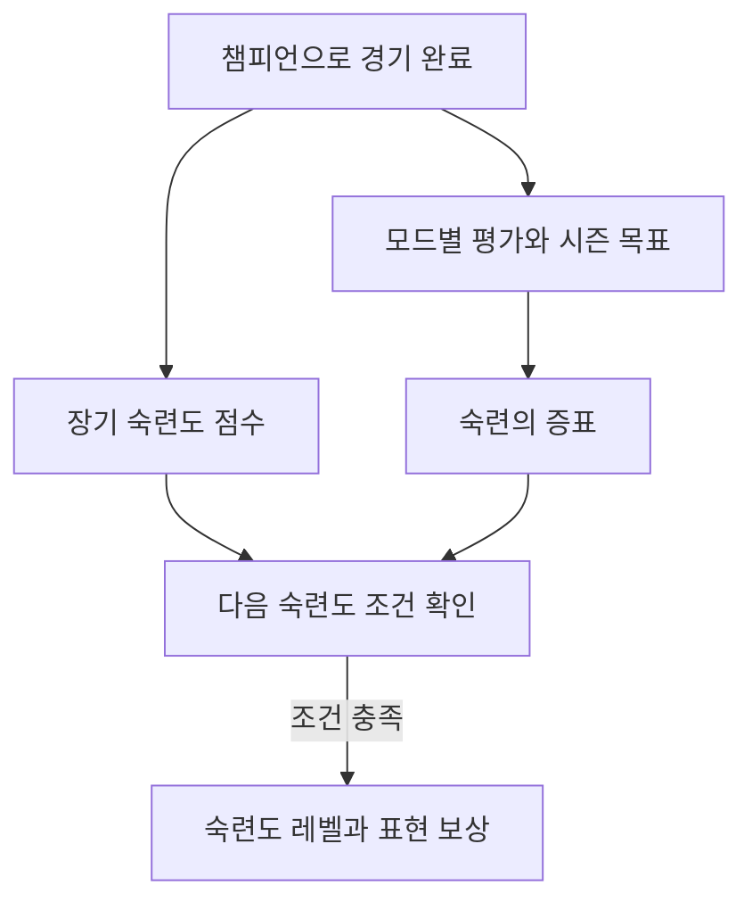

# 17. 계정 성장·챔피언 획득·숙련도·수집 역기획

[문서 목록](00_README.md)

> 대상: PC판 계정에 남는 성장과 소유권. 조사일: 2026-11-13. 확인 최신 본편 노트: 26.22.
> `[공식]`은 공개 규칙, `[분석]`은 설계 해석, `[제안]`은 데이터·처리 재구성이다. 이 문서의 계정 경험치는 경기 안에서 챔피언이 얻는 경험치와 다르다.

## 1. 시스템 목적

[분석] 매 경기 초기화되는 MOBA에 장기적인 동기를 제공하려면 실력 경쟁 외에도 배움, 특정 챔피언에 대한 애착, 수집, 자기표현의 경로가 필요하다.
계정 성장은 '얼마나 강한 계정인가'보다 '어떤 플레이에 접근할 수 있고 어떤 이력을 쌓았는가'를 표현하도록 읽을 수 있다.
획득한 챔피언은 선택 가능한 전략을 넓히고, 외형은 그 선택의 정체성을 꾸민다.

| 성장 축 | 누적 대상 | 주요 의사결정 | 초기화·소멸 범위 |
|---|---|---|---|
| 계정 레벨 | 계정 XP | 다음 기능을 배우고 접근 | 장기 누적 |
| 챔피언 소유 | 챔피언 이용 권한 | 어떤 역할·플레이 스타일을 확보 | 영구 소유와 임시 이용 구분 |
| 챔피언 숙련도 | 특정 챔피언의 이용 이력 | 익숙한 챔피언을 깊이 연습 | 장기 레벨과 시즌 목표 구분 |
| 도전과제 | 특정 행동·누적 성과 | 승리 외의 부가 목표 추구 | 상시·기간 한정 구분 |
| 명예 | 행동에 대한 평판 | 협업·소통 유지 | 현행 정책에 따른 변화 |
| 외형 수집 | 스킨·아이콘·감정표현 등 | 선호 챔피언과 정체성 표현 | 소유권·대여·사용 조건 구분 |
| 패스 | 기간별 BXP | 제한 기간 동안 보상 진행 | 해당 패스 종료 정책 |

위 표는 공개 기능을 목적별로 정리한 [분석]이다. 모든 축이 같은 방식으로 계산되거나 같은 서버에 저장된다는 뜻은 아니다.

## 2. 확인한 공개 규칙

| 규칙 | 확인한 범위 | 출처 |
|---|---|---|
| 계정 XP | 경기·목표 수행으로 획득하며 계정 레벨에 상한이 없다고 안내한다 | [M17-01] |
| XP 자격 | 최소 경기 시간 조건이 있고 사용자 설정 경기는 XP 대상이 아니다 | [M17-01] |
| 파랑 정수 | 챔피언 구매·제작에 사용하며 패스 진행 등이 획득 경로다 | [M17-01] |
| 모드 해금 | 레벨과 챔피언 수, 일반 경기 경험 등을 랭크 접근 조건으로 사용한다 | [M17-02] |
| 숙련도 | 숙련도 점수와 숙련의 증표를 구분하고, 시즌 목표는 별도로 초기화한다 | [M17-03] |
| 도전과제 | 무료 업적 시스템이며 프로필 칭호·토큰·성취 표현을 제공한다 | [M17-04] |
| 제작 재고 | 상점에서 소유한 콘텐츠와 별도의 전리품 재고를 사용한다 | [M17-05] |

지원 문서의 보상 경로는 시즌별로 바뀔 수 있다. 오래된 '레벨업마다 동일한 챔피언 캡슐 지급' 설명을 현행 공통 규칙으로 복사하지 않는다.

## 3. 계정 온보딩

### 3.1 기능을 단계적으로 열어주는 이유

[분석] 챔피언 조작, 룬, 주문, 역할 선택, 밴픽, 랭크를 한 번에 제공하면 학습해야 할 선택지가 과도해진다.
반대로 숙련된 복귀자나 새 역할을 배우는 이용자에게 모든 교육을 강제하면 반복 비용이 커진다.
해금 설계는 신규 이용자에게 필요한 최소 경험을 확보하면서, 해금할 기능과 남은 조건을 명확하게 보여줘야 한다.

[공식] 열람한 모드 해금 안내는 신속 대전·ARAM을 레벨 3, 연습 모드를 레벨 9, 일반 드래프트를 레벨 10에 배치한다.
랭크는 레벨 30, 챔피언 20개 이상, 신속 대전 또는 일반 드래프트 10경기 조건을 안내한다. [M17-02]

| 학습 단계 | 설계상 배워야 하는 것 | 검증하기 쉬운 목표 예시 |
|---|---|---|
| 첫 조작 | 이동·기본 공격·스킬·카메라 | 지정 위치 이동과 적 대상 공격 |
| 첫 전투 | 사거리·체력·쿨다운 | 위험한 교전을 피하고 회복 |
| 첫 성장 | 미니언·골드·상점 | 구매를 통해 전투 패턴 변화 이해 |
| 첫 팀플레이 | 역할·라인·핑·오브젝트 | 아군과 함께 목표 확보 |
| 첫 대전 확장 | 상대의 패턴과 정보 불완전성 | 시야 없는 구간의 위험 인지 |
| 경쟁 진입 | 밴픽·역할 책임·경기 완주 | 기본적인 큐 규칙 이해 |

표의 목표는 [제안]이다. 실제 튜토리얼의 미션 목록을 복제한 것이 아니다.

### 3.2 복귀자와 신규자의 차이

복귀자는 계정 레벨이 충분해도 새로운 아이템·맵·역할 규칙을 모를 수 있다.
[제안] 계정 레벨과 최근 시스템 노출 이력을 별개로 추적해, 복귀자에게는 바뀐 규칙을 짧게 안내한다.
이때 과거 전적을 이유로 새로운 모드를 무조건 이해한다고 가정하지 않는다.

## 4. 챔피언 획득과 이용 권한

[공식] 파랑 정수는 챔피언 획득에 사용할 수 있고, 전리품의 챔피언 파편은 영구 해금 또는 정수 변환 등으로 처리할 수 있다. [M17-01][M17-05]
[분석] 챔피언 획득은 단순한 수집 숫자 증가와 역할 선택 폭 확대라는 두 가지 의미가 있다.
사용자는 한 역할의 대체 챔피언을 확보하거나, 친구 파티에서 부족한 역할을 맡기 위해 구매할 수 있다.

### 4.1 이용 가능 여부를 계산하는 재구성안

```text
CanSelectChampion(player, champion, mode, phase) =
    ModeAllowsChampion(champion)
    AND PhaseAllowsChampion(champion)
    AND (
        OwnsChampion(player, champion)
        OR HasValidTemporaryAccess(player, champion, mode)
        OR ModeGrantsAccess(mode, champion)
    )
```

이 식은 [제안]이며 실제 선택 가능 여부 API가 아니다.
보유권이 있어도 밴·다른 이용자의 선택·모드 제한 때문에 선택할 수 없는 상태를 별도로 표시해야 한다.
무료 체험·연습 모드 접근을 영구 소유권으로 기록하면 이후 일반 대전에서도 잘못 해금될 수 있다.

| UI 상태 | 플레이어가 알아야 할 것 |
|---|---|
| 영구 보유 | 해당 콘텐츠 이용 권한이 계정에 있음 |
| 임시 이용 가능 | 기간·모드 제한이 있을 수 있음 |
| 잠김 | 필요한 화폐·획득 방법 |
| 현재 경기에서 사용 불가 | 소유권이 아니라 밴픽·모드 조건 때문 |
| 서비스 비활성 | 운영상 일시 제외이며 구매 상태와 무관 |

## 5. 챔피언 숙련도

[공식] 숙련도 점수는 경기 완료 시 챔피언별로 쌓이고, 높은 단계에는 숙련의 증표도 필요하다.
장기 숙련도 레벨은 시즌이 바뀌어도 유지되지만 시즌 마일스톤은 새로 진행한다. [M17-03]

[분석] 점수는 반복 경험, 평가 조건은 성과를 나타내므로 같은 챔피언을 많이 플레이하는 것과 좋은 경기를 만드는 것을 함께 장려한다.
단, 숙련도 레벨을 현재 랭크 실력의 대체값으로 사용하면 오래 플레이한 저숙련자와 짧게 플레이한 고숙련자를 구분하기 어렵다.

### 5.1 진행의 두 축



[제안] 점수가 충분하지만 증표가 부족한 상태를 별도로 표시한다.
조건을 한 개의 진행률로만 합치면 이용자는 충분히 플레이했는데 레벨이 오르지 않는 이유를 이해하기 어렵다.
성적 산출의 구체 가중치는 공개 확인되지 않았으므로 KDA·CS의 임의 가중합을 실제 평가 공식으로 제시하지 않는다.

### 5.2 플레이 사례

이용자가 같은 챔피언으로 반복 경기하여 점수 조건은 충족했으나 필요한 시즌 성과를 얻지 못한 상황이다.
결과 화면에서는 '점수 저장 완료'와 '추가 조건 미충족'을 동시에 보여줘야 한다.
이때 낮은 평가를 받은 경기의 점수를 버리거나, 다음 시즌에 장기 점수를 전부 초기화하는 동작은 별개 정책이다.

## 6. 도전과제와 자기표현

[공식] 도전과제는 다양한 경기 행동·누적 성취를 토큰과 칭호 등으로 표현하며, 기간 한정 성취는 별도의 레거시 범주로 구분한다. [M17-04]
[분석] 도전과제는 승패만으로 드러나지 않는 플레이 스타일을 프로필에 남기는 기능이다.
문제는 목표가 팀 승리와 충돌할 때 생긴다. 오브젝트를 확보해야 할 순간에 개인 기록을 위해 전투를 끌면 장기 보상과 경기 목표가 어긋난다.

| 도전과제 설계 유형 | 기대 효과 | 주의할 역효과 |
|---|---|---|
| 누적 경험 | 오래 즐긴 이력 표현 | 시간만 많은 이용자가 압도 |
| 특정 기량 | 독특한 성공 순간 기념 | 위험한 시도를 반복해 팀 손해 |
| 협동 성취 | 파티·팀 단위 목표 형성 | 솔로 이용자의 접근성 저하 |
| 폭넓은 챔피언 경험 | 새로운 선택 유도 | 흥미 없는 선택의 반복 강요 |
| 외형 수집 | 정체성·선호 표현 | 구매력을 실력으로 오해 |

[제안] 도전과제마다 유효 모드, 반복 가능 여부, 사건 중복 기준, 소급 계산 가능 여부를 정의한다.
시즌 한정 과제를 종료한 뒤에는 기존 기록의 보존과 신규 획득의 차단을 따로 처리한다.

## 7. 재화와 경험치의 명확한 분리

| 항목 | 생명주기 | 사용 목적 | 다른 항목과의 구분 |
|---|---|---|---|
| 경기 골드 | 한 경기 | 아이템 구매 | 상점 RP·파랑 정수와 무관 |
| 챔피언 경험치 | 한 경기 | 레벨·스킬 성장 | 계정 레벨과 무관 |
| 계정 XP | 계정 누적 | 기능 해금·레벨 | 패스 BXP와 별도 |
| 파랑 정수 | 계정 재화 | 챔피언 등 대상 콘텐츠 | 경기 전투 능력치 직접 증가가 아님 |
| 주황 정수 | 계정 제작 재화 | 대상 외형 파편의 영구화 | 챔피언 파편 정수와 구분 |
| RP | 계정 유료 재화 | 상점 상품 | 지역별 구매 정책·가격 적용 |
| 신화 정수 | 희귀 콘텐츠 재화 | 대상 상점 콘텐츠 | RP 환율로 단순 환산하지 않음 |
| BXP | 기간별 패스 | 보상 트랙 진행 | 계정 XP와 별도 |

화폐의 공개 용도는 [M17-01][M17-05], 신화 정수·패스의 상세 범위는 [수익화 문서](18_monetization_live_service.md)를 참조한다.
라이브 서비스에서 화폐의 역할이 바뀌면 표시명만 바꾸지 말고 기존 잔액·상품·보상표의 관계도 함께 갱신해야 한다.

## 8. 전리품·영구 소유·장착 상태

[공식] 전리품 보관함에서 얻은 파편은 소유 컬렉션과 구분되며, 사용 가능한 영구 콘텐츠로 전환하는 절차가 있다. [M17-05]
[분석] 이용자가 '획득했다'고 느끼는 순간과 실제 장착 권한이 생기는 순간이 다를 수 있어 가장 혼란을 일으키기 쉬운 부분이다.

[제안] 다음 세 객체를 분리한다.

```yaml
LootEntry:
  entry_id: unique_inventory_entry
  content_ref: champion_or_cosmetic
  form: shard_or_permanent_token
  count: integer

Entitlement:
  account_id: owner
  content_ref: unlocked_content
  access_type: permanent_or_temporary
  expires_at: optional
  acquired_by_transaction: source_id

LoadoutSelection:
  account_id: user
  champion_id: selected_champion
  cosmetic_id: selected_owned_skin
  mode_scope: applicable_modes
```

파편 세 개를 다른 콘텐츠로 바꾸는 경우처럼 소모와 신규 지급이 함께 일어나면 하나의 거래로 처리해야 한다.
통신 재시도로 같은 파편을 두 번 소모하거나 같은 영구 콘텐츠를 두 번 지급해서는 안 된다.

## 9. 보상 정산 절차 제안

1. 경기 결과의 유효성·모드·참여 자격을 확인한다.
2. 계정 XP, 숙련도, 도전과제, 패스 진행에 각각 필요한 사건을 전달한다.
3. 각 진행 시스템이 해당 정책 버전의 보상을 계산한다.
4. 보상 레코드를 고유 식별자로 기록하고 지급한다.
5. 결과 화면은 진행값과 실제 지급 내역을 구분한다.
6. 지연된 지급은 다시 접속해도 이어서 표시할 수 있게 한다.

[제안] 경기 종료 화면을 닫았다는 이유로 보상이 사라지면 안 된다.
또한 결과 화면의 애니메이션 재생 완료 여부와 서버의 실제 보상 지급 상태를 같은 값으로 취급하지 않는다.

## 10. 검증 시나리오

| ID | 상황 | 검증 목표 |
|---|---|---|
| AP-01 | 랭크 레벨만 충족, 챔피언 수 부족 | 부족한 조건을 정확히 안내 |
| AP-02 | 계정 XP와 BXP 동시 증가 | 각 진행 막대와 잔액을 구분 |
| AP-03 | 비보유 챔피언으로 임시 모드 플레이 | 숙련도 기록과 영구 소유권을 분리 |
| AP-04 | 숙련도 점수만 충분 | 미충족 증표 조건을 표시 |
| AP-05 | 시즌 변경 | 장기 숙련도와 시즌 목표를 다르게 처리 |
| AP-06 | 같은 결과 중복 수신 | 경험치·보상이 중복 지급되지 않음 |
| AP-07 | 제작 도중 네트워크 끊김 | 소모·지급 상태를 복구 가능 |
| AP-08 | 사용 중인 외형의 임시 권한 만료 | 기본 외형으로 안전하게 대체 |
| AP-09 | 게임 종료 후 바로 클라이언트 종료 | 진행과 보상 기록이 유지 |
| AP-10 | 기간 한정 과제 종료 경계 | 서버의 자격 시각 규칙 적용 |
| AP-11 | 이미 소유한 영구 콘텐츠 획득 | 해당 상품의 중복 처리 정책 적용 |
| AP-12 | 복귀 계정 | 기존 소유권은 유지하고 새 기능 안내 |

## 11. 평가 지표와 연동

[제안] 신규자의 첫 정상 경기 도달률, 역할별 첫 챔피언 획득률, 첫 랭크 진입까지의 이탈 구간, 파편과 영구 보상 혼동으로 발생한 문의를 측정한다.
장기 이용자에게는 새 챔피언 시도율, 숙련도 목표의 편중, 수집 화면 탐색 성공률을 볼 수 있다.
단순 보상 수령 횟수보다 이용자가 다음 선택을 이해하고 실제로 사용했는지가 중요하다.

- [매칭·랭크](15_matchmaking_ranked_social.md): 접근 자격과 경기 결과.
- [행동·공정성](16_behavior_integrity_surrender.md): 명예와 보상 자격.
- [수익화·라이브 서비스](18_monetization_live_service.md): 구매·패스·화폐 공급.
- [모드·연습](19_modes_practice_custom.md): 임시 이용 권한과 모드별 진행 자격.

## 12. 출처

열람일: 2026-11-13.

- [M17-01] Riot Support, [Reward (BE/XP) System Breakdown](https://support.riotgames.com/en-us/league-of-legends/rewards/reward-bexp-system-breakdown). 계정 XP, BE, RP, 레벨 보상 구조.
- [M17-02] Riot Support, [Unlocking Game Modes](https://support.riotgames.com/en-us/league-of-legends/gameplay/unlocking-game-modes). 공개된 모드·랭크 접근 요건.
- [M17-03] Riot Support, [Champion Mastery Guide](https://support.riotgames.com/en-us/league-of-legends/rewards/champion-mastery-guide). 숙련도 점수·증표·시즌 마일스톤.
- [M17-04] Riot Support, [Challenges FAQ — League of Legends](https://support.riotgames.com/en-us/league-of-legends/gameplay/challenges-faq-league-of-legends). 도전과제·프로필 표현·레거시 구분.
- [M17-05] Riot Support, [Hextech Crafting Glossary](https://support.riotgames.com/en-us/league-of-legends/rewards/hextech-crafting-faq) 및 **Hextech Crafting FAQ**. 파편·정수·영구 소유·전리품 재고. https://support.riotgames.com/en-us/league-of-legends/rewards/hextech-crafting-glossary ;

[미확인] 개별 챔피언의 현행 가격표, 계정 XP의 정확한 수식, 모든 도전과제의 최신 조건은 본문에서 확정하지 않았다. 해당 값은 별도 버전 데이터로 관리할 대상이다.
