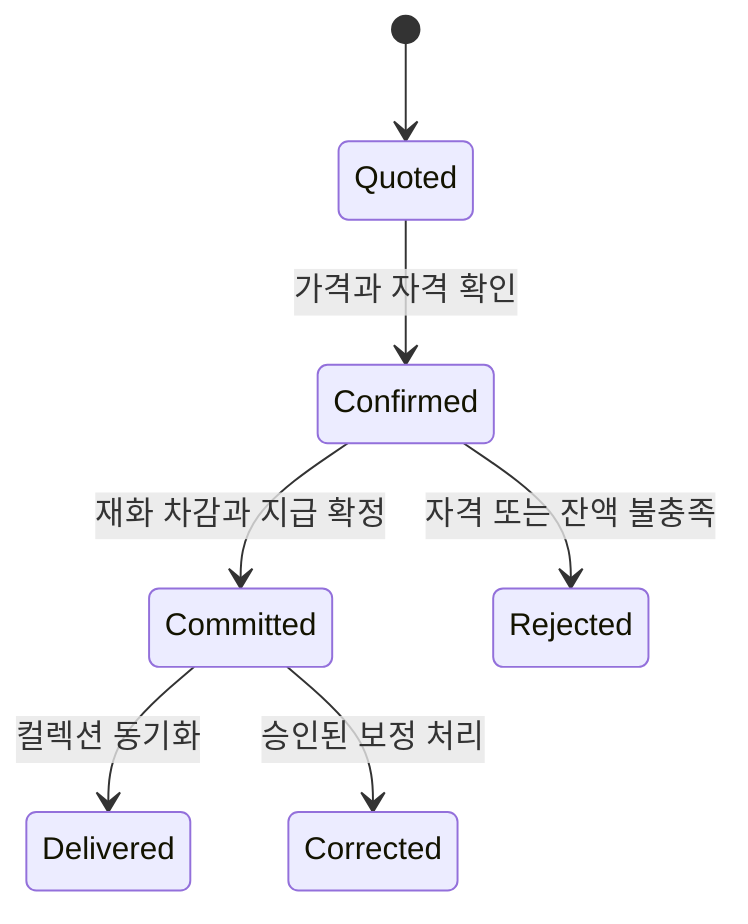

# 18. 수익화·상점·패스·전리품·라이브 서비스 역기획

[문서 목록](00_README.md)

> 대상: PC판의 계정 상점과 운영 구조. 조사일: 2026-11-13. 확인 최신 본편 노트: 26.22.
> `[공식]` 공개 상품 규칙, `[분석]` 설계 해석, `[제안]` 재현용 상품·거래·운영 모델을 구분한다. 실제 매출·전환율·내부 가격 최적화 공식은 확인하지 않았다.

## 1. 시스템 목적과 경쟁 게임의 제약

[분석] LoL의 수익화는 챔피언에 대한 애착, 외형 수집, 기간별 목표, 희귀 콘텐츠 선호를 상품으로 연결한다.
동시에 경쟁 게임은 전투의 판독 가능성과 규칙의 예측 가능성이 유지되어야 하므로 판매 콘텐츠가 전투 정보의 명확성을 해치지 않도록 관리할 필요가 있다.
챔피언 구매는 선택 가능한 범위를 넓히는 기능이고, 경기 중 골드로 사는 아이템과는 다른 경제다.

| 경제 | 들어오는 자원 | 소비 대상 | 분석 단위 |
|---|---|---|---|
| 한 경기의 경제 | 골드·경험치 | 아이템·스킬 성장 | 경기 전략과 밸런스 |
| 계정 획득 경제 | 플레이 보상·계정 재화 | 챔피언·제작 대상 | 접근성과 장기 목표 |
| 유료 상품 경제 | RP 등 상품별 재화 | 외형·패스·전리품 등 | 가치 전달과 구매 경험 |
| 기간별 진행 경제 | BXP·이벤트 목표 | 패스 보상 트랙 | 플레이 주기와 종료 정책 |

경제를 분리해서 설명해야 '유료 계정은 경기에서 골드를 더 들고 시작한다'는 잘못된 해석을 피할 수 있다.

## 2. 상품군별 가치 제안

| 상품군 | 이용자가 얻는 가치 | 구매 판단의 핵심 정보 | 재구현 시 주의점 |
|---|---|---|---|
| 챔피언 | 새로운 조작·역할·조합 선택 | 플레이 스타일, 소유 여부, 가격 | 외형과 챔피언을 혼동하지 않도록 |
| 스킨 | 좋아하는 챔피언의 시각·청각 표현 | 모델·효과·음성·애니메이션 미리보기 | 원본 스킬의 식별 가능성 |
| 크로마 | 기존 외형의 색·스타일 변형 | 기반 스킨 보유 조건 | 사용할 수 없는 구매 방지 |
| 아이콘·감정표현·휘장 | 계정 정체성 | 표시 위치·사용 방식 | 과도한 알림과 화면 방해 |
| 패스 | 기간별 목표와 보상 접근 | 무료/유료, 남은 기간, 진행량 | 구매와 진행을 분리 |
| 전리품 | 무작위 콘텐츠와 제작 재료 | 보상 풀·확률·중복 처리 | 기초 확률과 보장 규칙 구분 |
| 신화급 상점 | 희귀 콘텐츠에 대한 선택적 교환 | 현재 목록·교체 시각·필요 재화 | 한정성과 재등장 정책 표시 |
| 성소 | 특정 희귀 상품군의 추첨 | 배너·확률·보장 카운터 | 다른 배너 카운터 합산 금지 |

표는 공식 상품 범주 [M18-01]~[M18-04]를 바탕으로 한 [분석]이다. 실제 개발 조직이나 매출 비중을 나타내지 않는다.

## 3. 직접 구매

[분석] 직접 구매는 이용자가 원하는 콘텐츠와 지불할 비용을 먼저 확정한다는 장점이 있다.
반면 상품이 많아지면 탐색 비용이 늘어나므로 챔피언별, 테마별, 보유 여부별 필터가 중요하다.

[제안] 상품 상세에는 다음 정보를 우선 제공한다.

1. 구매 후 계정에 생기는 정확한 권한.
2. 해당 콘텐츠를 사용하기 위한 기반 챔피언·스킨 조건.
3. 단품·세트 구성 차이와 이미 보유한 항목의 처리.
4. 지불 재화와 확정 비용.
5. 판매 종료 시각과 지역별 정책.
6. 게임 안에서 어떻게 보이는지 확인할 수 있는 미리보기.

이미 보유한 챔피언을 포함한 세트라면 '세트 총 구성'과 '이번 거래로 새로 얻는 구성'을 구분해야 한다.
외형의 선호와 전투 효율을 혼동하지 않도록 모델·이펙트·사운드의 변경 범위를 설명한다.

## 4. 배틀패스

### 4.1 확인한 현행 사례

[공식·기간 사례] Worlds 2026 지원 안내는 무료 보상과 유료 보상을 구분하며 기본 패스 가격을 1,650 RP로 안내한다.
해당 패스에는 48개 기본 단계와 8개 반복 단계가 있고, 단계당 500 BXP를 요구한다고 설명한다. [M18-01]
이는 특정 이벤트의 사례이며 모든 패스가 이 가격·길이를 유지한다는 규칙은 아니다.

### 4.2 패스의 상태 구조

[분석] 패스는 다음 세 상태를 분리해야 이해하기 쉽다.

| 축 | 질문 | 예시 상태 |
|---|---|---|
| 진행 | 목표를 얼마나 수행했는가 | 누적 BXP와 도달 단계 |
| 접근 권한 | 유료 트랙을 열었는가 | 무료 이용·패스 구매 |
| 수령 | 받을 자격이 있는 보상을 받았는가 | 잠김·수령 가능·수령 완료 |

패스를 늦게 구매한 이용자가 이미 달성한 유료 보상에 접근하게 하려면 진행 기록이 구매 여부와 독립적으로 유지되어야 한다.
이 동작을 설명할 때 '구매 즉시 모든 보상을 받는다'고 표현하면 아직 진행하지 않은 보상까지 지급된다는 오해를 만든다.

### 4.3 시간 경계

[공식] Worlds 2026 안내는 진행 종료와 패스 비활성 시각을 서로 다르게 표시한다. [M18-01]
[제안] 이를 구현할 때 아래 시각을 독립적으로 다룬다.

```yaml
PassWindow:
  starts_at: server_timestamp
  progress_ends_at: server_timestamp
  purchase_ends_at: server_timestamp
  claim_ends_at: server_timestamp
  display_timezone: player_locale
```

경기를 시작한 시각과 종료한 시각 중 무엇으로 보상 자격을 판단하는지 정책에 기록한다.
클라이언트가 표시하는 남은 시간과 서버 판정 기준이 다르면 종료 직전 분쟁이 늘어난다.

### 4.4 패스 설계의 교환관계

[분석] 시간 기반 진행은 특정 역할·실력에 치우치지 않고 보상을 주기 쉽지만, 참여의 질보다 오래 머문 시간을 보상할 위험이 있다.
성과 목표는 능동적인 플레이를 유도하지만, 팀 승리에 필요한 행동보다 개인 미션을 우선하게 만들 수 있다.
따라서 기본 진행, 일일·주간 목표, 특별 성취를 섞더라도 각 모드의 참여 자격과 정상 경기 조건을 명확히 해야 한다.

## 5. 마법공학 제작과 전리품

[공식] 마법공학 상자는 파편·영구 콘텐츠·정수 등을 제공하며, 주요 보상과 추가 보상 및 보장 규칙을 별도로 설명한다. [M18-02]
[분석] 전리품은 획득과 사용 사이에 제작 판단을 추가한다. 사용자는 파편을 영구화하거나 재료로 전환해 다른 목표를 향할 수 있다.

| 단계 | 상태 변화 | 필수 피드백 |
|---|---|---|
| 전리품 획득 | 보관함 항목 증가 | 상자·열쇠·파편의 종류 |
| 개봉 | 상자 소모, 결과 생성 | 소모 항목과 획득 내역 |
| 제작 선택 | 사용할 재료와 목표 확정 | 영구화·분해 등 선택 결과 |
| 제작 실행 | 재료 차감, 권한 또는 재화 지급 | 실제 소유 여부 |
| 컬렉션 사용 | 외형·챔피언 장착 | 적용 가능한 모드와 조건 |

### 5.1 확률을 읽을 때의 구분

[공식] 상자 안내는 스킨 파편의 기본 확률과 연속 미획득 방지 규칙에 따른 실효 확률을 구분한다. [M18-02]
[분석] 이 구조에서 확률표의 한 행을 단순 반복한 결과와 전체 시스템의 장기 분포는 같지 않을 수 있다.
추가 상자, 별도 보너스, 중복 콘텐츠 대체, 확정 지급 카운터를 각각 반영해야 전체 보상 공급량을 분석할 수 있다.

역기획 데이터에는 최소한 아래를 구분해 기록한다.

- 기본 보상 풀과 기본 가중치.
- 기본 보상과 함께 나올 수 있는 추가 보상.
- 연속 미획득 보정과 카운터 초기화 조건.
- 동일 보상을 이미 보유했을 때의 대체 규칙.
- 판매 지역·출시 기간별로 달라지는 대상 목록.

## 6. 성소

### 6.1 공개 수치 스냅샷

다음은 2026-11-13에 열람한 한국어 성소 안내의 요약이다. [M18-03]

| 항목 | 고귀 스킨 배너 | 신화급 변형 스킨 배너 |
|---|---|---|
| 사용 재화 | 고대 불꽃 | 고대 불꽃 |
| 불꽃 구매 단가 | 400 RP | 400 RP |
| S급 기본 확률 | 0.5% | 0.5% |
| S급 보장 상한 | 80회 이내 | 40회 이내 |
| A급 기본 확률 | 10% | 10% |
| B급 기본 확률 | 89.5% | 89.5% |
| 보장 진행 | 같은 배너 계열끼리 이어짐 | 같은 배너 계열끼리 이어짐 |

[공식] 서로 다른 배너 계열의 보장 진행은 공유하지 않으며 S급 획득 시 해당 카운터가 초기화된다고 안내한다. [M18-03]

### 6.2 설계 해석

[분석] 기본 확률은 개별 추첨의 희소성을, 보장 상한은 목표 획득까지의 불확실성 한계를 표현한다.
배너 간 카운터를 분리하면 이용자의 목표가 특정 상품 계열에 묶이므로 구매 직전 현재 계열과 남은 보장 진행을 분명하게 보여줘야 한다.
회전하는 상품 목록과 이어지는 카운터가 동시에 존재하므로 '진행이 이어진다'와 '원하는 과거 상품이 다시 나온다'는 다른 약속이다.

### 6.3 계산 시 주의점

[계산 예시] 진행이 없는 상태에서 고대 불꽃을 모두 400 RP로 조달한다고 가정하면, 80개와 40개의 명목 합계는 각각 32,000 RP와 16,000 RP다.
이는 단순 곱셈으로 구한 조달량 예시이며 평균 지출, 실제 현금 결제액, 개별 이용자의 필요 지출을 뜻하지 않는다.
기보유 불꽃·누적 진행·중간 획득·지역 상품 구성은 이 계산에 포함하지 않았다.

[미확인] 보장 규칙끼리 충돌할 때의 내부 추첨 순서나 실제 난수 생성 구현은 공개 자료만으로 단정하지 않는다.

## 7. 신화급 상점

[공식] 신화 정수는 희귀 콘텐츠를 교환하는 재화이며, 상점의 상품군은 서로 다른 주기로 교체될 수 있다. [M18-04]
[분석] 직접 선택형 희귀 상점은 무작위 획득과 다른 의사결정을 만든다. 이용자는 현재 상품을 살지, 미래 상품을 위해 정수를 남길지 판단한다.

| 운영 변수 | 경험에 주는 영향 |
|---|---|
| 재화 공급량 | 원하는 상품까지의 기간 |
| 상품 가격 | 한 번의 선택이 다른 목표에 미치는 기회비용 |
| 교체 주기 | 방문 동기와 놓칠 위험 |
| 재등장 정책 | 기다림의 예측 가능성 |
| 개인별 목록 | 이용자 간 정보 공유와 실제 상점의 차이 |

[제안] 상품 목록은 스크린샷이나 문서에 고정하기보다 지역·계정·시점이 연결된 목록 버전으로 보관한다.

## 8. 구매·지급·환불의 처리 모델

아래는 [제안]이며 Riot 내부 결제 구조가 아니다.



```yaml
PurchaseTransaction:
  transaction_id: unique_id
  account_id: buyer
  offer_id: exact_catalog_offer
  catalog_version: immutable_revision
  paid_currency: currency_type
  paid_amount: confirmed_amount
  granted_entitlements: exact_content_list
  state: committed
  related_adjustments: refund_or_correction_records
```

차감과 지급은 한쪽만 성공하는 상태를 외부에 확정으로 표시하지 않는다.
동일 요청을 다시 보냈을 때 중복 결제가 생기지 않도록 멱등성을 보장해야 한다.
랜덤 상품은 클라이언트 연출을 다시 재생해도 이미 확정된 지급 결과가 달라지지 않아야 한다.

[공식] 환불 가능 여부는 상품·사용 여부·구매 경로·지역 정책에 따라 다르다. [M18-03][M18-05]
한국어 성소와 글로벌 안내의 기간을 혼합해 모든 이용자에게 하나의 환불 일수를 제시하지 않는다.

## 9. 라이브 서비스 운영

[분석] 새 시즌·이벤트는 게임 규칙, 외형 테마, 패스, 임무, 상점, 알림을 같은 주제로 묶어 복귀 동기를 만든다.
반면 각 요소의 시작·종료 시각이 어긋나면 구매했지만 진행할 수 없는 상품, 끝났지만 계속 노출되는 임무가 생긴다.

| 운영 단계 | 필요한 확인 |
|---|---|
| 기획 | 대상 이용자, 상품 가치, 보상 공급량 |
| 출시 준비 | 문구·가격·권한·현지화·대상 지역 |
| 공개 | 서버 카탈로그와 클라이언트 표시 일치 |
| 진행 | 목표 진척·보상 지급·문의 이상 징후 |
| 종료 | 진행·구매·수령 종료의 분리 |
| 복구 | 잘못된 지급·누락·설정 오류 정정 |
| 회고 | 참여·만족·재방문·보상 경제 변화 |

실제 매출 자료 없이 특정 상품을 '가장 높은 수익원'이라고 순위를 매기지 않는다.
시각적 희소성이 높은 외형도 전투 중 판독성이 떨어지면 게임 전체의 경쟁 신뢰를 손상시킬 수 있으므로 콘텐츠 QA에 함께 포함한다.

## 10. 검증 시나리오

| ID | 상황 | 기대 결과 |
|---|---|---|
| MT-01 | 구매 요청 재전송 | 한 번만 차감·지급 |
| MT-02 | 가격 변경 순간 구매 | 확정한 카탈로그 버전 또는 재확인 절차 적용 |
| MT-03 | 이미 보유한 세트 구성 | 실제 신규 획득과 가격 정책 일치 |
| MT-04 | 패스 뒤늦게 구매 | 기존 진행과 유료 접근 권한 결합 |
| MT-05 | 진행 종료 직전 경기 | 명시된 자격 시각 적용 |
| MT-06 | 성소 배너 계열 변경 | 각 계열 카운터가 섞이지 않음 |
| MT-07 | S급 확정 획득 | 관련 지급과 카운터 초기화를 함께 기록 |
| MT-08 | 전리품 연출 중 종료 | 재접속 후 같은 확정 결과 표시 |
| MT-09 | 크로마 기반 스킨 미보유 | 사용 조건을 구매 전 설명 |
| MT-10 | 환불 후 장착 상태 남음 | 권한과 장착 정보를 정합하게 갱신 |
| MT-11 | 지역별 상품 비활성 | 다른 지역 안내만 보고 구매 가능으로 표시하지 않음 |
| MT-12 | 지급 오류 일괄 복구 | 원래 거래와 보정 지급을 추적 가능 |

## 11. 연동과 측정

[제안] 상품 조회→상세 이해→구매→실제 사용의 흐름을 함께 본다.
지표는 단순 구매율 외에 구매 직후 문의, 중복 구매 시도, 미사용 콘텐츠, 패스 종료 혼동, 보상 지급 실패, 스킨 판독성 문제를 포함한다.
이용자 단위 지출을 추정하거나 특정 집단에 대한 실제 매출을 공개 자료 없이 만들지 않는다.

- [계정·수집](17_account_progression_collection.md): 영구 소유·재화·장착.
- [행동·공정성](16_behavior_integrity_surrender.md): 보상 자격·명예.
- [UI·피드백](14_ui_feedback_replays.md): 미리보기·가격·확률·종료 시각.
- [밸런스·분석·QA](21_balance_analytics_quality.md): 경제 공급량과 콘텐츠 검증.

## 12. 출처

열람일: 2026-11-13. 가격·확률은 위에서 지정한 상품의 해당 안내 스냅샷이다.

- [M18-01] Riot Support, [League of Legends — Season 3: Worlds 2026](https://support.riotgames.com/en-us/league-of-legends/events/league-of-legends-season-3-worlds-2026). 무료/유료 패스, 단계·BXP, 기간별 운영 사례.
- [M18-02] Riot Support, [Hextech Crafting FAQ](https://support.riotgames.com/en-us/league-of-legends/rewards/hextech-crafting-faq). 보상 풀·추가 보상·보장 규칙·제작.
- [M18-03] Riot Support, [성소](https://support.riotgames.com/ko-kr/league-of-legends/store/the-sanctum). 고대 불꽃·배너별 확률·보장 진행과 한국어 정책.
- [M18-04] Riot Support, [신화급 상점 및 신화 정수 FAQ](https://support.riotgames.com/ko-kr/league-of-legends/rewards/mythic-shop-and-mythic-essence-faq/). 재화 용도·상품 회전 구조.
- [M18-05] Riot Games, [Global Refund Policy](https://www.riotgames.com/en/global-refund-policy). 상품·지역·사용 여부에 따른 정책 분기.

[미확인] 국가별 현금→RP 가격표, 실제 결제·보상 서버 구조, 상품별 매출·잔존율·마케팅 비용은 이 문서의 확정 범위가 아니다.
