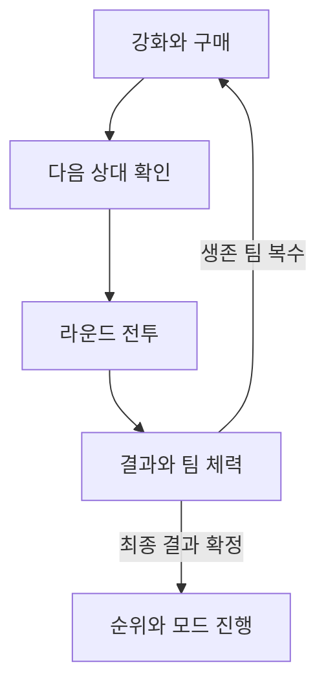

# 19. 게임 모드·튜토리얼·연습·사용자 설정 역기획

[문서 목록](00_README.md)

> 대상: PC판 본편과 대체 모드의 규칙 분리. 조사일: 2026-11-13. 확인 최신 본편 노트: 26.22.
> `[공식]` 공개된 기능, `[분석]` 설계 의도 해석, `[제안]` 모드 구성·실험·검증 모델이다. 대체 모드의 수치를 일반 소환사의 협곡에 적용하지 않는다.

## 1. 시스템 목적

[분석] 동일한 챔피언 조작으로도 지도, 성장 속도, 선택 방식, 승리 조건이 달라지면 다른 플레이 동기가 생긴다.
주요 경쟁 모드는 숙련과 전략의 일관성을, 짧은 모드는 빠른 전투와 부담 감소를, 연습 모드는 반복 학습을 제공한다.
모드 선택은 단순한 맵 선택보다 많은 규칙을 함께 바꾸는 행위다.

| 모드 축 | 바뀌는 내용 | 플레이 경험에 주는 영향 |
|---|---|---|
| 지도 | 라인·정글·지형·목표 | 교전 빈도와 정보 범위 |
| 챔피언 선택 | 지정·드래프트·무작위 | 조합 전략과 우연성 |
| 성장 | 시작 레벨·골드·획득 속도 | 강해지는 시점과 역전 여지 |
| 종료 | 넥서스·라운드·팀 체력 | 이겨야 하는 단위 |
| 변경 요소 | 증강·특수 아이템·환경 효과 | 매 경기 변주 |
| 메타 보상 | 계정 XP·숙련도·전용 진행 | 반복 플레이의 이유 |
| 운영 | 상시·기간 한정·시간대 제한 | 이용자 수와 대기 시간 |

## 2. 모드별 범위

| 구분 | 핵심 구조 | 분석 포인트 | 근거 |
|---|---|---|---|
| 일반·랭크 협곡 | 본편 5대5 전략 규칙 | 장기 성장·라인·시야·오브젝트의 결합 | 본 문서군의 01~13 |
| 신속 대전 | 사전 챔피언·역할 선택, 빠른 성장의 협곡 | 준비 시간과 경기 길이 축소 | [M19-01] |
| ARAM | 5대5 단일 라인 중심 전투 | 제한된 선택·지속적인 집단 교전 | [M19-02] |
| 아레나 | 두 명씩 구성된 8개 팀의 라운드 경쟁 | 빌드·증강 조합과 소규모 전투 | [M19-03] |
| AI 상대 대전 | 사람과 AI의 경기 | 초기 학습과 낮은 대인 부담 | [M19-04] |
| 연습 모드 | 제어 가능한 실험 환경 | 같은 조건에서 반복 실행 | [M19-05][M19-06] |
| 사용자 설정 | 참여자·팀·조건을 직접 구성 | 친구 경기·학습·행사 운영 | [M19-02][M19-07] |
| 기간형 변형 | 별도 데이터와 운영 일정 | 신선도·이용자 수 집중 | [M19-07][M19-08] |

[분석] 모드의 존재 여부와 특정 지역에서 현재 매칭이 열려 있는지는 다르다.
사용자 설정만 허용되는 지역, 특정 시간에만 열리는 큐, 이벤트 기간에만 있는 모드를 별도 상태로 표현해야 한다.

## 3. 신속 대전

### 3.1 확인한 차이

[공식] 신속 대전은 같은 협곡 지도에서 시작 성장과 오브젝트·종료 진행을 바꾸며, 챔피언과 포지션을 큐 진입 전에 선택한다.
열람한 2026 안내는 3레벨·1,400골드 시작, 포지션 퀘스트 미적용, 장기전을 줄이는 구조물 약화 단계를 설명한다. [M19-01]

[분석] 본편과 같은 지도를 사용한다고 같은 전략적 길이를 갖는 것은 아니다.
빠른 아이템 완성은 약한 초반을 버티는 기간을 줄이고, 강제 종료 압력은 늦은 성장만 기다리는 운영의 가치를 낮춘다.
사전 선택은 밴픽 상호작용을 줄이는 대신 원하는 챔피언으로 실제 조작을 연습할 가능성을 높인다.

### 3.2 전용 설계 요구

| 변경 | 생기는 효과 | 추가 확인 사항 |
|---|---|---|
| 시작 성장 증가 | 기본 전투 도구를 일찍 사용 | 초반 폭발력·초보자 학습 부담 |
| 골드·경험치 공급 증가 | 빌드 완성과 성장 체감 가속 | 아이템 선택 시간 부족 |
| 후발 팀 보조 | 불리한 경기의 참여 유지 | 우위를 만든 보상이 무의미해지지 않는지 |
| 종료 압력 | 경기 길이의 긴 꼬리 감소 | 끝나는 이유를 예측 가능한지 |
| 사전 챔피언 선택 | 경기 진입 단축 | 역할 수급과 파티 선택 충돌 |

표는 [분석]이다. 실제 보정 곡선이나 숨은 역전 계수는 제시하지 않는다.

### 3.3 역기획 시 흔한 혼동

신속 대전의 시작 골드·드래곤 조건·항복 시각을 일반 랭크의 규칙으로 옮기면 문서 전체의 전략 분석이 어긋난다.
같은 챔피언을 테스트했더라도 테스트 모드가 다르면 획득 골드, 레벨, 아이템 시점까지 함께 기록해야 한다.

## 4. 무작위 총력전: ARAM

### 4.1 선택과 공간 구조

[공식] ARAM은 두 팀 다섯 명이 단일 라인 중심으로 전투하는 모드다.
현행 지원 안내는 챔피언 카드 중 선택하고 남은 카드를 팀 벤치로 보내는 흐름, 지도 회전, 아군과의 챔피언 교환을 설명한다. [M19-02]
과거의 재주사위 설명을 그대로 현재 선택 UI로 단정하지 않는다.

[분석] 한 라인에 팀이 집중되면 정글의 장거리 순환이나 다중 라인의 압박보다 포킹, 회복, 집단 진입, 전선 유지가 중요해진다.
챔피언 선택에 우연성이 들어가므로 모든 경기에 같은 조합을 만들기보다 주어진 조합의 승리 방식을 찾아야 한다.

| 조합 성향 | 유리한 전개 | 상대의 대응 가능성 |
|---|---|---|
| 원거리 압박 | 접촉 전 체력 차이 축적 | 확실한 진입으로 사거리 이점 차단 |
| 강한 집단 진입 | 짧은 시간에 다수 적 통제 | 분산 배치와 진입기 회피 |
| 유지력 중심 | 작은 교환을 누적해서 전선 유지 | 큰 폭발 피해로 회복 전에 제거 |
| 근거리 지속전 | 교전이 길수록 화력 유지 | 교전 거리와 진입 시점 제한 |

이는 [분석]이며 특정 조합의 실제 승률 순위가 아니다.

### 4.2 모드별 밸런스 분리

[제안] 같은 챔피언 정의를 재사용하더라도 모드별 추가 규칙은 독립된 수정 계층으로 둔다.
한 모드의 보정이 본편의 스킬 계수에 영구적으로 섞이면 다음 패치에서 의도하지 않은 변화가 생긴다.
피해량·회복·보호막·자원·아이템 제한처럼 영향을 주는 축을 명시하고 전투 로그에 적용 모드 버전을 남긴다.

## 5. 아레나

[공식] 아레나는 16명이 두 명씩 팀을 이루어 여러 라운드를 진행하며, 팀 체력을 소모시키고 최후의 팀을 가리는 구조다.
진행 중 증강 선택이 제공되며, 본편 룬 대신 모드 전용 성장 선택을 사용한다고 안내한다. [M19-03]

[분석] 아레나는 긴 라인 성장 대신 '준비→상대 확인→전투→다음 강화'를 반복해 빌드의 인과관계를 빠르게 보여준다.
두 명의 조합은 상대적으로 파악하기 쉬운 반면, 증강과 아이템이 결합할수록 상호작용 수가 늘어나므로 설명과 검증 비용이 높아진다.



### 5.1 준비 단계의 의사결정

| 선택 | 비교해야 할 요소 |
|---|---|
| 즉시 화력 | 이번 라운드 승리 가능성 |
| 방어·회복 | 적의 주된 피해와 전투 길이 |
| 시너지 강화 | 이미 선택한 증강·파트너의 기능 |
| 범용 선택 | 이후 상대가 바뀔 때의 안정성 |
| 무작위 선택 재시도 | 현재 선택의 가치와 남은 재시도 기회 |

[제안] 증강 설명은 '무엇이 바뀌는지'와 '어떤 사건에 반응하는지'를 함께 보여준다.
부가 피해가 스킬 피해인지 별도 피해인지 같은 내부 분류가 다른 효과 발동에 영향을 준다면, 이용자가 판단할 수 있는 수준으로 규칙을 설명해야 한다.

## 6. 기간형·별도 규칙 모드

[공식·운영 사례] 열람한 League Classic 지원 안내는 과거 협곡·정글·아이템·룬/특성 체계를 사용하는 별도 방식이며, 지역별 큐 운영 시간과 종료 기간이 존재한다고 설명한다. [M19-07]
[공식·26.22 확인] 본편 노트는 ARAM Mayhem과 Classic의 변경을 별도 항목으로 다룬다. [M19-08]

[분석] 과거 버전 재현 모드의 데이터는 현재 본편을 설명하는 근거로 사용하면 안 된다.
예를 들어 Classic의 룬·특성·화폐가 존재한다고 해서 본편 룬 시스템이 과거 방식으로 돌아갔다고 결론 내릴 수 없다.
기존 챔피언 이름이 같아도 스킬·아이템·맵 규칙의 버전이 다를 수 있다.

[제안] 기간형 모드는 다음 운영 상태를 지원한다.

```text
Announced -> Downloadable -> Open -> TimeWindowLimited -> Closed
                          -> CustomOnly
```

실제 서비스가 위 이름을 사용한다는 뜻은 아니다.
모드 종료 뒤에도 전적·획득 보상·개인 기록을 보존할지와, 다음 회차에 진행이 이어질지를 별도로 정의한다.

## 7. 튜토리얼과 AI 상대 대전

[공식] 신규 계정은 AI 상대 대전 등에서 시작해 레벨에 따라 다른 모드에 접근하도록 안내된다. [M19-04]
[분석] AI의 목적은 사람을 최대한 많이 이기는 것만이 아니다. 신규 이용자가 규칙을 발견하고 다음 대전으로 옮겨갈 수 있어야 한다.

| 학습 주제 | 환경이 제공해야 할 단서 | 실패 시 피드백 제안 |
|---|---|---|
| 공격 사거리 | 목표와 거리를 비교 가능 | 접근이 필요한 이유 |
| 미니언 처치 | 체력 감소와 골드 획득 연결 | 막타 타이밍의 차이 |
| 포탑 위험 | 공격 대상 전환의 명확한 신호 | 들어가면 위험한 조건 |
| 회복·귀환 | 회복 장소와 이동 손실 | 언제 전선을 비워도 되는지 |
| 역할 협업 | 아군의 목적과 이동 표시 | 혼자 행동했을 때의 손실 |

[제안] 학습용 AI와 경쟁용 AI는 같은 의사결정 모델을 사용할 필요가 없다.
교육 시나리오에서는 위험한 실수를 한 번에 처벌하기보다 원인과 결과가 드러나는 속도를 조절할 수 있다.
[미확인] 실제 LoL 봇의 행동 트리·기계학습 사용 여부·난이도별 의사결정 코드는 본 문서에서 추정하지 않는다.

## 8. 연습 모드

### 8.1 공개 확인한 기능 범위

[공식] 25.S1.1 노트는 최대 10명 참가가 가능한 다인 연습 모드를 안내한다.
25.21은 인간 이용자 한 명인 연습 환경에서 모든 챔피언을 이용할 수 있으며, 봇·관전자는 이 조건을 깨지 않는다고 설명한다. [M19-05][M19-06]

[분석] 연습 모드는 경기 승패보다 반복 실험의 비용을 줄이는 도구다.
같은 공격을 다시 시도하려고 매번 경험치와 골드를 모아야 한다면 실험 결과보다 준비 시간이 더 길어진다.
반대로 자동 회복·쿨다운 초기화 같은 보조 상태가 켜진 것을 잊으면 실전과 다른 결과를 참이라고 기록할 수 있다.

### 8.2 재현 가능한 실험 양식

아래 항목은 [제안]이며 실제 클라이언트가 모두 자동 저장한다는 뜻은 아니다.

```yaml
PracticeExperiment:
  patch: tested_version
  mode: practice
  human_player_count: configured_count
  champion_and_level: test_subject
  ability_ranks: fixed_values
  items_and_runes: fixed_loadout
  target_state: health_resists_and_status
  map_position: repeatable_location
  training_toggles: explicitly_recorded
  procedure: ordered_actions
  observations: damage_timing_and_failures
```

### 8.3 실험 예시: 방어 아이템의 효과 비교

1. 같은 챔피언·레벨·스킬 단계·공격 아이템을 고정한다.
2. 대상의 체력·방어 상태와 적용 효과를 기록한다.
3. 스킬 한 번 또는 정해진 공격열을 실행한다.
4. 대상의 방어 조건 하나만 바꾸고 반복한다.
5. 쿨다운·중첩·전투 시작 조건이 같았는지 확인한다.
6. 결과 차이를 관측값으로 저장하고 게임 내부 공식과 구분한다.

이 실험은 변수를 통제해 피해 변화의 방향을 확인하는 데 유용하다.
실험 한 번의 숫자만으로 모든 챔피언·아이템의 처리 순서를 확정해서는 안 된다.

## 9. 사용자 설정 경기

[분석] 사용자 설정은 매치메이킹이 정하던 참가자와 팀 구성을 이용자가 직접 제어하게 한다.
친구 간 경기, 동작 재현, 교육, 내전·행사 운영 등 목적이 다양하므로 호스트 권한과 경기 참가 권한을 구분해야 한다.

| 설정 | 설계상 목적 |
|---|---|
| 지도·모드·선택 방식 | 동일한 규칙으로 경기 구성 |
| 팀·슬롯 | 원하는 상대와 조합 구성 |
| 참가 제한 | 초대한 인원만 참여 |
| 봇 구성 | 인원이 부족하거나 학습할 때 보조 |
| 관전 설정 | 교육·중계와 경기 정보 보호 절충 |
| 재경기 | 같은 조건의 실험·친선 경기 반복 |

[공식] ARAM 안내는 매칭 경기와 달리 사용자 설정에서 다른 챔피언 선택 방식을 사용할 수 있다고 설명한다. [M19-02]
[제안] 사용자 설정의 자유도와 랭크 보상을 분리해 반복적인 보상 획득 경로가 되지 않도록 한다.

## 10. 모드 데이터 구조 제안

```yaml
ModeDefinition:
  mode_id: immutable_identifier
  ruleset_version: exact_revision
  map_id: map_variant
  team_layout: teams_and_slots
  champion_selection: draft_random_or_preset
  progression_policy: gold_xp_start_and_gain
  objective_policy: spawn_and_win_rules
  combat_modifiers: mode_specific_layer
  item_catalog: allowed_item_set
  termination_policy: nexus_rounds_or_other
  reward_eligibility: xp_mastery_pass_rank_flags
  availability_policy: region_schedule_and_party_rules
```

모드별로 게임 전체를 복제하면 공통 버그 수정 비용이 커진다.
반대로 하나의 거대한 조건문으로 모든 모드를 처리하면 한쪽 수정이 다른 모드의 성장·보상까지 바꾸기 쉽다.
[제안] 공통 전투·조작 기능과 모드별 정책을 구분하고, 적용된 정책 묶음을 경기 시작 시 확정한다.

## 11. 검증 시나리오

| ID | 상황 | 기대 결과 |
|---|---|---|
| GM-01 | 신속 대전에서 일반 협곡으로 전환 | 시작 성장·오브젝트 설정이 정상 복원 |
| GM-02 | ARAM 전용 보정이 있는 챔피언 | 본편 경기에는 해당 보정이 섞이지 않음 |
| GM-03 | 사전 선택 파티에서 역할 중복 | 대기열 진입 전 정확히 검증 |
| GM-04 | 아레나 라운드 종료 | 임시·영구 강화의 지속 범위 구분 |
| GM-05 | 혼자 연습하다 인간 참가자 추가 | 전챔피언 접근 조건을 다시 계산 |
| GM-06 | 연습 초기화 뒤 같은 실험 | 남은 중첩·타이머가 결과를 오염하지 않음 |
| GM-07 | 기간 모드가 운영 시간 종료 | 진행 중 경기와 신규 입장 정책 분리 |
| GM-08 | 사용자 설정 승리 | 모드별 보상 자격을 정확히 적용 |
| GM-09 | 같은 챔피언의 Classic·본편 버전 | 스킬·아이템·룬 데이터가 혼용되지 않음 |
| GM-10 | 연습에서 나간 뒤 랭크 진입 | 실험용 상태·권한이 남지 않음 |
| GM-11 | 모드 미지원 지역 | 버튼·설명·대기열 상태가 일치 |
| GM-12 | 업데이트 후 과거 실험 재현 | 사용 버전 차이를 확인 가능 |

## 12. 연결 문서

- [핵심 경기 루프](01_core_match_loop.md): 본편의 기준 규칙.
- [챔피언·드래프트](02_champions_draft_roles.md): 선택 정책의 차이.
- [성장·경제](05_economy_experience.md): 경기별 성장 변경.
- [계정·수집](17_account_progression_collection.md): 모드별 보상·접근 권한.
- [밸런스·분석·QA](21_balance_analytics_quality.md): 모드 데이터의 검증.

## 13. 출처와 한계

열람일: 2026-11-13. 과거 패치 출처는 해당 기능의 도입·변경 근거이며 이후 모든 수치의 불변성을 보증하지 않는다.

- [M19-01] Riot Support, [Swiftplay Game Mode](https://support.riotgames.com/en-us/league-of-legends/gameplay/swiftplay-game-mode). 사전 선택, 빠른 성장, 전용 규칙.
- [M19-02] Riot Support, [ARAM Game Mode](https://support.riotgames.com/en-us/league-of-legends/gameplay/aram-game-mode). 단일 라인, 챔피언 카드·벤치·지도 회전, 사용자 설정.
- [M19-03] Riot Support, [League of Legends — Arena Game Mode](https://support.riotgames.com/en-us/league-of-legends/gameplay/league-of-legends-arena-game-mode). 16인·듀오·라운드·증강 구조.
- [M19-04] Riot Support, [Unlocking Game Modes](https://support.riotgames.com/en-us/league-of-legends/gameplay/unlocking-game-modes). 신규 계정 접근 흐름.
- [M19-05] Riot Games, [Patch 25.S1.1 Notes](https://www.leagueoflegends.com/en-au/news/game-updates/patch-25-s1-1-notes/). 최대 10인 연습 모드 도입 근거.
- [M19-06] Riot Games, [Patch 25.21 Notes](https://www.leagueoflegends.com/en-us/news/game-updates/patch-25-21-notes/). 솔로 연습의 전챔피언 접근과 연습 기능 개선.
- [M19-07] Riot Support, [League of Legends Classic](https://support.riotgames.com/en-us/league-of-legends/gameplay/welcome-to-league-of-legends-classic). 별도 규칙과 지역·기간 운영.
- [M19-08] Riot Games, [League of Legends Patch 26.22 Notes](https://www.leagueoflegends.com/en-us/news/game-updates/league-of-legends-patch-26-22-notes/). 현재 공지에서 별도 모드로 다루는 범위 확인.

[미확인] 모든 지역의 실시간 큐 개방 상태, 향후 모드 일정, 비공개 봇 AI, 정확한 모드별 밸런스 데이터 전량은 본 문서에서 확정하지 않았다.
