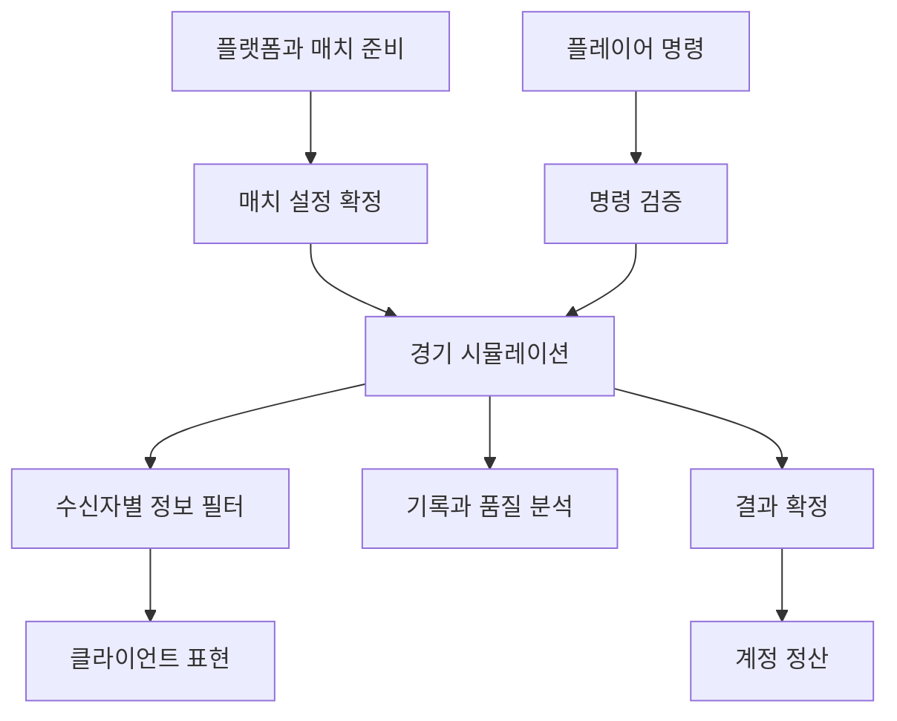
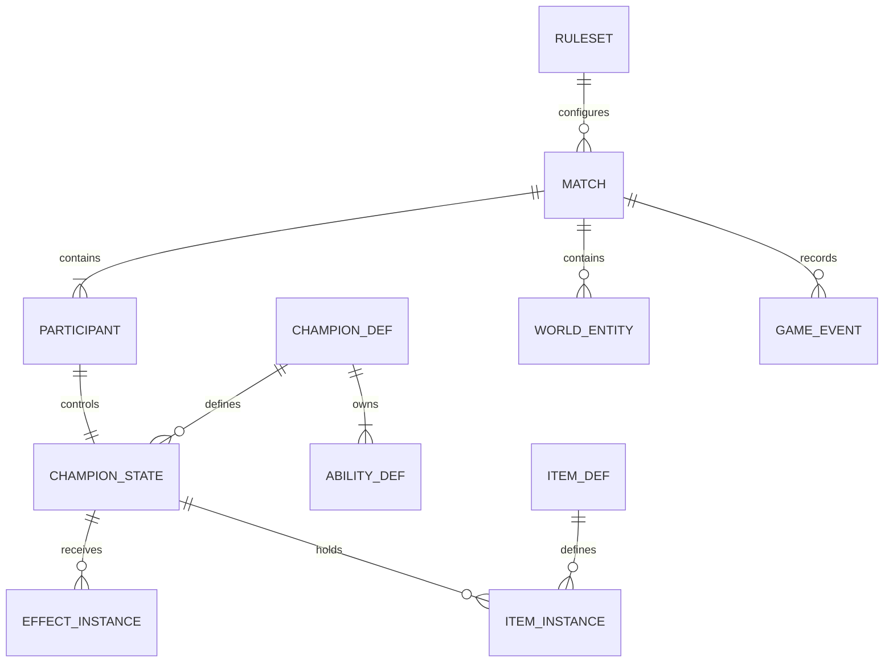

# 20. 네트워크·데이터·재현 아키텍처

[문서 목록](00_README.md) · [전투](03_combat_stats_damage.md) · [시야](09_vision_fog_information.md) · [품질 검증](21_balance_analytics_quality.md)

## 1. 이 문서의 성격

**원작의 현재 서버 코드를 복원한 문서가 아니다.** 공개된 Riot 기술 사례를 한정된 근거로 삼고, 앞의 게임 규칙을 구현 가능한 책임과 데이터로 분해한 [제안] 문서다.

- 분석 기준일: 2026-11-13.
- 과거에 공개된 기술 사실에는 공개 연도를 붙인다.
- 서버 주기, 패킷 스키마, 현재 언어·프레임워크, 호스팅 단위, 정확한 예측·지연 보상 방식은 현행 구현으로 단정하지 않는다.
- 특히 결정적 서버 재생, 고정 시간 간격, 모든 클라이언트의 동기식 실행은 서로 다른 개념이다.

## 2. 공개 자료로 확인할 수 있는 경계

| 확인 내용 | 시점 | 이 문서에서 사용할 범위 |
| --- | --- | --- |
| Chronobreak는 기록을 재생해 과거 경기 상태를 복구하기 위해 개발됨 | 2017 공개 | 복구 가능성과 입력 기록의 필요성 [N01] |
| 게임플레이 핵심 상태를 결정적으로 만드는 접근을 설명함 | 2017 공개 | 전체 메모리·모든 출력의 동일성과 구별 [N02] |
| 당시 서버는 고정 간격 대신 측정한 프레임 시간을 기록하는 선택을 설명함 | 2017 공개 | 결정성이 곧 고정 틱이라는 오해 방지 [N02] |
| 통합 시간 체계를 도입한 과정을 설명함 | 2017 공개 | 일시정지·재생·시간 복구 문제의 근거 [N03] |
| Data Dragon과 로컬 게임 API 등 공개 인터페이스를 안내함 | 열람일 기준 문서 | 외부 공개 데이터와 실행 규칙을 구분 [N04] |

위 내용을 2026년 전체 엔진 구조가 과거와 동일하다는 증거로 사용하지 않는다.

## 3. 재현 시스템의 책임 분리 [제안]

게임 규칙의 확정, 사용자의 입력 반응, 시각화, 계정 정산은 서로 다른 실패 조건을 가진다. 한 계층의 장애가 다른 계층의 결과를 임의로 바꾸지 않도록 분리한다.



여기서 서버 권한 모델은 재현용 선택이다. 클라이언트는 사용 의도를 보내고, 서버가 소유권·상태·자원을 검사한 뒤 유효한 결과를 확정한다. 서버가 승인하지 않은 피해량이나 골드를 클라이언트 보고만으로 수용하지 않는다.

## 4. 규칙 정의와 실행 상태 [제안]

| 종류 | 예시 | 변경 시점 | 저장 원칙 |
| --- | --- | --- | --- |
| 콘텐츠 정의 | 챔피언, 스킬, 아이템, 미니언 | 패치·콘텐츠 빌드 | 버전 고정과 ID 참조 |
| 모드 정책 | 팀 수, 승리 조건, 상점 제약 | 매치 생성 전 | 매치 설정에 스냅샷 |
| 경기 실행 상태 | 체력, 위치, 골드, 버프, 목표 | 시뮬레이션 진행 | 확정 상태와 이벤트 |
| 개인 설정 | 입력, 카메라, HUD | 사용자 변경 | 계정·장치 정책 적용 |
| 계정 상태 | 보유물, 진행, 제재 | 승인된 정산 | 경기와 독립된 영속화 |
| 분석 기록 | 명령, 결과, 성능, 관측 | 기록 정책 | 버전과 시간 축 보존 |

스킬 툴팁에 보이는 값을 실행 규칙의 유일한 원본으로 사용하면 조건부 계수와 예외가 손실될 수 있다. 런타임 계산과 표시 설명은 같은 정의를 참조하되 서로의 역할을 대신하지 않게 한다.

## 5. 데이터 관계 모델 [제안]



계정 ID와 경기 참가자 ID를 같게 쓰지 않는다. 특정 경기의 재생·관전·통계에 필요한 식별과 계정에 대한 접근 권한을 분리할 수 있기 때문이다.

### 5.1 최소 정의 예시

```yaml
ability_definition:
  definition_id: ability_example
  revision: content_revision
  target_policy: target_selector_ref
  cost_policy: cost_rule_ref
  cast_policy: cast_rule_ref
  effect_graph: ordered_effects
  cooldown_policy: cooldown_rule_ref
  visibility_policy: disclosure_rule_ref

effect_instance:
  instance_id: unique_id
  definition_id: effect_ref
  source_entity_id: source_ref
  owner_entity_id: target_ref
  start_time: simulation_time
  end_condition: expiry_or_event
  stack_state: explicit_state
  captured_parameters: optional_snapshot
```

수치가 적용 시점에 고정되는지, 매번 갱신되는지도 정의가 필요하다. 버프를 얻을 때의 공격력을 저장하는 효과와 적중 순간의 공격력을 읽는 효과는 같은 계수라도 결과가 다르다.

## 6. 명령과 결과를 분리하기 [제안]

플레이어 명령은 “어디로 이동하고 싶은가”, “무엇을 사용하려는가”를 나타낸다. 그 명령이 실제 이동·소모·피해로 이어지는지는 현재 규칙과 상태로 결정한다.

| 명령 | 검사할 조건 | 가능한 결과 |
| --- | --- | --- |
| 이동 | 참가 권한, 생존, 이동 금지, 유효 목적지 | 경로 적용·보정·거부 |
| 기본 공격 | 대상 유효성, 사거리, 공격 상태 | 접근·공격 시작·거부 |
| 스킬 사용 | 자원, 쿨다운, 대상, 시전 조건 | 시전·예약·실패 |
| 아이템 구매 | 상점 접근, 골드, 슬롯, 구매 제한 | 원자적 구매·실패 |
| 와드 사용 | 충전, 설치 조건, 개수 정책 | 설치·교체·실패 |
| 재접속 | 세션 권한, 경기 상태 | 현재 상태 복원·거부 |

`CommandAccepted`와 `DamageApplied`는 같은 종류의 이벤트가 아니다. 시전이 승인된 뒤에도 적이 이동하거나 투사체가 막히면 피해가 발생하지 않을 수 있다.

## 7. 한 처리 구간의 단계 [제안]

1. 해당 구간에 처리할 입력과 외부 사건을 수집한다.
2. 오래되거나 중복된 명령과 권한이 없는 명령을 분류한다.
3. 이동·공격·시전 등 행동 상태를 갱신한다.
4. 충돌, 대상 조건, 효과 만료와 발생 조건을 평가한다.
5. 전투 결과와 경제·오브젝트 사건을 확정한다.
6. 종료 조건과 다음 예약 이벤트를 갱신한다.
7. 수신자별 허용 정보를 추려 전달하고 기록한다.

이 순서는 원작 실행 순서의 주장이 아니다. 실제 재현 구현에서는 동시성 정책을 먼저 정의해야 한다. 예를 들어 같은 구간의 회복과 치명적 피해, 대상 불가 전환과 투사체 적중의 우선순위가 결과에 영향을 준다.

## 8. 네트워크에서 분리할 네 가지 시간 [제안]

| 시간 | 용도 | 혼동할 때의 문제 |
| --- | --- | --- |
| 시뮬레이션 시간 | 쿨다운, 버프, 목표, 승패 | 화면 속도에 따라 규칙이 바뀜 |
| 입력 생성·수신 시간 | 명령 정렬과 지연 분석 | 과거 입력을 현재 행동으로 오인 |
| 표현 시간 | 보간, 애니메이션, 음향 | 스킬이 판정보다 먼저 또는 늦게 보임 |
| 실제 경과 시간 | 연결 관리, 운영, 타임아웃 | 일시정지 중 세션 관리 실패 |

원작의 정확한 시간 보정 정책은 확인하지 않았다. 재현 시스템에서는 어떤 입력까지 유효한지, 어떤 상태를 과거 기준으로 검사할지, 어떤 결과는 되돌리지 않을지를 기능별로 명시해야 한다.

### 8.1 예측과 보간의 경계

로컬 이동에 빠른 피드백을 주는 예측과, 다른 개체의 움직임을 부드럽게 보여 주는 보간은 목적이 다르다. 클라이언트가 이동 애니메이션을 먼저 보여주더라도 골드·처치·승패를 같은 방식으로 예측 확정해서는 안 된다.

단순한 시각 오차를 줄이기 위해 적의 숨겨진 좌표를 미리 전송하는 설계도 적절하지 않다. 반응성과 정보 제한을 함께 만족시키는 것이 [시야](09_vision_fog_information.md)와의 계약이다.

## 9. 정보 가시성과 복제 [제안]

```yaml
replication_policy:
  entity_id: world_entity
  receiver_team: team_id
  visibility_reason: visible_or_team_or_public
  visible_fields: allowed_field_set
  last_authorized_time: simulation_time
  on_visibility_lost: configured_policy
```

같은 개체라도 아군, 적, 관전자에게 제공하는 필드가 다를 수 있다. 시야에서 숨기는 처리는 화면에서 모델을 끄는 단계뿐 아니라 네트워크 전달, 미니맵, 음향, 이벤트 로그, 이펙트 생성에 일관되게 적용해야 한다.

정확한 피해량과 경제 보상에는 유실·중복 방지가 중요하다. 반면 자주 갱신되는 위치 표현은 오래된 상태를 전부 전달하는 것보다 최신 유효 상태가 유용할 수 있다. 상태별 전달 정책을 나눈다.

## 10. 재접속과 상태 복원 [제안]

재접속은 경기 시작 설정을 다시 실행하는 기능이 아니다. 현재 시간의 상태를 가져와서 지속 중인 행동·버프·목표·구조물을 복구하는 기능이다.

1. 참가자의 재접속 권한과 현재 경기 상태를 확인한다.
2. 수신 가능한 현재 스냅샷을 만든다.
3. 스냅샷 이후 이벤트를 연결해 빠진 구간을 처리한다.
4. 클라이언트 표현을 현재 시점으로 맞춘다.
5. 입력 시퀀스를 재정렬하고 예전 명령의 중복 적용을 막는다.

스냅샷을 전송하는 동안에도 경기가 진행되므로 기준 시점과 이후 변경의 경계를 보존해야 한다. 복원 중 보여 줄 수 없는 비공개 정보가 포함되지 않도록 참가자 권한을 유지한다.

## 11. 결정적 재생과 복구 [분석·제안]

기록된 동일 조건을 다시 실행하는 시스템은 버그 재현과 수치 변경의 영향 비교에 유용하다. 그러나 결과가 같으려면 입력만이 아니라 규칙 버전, 무작위 상태, 이벤트 순서, 외부 의존성까지 통제해야 한다.

| 기록 대상 | 필요한 이유 |
| --- | --- |
| 매치 초기 설정 | 챔피언·모드·맵 조건 일치 |
| 콘텐츠 해시 | 같은 ID의 다른 규칙 사용 방지 |
| 입력과 처리 순서 | 동시 행동의 판정 재현 |
| 시간 진행 정보 | 타이머와 처리 간격 재현 |
| 무작위 시드·상태 | 확률 결과 재현 |
| 외부 사건 | 연결, 운영 명령 등 재현 |
| 비교용 핵심 상태 | 최초 불일치 지점 찾기 |

원작의 2017 설명도 핵심 게임플레이 상태의 결정성과 전체 메모리의 완전한 동일성을 구별한다.[N02] 따라서 재현 검증 역시 화면 파티클 개수의 우연한 차이와 실제 피해 판정 차이를 같은 수준으로 취급하지 않는다.

## 12. 공개 데이터 활용의 범위

[공식] Data Dragon은 챔피언·아이템 등 정적 데이터와 자산을 제공하며, 수동 갱신이므로 패치 직후 지연되거나 지역 클라이언트 버전과 다를 수 있다.[N04]

[분석] 따라서 공개 JSON은 콘텐츠 목록과 표시 값을 조사하는 출발점이다. 그 파일만으로 서버의 숨겨진 계산 순서, 모든 예외, 현재 긴급 수정까지 검증했다고 볼 수 없다.

재현용 콘텐츠 파이프라인은 `source_version`, `verified_patch`, `mode`, `region`, `confidence`, `last_checked`를 따로 기록한다. “최신”이라는 문자열 하나로 데이터의 현재성을 표현하지 않는다.

## 13. 기술 선택의 판단 기준 [제안]

| 선택 | 얻는 것 | 부담·검토점 |
| --- | --- | --- |
| 명시적 효과 정의 | 조합 가능성·데이터 변경 | 예외 처리와 실행 순서 복잡성 |
| 서버 권한 판정 | 일관된 결과·검증 경계 | 지연을 느끼지 않게 하는 표현 필요 |
| 수신자별 가시성 필터 | 정보 노출 제한 | 복제 비용과 시야 전이 정확성 |
| 기록 재생 기반 검증 | 회귀 재현·비교 | 결정성 관리 비용 |
| 모드별 정책 데이터 | 특수 모드 확장 | 정책 조합의 검증 폭증 |
| 결과 정산 분리 | 장애 시 재시도 | 중복 반영 방지와 식별 체계 |

LoL형 기능을 구현할 때 모든 개체를 고비용 물리 시뮬레이션 대상으로 취급할 필요는 없다. 이동·범위·적중 규칙이 요구하는 정밀도와 네트워크 일관성을 먼저 정의하고 시각 효과는 별도 예산으로 관리한다. 이것은 엔진 선택에 관한 제안이며 원작의 물리 엔진 구성을 뜻하지 않는다.

## 14. 검증 시나리오 [제안]

| ID | 시나리오 | 기대 결과 |
| --- | --- | --- |
| NET-01 | 동일 명령 중복 전달 | 자원·효과 한 번만 적용 |
| NET-02 | 늦은 공격 명령이 사망 후 도착 | 현재 규칙에 맞게 거부·분류 |
| NET-03 | 이동 중 패킷 손실과 순서 뒤바뀜 | 유효한 최신 상태로 수렴 |
| NET-04 | 적이 시야 경계를 반복 통과 | 미허용 현재 정보 누출 없음 |
| NET-05 | 버프 지속 중 재접속 | 남은 시간·중첩·효과 동일 |
| NET-06 | 결과 정산 응답 유실 후 재시도 | 보상과 랭크를 한 번만 반영 |
| NET-07 | 동일 기록을 같은 콘텐츠로 재생 | 핵심 판정 상태 일치 |
| NET-08 | 다른 콘텐츠 해시로 재생 요청 | 비호환을 탐지하거나 명시적 변환 |
| NET-09 | 재생 시점을 과거로 이동 | 미래 효과·정보가 남지 않음 |
| NET-10 | 일반 사용자에게 관전자 데이터 전달 시도 | 역할 권한으로 차단 |
| NET-11 | 상점 연속 구매 중 응답 유실 | 골드와 슬롯의 원자성 보존 |
| NET-12 | 종료 처리 중 마지막 전투 이벤트 도착 | 정한 순서로 결과 하나만 확정 |

## 15. 출처

- [N01] Riot Games, [Determinism in League of Legends: Introduction](https://www.riotgames.com/en/news/determinism-league-legends-introduction), 2017-06-20. Chronobreak와 서버 재생의 목적. 열람 2026-11-13.
- [N02] Riot Games, [Determinism in League of Legends: Implementation](https://www.riotgames.com/en/news/determinism-league-legends-implementation), 2017-06-20. 게임플레이 결정성, 시간·입력 기록의 당시 설계. 열람 2026-11-13.
- [N03] Riot Games, [Determinism in League of Legends: Unified Clock](https://www.riotgames.com/en/news/determinism-league-legends-unified-clock), 2017-10-10. 시간 체계 정리의 사례. 열람 2026-11-13.
- [N04] Riot Games, [Riot Developer Portal — League of Legends](https://developer.riotgames.com/docs/lol). 정적 데이터·공개 인터페이스·버전 주의사항. 공개 API가 현재 서버 구현 전체를 설명하는 것은 아님. 열람 2026-11-13.
