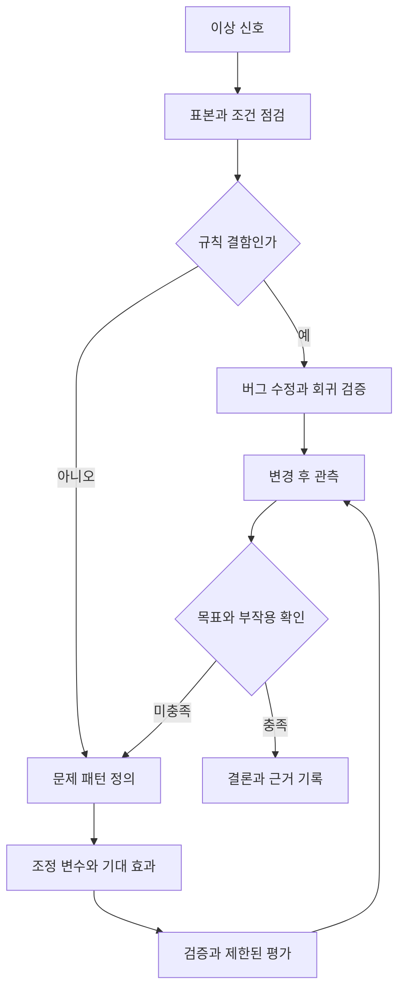

# 21. 밸런스·분석 지표·품질 검증

[문서 목록](00_README.md) · [전투](03_combat_stats_damage.md) · [경제](05_economy_experience.md) · [기술 구조](20_network_data_architecture.md)

## 1. 범위

이 문서는 개별 챔피언의 현재 강약 순위를 제공하지 않는다. 시스템이 정상 작동하는지, 플레이 경험이 의도한 방향인지, 패치가 어떤 영향을 냈는지를 판단하는 역기획 문서다.

- 조사 기준일: 2026-11-13.
- 공개 Riot 자료에서 확인한 과거 운영 방법은 [공식·당시]로 표시한다.
- 아래 지표 정의, 예시 수치, 실험 절차, 자동 검증 정책은 [분석·제안]이다.
- 제시한 예시 데이터는 실제 서버 통계가 아니다.

## 2. 공개된 접근의 핵심

[공식·당시] Riot의 2019 Champion Balance Framework는 서로 다른 숙련 집단과 프로 경기의 지표를 구분해서 밸런스 대상을 판단하는 방법을 설명했다.[B01]

[공식·당시] 2016년 자동화 글은 게임 클라이언트와 서버의 기능을 검증하는 BVS와 조건 기반 대기 등 테스트 자동화 사례를 공개했다.[B02]

[공식·당시] 2018년 성능 글은 실제 이용 환경의 프레임 성능을 수집하고 문제 장면을 재현하는 과정의 중요성을 다뤘다.[B03]

이 자료의 정확한 당시 임계값·운영 규모를 2026년 현재 정책으로 사용하지 않는다.

## 3. 밸런스 목표를 여러 축으로 정의하기 [분석]

| 축 | 질문 | 단일 승률로 놓치는 것 |
| --- | --- | --- |
| 승리 가능성 | 비슷한 조건에서 경쟁할 수 있는가 | 조합·숙련·역할 차이 |
| 대응 가능성 | 상대에게 합리적인 대응이 있는가 | 승률은 정상인데 불쾌한 패턴 |
| 표현 가능성 | 잘하는 플레이가 결과에 반영되는가 | 역할과 숙련의 차별성 |
| 선택 다양성 | 여러 빌드·조합이 의미 있는가 | 하나의 정답이 사실상 강제됨 |
| 역할 경험 | 각 포지션이 의사결정에 참여하는가 | 기여는 높지만 체감은 낮음 |
| 경기 흐름 | 유불리가 진전과 마무리로 이어지는가 | 지루한 대기 또는 과도한 급종료 |

어떤 챔피언의 승률을 50%에 가깝게 맞추는 일과 그 챔피언의 경험을 건강하게 만드는 일은 같은 작업이 아니다. 상대가 반응할 수 있는 구간, 실패했을 때 부담하는 비용, 강한 상황과 약한 상황의 차이를 함께 봐야 한다.

## 4. 통계의 관측 단위 [제안]

| 단위 | 주요 식별 | 사용 사례 |
| --- | --- | --- |
| 매치 | 패치, 큐, 지역, 경기 ID | 게임 길이, 종료, 팀 격차 |
| 참가자 | 포지션, 챔피언, 숙련 구간 | 성장, 피해, 사망, 빌드 |
| 조합 | 팀 구성과 상대 구성 | 시너지, 카운터, 피해 편중 |
| 구간 | 시간 범위, 국면, 목표 상태 | 초반·중반 성능의 분리 |
| 사건 | 발생 시각, 위치, 원인, 결과 | 버그·특정 상호작용 |
| 세션 | 연결·프레임·입력 상태 | 지연, 재접속, 성능 |

한 경기의 두 팀은 독립된 두 표본이 아니다. 같은 플레이어의 반복 경기, 파티, 같은 매치의 참가자 등 관측 간 상관도 고려해야 한다. 집계 방법에 따라 실제보다 표본이 많아 보일 수 있다.

## 5. 지표 사전 [제안]

| 지표 | 정의의 핵심 | 같이 봐야 할 변수 |
| --- | --- | --- |
| 챔피언 승률 | 유효 종료 경기 중 승리 비율 | 포지션, 숙련, 미러, 패치 |
| 선택률 | 해당 큐의 선택 가능 기회 대비 선택 | 보유·밴·모드 제약 |
| 금지율 | 유효 밴 기회에서 대상이 된 비율 | 신규성, 체감 불쾌감, 강함 |
| 역할별 성장 | 비교 시점의 골드·경험치 분포 | 라인 교환, 퀘스트, 교전 |
| 오브젝트 전환율 | 특정 우위 이후 목표 획득 비율 | 인원, 위치, 웨이브, 체력 |
| 역전 빈도 | 불리함 정의 후 최종 승리 비율 | 기준 시점, 격차 크기 |
| 게임 길이 | 유효 시작부터 종료까지 | 리메이크·조기 종료 분리 |
| 교전 지속 | 정한 참여·간격 규칙의 교전 길이 | 조합, 아이템, 인원 |
| 빌드 다양성 | 조건별 아이템 선택의 분산 | 구매 시점과 적 조합 |
| 실효 참여 | 목표 전후 유의미한 행동 | 단순 피해량 외 시야·압박 |

“오브젝트를 획득한 팀의 승률”은 그 목표의 순수한 효과와 다르다. 원래 유리한 팀이 더 쉽게 획득하기 때문이다. 동일한 경기 상태를 통제하지 않은 전후 비교로 목표가 승리를 얼마나 유발했는지 단정하지 않는다.

## 6. 표본 수와 불확실성 예시 [제안·가상 데이터]

표본이 독립이라는 단순 가정 아래 비율의 대략적인 표준오차는 다음과 같이 계산할 수 있다.

\[
SE \approx \sqrt{\frac{p(1-p)}{n}}
\]

관측 승률이 54%라고 가정하면 다음과 같다.

| 가상 표본 | 대략적인 95% 범위 | 해석 |
| --- | --- | --- |
| 400경기 | 약 49.1%~58.9% | 작은 차이를 확신하기 어려움 |
| 10,000경기 | 약 53.0%~55.0% | 같은 단순 가정에서 범위가 좁음 |

이 표는 설명용 정규 근사다. 실제 분석에서는 표본 구조, 반복 사용자, 역할 분포, 선택 편향과 다중 비교를 다뤄야 한다. 신뢰구간이 좁아도 편향된 데이터의 결론이 옳아지는 것은 아니다.

### 6.1 단순 승률을 왜곡하는 사례

- 숙련된 사용자만 선택하는 챔피언과 많은 신규 사용자가 선택하는 챔피언을 그대로 비교한다.
- 불리할 때 구매하는 방어 아이템과 유리할 때 구매하는 공격 아이템의 구매 후 승률을 비교한다.
- 오랜 경기를 해야 살 수 있는 아이템을 짧은 경기의 아이템과 같은 조건으로 비교한다.
- 상위권과 일반 구간에서 역할이 다른 챔피언을 합쳐 평가한다.
- 패치 직후 실험 빌드와 이후 정착한 빌드를 한 평균으로 섞는다.

## 7. 밸런스 변경의 검토 흐름 [제안]



조정을 하기 전에 “무엇이 강하다”를 행동 단위로 적는다. 예를 들어 “초반 라인에서 자원 소모 없이 안전하게 웨이브를 처리해 상호작용을 회피한다”는 문제 정의는 단순히 승률이 높다는 진술보다 조정 지점을 찾기 쉽다.

## 8. 조정 변수와 예상 부작용 [분석]

| 조정 대상 | 직접 기대 효과 | 함께 검토할 부작용 |
| --- | --- | --- |
| 기본 피해량 | 초반 교환·정리 능력 변화 | 다른 포지션의 사냥 속도 |
| 계수 | 성장 이후 효율 변화 | 특정 아이템 경로 독점 |
| 비용 | 반복 사용 제약 | 자원 없는 상대와 상성 극단화 |
| 대기시간 | 사용 빈도와 빈틈 변화 | 연계·탈출의 질적 변화 |
| 사거리·속도 | 위험 감수와 대응 시간 변화 | 숙련 구간별 효과 차이 |
| 시야 제공 | 안전성과 추적 능력 변화 | 갱킹·정글 경로 가치 변화 |
| 아이템 조합식 | 구매 시점·귀환 선택 변화 | 중간 부품의 강제성 |
| 중립 목표 보상 | 팀의 이동 유인 변화 | 다른 라인 선택권 축소 |

수치 하나를 바꿔도 시스템 간 경로가 여러 개다. 예를 들어 스킬 피해 상승은 직접 교전만이 아니라 웨이브 처리, 먼저 이동하는 시간, 시야 확보, 목표 준비에도 영향을 줄 수 있다.

## 9. 기능 품질과 밸런스 품질을 분리하기 [제안]

| 분류 | 질문 | 예시 |
| --- | --- | --- |
| 기능 정확성 | 명세와 같은 결과인가 | 자원은 소모됐는데 스킬이 발생하지 않음 |
| 시스템 일관성 | 관련 기능이 같은 의미를 쓰는가 | UI와 판정의 사거리 불일치 |
| 네트워크 일관성 | 참가자가 같은 확정 결과를 받는가 | 사망·아이템 상태 불일치 |
| 체감 품질 | 결과를 이해하고 대응할 수 있는가 | 예고가 희미해 회피 불가능처럼 느낌 |
| 경쟁 밸런스 | 조건별 경쟁과 대응이 유지되는가 | 특정 상성이 지나치게 일방적 |

버그가 승률에 영향을 주지 않았다고 수정 우선순위가 항상 낮은 것은 아니다. 재현이 드물어도 승패·공정성·결과 정산을 잘못 바꾸는 결함은 별도로 평가한다.

## 10. 자동 검증의 범위 [제안]

모든 챔피언·스킨·아이템·룬·상태의 완전 조합은 빠르게 커진다. 모든 조합을 같은 비용으로 검사하는 대신 공통 규칙의 불변 조건과 위험한 상호작용을 나눠 검사한다.

| 계층 | 검증 대상 | 예시 |
| --- | --- | --- |
| 순수 계산 | 수치·조건·변환 | 가속 환산, 효과 중첩 정책 |
| 개별 기능 | 하나의 스킬·아이템 | 비용·대기·적중·취소 |
| 대표 상호작용 | 종류별 조합 | 투사체와 대상 불가, 보호막과 피해 |
| 전체 흐름 | 시작~종료~정산 | 재접속 포함 경기 완료 |
| 기록 회귀 | 과거 결함 장면 | 동일 입력에서 재발하지 않음 |
| 시각·음향 | 식별과 피드백 | 경계·위계·정보 노출 |

소환물, 변신, 복제, 재시전, 부활, 전역 스킬 같은 기능은 공통 구현을 공유하면서도 특수 경계를 만들기 쉽다. 콘텐츠 이름보다 기능 태그를 기준으로 대표 사례를 고른다.

## 11. 검증 사례 설계 [제안]

```yaml
test_case:
  id: COMBAT_PROJECTILE_TARGET_STATE
  ruleset_revision: pinned_revision
  content_hash: pinned_hash
  setup:
    target_state: targetable
    attacker_state: ready
  action:
    - launch_projectile
    - change_target_state_before_impact
  expected:
    outcome: resolved_by_defined_target_policy
    duplicate_damage: false
  evidence:
    - command_log
    - effect_log
    - relevant_state_snapshot
```

예상값은 구현 코드가 방금 계산한 값을 그대로 복사해서 만들지 않는다. 별도로 작성한 규칙과 검산으로 기대값을 도출해야 같은 오류를 테스트도 따라 하는 문제를 줄일 수 있다.

### 시간 기반 테스트

“몇 초 기다리면 완료될 것”이라고 가정하기보다 시전 종료·효과 만료·목표 상태 등 실제 조건을 기다린다. 시간 자체가 검증 대상일 때에는 허용 오차와 시간 도메인을 명시한다. 조건 대기를 강조한 Riot의 과거 자동화 사례도 같은 문제를 다룬다.[B02]

## 12. 성능 품질의 관측 [분석·제안]

평균 FPS만으로는 교전 순간의 긴 프레임을 설명하기 어렵다. 성능은 순간 전투 조작과 직접 연결되므로 평균과 함께 분포·꼬리 구간·특정 장면을 확인한다.

| 관측 | 필요한 구분 | 진단 예 |
| --- | --- | --- |
| 클라이언트 프레임 | CPU·GPU·표현·로딩 | 다수 투사체에서만 끊기는가 |
| 서버 처리 시간 | 이동·시야·효과·기록 | 큰 교전에서 처리 예산을 넘는가 |
| 네트워크 | 지연·지터·손실·복구 | 일정한 지연과 순간 튐 구분 |
| 자산 메모리 | 챔피언·스킨·효과 | 새 콘텐츠 조합에서만 증가하는가 |
| 시작·재접속 | 로딩과 상태 복원 | 긴 재접속이 결과를 악화시키는가 |

하드웨어, 화면 설정, 모드, 콘텐츠 버전이 다른 집단을 합친 평균은 원인을 숨길 수 있다. 동일 장면을 비교하는 재현과 실제 사용자 분포를 보는 관측을 함께 사용한다.[B03]

## 13. 결함 우선순위 예시 [제안]

| 우선도 | 판정 기준 | 예 |
| --- | --- | --- |
| 치명 | 경기 진행·승패·정산 신뢰 훼손 | 중복 보상, 잘못된 승자, 반복 충돌 |
| 높음 | 핵심 경쟁 기능·정보 경계 훼손 | 시야 밖 정보, 특정 스킬 불발 |
| 중간 | 제한된 기능·조건에서 불일치 | 특정 상점 조작, 일부 툴팁 |
| 낮음 | 결과에 거의 영향 없는 표현 문제 | 장식 효과의 미세한 차이 |

우선도와 발생 빈도는 별도 필드다. 드물지만 치명적인 결함과 흔하지만 가벼운 결함을 한 숫자만으로 묶지 않는다.

## 14. 패치 검증 시나리오 [제안]

| ID | 변경 또는 상황 | 확인할 결과 |
| --- | --- | --- |
| QA-01 | 스킬 피해 조정 | 레벨·계수·대상 종류별 기대값 |
| QA-02 | 포지션 보상 조정 | 기존 아이템·레벨 상한과의 충돌 |
| QA-03 | 와드·시야 변경 | 전장·미니맵·음향 정보의 일관성 |
| QA-04 | 몬스터 보상 변경 | 마지막 타격·팀 귀속·버프 중복 |
| QA-05 | 구매 제한 변경 | 구매·판매·조합·되돌리기 경계 |
| QA-06 | 입력 방식 확대 | 동일 명령 의미와 설정 마이그레이션 |
| QA-07 | 모드 규칙 복제 | 협곡 전용 효과가 특수 모드에 유입되지 않음 |
| QA-08 | 결과 시스템 재시도 | 같은 결과를 한 번만 반영 |
| QA-09 | 새로운 스킨·효과 | 판정 경계·실루엣·중요도 식별 |
| QA-10 | 수정 후 승률 변화 | 버그 수정 효과와 사용자 구성 변화 분리 |

## 15. 운영 보고서 최소 형식 [제안]

패치 보고서에는 변경 사항뿐 아니라 의도, 관측 기간, 유효 표본, 제외 조건, 이전 버전과의 차이, 예상하지 못한 영향, 추가로 필요한 검증을 함께 남긴다.

예: “스킬 재사용 간격을 늘려 반복적인 안전 압박을 줄이려 했다. 전체 승률은 비슷하지만 해당 상황의 연속 사용이 감소했다. 정글 사용자의 사냥 속도도 영향을 받아 포지션별 추가 확인이 필요하다.” 이와 같은 설명은 성공·실패를 단순한 승률 한 줄보다 구체적으로 평가하게 한다.

## 16. 출처

- [B01] Riot Games, [/dev: Champion Balance Framework](https://www.leagueoflegends.com/en-us/news/dev/dev-champion-balance-framework/), 2019-05-30. 당시 숙련 집단별 평가 접근. 현행 자동 판정 공식의 공개라고 해석하지 않음. 열람 2026-11-13.
- [B02] Riot Games, [Automated Testing for League of Legends](https://www.riotgames.com/en/news/automated-testing-league-legends), 2016년 공개. BVS, 기능 자동화, 조건 대기 사례. 열람 2026-11-13.
- [B03] Riot Games, [Profiling: Real World Performance in League](https://www.riotgames.com/en/news/profiling-real-world-performance-league), 2018-08-07. 실사용 환경 성능 분석 사례. 열람 2026-11-13.
