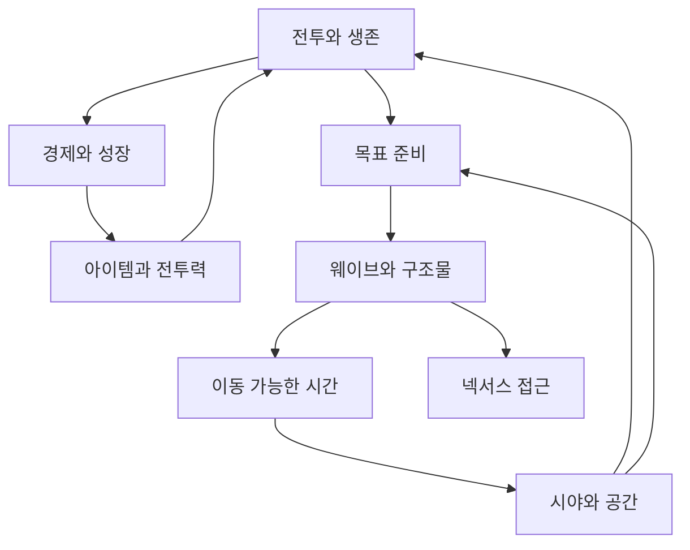

# 22. 시스템 의존성·통합 시나리오·요구사항

[문서 목록](00_README.md) · [핵심 루프](01_core_match_loop.md) · [버전과 근거](90_sources_version_ledger.md)

## 1. 목적

개별 시스템 설명만으로는 LoL의 실제 플레이를 설명하기 어렵다. 한 번의 귀환이 경제·이동·시야·오브젝트에 동시에 영향을 주기 때문이다. 이 문서는 앞의 시스템을 플레이 장면과 데이터 소유권으로 연결한다.

이 문서의 시나리오와 인터페이스는 [분석·제안]이며 실제 경기 기록이 아니다. 각 기능의 공식 근거와 패치 범위는 링크된 담당 문서에 있다. 예시 값이나 변수는 원작의 비공개 내부 수치로 해석하지 않는다.

## 2. 시스템 책임 지도 [제안]

| 시스템 | 책임지는 상태·규칙 | 주로 받는 입력 | 주로 내보내는 변화 |
| --- | --- | --- | --- |
| 경기 흐름 | 진행·종료·확정 결과 | 목표 파괴, 특수 종료 | 매치 상태 |
| 챔피언·드래프트 | 선택과 구성 | 모드, 보유·밴·역할 | 확정 참가 구성 |
| 전투·능력치 | 피해·회복·생존 | 공격, 스킬, 효과 | 체력·처치 |
| 스킬·상태 | 시전·대기·제어 | 사용 명령, 효과 | 행동 가능성 |
| 경제·경험치 | 보상·성장 | 처치, 자원, 시간 | 골드·레벨 |
| 아이템 | 구매·소유·효과 | 골드, 상점, 슬롯 | 능력치·조건부 효과 |
| 룬·소환사 주문 | 사전 구성의 적용 | 확정 로드아웃 | 전투·이동 변형 |
| 맵·이동 | 접근 가능한 공간 | 목적지, 지형 상태 | 위치·경로 |
| 시야 | 팀별 관측 가능성 | 위치, 와드, 지형 | 공개·비공개 상태 |
| 라인·구조물 | 반복 압박·통로 | 미니언, 피해 | 웨이브·진입 경로 |
| 정글·목표 | 중립 자원·팀 보상 | 전투, 스폰 규칙 | 버프·경제·목표 상태 |
| 입력·UI | 의도 전달·피드백 | 사용자 조작·확정 결과 | 명령·표현 |
| 매칭·랭크 | 참가 집단·경쟁 평가 | 큐·파티·결과 | 매치와 등급 |
| 계정·수집 | 지속 진행·보유물 | 승인된 정산 | 선택 가능 콘텐츠 |
| 운영·상품 | 콘텐츠 제공·판매 정책 | 시즌, 구매, 보상 | 권리와 콘텐츠 상태 |

전략·매크로는 이 표의 상태를 직접 소유하는 엔진 컴포넌트라기보다 플레이어가 여러 시스템을 함께 해석하는 층이다. [매크로 문서](12_team_macro_strategy.md)의 분석과 서버 구현의 책임 분해를 구별한다.

## 3. 가장 강한 의존 관계 [분석]

이 도식에서 경제 우위가 자동으로 승리로 연결되지는 않는다. 아이템 구매, 합류, 시야, 웨이브가 그 우위를 사용할 기회를 만들어야 한다. 시스템 간 연결이 끊기면 장점이 실제 결과로 전환되지 않는다.

## 4. 시나리오 A — 라인 교환에서 구매 우위까지

### 상황 [가상]

아군 라이너가 짧은 교환에서 상대 체력을 낮췄다. 자기 체력과 자원도 줄었으며 현재 웨이브를 처리한 뒤 귀환할지, 더 압박할지 고민한다.

| 순서 | 행동·판단 | 관련 시스템 | 확인할 상태 |
| --- | --- | --- | --- |
| 1 | 상대 핵심 스킬의 빈틈을 이용해 공격 | 전투·스킬 | 사거리, 비용, 대기시간 |
| 2 | 교환 종료 후 거리를 벌림 | 이동·군중 제어 | 추격·반격 가능성 |
| 3 | 웨이브를 처리할지 결정 | 미니언·경제 | 체력, 자원, 적 정글 정보 |
| 4 | 귀환 시점을 선택 | 맵·시야 | 안전한 위치와 이동 시간 |
| 5 | 현재 골드로 부품을 구매 | 상점·아이템 | 조합 경로와 슬롯 |
| 6 | 복귀 후 다음 교환을 준비 | 성장·매크로 | 상대 구매와 웨이브 상태 |

### 설계 해석

교환의 보상은 적 체력을 줄인 사실뿐 아니라 상대의 이후 선택을 제한한 데 있다. 하지만 추가 공격을 욕심내다 귀환 시점을 놓치면 구매 우위를 사용하지 못한다. 한 번의 조작 성공이 다음 판단까지 자동으로 대신하지 않도록 연결되어 있다.

### 통합 요구사항 [제안]

- 전투 후 현재 자원과 스킬 상태를 UI가 일관되게 표시한다.
- 귀환 중 행동·피해에 따른 중단 규칙은 하나의 정의를 사용한다.
- 구매는 골드 차감과 아이템 추가를 함께 확정한다.
- 재접속이 발생해도 진행 중이던 구매 결과를 두 번 적용하지 않는다.

관련 문서: [전투](03_combat_stats_damage.md), [경제](05_economy_experience.md), [아이템](06_items_shop_builds.md), [라인](10_lanes_minions_structures.md).

## 5. 시나리오 B — 중립 목표 전투의 사전 준비

### 상황 [가상]

다음 중요한 중립 목표를 두고 양 팀이 움직인다. 아군은 정면 전투력이 유리하다고 판단하지만, 현재 강 입구를 볼 수 없고 한 명이 아직 귀환 중이다.

1. 가까운 웨이브를 처리해 상대가 먼저 구조물을 압박하기 어렵게 한다.
2. 아군이 합류할 수 있는 경로와 현재 시간을 확인한다.
3. 시야를 확보하고 적 관측 수단을 제거할 기회를 찾는다.
4. 목표를 바로 공격할지, 들어오는 적을 먼저 노릴지 정한다.
5. 적 정글러와 핵심 스킬의 개입 가능성을 다시 평가한다.
6. 성공 후 남은 체력·인원으로 다음 목표를 정한다.

### 설계 해석

목표의 보상은 팀을 모으는 유인이다. 목표 주변의 좁은 경로와 시야 제한은 미리 도착한 팀에 조건부 이점을 준다. 그러나 목표 자체를 공격하는 동안 자원과 위치가 묶이므로 먼저 시작한 팀이 항상 유리한 것은 아니다.

### 경계 조건 [제안]

| 경계 | 처리 요구 |
| --- | --- |
| 목표 처치와 참가자 사망이 거의 동시에 발생 | 획득·보상·버프 정책을 명시된 순서로 확정 |
| 시야가 없는 쪽에서 막타 이벤트가 발생 | 승리 팀에는 허용 정보만 전달 |
| 목표가 전투에서 벗어나 초기화 조건에 들어감 | 체력·어그로·UI를 같은 상태로 갱신 |
| 보상 지급 때 연결이 끊김 | 참가자의 실제 자격에 따라 지급·복원 |

관련 문서: [시야](09_vision_fog_information.md), [정글·에픽 목표](11_jungle_epic_objectives.md), [팀 전략](12_team_macro_strategy.md).

## 6. 시나리오 C — 분할 압박과 강제 선택

### 상황 [가상]

아군 한 명이 사이드에서 구조물을 위협하고 나머지 인원이 반대편에서 큰 목표를 압박한다. 적은 사이드 수비, 정면 전투, 목표 교환 중 하나를 선택해야 한다.

분할 압박의 성립 조건은 단순히 혼자 강한 챔피언이 있는지가 아니다. 양쪽 압력이 비슷한 시간에 도착하고, 한쪽이 전투를 피할 수 있으며, 적 이동을 읽을 정보가 있어야 한다.

| 조건 | 충족하면 | 부족하면 |
| --- | --- | --- |
| 웨이브 위치 | 구조물에 실질적 위협 | 혼자 있어도 적이 무시 가능 |
| 탈출 또는 대응 능력 | 수비 인원을 끌어도 손실 억제 | 포위되어 목표와 인원을 함께 잃음 |
| 본대의 안전 | 상대가 갈라질 때까지 시간 확보 | 본대가 먼저 전멸 |
| 정보 | 적 재배치에 맞춰 행동 변경 | 수비 인원 추정을 틀림 |
| 다음 목표 | 적 선택에 따른 대가 부과 | 지연만 하고 실익 없음 |

관련 문서: [맵](08_map_terrain_navigation.md), [구조물](10_lanes_minions_structures.md), [매크로](12_team_macro_strategy.md).

## 7. 시나리오 D — 스킬 한 번의 전체 처리

### 상황 [가상]

플레이어가 투사체 스킬을 사용한다. 대상은 이동 중이며 피격 직전에 상태가 바뀔 수 있다. 이 사례는 원작 전체 스킬의 공통 실행 순서를 선언하는 것이 아니라 재현 설계의 확인 항목이다.

| 구간 | 질문 | 담당 |
| --- | --- | --- |
| 입력 | 어느 슬롯과 조준 위치를 의도했는가 | 입력 |
| 사용 검증 | 비용·대기·상태가 허용하는가 | 스킬 |
| 시전 | 이동·공격과 어떻게 상호작용하는가 | 행동 상태 |
| 이동·충돌 | 무엇과 어느 순서로 만나는가 | 투사체·지형 |
| 적중 | 그 순간 대상이 유효한가 | 대상·상태 |
| 피해 | 어떤 계산과 방어를 적용하는가 | 전투 |
| 후속 효과 | 제어·추가 피해·흡수 등이 발생하는가 | 효과 |
| 표현 | 누구에게 어느 정보를 보여주는가 | 시야·UI |
| 기록 | 재현할 수 있는 원인과 결과가 남는가 | 로그 |

어느 단계에서 자원을 소모하고, 취소되면 무엇을 돌려주며, 재사용 대기시간은 언제 시작하는지 별도로 정의해야 한다. 이 차이가 재시전·충전·채널링·조건부 스킬의 개성을 만든다.

관련 문서: [스킬·상태](04_abilities_status_effects.md), [입력](13_controls_movement_targeting.md), [네트워크](20_network_data_architecture.md).

## 8. 시나리오 E — 연결 중단과 경기 종료

진행 중 연결이 끊긴 플레이어가 복귀했는데 경기가 이미 끝났을 수 있다. 이때 경기 서버의 상태 복원, 결과 서비스, 클라이언트 화면이 서로 다른 시점을 보여 주지 않아야 한다.

### 요구되는 구분 [제안]

- 경기 진행 여부와 참가자의 연결 여부를 독립적으로 저장한다.
- 재접속 요청의 승인 뒤에도 종료 상태가 변경될 수 있음을 고려한다.
- 확정 결과를 받아들인 뒤에는 새 게임 입력을 유효한 경기 행동으로 처리하지 않는다.
- 결과 정산의 응답 실패는 결과 자체의 실패와 구분한다.
- 계정 보상·랭크·명예는 각 정책에 맞게 처리하며 같은 이벤트를 중복 적용하지 않는다.

관련 문서: [매치](01_core_match_loop.md), [매칭·랭크](15_matchmaking_ranked_social.md), [행동](16_behavior_integrity_surrender.md), [계정](17_account_progression_collection.md).

## 9. 시스템 간 계약의 불변 조건 [제안]

| ID | 요구사항 | 주 담당 | 검증 근거 |
| --- | --- | --- | --- |
| INT-01 | 승패는 하나의 확정 결과를 사용한다 | 매치 | 중복 종료·늦은 입력 |
| INT-02 | 비용 차감과 기능 발생의 관계가 명세와 같다 | 스킬·아이템 | 취소·실패·재시도 |
| INT-03 | 처치 한 건의 기본 보상은 중복 지급되지 않는다 | 경제 | 중복 이벤트 |
| INT-04 | 현재 시야가 없는 적의 정보는 정책대로 제한한다 | 시야·표현 | 전장·미니맵·음향 |
| INT-05 | 아이템 슬롯과 제한은 역할·모드 정책을 따른다 | 아이템 | 퀘스트 전후·모드 변경 |
| INT-06 | 스킬 불가 이유와 실제 판정이 일치한다 | 스킬·UI | 제어·비용·대상 |
| INT-07 | 구조물 파괴가 지도와 경로 규칙에 반영된다 | 구조물·맵 | 파괴 전후 |
| INT-08 | 중립 목표의 획득 팀과 보상 대상이 일치한다 | 목표·경제 | 동시 적중·사망 |
| INT-09 | 재접속은 현재 상태를 복원한다 | 네트워크 | 버프·구매·부활 중 복귀 |
| INT-10 | 같은 콘텐츠 버전으로 기록을 해석한다 | 데이터·재생 | 버전 불일치 |
| INT-11 | 특수 모드의 규칙이 다른 큐에 유입되지 않는다 | 모드 | 공통 콘텐츠 비교 |
| INT-12 | 계정 진행과 매치 임시 상태가 분리된다 | 계정·경기 | 다음 경기 시작 |
| INT-13 | 상점 거래의 골드와 보유물이 함께 변한다 | 아이템 | 불충분 골드·동시 요청 |
| INT-14 | 결과 재시도는 후속 정산을 중복시키지 않는다 | 결과·계정 | 응답 유실 |
| INT-15 | 입력 방식이 달라도 동일 행동의 규칙은 동일하다 | 입력·전투 | 이동·타기팅 비교 |
| INT-16 | 통계는 정의된 모드·버전·종료 분류를 보존한다 | 분석 | 리메이크·특수 큐 |

## 10. 수치 조정의 영향 추적 예시 [분석]

스킬의 미니언 대상 피해를 올리면 라인 정리가 빨라질 수 있다. 정리가 빨라지면 먼저 움직일 여유가 생기고, 시야를 확보한 팀이 목표를 더 쉽게 준비할 수 있다. 최종 결과가 목표 획득률 증가로 보이더라도 원인은 목표 보상 자체가 아닐 수 있다.

따라서 변경 보고서에는 직접 바꾼 숫자와 함께 예상 경로를 적는다.

| 변경 | 직접 영향 | 2차 영향 | 관측할 부작용 |
| --- | --- | --- | --- |
| 웨이브 정리 능력 | 라인 체류 시간 | 선이동·시야 | 상호작용 회피 |
| 이동 수단 | 합류·도주 | 분할 압박·목표 배치 | 대응 시간 부족 |
| 시야 도구 | 안전한 경로 | 갱킹·매복 | 특정 역할의 부담 |
| 목표 보상 | 목표 선호 | 팀 합류·교환 | 다른 선택의 소멸 |
| 역할 성장 보상 | 성장 체감 | 레벨·슬롯 예외 | UI·상점 규칙 충돌 |

## 11. 문서에서 구현 과제로 옮기는 순서 [제안]

첫 단계에서는 이동·공격·피해·사망·부활·단순 목표 종료까지의 완결된 작은 경기를 만든다. 다음 단계에서 웨이브·경제·상점·시야를 연결해 선택의 기회비용이 실제로 발생하는지 확인한다. 이후 역할·드래프트·룬·오브젝트·특수 상호작용을 확장한다.

랭크·계정·수익화는 경기 결과와 선택 가능 콘텐츠를 연결하는 별도 층으로 다룬다. 개발 순서의 기준은 원작 메뉴 배치가 아니라, 한 기능의 결과를 다음 기능이 정확히 사용할 수 있는지다.

이 순서는 독자적인 재현 계획이며 Riot의 실제 개발 순서나 조직 구조를 뜻하지 않는다.

## 12. 확인이 남아 있는 항목

원작과 수치까지 일치시키려면 현재 클라이언트의 정확한 버전, 지역·큐, 포지션 퀘스트 상태, 개별 챔피언·아이템·효과의 예외를 고정한 실측이 추가로 필요하다. 특히 문서에 [미확인]으로 남긴 처리 순서·확률·내부 계산은 구현값으로 그대로 사용해서는 안 된다.

관련 근거와 충돌 기록은 [90. 출처·버전 관리](90_sources_version_ledger.md), 용어의 의미는 [91. 용어집](91_glossary.md)을 참조한다.
