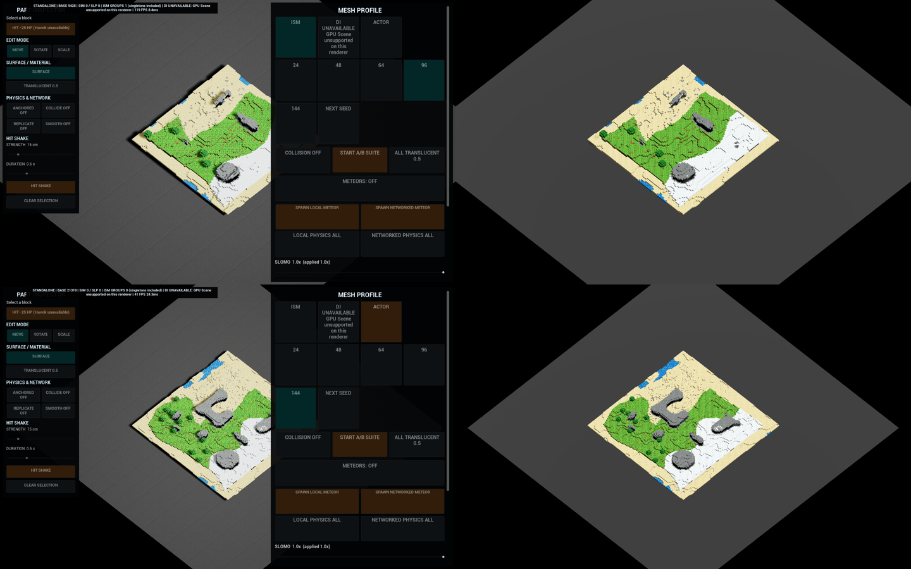
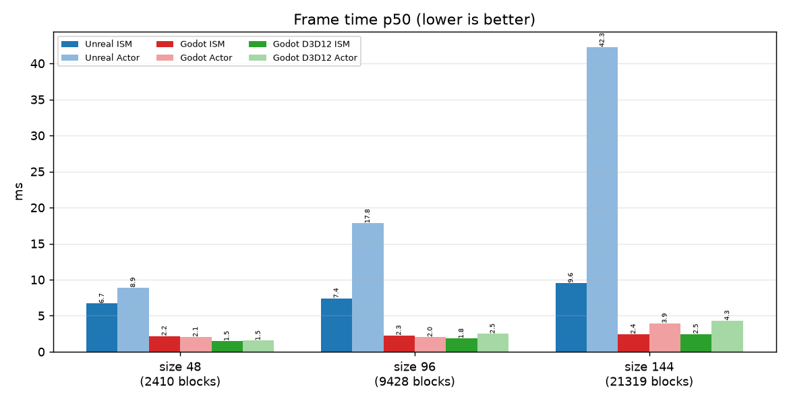
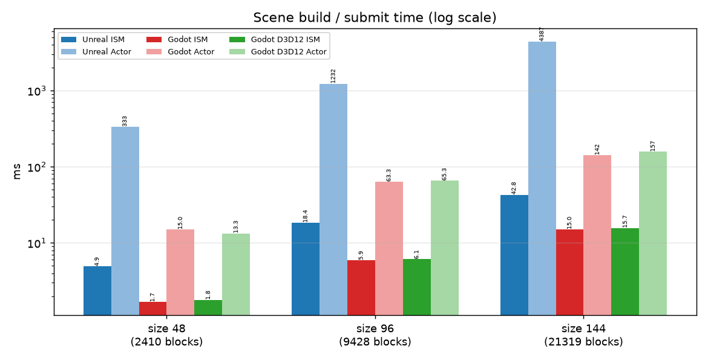

# Unreal ↔ Godot 인스턴싱 성능 비교 리포트 (InstancedMeshProfile 포팅)

- 브랜치/워크트리: `Forge-ISM-profile` (`D:\Github\GoDotProjects-worktrees\Forge-ISM-profile\ISMProfile`)
- 원본: `D:\Github\UnrealSamples-worktrees\InstancedMeshProfile\InstancedMeshProfile` (UE 5.6.1)
- 측정일: 2026-11-20 · CPU i9-13900HX · GPU RTX 4070 Laptop · 창 모드 1440×900, VSync 끔
- Godot 4.7.2 (Forward+, Vulkan 기본 / D3D12 보조) vs Unreal 5.6.1 (D3D12)

## 1. 한 줄 요약

같은 지형(블록 수·해시 일치), 같은 카메라/에셋/측정 방식에서 **Godot 포트가 모든 크기에서 프레임 시간이 짧았다.**
다만 Unreal 쪽이 `UnrealEditor -game` + HUD 오버레이 상태로 측정된 점이 크게 작용하므로, 격차 크기(3~11배)를 엔진 자체 성능 차이로 그대로 읽으면 안 된다(→ 5장).
엔진을 가로지르는 **모양(shape)** 은 분명하다.

- **Unreal**: 블록당 Actor는 개수에 비례해 급격히 느려진다 (144 크기에서 ISM 대비 4.4배). 렌더 스레드가 프레임 시간을 거의 전부 차지.
- **Godot**: 블록당 노드(MeshInstance3D)도 같은 메시·머티리얼이면 자동으로 묶여 그려진다(draw call 4~5회). Actor/ISM 격차가 거의 없다(144에서 1.6배).
- **씬 구성 시간**: Actor 경로가 Unreal 333 / 1,232 / 4,387 ms, Godot 15 / 63 / 142 ms (22~31배).

## 2. 동일 조건 검증

| 항목 | Unreal | Godot | 일치 여부 |
|---|---|---|---|
| 지형 레이아웃 (seed 1337) | `FProfileLayout` | `tools/gen_assets.py` 포팅 | 블록 수·FNV 해시 **전 크기 일치** |
| 크기별 블록 수 / 해시 | 48: 2410 / 4078198733 · 96: 9428 / 3827066910 · 144: 21319 / 598475029 | 동일 | 일치 (두 엔진 런타임이 각자 해시를 계산해 검증) |
| 큐브·배치 | 100uu 큐브, 셀×100uu | 1m 박스, 셀×1m (좌표축 변환 `UE(x,y,z)→Godot(y,z,-x)`) | 동일 |
| 표면 텍스처 | 16px 타일 4×4 아틀라스(옆면/윗면 2장), nearest | `FProfileBlockAppearance` 포팅 PNG | 동일 |
| 셰이딩 | 옆/윗면 노멀 Z 블렌드, 이미시브 = 알베도×0.14, 완전 러프 | 같은 공식을 spatial 셰이더로 구현 | 동일 공식 |
| 카메라 | 직교, 위치 `중심+(-65,-65,115)·S`, 중심을 바라봄, OrthoWidth `S·210` | 같은 위치/방향 | 증거 스크린샷의 지형 윤곽이 일치하도록 보정 (UE의 OrthoWidth가 뷰포트 **높이**를 기준으로 동작) |
| 조명 | Directional pitch -55 / yaw -30, 동적 그림자, 하늘색 ambient 없음 | 동일 방향, ACES 톤맵, 에너지 0.9 | 방향 동일, **밝기는 눈으로 보정** (UE lux ≠ Godot energy) |
| 바닥판 | `/Engine/BasicShapes/Plane`, (S+180)칸, z=-2칸 | PlaneMesh 같은 크기·위치 | 형상 동일, 재질은 회색(UE는 WorldGrid) |
| 충돌 / 물리 / 메테오 | 없음 | 없음 | 동일 |
| 측정 절차 | 워밍업 3 s → 측정 5 s, 크기당 2회 반복, AB/BA 교차 | 동일 | 동일 |
| 통계 | 프레임 시간 p50 / p95 (nearest-rank) | 동일 알고리즘 | 동일 |
| 렌더링 설정 | AA 없음, 자동노출/블룸/GI 끔, VSync 끔 | MSAA/TAA/FXAA 끔, GI 없음, VSync 끔 | 근사 동일 |

시각 비교 (왼쪽 Unreal, 오른쪽 Godot. 위: ISM 96, 아래: Actor 144; Unreal 화면은 HUD 패널이 지형 일부를 가림):



## 3. 결과

각 칸은 4회 평균(Unreal 2 프로세스 × 2회, Godot Vulkan 2 프로세스 × 2회). Godot D3D12는 보조 측정 1 프로세스(2회). 원자료: `comparison.csv`, `data.json`, `../results/**/summary.csv`·`samples.csv`.

### 프레임 시간 p50 (ms, 낮을수록 좋음)

| 크기 | 블록 | Unreal ISM | Unreal Actor | Actor/ISM | Godot ISM | Godot Actor | Actor/ISM | Godot D3D12 ISM | Godot D3D12 Actor |
|---|---|---|---|---|---|---|---|---|---|
| 48 | 2,410 | 6.71 | 8.90 | 1.3× | 2.19 | 2.05 | 0.94× | 1.48 | 1.54 |
| 96 | 9,428 | 7.42 | 17.82 | 2.4× | 2.27 | 2.04 | 0.90× | 1.82 | 2.50 |
| 144 | 21,319 | 9.55 | 42.26 | 4.4× | 2.44 | 3.94 | 1.62× | 2.47 | 4.33 |



p95는 같은 경향이다 (Unreal Actor 144: 54 ms, Godot Actor 144: 4.8 ms). `chart_frame_p95.png` 참고.

### Unreal ÷ Godot(Vulkan) 배수

| 크기 / 모드 | p50 | p95 | 씬 구성 시간 | 프로세스 메모리 |
|---|---|---|---|---|
| 48 ISM | 3.1× | 2.6× | 3× | 4.2× |
| 48 Actor | 4.3× | 3.8× | 22× | 4.2× |
| 96 ISM | 3.3× | 3.2× | 3× | 4.2× |
| 96 Actor | 8.7× | 9.0× | 19× | 4.1× |
| 144 ISM | 3.9× | 4.1× | 3× | 4.4× |
| 144 Actor | 10.7× | 11.3× | 31× | 4.0× |

### 씬 구성 시간 (ms, 로그 스케일 차트)

| 크기 | Unreal ISM | Unreal Actor | Godot ISM | Godot Actor |
|---|---|---|---|---|
| 48 | 4.9 | 333 | 1.7 | 15 |
| 96 | 18.4 | 1,232 | 5.9 | 63 |
| 144 | 42.8 | 4,387 (±2,900) | 15.0 | 142 |

Godot Actor는 첫 프레임까지(리소스 업로드·인스턴스 uniform 할당) 추가로 ~0.6 s(144), ~0.13 s(96)가 더 걸린다 (`first_frame_ms`). ISM은 ~5 ms. Unreal 쪽 해당 지표는 수집되지 않았다.



### Godot 내부 지표 (Vulkan, 중앙값)

| 크기 / 모드 | draw call | 삼각형 | 렌더 제출 CPU (ms) | GPU (ms) |
|---|---|---|---|---|
| 48 ISM / Actor | 4 / 4 | 57,844 | 0.09 / 0.66 | 0.83 / 0.62 |
| 96 ISM / Actor | 4 / 4 | 226,276 | 0.09 / 1.52 | 1.88 / 0.58 |
| 144 ISM / Actor | 4 / 5 | 511,660 | 0.09 / 3.32 | 2.17 / 0.63 |

Actor 모드에서도 draw call이 4~5회에 그친다: Godot Forward+는 메시·머티리얼이 같은 인스턴스를 하드웨어 인스턴싱으로 묶는다(UE의 Dynamic Instancing에 해당). 그래서 GPU 비용은 ISM과 비슷하고, Actor의 추가 비용은 인스턴스당 컬링/정렬 CPU(렌더 제출 0.66 → 3.32 ms)로만 나타난다.
ISM의 GPU 시간이 Actor보다 큰 이유는 검증하지 않았다. 가설: MultiMesh는 인스턴스 단위 컬링이 없어 그림자 캐스케이드마다 전체를 그린다.

### Unreal 내부 지표 (중앙값)

| 크기 / 모드 | 게임 스레드 | 렌더 스레드 | GPU |
|---|---|---|---|
| 48 ISM / Actor | 2.35 / 2.57 | 6.7 / 8.9 | 4.8 / 2.9 |
| 96 ISM / Actor | 2.76 / 2.72 | 7.4 / 17.8 | 6.0 / 3.6 |
| 144 ISM / Actor | 2.95 / 3.24 | 9.2 / 42.3 | 7.9 / 6.7 |

Unreal은 프레임 시간이 렌더 스레드 시간과 거의 같다 → 렌더 스레드 병목. Actor는 개수에 비례해 증가(144에서 42 ms)한다.

### 메모리 (프로세스 작업 집합, MB)

| 크기 | Unreal ISM / Actor | Godot ISM / Actor |
|---|---|---|
| 48 | 2,427 / 2,453 | 572 / 588 |
| 96 | 2,569 / 2,664 | 609 / 657 |
| 144 | 2,855 / 3,028 | 649 / 759 |

**엔진 간 직접 비교 불가**: Unreal은 에디터 모듈이 올라간 프로세스(`UnrealEditor -game`)다. 같은 엔진 안에서 ISM→Actor 증가량만 비교하는 것이 의미 있다(Unreal +174 MB, Godot +110 MB, 144 기준).

## 4. 해석

1. **Unreal의 병목은 렌더 스레드 CPU.** Actor 144는 GPU 6.7 ms에 프레임 42 ms. 컴포넌트 2만 개의 프록시·컬링·드로우 정리가 지배적이다. ISM으로 묶으면 9.6 ms.
2. **Godot의 노드 경로는 사실상 자동 인스턴싱.** Actor와 ISM의 격차가 144 크기에서야 1.6배로 벌어진다. 2만 개 이하 규모에서 "ISM으로 묶어야 한다"는 압박은 Unreal보다 훨씬 약하다.
3. **씬 구성 시간**은 두 엔진 모두 ISM이 압도적이지만 Unreal Actor 경로(스폰·컴포넌트 등록)가 특히 비싸다 (144: 4.4 s, 반복 간 편차 ±2.9 s).
4. Godot의 ISM(MultiMesh)이 항상 최선은 아니다: 144에서 GPU 시간이 노드 경로보다 길고, 인스턴스 컬링이 없다.

## 5. 한계와 비교 오염 요인 (읽기 전에 확인)

가장 큰 것부터:

1. **Unreal 측정 조건이 무겁다.** `UnrealEditor.exe -game`(비쿠킹, 에디터 모듈 로드)에서 측정했고, 샘플의 HUD(Part Inspector / Mesh Profile 패널, 상단 통계 줄)가 매 프레임 그려졌다. Godot에는 HUD가 없다. 쿠킹된 패키지로 HUD 없이 재측정하면 Unreal 수치는 내려갈 가능성이 높고, 그 크기는 측정하지 않았다. 원본 `Saved/GamePackage`의 패키지는 11/10 빌드라 현재 코드와 달라 사용하지 않았다.
2. **머티리얼 비용이 다르다.** Unreal 머티리얼은 히트 셰이크 WPO, 인스턴스당 12개 커스텀 데이터, 버텍스 인터폴레이터를 가진다. Godot 셰이더는 블록 타입 1개만 쓴다.
3. **조명·그림자는 눈으로 맞췄다.** 방향은 같고 밝기는 증거 샷의 픽셀값에 맞춰 보정했다 (평면 66~78 / 모래 229,224,193 / 눈 229,230,229 대비 Godot 65 / 239,229,181 / 227,230,231). 그림자 기법은 다르다 (Godot: 4분할 PSSM 4096).
4. **그래픽 API가 다르다.** Unreal D3D12 vs Godot Vulkan(기본). Godot D3D12를 보조로 측정했다. D3D12 모드의 GPU 시간이 크기와 무관하게 ~0.5 ms로 평평해 신뢰하지 않는다.
5. **측정 중 PC가 비어 있지 않았다.** 다른 Unreal 에디터(Sandbox), Visual Studio, 브라우저 등이 떠 있었다. 특히 Unreal Actor는 반복 간 편차가 크다 (144 p50: 평균 42 ms, 범위 ±14.5 ms, 4회). Godot는 ±0.1~0.4 ms.
6. **지표 의미가 다르다.**
   - 프레임 시간(p50/p95)은 양쪽 모두 프레임 간 벽시계 시간이라 직접 비교 가능하다.
   - 게임 스레드 시간은 비교하지 않았다. Godot의 `TIME_PROCESS`가 프레임 시간을 넘는 값을 내서 신뢰하지 않으며, CSV(`game_p50_ms`)에만 남겼다.
   - GPU 시간은 각 엔진이 보고한 값이다. 의미가 같다고 보장되지 않는다.
   - 메모리는 Unreal은 프레임별 중앙값, Godot는 케이스 종료 시 1회 샘플이다.
7. **Godot는 인스턴스별 uniform에 전역 버퍼 한도가 있다.** 노드마다 블록 타입을 `instance uniform`으로 주는 Actor 경로가 144 크기(21k 노드)에서 기본 한도(65,536)에 걸려 렌더 오류가 났다. `limits/global_shader_variables/buffer_size`를 2,097,152로 올려 해결했다. Unreal 커스텀 프리미티브 데이터에는 같은 제약이 없다.
8. **측정 규모가 작다.** 크기 3종 × 모드 2종 × 반복 4회. 시드 1개. 사용 가능한 수준이지만 통계적 결론용은 아니다.
9. Unreal의 `Dynamic Instancing`은 이 렌더러 설정에서 "UNAVAILABLE"(HUD 표시)이었다. 따라서 Unreal의 Actor 경로는 자동 인스턴싱 없이 측정된 것이다.

## 6. 재현 방법

```powershell
# 1. 에셋 생성 (지형 + 아틀라스). UE 해시와 대조: 24, 48 은 --check-hash 로 검증됨
python tools\gen_assets.py --sizes 24,48,96,144 --check-hash 24=711236125,48=4078198733

# 2. Godot 측정
Godot_v4.7.2-stable_win64_console.exe --path godot --rendering-method forward_plus -- --sizes=48,96,144 --modes=ISM,Actor --repeats=2 --warmup=3 --seconds=5 --seed=1337 --shots --out=<절대경로>

# 3. Unreal 측정 (원본 프로젝트는 건드리지 않고 임시 폴더에 복사해 설치형 UE 5.6.1로 빌드)
.\run_unreal_baseline.ps1 -RunId ue-run1

# 4. 연속 재측정 (UE + Godot Vulkan + Godot D3D12; 측정 중 다른 작업 금지)
.\run_all.ps1 -Tag r2

# 5. 리포트 표/차트
python tools\compare_report.py --unreal results\unreal\ue-run1\Profile,results\unreal\ue-r2\Profile --godot results\godot\gd-run1,results\godot\gd-r2-vulkan --godot-d3d12 results\godot\gd-r2-d3d12 --out report
```

## 7. 포팅 구성

| 파일 | 역할 |
|---|---|
| `tools/gen_assets.py` | `ProfileLayout.cpp`(지형, 해시, UE `FRandomStream`)와 `ProfileBlockAppearance.cpp`(아틀라스)의 파이썬 포팅. float32 연산 순서를 따른다. |
| `godot/main.gd` | 벤치마크 러너(ISM = `MultiMeshInstance3D`, Actor = 블록당 `MeshInstance3D`), 카메라/조명/셰이더, CSV·JSON 출력 |
| `godot/assets/` | 생성된 레이아웃(.bin)과 아틀라스 PNG |
| `run_unreal_baseline.ps1`, `run_all.ps1` | Unreal 빌드/실행, 연속 측정 |
| `tools/compare_report.py`, `tools/tune_look.py` | 비교 표/차트, 조명 보정 도구 |

포팅 중 확인한 점: 소스 엔진의 `FRandomStream`은 가수부를 `Seed >> 9`로 만든다(옛 구현의 `& 0x7fffff`가 아님). 이를 반영하자 나무 수가 맞아 해시가 일치했다.

## 8. 후속 제안

- 쿠킹된 Unreal Game 패키지를 현재 코드로 다시 만들고 HUD를 숨겨 재측정 (가장 큰 오염 요인 제거).
- Godot 셰이더를 Unreal 머티리얼과 같은 비용으로 맞추기 (WPO·12 커스텀 데이터).
- 더 큰 크기(200~256)와 다중 시드, 이후 마일스톤(충돌 모드, 물리)으로 확장.
