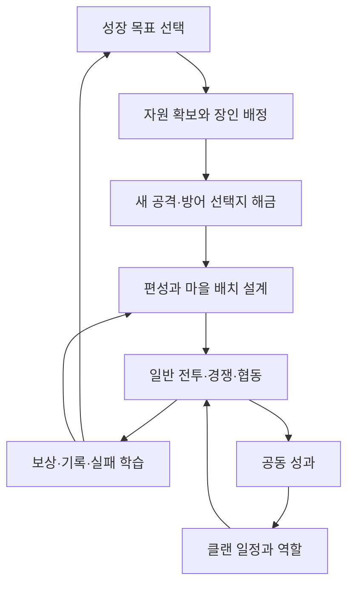

# 01. 핵심 루프·설계 축·시스템 연결

> 기준일: 2026-11-13 KST. 이 문서의 동기·인과관계·수식은 **[해석] 또는 [제안]**이다. 확인된 원작 규칙은 출처를 별도로 표기한다.

## 1. 게임의 핵심 약속 [해석]

플레이어는 자신만의 마을을 지속해서 성장시키고, 제한된 병력 조합과 전투 중 개입으로 다른 마을을 공략하며, 그 성과를 클랜의 공동 목표에 기여한다. 중요한 특징은 **상시 유지되는 성장 상태와 짧게 끝나는 전투 상태의 결합**이다.

건물 하나를 올리는 선택은 여러 날의 성장 계획에 영향을 준다. 병력 하나를 어느 방향에 놓는 선택은 몇 초 뒤 전투 경로를 바꾼다. 클랜전의 한 번의 공격은 개인 계정 밖의 집단 결과에 남는다. 서로 다른 시간 규모의 선택을 한 계정 안에 묶는 것이 장기 반복의 기반이다.

## 2. 확인 가능한 핵심 전제

[확인] 일반 전투는 자유로운 자원 획득·연습에, 랭크전은 제한된 공격을 통한 경쟁에 초점을 둔다. 이 구분은 플레이 빈도와 경쟁 성적을 분리하는 기본 전제다. [공식 모드 비교](https://support.supercell.com/clash-of-clans/en/articles/battle-vs-ranked-battle-whats-the-difference.html)

[확인] 개발팀은 2025년 모드 분리의 이유로 플레이어 동기의 차이, 반복 공격에 따른 강제 난이도 상승, 경쟁 플레이어의 자원 획득 제약 등을 설명했다. 이하의 동기 모델은 이 문제 정의를 바탕으로 한 독립 분석이다. [설계 배경 공지](https://supercell.com/en/games/clashofclans/blog/news/battle-and-ranked-modes-are-coming-to-clash-/)

## 3. 네 가지 반복 루프

| 루프 | 시작 동기 | 핵심 행동 | 즉시 피드백 | 다음 루프를 만드는 결과 |
|---|---|---|---|---|
| 전술 학습 | 이 배치를 공략하고 싶다 | 정찰→편성 선택→투입→능력 사용 | 별·파괴율·남은 시간·실패 위치 | 조합 수정, 진입 방향 재설계 |
| 마을 성장 | 다음 능력을 해금하고 싶다 | 자원 확보→업그레이드 예약→완료 확인 | 비용 감소·타이머·새 건물/레벨 | 더 어려운 상대와 더 많은 선택지 |
| 경쟁 성취 | 다음 리그에 도달하고 싶다 | 공격권 관리→상대 공략→방어 개선 | 점수·순위·승강 예상 | 배치·장비 최적화, 반복 숙련 |
| 공동 기여 | 클랜의 승리에 도움이 되고 싶다 | 지원·전쟁 공격·수도 기여·과제 | 개인 기록과 공동 누적치 | 다음 일정 참여, 역할 분담 |

단일 보상으로 네 동기를 모두 해결하려 하면 자원 효율만 높은 행동이 다른 콘텐츠를 압도한다. 예를 들어 클랜 수도의 전용 성장과 보상을 본 마을 자원과 완전히 동일시하면 협동의 의미가 시간당 수익률 비교로 축소된다. 각 루프의 가치가 다르게 보이도록 분리하되 일부 교환 경로로 연결하는 것이 중요하다.

## 4. 전체 연결 구조



이 다이어그램에서 반복은 단순한 자원 회전이 아니다. 실패 학습이 편성을 바꾸고, 편성을 바꾸기 위해 연구·장비·영웅 우선순위가 바뀌는 **전술과 성장 사이의 피드백**이 핵심이다.

## 5. 플레이어가 관리하는 다섯 종류의 제약 [해석]

| 제약 | 대표 선택 | 부족할 때의 행동 | 설계상 위험 |
|---|---|---|---|
| 용량 | 병력·마법·지원군·장비 슬롯 | 한 기능을 포기하고 다른 기능 확보 | 하나의 조합이 모든 상황에 최적 |
| 시간 | 건설·연구·대회 마감 | 미리 계획하고 병렬 작업 조정 | 실수 한 번이 지나치게 긴 손실 |
| 자원 | 건설 재화·광석·전용 메달 | 파밍하거나 다른 성장 연기 | 획득처 하나에 활동 강제 집중 |
| 기회 | 랭크·전쟁·수도 공격 횟수 | 정찰·연습 후 중요한 공격 사용 | 참여 부담과 실패 공포 과대 |
| 정보 | 함정·AI 반응·상대 기지 | 리플레이·유인·정찰로 가설 갱신 | 규칙이 불투명해 실패 이유를 모름 |

[확인] 병력 생산 대기가 제거된 뒤에도 성장과 대회 제약은 남는다. 따라서 예전의 “훈련을 기다리게 해 접속 주기를 만든다”는 설명을 현행 핵심 루프 전체에 적용하지 않는다. [Clash Anytime](https://supercell.com/en/games/clashofclans/blog/release-notes/welcome-to-clash-anytime-update/)

## 6. 전술의 최소 문법 [해석]

전투는 크게 진입 경로 만들기, 핵심 위협 처리, 지속 화력 유지, 잔여 건물 정리로 읽을 수 있다. 순서가 항상 고정된다는 뜻은 아니다. 네 기능 중 무엇을 병력·마법·영웅·지원군에 맡길지 설계하는 것이 편성이다.

### 6.1 유도와 목표 선택

병력을 직접 이동 명령으로 조종하기보다 배치 순서와 주변 건물 제거를 통해 다음 목표를 유도한다. 같은 병력 수라도 외곽 건물의 잔존 상태에 따라 본대가 중앙으로 들어가거나 둘로 갈릴 수 있다. 이 때문에 타깃 AI는 편의 기능을 넘어 플레이어가 배우는 규칙이다.

### 6.2 위험의 시간 분산

범위 피해와 함정을 한꺼번에 맞는 상황을 피하려면 투입 간격과 진입 방향을 조절한다. 반대로 너무 분산하면 치유·강화 범위에서 벗어나거나 화력이 모이지 않는다. “집중 화력”과 “피해 분산”의 상충이 전투 중 결정을 만든다.

### 6.3 별과 파괴율의 다른 가치

최종 성과가 단계적으로 평가되면 안전한 성과를 확보한 후 더 큰 보상을 노릴 수 있다. 다만 각 모드가 별·파괴율·공격 횟수를 어떻게 합산하는지는 다르므로 공통 전투 결과와 모드 점수를 나눠야 한다. 자세한 판정은 [06](06_battle_rules_and_resolution.md), 클랜전 최고 기록은 [14](14_clan_wars.md)를 따른다.

## 7. 성장 설계의 핵심: 비용보다 다음 선택

업그레이드의 가치는 DPS 증가만으로 설명되지 않는다. 다음 병력 해금, 새로운 진입 수단, 방어 타깃 변경, 조합 공간 확장이 더 큰 전략 변화를 만들 수 있다.

**[제안] 업그레이드 가치 평가 모델**

```text
Value(upgrade) =
  ΔCombatOptions × w_options
  + ΔExpectedBattleOutcome × w_outcome
  + ΔResourceThroughput × w_economy
  + ΔFutureUnlocks × w_unlock
  - TemporaryAvailabilityLoss × w_downtime
  - ResourceOpportunityCost
```

가중치는 원작의 비공개 수치가 아니라 기획 검토 도구다. 예를 들어 주력 공격 수단을 올리는 동안 중요한 전쟁이 잡혀 있다면 잠시 잃는 출전 가능성의 비용이 커질 수 있다. 동일한 업그레이드도 사용자의 일정과 보유 대체 수단에 따라 가치가 달라진다.

### 7.1 초반·중반·후반의 서로 다른 질문

| 성장 단계 | 주요 질문 | 필요한 UI 피드백 | 과도하게 만들면 안 되는 부담 |
|---|---|---|---|
| 초반 | 무엇을 할 수 있고 왜 이겼는가? | 짧은 목표·해금 미리보기·실패 설명 | 장기 경제표와 과도한 메뉴 |
| 중반 | 어떤 공격 스타일에 투자할까? | 주력 편성 연관 업그레이드·자원 계획 | 동시에 열린 목표의 과부하 |
| 후반 | 상대 배치와 규칙에 어떻게 적응할까? | 세부 통계·리플레이·배치 버전 | 숙제 횟수로 경쟁을 대체하는 구조 |
| 복귀 | 현재 계정으로 무엇부터 하면 될까? | 변경 요약·기존 자산 활용·우선 목표 | 바뀐 규칙을 모두 처음부터 학습 |

이는 고정 TH 구간을 주장하는 표가 아니다. 실제 유저 분류는 보유 공격 선택지·완료한 튜토리얼·활동 이력으로 구성하는 편이 적절하다.

## 8. 소셜 시스템이 전투에 주는 영향

클랜은 대화방에 그치지 않는다. 병력 지원은 당장 가능한 공격을 바꾸고, 전쟁의 제한된 공격은 전략 공유를 유도하며, 수도의 누적 파괴는 다른 사람의 후속 공격을 위해 일부를 먼저 제거하는 행동에 가치를 준다.

**[해석] 개인 효율과 공동 효율의 차이**

개인만 보면 가장 쉬운 목표를 공격해 즉시 보상을 받는 행동이 합리적일 수 있다. 클랜 수도에서는 특정 위험 건물을 먼저 처리하거나 약한 구성원에게 쉬운 마무리를 남기는 편이 클랜 전체에 나을 수 있다. 따라서 수도의 개인 기여 화면은 마지막 타격만 칭찬해서는 안 되며 선행 피해·공략 정보·지원도 드러낼 필요가 있다. 일반 클랜전은 공격 간 피해가 누적되지 않으므로 같은 논리를 그대로 적용하지 않는다. 이 UI 보완은 재구현 제안이지 원작 전체의 실제 평가식은 아니다.

## 9. 모드별 설계 목적 비교

| 시스템 | 숙련이 드러나는 부분 | 실패 부담 | 장기 연결 |
|---|---|---|---|
| 일반 전투 | 목표 선별·자원 확보·새 조합 실험 | 다시 시도하기 쉬움 | 자원·과제·별 보너스 |
| 개인 랭크 | 제한된 기회에서 공격·방어 일관성 | 대회 순위에 누적 | 리그 성취·보상 효율 |
| 일반 클랜전 | 역할 배분·기지별 최고 공격 관리 | 클랜 성적에 영향 | 전쟁 경험·클랜 결속 |
| CWL | 여러 라운드의 명단·공격 운영 | 시즌 승강과 연결 | 전용 메달·장기 목표 |
| 장인 기지 | 소수 병력 능력·단계별 전개 | 독립된 반복 구조 | 별도 성장·본 마을 연결 |
| 클랜 수도 | 누적 파괴·후속 공격 준비 | 공유 기회 사용 | 공동 건설·주말 보상 |
| 연습·도전 | 제한된 조건의 해법 학습 | 규칙에 따라 반복 가능 | 전술 문법 습득 |

표의 목적·부담 평가는 분석이며 횟수·보상 상수는 각 모드 문서의 확인 규칙을 따른다.

## 10. 설계 검증용 가설 [제안]

| 가설 | 측정 단위 | 반례가 관찰되면 확인할 것 |
|---|---|---|
| 편성 저장은 새 전략 시도를 늘린다 | 계정당 서로 다른 유효 편성 수 | 저장은 했지만 전투에 사용하지 않는지 |
| 일반/랭크 분리는 경쟁 회피 유저의 활동을 유지한다 | 도입 전후 동일 성장군의 일반 전투 재방문 | 단기 이벤트 보상 효과와 혼동하는지 |
| 성장 해금은 일시적 전투 다양성을 만든다 | 해금 후 7일간 병력·영웅 조합 변화 | 새 수단이 너무 강해 단일 조합화되는지 |
| 공동 파괴는 협동 전략을 만든다 | 선행 공격과 후속 공격의 목표 변화 | 마무리만 보상받아 기여 경쟁이 되는지 |
| 실패 원인 설명은 재도전을 늘린다 | 실패 유형별 다음 편성 변경·재시도 | 설명이 부족한지, 실제로 대응 수단이 없는지 |

관측 기간과 임계값은 게임 규모와 표본에 맞춰 사전에 정한다. 원작의 실제 매출·유지율·참여율로 오해할 수 있는 가상 통계는 제시하지 않는다.

## 11. 최소 수용 시나리오 [제안]

1. 일반 전투에서 연속 패배해도 개인 랭크 결과가 잘못 바뀌지 않는다.
2. 성장 목표에서 필요한 자원·선행 건물·예상 완료 시간을 일관되게 확인한다.
3. 새 편성을 선택하면 현재 사용할 수 없는 영웅·장비·지원 슬롯을 출전 전에 설명한다.
4. 클랜전·랭크용 배치와 본 마을 배치를 구분하고 적용 시점을 보여준다.
5. 전투 실패 후 같은 전략을 다시 쓰거나 일부만 수정하는 경로가 명확하다.
6. 사용자가 하루 경쟁 공격을 마쳐도 일반 자원 획득 루프를 계속 이용할 수 있다.
7. 시즌이 바뀌면 성장 자산, 임시 버프, 시즌 점수 중 무엇이 유지되는지 설명한다.

## 12. 관련 문서와 출처

- 성장·경제: [02 건설](02_village_builders_and_construction.md), [03 해금](03_progression_research_and_unlocks.md), [04 자원](04_resources_loot_and_economy.md)
- 전투: [05 편성](05_army_composition.md), [06 판정](06_battle_rules_and_resolution.md), [07 AI](07_unit_ai_and_pathfinding.md)
- 경쟁: [11 매칭·보호막](11_matchmaking_shields_and_revenge.md), [12 랭크](12_ranked_leagues_and_tournaments.md)
- 근거: [공식 모드 비교](https://support.supercell.com/clash-of-clans/en/articles/battle-vs-ranked-battle-whats-the-difference.html), [2025년 분리 설계 배경](https://supercell.com/en/games/clashofclans/blog/news/battle-and-ranked-modes-are-coming-to-clash-/), [Clash Anytime](https://supercell.com/en/games/clashofclans/blog/release-notes/welcome-to-clash-anytime-update/)
