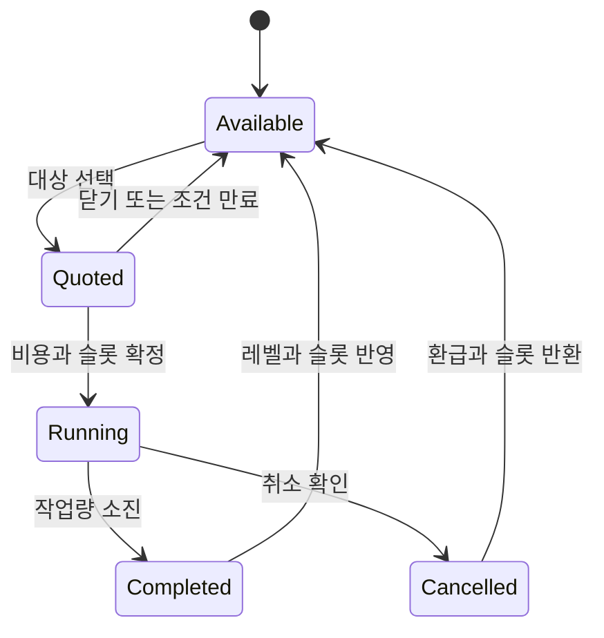

# 02. 마을·장인·건설 시스템 역기획

> 기준일: 2026-11-13 KST. [확인] 공개 규칙, [해석] 설계 분석, [제안] 재구현 모델, [미확인] 실측 필요 항목. 아래 저장 구조와 처리 순서는 Supercell 내부 구현을 뜻하지 않는다.

## 1. 시스템의 역할과 경계

마을은 자원 생산 설비, 공격력을 해금하는 시설, 방어 배치, 장기 성장 기록을 같은 공간에 표현한다. [해석] 건물의 역할은 전투 능력치에 그치지 않는다. “지금 가진 자원을 어디에 묶을 것인가”, “동시 작업 슬롯을 무엇에 사용할 것인가”, “다음 접속 때 어떤 선택을 할 것인가”를 만드는 시간 관리 장치다.

이 문서는 건설·업그레이드 수명주기를 다룬다. 전투 중 시설 판정은 [10. 방어·배치](10_defenses_traps_and_layout.md), 성장 선행 조건은 [03. 성장·연구](03_progression_research_and_unlocks.md), 자원 정산은 [04. 경제](04_resources_loot_and_economy.md)를 따른다.

## 2. 확인된 규칙과 버전 주의

- [확인] 본마을 장인은 건물과 영웅 성장에 쓰인다. 기본 장인 오두막 외 추가 오두막은 보석으로 확보하고, B.O.B는 장인 기지 목표 달성으로 본마을에 합류한다. 도제는 별도 무제한 작업 슬롯으로 취급하면 안 된다. [공식 장인 안내](https://support.supercell.com/clash-of-clans/en/articles/builders-4.html)
- [확인] 업그레이드 취소 시 지불 자원의 50%를 돌려준다. 보석으로 부족 자원을 충당했더라도 환급은 해당 자원이며 보석 환급이 아니다. 공식 설명은 취소 가능한 건설을 안전한 자원 금고로 악용하지 못하게 하는 것이다. [공식 취소 안내](https://support.supercell.com/clash-of-clans/en/articles/canceling-an-upgrade.html)
- [확인] 연구 조수와 장인 도제는 기존 작업을 가속한다. 통합 작업일은 첫 배정 때 시작하는 23시간이며, 작업일마다 각 조력자에게 한 번 배정한다. 도제는 장인 물약의 가속 대상이 아니다. [조력자 안내](https://sc-clashofclans.zendesk.com/hc/en-us/articles/49529140074139-Helpers-The-Helper-Hut)
- [확인] 2026-08 패치에서 장벽 링 사용 시 유휴 장인 요구가 제거됐다. 따라서 “장벽의 모든 성장 수단은 항상 장인이 필요하다”라는 공통 검증은 부정확하다. [August Update](https://supercell.com/en/games/clashofclans/blog/release-notes/august-update-3/)

### 기본 장인 확보 데이터

[확인] 공식 지원문서 기준 오두막 비용은 1번 무료, 2번 250, 3번 500, 4번 1,000, 5번 2,000보석이다. 2번 오두막은 튜토리얼 구매에 포함된다. B.O.B는 BH9에서 관련 건물을 세운 뒤 본마을 건물 3개 개조, 장인 기지 병력 1종 레벨 18, 방어 시설 1개 레벨 9, 장인 기지 영웅 레벨 합 45 조건을 요구한다. [공식 장인 안내](https://support.supercell.com/clash-of-clans/en/articles/builders-4.html)

[해석] 영구 장인 추가는 기간제 가속과 달리 이후 모든 건설 계획의 병렬성을 바꾼다. 그래서 상점의 일회성 비용과 건설 모델의 장기 처리량을 연결해서 평가해야 한다.

[범위] B.O.B는 본마을 추가 장인이다. O.T.T.O와 B.O.T.O의 장인 기지 역할 및 현재 지원문서의 해금 표현은 [16. 장인 기지](16_builder_base.md)에 정리한다. B.O.B 해금을 장인 기지의 장인이 영구히 빠져나가는 것으로 구현하지 않고, 장인 기지의 최대 장인 수도 과거 숫자로 고정하지 않는다.

## 3. 핵심 객체와 배치 규칙

[제안] 마을의 시각 좌표와 논리 배치 좌표를 분리한다. 건물은 타일 원점·점유 크기·회전·시설 정의를 가지며, 렌더링 높이와 장식 오프셋은 배치 유효성에 영향을 주지 않는다.

| 객체 | 핵심 속성 | 불변 조건 |
| --- | --- | --- |
| BuildingInstance | instanceId, definitionId, level, tileOrigin | 마을 내 ID는 재사용하지 않는다 |
| Placement | footprint, blockedCells, layoutId | 점유 셀 중복과 맵 경계 이탈을 막는다 |
| BuildJob | targetId, fromLevel, toLevel, remainingWork | 한 대상에 중복 작업을 시작하지 않는다 |
| BuilderSlot | workerId, jobId, availableAt | 한 장인은 한 기본 작업만 점유한다 |
| UpgradeQuote | costVector, duration, ruleVersion, expiresAt | 승인 화면과 실제 차감 조건을 연결한다 |
| HelperAssignment | helperId, jobId, workdayId | 조력자는 작업을 새로 생성하지 않는다 |

[미확인] 정확한 타일 수, 장애물 생성 거리, 시설별 편집 제한은 이 문서에서 고정하지 않는다. 실제 클라이언트의 배치 표시와 편집 오류를 수집하여 정의 테이블로 넣는다.

배치 편집은 “드래그 중 임시 위치”와 “확정된 마을 상태”를 분리한다. 유효한 새 위치가 확정되기 전 기존 위치를 지우면 통신 실패 시 건물이 사라지는 문제가 생긴다. 저장된 전쟁·랭크 배치와 현재 본마을은 별도 스냅샷 식별자로 연결한다.

## 4. 업그레이드 상태 기계



[제안] 시작은 하나의 원자적 거래로 처리한다.

1. 계정·대상 버전과 선행 조건을 다시 검증한다.
2. 필요한 장인, 자원, 업그레이드 정의를 잠근다.
3. 화면에 제시했던 가격과 달라졌다면 새 견적을 보여준다.
4. 비용을 차감하고 작업·장인 점유·시작 이벤트를 함께 기록한다.
5. 응답이 유실되어도 동일 요청 ID 재전송은 같은 결과를 반환한다.

완료 처리는 앱이 켜져 있는지를 기준으로 삼지 않는다. [제안] 서버 시각의 경과 작업량을 적용하고, 레벨 상승·장인 해제·보상 이벤트에 동일 완료 ID를 붙인다. 오프라인 기간이 길어도 완료 이벤트를 한 번만 발생시킨다.

### 작업량 기반 시간 모델

[제안] 기본 작업량을 W, 구간별 작업 속도를 v(t)라고 두면 남은 작업은 다음과 같다.

```text
remainingWork = max(0, W - integral(v(t), startTime, now))
displayETA   = remainingWork / currentRate
```

물약·도제·이벤트를 “무조건 남은 시간에서 배수로 차감”하면 중첩과 종료 시점 오류가 발생하기 쉽다. 기본 장인 속도와 추가 기여량을 정의하되, 실제 가산·승산·중복 제한은 아이템 규칙으로 분리한다. 서버가 정한 작업량과 UI의 반올림된 남은 시간을 혼용하지 않는다.

## 5. 취소·가속·이동의 경계 처리

| 상황 | [제안] 처리 | 확인 또는 검증할 점 |
| --- | --- | --- |
| 취소 버튼 직후 자연 완료 | 서버 확정 순서 하나만 승리 | 완료와 환급 동시 지급 금지 |
| 자원 할인가로 시작 후 이벤트 종료 | 지불 내역 기준 환급 | 원래 정가를 기준으로 환급하지 않음 |
| 장인 물약 사용 중 조기 완료 | 다음 작업에 남은 버프 적용 정책 분리 | 버프를 작업에만 붙이지 않음 |
| 도제 배정 대상이 곧 완료 | 잔여 지원량 처리 정책 표시 | 다른 대상 자동 이동은 실측 필요 |
| 보관함 초과 상태에서 취소 | 환급 상한·초과 허용 정책을 명시 | 전리품 적재 규칙과 동일하다고 가정 금지 |
| 편집 중 작업 완료 | 임시 배치와 성장 상태를 병합 | 예전 레벨의 건물로 덮어쓰기 금지 |
| 시설 이동 후 작업 선택 | instanceId로 작업 추적 | 좌표를 작업 ID로 사용 금지 |
| 일시적인 추가 장인 이벤트 종료 | 기존 작업과 신규 고용을 분리 | Work for Hire는 진행 중 작업 지속 |

마지막 행은 공식 Work for Hire 안내가 진행 중 작업의 지속을 설명한다. [관련 출처](https://sc-clashofclans.zendesk.com/hc/en-us/articles/49529091450779-Work-for-Hire-Event)

## 6. 설계 의도와 정량 분석

[해석] 장인은 플레이 시간을 직접 제한하기보다 성장 속도의 동시성을 제한한다. 자원이 충분해도 빈 장인이 없으면 성장을 시작하지 못하고, 장인이 있어도 자원이 없으면 공격할 이유가 생긴다. 두 제약이 서로 번갈아 병목이 되는 것이 기본 구조다.

[제안] 다음 지표를 TH·접속 빈도·장인 수로 나눠 분석한다.

| 지표 | 정의 | 읽을 수 있는 문제 |
| --- | --- | --- |
| 장인 가동률 | 작업 중 장인 시간 / 보유 장인 시간 | 재화 부족 또는 재접속 부담 |
| 자원 충족 유휴율 | 비용을 감당할 수 있으나 장인이 쉬는 시간 | 선택 피로·UI 탐색 문제 |
| 완료 후 재배정 지연 | 완료부터 다음 시작까지 시간 | 알림 효과와 생활 시간 불일치 |
| 막힌 업그레이드 비율 | 선행 조건/용량/슬롯으로 실패한 시도 | 성장 안내의 부족 |
| 취소율 | 시작 작업 대비 취소 작업 | 잘못된 선택 유도·이벤트 혼란 |

예를 들어 장인 5명이 24시간씩 가동되면 하루 120 장인시간을 처리한다. 하루 평균 6시간의 유휴가 각 슬롯에 생기면 90 장인시간으로 떨어진다. 이 계산은 예시이며 실제 계정 진행 속도는 선행 조건, 영웅 점유, 재화, 가속에 의해 달라진다. 장인 추가 구매의 체감 가치는 이론적 슬롯 증가와 실제 가동률을 함께 봐야 한다.

## 7. 정상 시나리오

[제안] 플레이어가 방어 시설 A를 선택한다. 현재 레벨, 다음 레벨의 핵심 차이, 자원 비용, 완료 예정 시각, 장인 점유를 본다. 시작 후 장인 목록 최상단의 진행 작업으로 옮겨진다. 다른 기기에서 같은 작업을 열면 동일 남은 시간과 도제 배정 상태가 나타난다. 오프라인 완료 후 돌아오면 시설 레벨은 이미 갱신되어 있고, 장인은 즉시 다시 쓸 수 있다.

이 흐름에서 “완료 연출을 봐야 능력치가 적용”되는 의존 관계를 만들지 않는다. 연출은 완료 상태를 설명하는 UI이며 상태 변경의 전제 조건이 아니다.

## 8. 수용 기준·QA

| ID | 검증 조건 | 기대 결과 |
| --- | --- | --- |
| BUILD-01 | 자원 또는 장인 부족 | 차감·점유 없이 정확한 이유 표시 |
| BUILD-02 | 시작 요청을 3회 재전송 | 작업·비용 차감 각각 1회 |
| BUILD-03 | 완료 경계에 취소 요청 | 완료 또는 취소 한 결과만 확정 |
| BUILD-04 | 장벽 링 사용, 모든 장인 작업 중 | 2026-08 이후 규칙에서 링 사용 허용 |
| BUILD-05 | 도제와 물약 동시 적용 | 도제 자체에 물약 배수 중복 미적용 |
| BUILD-06 | 이벤트 중 할인 시작 후 취소 | 실제 지불 자원 기준 환급 검증 |
| BUILD-07 | 계정 시계를 한 달 변경 | 서버 완료 상태와 재화에 영향 없음 |
| BUILD-08 | 배치 이동 중 작업 완료 | 시설 유실·중복·레벨 되돌림 없음 |

## 9. 자료 경계와 다음 확인

실제 건물별 건설 비용·시간·점유 크기 전체를 수집한 도감은 아니다. 파라미터는 빌드 버전과 이벤트에 묶어 관리한다. 영웅·펫·연구 큐의 구분은 다음 문서에서 이어진다.

출처: [장인](https://support.supercell.com/clash-of-clans/en/articles/builders-4.html), [취소](https://support.supercell.com/clash-of-clans/en/articles/canceling-an-upgrade.html), [조력자](https://sc-clashofclans.zendesk.com/hc/en-us/articles/49529140074139-Helpers-The-Helper-Hut), [2026-08 패치](https://supercell.com/en/games/clashofclans/blog/release-notes/august-update-3/), [일시 고용 이벤트](https://sc-clashofclans.zendesk.com/hc/en-us/articles/49529091450779-Work-for-Hire-Event). 열람일 2026-11-13.
