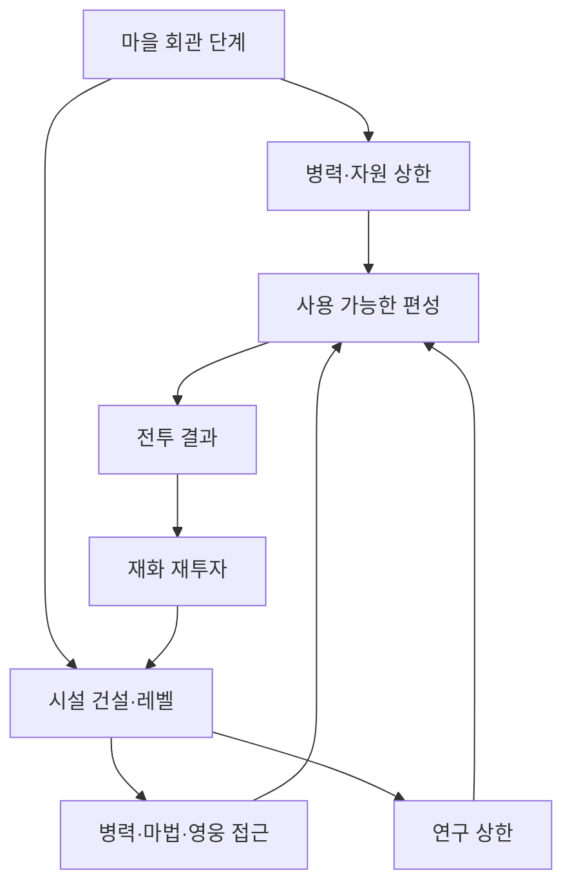

# 03. 성장·연구·해금 시스템 역기획

> 기준일: 2026-11-13 KST. [확인] 공개 근거, [해석] 설계 의미, [제안] 재구현 모델. TH19는 이달 중순 출시 예고 단계이므로 이 문서의 현행 성장 단계에 합치지 않는다.

## 1. 성장의 구성

[해석] 클래시 오브 클랜의 성장은 마을 회관 숫자 하나로 표현되지 않는다. 같은 TH라도 병력·영웅·장비·방어·장벽·지원 시설의 진행률이 다르다. 따라서 계정 강도를 단일 평균 레벨로 판단하면 해금은 빠르지만 핵심 공격 조합이 약한 계정과 균형 성장 계정을 구별하지 못한다.

[제안] 성장 벡터를 다음처럼 정의한다.

```text
Progress = {
  accessTier,
  armyCapacity,
  researchedCombatPower,
  heroRosterAndLevels,
  equipmentBreadthAndLevels,
  petOptions,
  defensivePower,
  resourceCapacity,
  workerThroughput
}
```

TH는 접근 권한과 상한을 여는 축이고, 각 하위 시스템은 그 권한을 실제 성능으로 바꾸는 축이다. 현행 숫자 테이블은 설정 데이터로 분리한다.

## 2. 확인된 중요한 예외

- [확인] 연구소 건물을 업그레이드하는 동안 이미 진행하던 연구는 계속되며, 연구소 업그레이드가 끝나기 전에는 새 병력·마법 연구를 시작하지 못한다. “연구소가 공사 중이면 모든 연구 시간이 정지”하는 모델은 맞지 않는다. 2021 정식 패치에 명시된 규칙으로, 향후 변경 여부는 버전 검증 대상이다. [TH14 Patch Notes](https://supercell.com/en/games/clashofclans/blog/release-notes/full-patch-notes-th14-update/)
- [확인] Work for Hire의 고블린 연구자는 연구소가 사용 중이어도 추가 연구를 맡는 기간제 예외다. 보통 연구 큐와 추가 큐를 동일 슬롯으로 덮어쓰면 안 된다. [공식 이벤트 안내](https://sc-clashofclans.zendesk.com/hc/en-us/articles/49529091450779-Work-for-Hire-Event)
- [확인] 2026-06 Hero Journey는 영웅 레벨 합을 진행 점수로 사용하고 TH7부터 영웅 회관에서 접근한다. 영웅 성장에 장비·광석·스킨 등의 보상 경로를 추가했다. [Anime Fury Update](https://supercell.com/en/games/clashofclans/blog/release-notes/the-anime-fury-update-is-here/)
- [확인] Supercharge는 최대 레벨 시설의 임시 추가 성장이다. 새 시설 레벨이 열리면 같은 Supercharge 상태를 영구 레벨처럼 유지하지 않는다. [공식 Supercharge 안내](https://sc-clashofclans.zendesk.com/hc/en-us/articles/49529107491739-Supercharge)
- [확인] 같은 현행 지원문서는 방어 시설의 Supercharge를 2단계, 생산 시설을 3단계로 구분한다. 모든 시설에 같은 추가 단계 수를 부여하지 않고 시설별 TH·최대 레벨 조건도 함께 확인한다.

## 3. 해금 그래프

[제안] 해금 조건은 AND와 OR를 명시한 그래프로 저장한다. “TH가 충분하다”와 “해당 기능의 시설이 완성됐다”를 같은 조건으로 취급하지 않는다.



가령 새 병력 B를 쓰려면 병영 레벨 해금과 병력 공간이 필요하며, 더 높은 병력 레벨을 쓰려면 연구 상한과 비용이 필요하다. 이 문장의 관계는 재구현 모델이고 개별 시설 수치·해금 단계는 실제 버전 테이블로 넣어야 한다.

| 조건 종류 | 예시 필드 | 실패 메시지 설계 |
| --- | --- | --- |
| 접근 단계 | minTownHall | 필요한 TH와 이동 버튼 |
| 선행 시설 | requiredBuildingLevel | 해당 시설 선택 또는 건설 메뉴 이동 |
| 선행 성장 | prerequisiteUpgradeIds | 완료해야 하는 항목 목록 |
| 재화 용량 | minStorageCapacity | 자원 부족과 용량 부족을 분리 |
| 작업 슬롯 | requiredWorkerType | 다음 사용 가능 시각 |
| 영구 보유 | unlockEntitlement | 획득 가능한 콘텐츠 경로 |
| 기간 조건 | eventWindow | 시작·종료 및 영구 보유 여부 |

## 4. 성장 큐의 분리

[제안] 건설, 연구, 영웅, 펫, 장비는 공통 UpgradeService를 사용할 수 있지만, 같은 큐 규칙을 강제하지 않는다.

| 성장 계열 | 설계상 주 병목 | 함께 관리할 상태 |
| --- | --- | --- |
| 건물·장벽 | 자원·장인·단계 | 건설 중 기능과 방어 스냅샷 |
| 병력·마법·시즈 연구 | 연구 슬롯·시설 레벨·자원 | 연구 중 기존 레벨 사용 |
| 영웅 | 본체 성장·편성 가능 상태 | 영웅 회관·출전 슬롯 |
| 펫 | 펫 하우스·펫 성장 | 영웅별 배정과 중복 방지 |
| 장비 | 광석·대장간 상한 | 본체 레벨과 독립된 장비 효과 |
| Supercharge | 최종 레벨·일시적 추가 투자 | 리셋·보상·신규 레벨 전환 |

영웅의 회복 대기 제거와 영웅 업그레이드 중 사용 정책은 다른 문제다. 훈련 대기 제거를 “모든 성장 중 이용 제한 제거”로 확장하지 않는다. 영웅별 현행 편성·업그레이드 제한은 [09. 영웅·장비·펫](09_heroes_equipment_and_pets.md)에서 확인한다.

## 5. 성장 상태와 데이터

```text
UpgradeDefinition:
  id, targetType, targetLevel, requiredConditions[]
  costVector, baseWork, workerPolicy, completionEffectIds
  combatAvailabilityPolicy, activeRuleVersion

ProgressNode:
  nodeId, requirementExpression, rewardPoolId
  rewardSnapshotPolicy, repeatPolicy, retroactivePolicy

AccountProgress:
  unlockedIds, levelByEntity, activeJobs
  claimedNodeIds, migrationVersion, catchupCohortId
```

[제안] 조회는 “현재 잠금 여부”, “바로 다음에 할 수 있는 행동”, “최종 도달 조건”을 따로 반환한다. 모든 선행 조건을 한 번에 나열하면 신규 사용자는 어디서 시작해야 하는지 알기 어렵다. 현재 막힌 가장 가까운 조건 하나를 주 행동으로 노출하고, 전체 경로는 펼쳐서 보여준다.

### 완료 후 효과 전파

1. 작업 완료가 확정되면 목표 레벨을 갱신한다.
2. 새로 충족된 해금 조건을 평가한다.
3. 병력 편성·보유 용량·성장 메뉴 캐시를 갱신한다.
4. Hero Journey 등 누적 성장 트랙 이벤트를 한 번 발생시킨다.
5. 저장된 공격·방어 스냅샷에 적용할 시점을 모드 규칙으로 결정한다.

“현재 계정 레벨이 올랐으니 진행 중 전투에도 즉시 반영”하는 방식은 결과 재현성과 공정성을 해친다. 전투가 참조한 규칙·레벨 스냅샷을 보존하는 모델이 필요하다.

## 6. 성장 전략의 역기획

### 균형 성장과 빠른 TH 진입

[해석] 빠른 상위 TH 진입은 새 병력과 상한을 앞당긴다. 반대로 선행 시설·저장 용량·연구 대기열의 미완료가 늘어난다. 유저에게 어느 한 전략만 정답이라고 단정하기보다 다음 목표별 효율을 분리해서 보여줘야 한다.

| 목표 | 우선 평가할 가치 | 놓치기 쉬운 비용 |
| --- | --- | --- |
| 자원 수급 | 반복 가능한 공격 조합 | 편성은 되지만 연구가 낮은 상태 |
| 클랜전 성과 | 주력 군대·영웅·장비의 조합 완성 | 성장 도중 출전 제약 |
| 빠른 최상위 접근 | 핵심 해금 임계 경로 | 오래 남는 연구 부채 |
| 배치 실험 | 신규 방어 종류·지형적 선택 | 방어 수치 성장의 분산 |
| 장기 계정 완성 | 큐 가동률·병렬성 | 자원별 수입과 지출 불균형 |

### 완료 시각의 하한

[제안] 전체 성장 작업량을 Wb, 유효 장인 수를 B, 연구량을 Wr이라고 하면 간단한 하한은 다음이다.

```text
T_lower_bound = max(Wb / B, Wr / R, longestPrerequisitePath)
```

R은 사용 가능한 유효 연구 병렬성이다. 실제 시간에는 자원 부족, 접속 간격, 특별 큐, 물약, 스케줄 제약이 들어간다. 이 식을 전체 완료 시간 예측값으로 직접 표시하면 안 된다.

### 따라잡기 설계

[해석] 상위 단계가 추가될 때 하위 단계 비용·시간을 줄이면 기존 성장 층 전체의 통과 시간이 압축된다. Hero Journey의 보상 보정은 오래전에 지급받지 못한 성장 가치를 보완한다. [제안] 신규·복귀 보정은 “낮은 TH”와 “오래 쉬었음”을 구분하고, 유료 구매만으로 보정 대상을 판정하지 않는다.

## 7. 경계 사례와 마이그레이션

- 새 레벨 출시로 최대 레벨 플래그가 해제될 때 Supercharge 이력을 삭제하지 않는다. 보상, 업적, 이후 할인 자격은 별도 이력으로 남긴다.
- 연구소 업그레이드 도중 기존 연구가 완료되면 다음 연구 가능 여부를 시설 상태로 다시 판단한다.
- 영웅 누적 레벨 보상 도입 시 과거 레벨 합, 장비 보유, 이미 받은 노드 보상을 각각 계산한다.
- 마이그레이션 보상 초과 저장 허용을 일반 보상 지급까지 확장하지 않는다.
- 장비 필수 퀘스트가 있는데 해당 장비를 보유하지 않은 계정에는 막힘이 생긴다. 2026-08 패치는 기본 일반 장비로 대체하는 퀘스트를 추가했다. [공식 패치](https://supercell.com/en/games/clashofclans/blog/release-notes/august-update-3/)
- 잠금 조건을 바꾸는 패치가 진행 중 작업을 취소해야 하는지는 별도 정책으로 결정한다. 기능 접근 제거와 이미 시작된 거래 무효화는 다르다.

## 8. 수용 기준·분석 지표

| ID | 시험 | 기대 결과 |
| --- | --- | --- |
| PROG-01 | TH 충족, 필수 시설 미완성 | 사용 가능으로 잘못 표시하지 않음 |
| PROG-02 | 연구소 공사 중 기존 연구 | 기존 타이머 지속, 신규 연구 제한 분리 |
| PROG-03 | 추가 연구 이벤트 종료 | 기존 추가 연구가 중단·중복되지 않음 |
| PROG-04 | 완료 이벤트 재전송 | 레벨·누적 트랙 점수가 한 번만 증가 |
| PROG-05 | 새 레벨 추가 | Supercharge와 영구 시설 레벨 분리 |
| PROG-06 | 보상 마이그레이션 재실행 | 동일 보상 중복 지급 없음 |
| PROG-07 | 미보유 희귀 장비 퀘스트 | 대체 퀘스트 또는 명확한 유효 조건 |
| PROG-08 | 전투 중 연구 완료 | 시작 스냅샷 기준 결과 재현 |

[제안] TH별 체류기간의 중앙값뿐 아니라 10·90백분위, 군대 한 조합 완성 시점, 해금 후 최초 사용까지 시간, 연구 큐 유휴율, 잠금 화면 이탈률을 본다. 성장 기간만 줄였는데 새 콘텐츠 사용률이 오르지 않는다면 접근 과정이나 학습 문제가 남아 있다.

## 9. 출처와 연결

[장인·건설](02_village_builders_and_construction.md), [영웅·장비·펫](09_heroes_equipment_and_pets.md), [퀘스트·패스](20_quests_achievements_and_pass.md), [운영·밸런스](23_liveops_and_balance.md)와 함께 읽는다.

출처: [TH14 정식 패치](https://supercell.com/en/games/clashofclans/blog/release-notes/full-patch-notes-th14-update/), [Work for Hire](https://sc-clashofclans.zendesk.com/hc/en-us/articles/49529091450779-Work-for-Hire-Event), [Hero Journey 도입](https://supercell.com/en/games/clashofclans/blog/release-notes/the-anime-fury-update-is-here/), [Supercharge](https://sc-clashofclans.zendesk.com/hc/en-us/articles/49529107491739-Supercharge), [2026-08 변경](https://supercell.com/en/games/clashofclans/blog/release-notes/august-update-3/). 열람일 2026-11-13.
