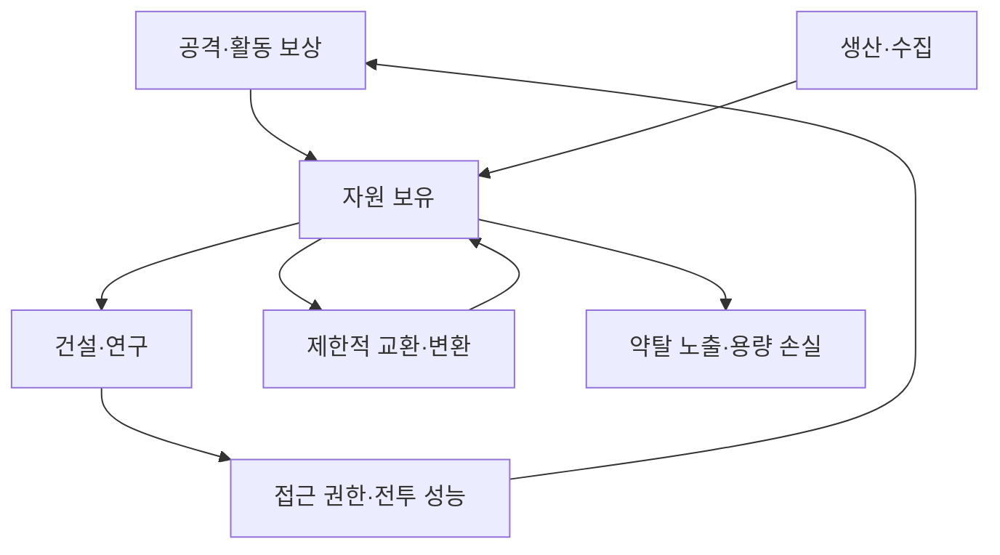

# 04. 자원·약탈·경제 시스템 역기획

> 기준일: 2026-11-13 KST. [확인] 공개 사실, [해석] 경제 설계 분석, [제안] 구현 모델. 모든 예시 수입량·비용은 설명용 가정이며 현행 가격표가 아니다.

## 1. 핵심 경제 구조

[해석] 본마을 경제는 공격 수입과 수동 생산을 장기 성장으로 전환하는 구조다. 전투에 투입할 병력의 준비 비용이 사라진 뒤에는 “공격군 생산비를 회수하는가”보다 “공격으로 얻은 자원을 다음 장인·연구 슬롯에 쓸 수 있는가”가 더 중요해졌다.

[확인] 2022년 본마을 병력·마법·시즈의 훈련 재화 비용이 제거됐고, 2025년에는 준비 시간과 영웅 회복 대기가 제거됐다. 따라서 옛 약탈 수익식의 엘릭서 훈련비와 시간당 훈련 가능 횟수를 현행 핵심 제약으로 쓰면 안 된다. [2022 변경](https://supercell.com/en/games/clashofclans/blog/news/home-village-changes-2/), [2025 Clash Anytime](https://supercell.com/en/games/clashofclans/blog/release-notes/welcome-to-clash-anytime-update/)

[확인] 본인 군대의 무료 편성과 클랜 지원 비용은 다르다. 2025 Clash Anytime의 Donations 절은 지원 시 병력·마법에 따라 엘릭서 또는 다크 엘릭서를 지불하도록 변경됐다고 설명한다. 따라서 기부를 경제 원장의 별도 소모 항목으로 기록한다. 자세한 지원 한도와 요청 규칙은 [13. 클랜·지원](13_clans_social_and_donations.md)을 따른다.



## 2. 재화 역할의 분리

[제안] 재화는 같은 정수형으로 저장하더라도 획득 정책·상한·노출·사용처를 개별 정의한다.

| 재화 계열 | 중심 역할 | 설계상 분리할 이유 |
| --- | --- | --- |
| 골드·엘릭서 | 본마을 일반 성장 | 수입은 비슷해도 소비 우선순위가 달라진다 |
| 다크 엘릭서 | 특정 병력·영웅·펫 성장 | 주력 성장 경로의 병목이 집중되기 쉽다 |
| 장인 골드·장인 엘릭서 | 장인 기지 성장 | 별도 공격·방어 보상 흐름을 갖는다 |
| 보석 | 영구 편의·가속·다양한 구매 | 프리미엄 잔액·환불 거래를 구분한다 |
| 세 종류 광석 | 영웅 장비 성장 | 성장 단계별 조합 수요가 다르다 |
| 클랜 캐피탈 골드 | 공동 마을 기여 | 개인 소비와 공동 성장의 소유 주체가 다르다 |
| 습격전·리그 메달 | 특정 참여 성과의 교환 | 획득 모드·상점·갱신 시점이 다르다 |
| 이벤트 재화 | 기간별 참여와 선택 보상 | 유효기간·전환·상점 종료를 갖는다 |
| Sparky Stones | 최종 성장의 외형 보상 | 전투 수치 투자 소멸의 잔존 가치를 준다 |

[확인] Fancy Shop은 Supercharge와 Crafted Defense 투자에 연결되는 Sparky Stones를 외형 보상에 사용한다. 새 레벨·제작 단계 전환과 영구 계정 가치 사이의 연결 장치로 읽을 수 있다. [공식 Fancy Shop](https://support.supercell.com/clash-of-clans/en/articles/the-fancy-shop.html)

## 3. 생산·저장·약탈의 세 지갑

[확인] 생산 시설에는 아직 수집하지 않은 자원이, 저장 시설에는 수집한 자원이 있다. 공격자는 상대 자원 전체를 가져갈 수 없고 TH 관련 제한이 작용한다. 마을 회관·클랜 성의 자원을 획득하려면 해당 건물을 완전히 파괴해야 한다. [Loot and Star Bonus](https://support.supercell.com/clash-of-clans/en/articles/about-multiplayer-and-trophies-3.html)

[제안] 다음 세 상태를 한 변수로 합치지 않는다.

```text
collectorBalance[r] : 생산 시설별 미수집 자원
storageBalance[r]   : 성장에 직접 사용할 잔액
treasuryBalance[r]  : 별도 수령 경로를 갖는 보상 잔액
```

생산은 오프라인 경과 시간에 비례하되 생산 시설 용량에서 멈춘다. 수집은 새 자원을 발행하는 행위가 아니라 생산 지갑에서 저장 지갑으로 옮기는 거래다. 창고가 가득 찼을 때의 잔여 생산량 보존 규칙은 별도 실측 대상이며, 모든 수집 버튼이 초과분을 버린다고 가정하지 않는다.

### 약탈 계산의 제안 모델

```text
availableLoot[r] =
  collectorLoot(r, snapshot)
  + min(storageLootRate[r] * exposedStorage[r], storageLootCap[r])
  + conditionalBuildingLoot(r, snapshot)

earnedLoot[r] = availableLoot[r] * eligibleDamageFraction[r]
creditedLoot[r] = applyCapacityPolicy(earnedLoot[r], rewardSource)
```

이 식은 원작의 공개되지 않은 정확한 공식이 아니다. 대상별 약탈 비율, 상한, TH 보정, 피해 단위 지급은 버전별 실측 파라미터다. 특히 피해 비율을 전체 건물 파괴율로 대체하면 자원 건물을 먼저 노리는 공격의 경제적 의미가 사라진다.

## 4. 공급·이동·소모를 구분하는 원장

[제안] 경제 분석은 플레이어의 잔액 증가를 모두 신규 공급으로 세지 않는다. 일반적인 실제 마을 약탈은 공격자와 방어자 사이 이동 성격이 있고, 보너스·이벤트 보상은 시스템 공급이다. 복제 마을·모드별 보상은 공격자 획득과 방어자 손실이 일치하지 않을 수 있으므로 원천 유형을 기록한다.

| LedgerEvent | 공격자 또는 수령자 | 상대·원천 | 분류 |
| --- | --- | --- | --- |
| CollectorProduced | 생산 시설 잔액 증가 | 시스템 | 공급 |
| CollectorCollected | 저장 증가, 생산 잔액 감소 | 자기 지갑 | 이동 |
| RaidLootCredited | 적재된 약탈 증가 | 전투 유형별 | 이동 또는 공급 |
| UpgradePurchased | 지불 자원 감소 | 업그레이드 | 소모 |
| DonationPurchased | 지원 비용 감소 | 클랜 지원 거래 | 소모 |
| UpgradeCancelled | 부분 환급 | 원 시작 거래 | 소모 일부 복원 |
| RewardClaimed | 보상 적재 | 보상 프로그램 | 공급 |
| ResourceConverted | 원 재화 감소, 대상 증가 | 변환 규칙 | 변환 |
| OverflowDiscarded | 적재되지 않은 양 기록 | 용량 정책 | 기회 손실 |

원장에는 transactionId, accountId, currencyId, delta, sourceType, sourceId, ruleVersion, idempotencyKey를 기록한다. 수령 성공 화면과 실제 원장 결과가 달라지면 고객지원으로도 설명하기 어렵다.

## 5. 변환과 자원 불균형 완충

[확인] Alchemist는 골드·엘릭서·다크 엘릭서의 변환을 제공하고, 레벨에 따라 변환 효율과 한도가 바뀐다. Prospector는 시즌 패스에 연결된 광석 변환 조력자다. [조력자 안내](https://sc-clashofclans.zendesk.com/hc/en-us/articles/49529140074139-Helpers-The-Helper-Hut)

[해석] 자원 전환은 가장 부족한 재화 때문에 나머지 재화까지 넘치는 상황을 완화한다. 무제한 동일 가치 교환으로 만들면 재화별 플레이 목표가 사라진다. 한도와 사용 주기가 수입 균형을 조정하는 핵심 변수다.

[제안] 변환 거래는 입력량 차감, 출력량 검증, 일일 사용권 소진을 함께 처리한다. 대상 보관량 부족으로 실패했는데 사용권만 사라지는 상태를 금지한다. 변환 보너스는 “입력 재화의 단위”와 “목표 재화의 가치 환산”을 혼동하지 않도록 독립 필드로 둔다.

## 6. Hoggy Bank와 초과 저장

[확인] Hoggy Bank는 시즌의 전리품을 별도로 누적하고 시즌 종료에 지급한다. 일반적으로 저장 시설에 실제 들어간 전리품이 누적 기준이지만, 장인 엘릭서 수레에는 별도 예외가 있다. 시즌 종료 지급은 일반 저장 상한을 초과할 수 있다. 전투 중 시즌 경계를 넘으면 해당 자원은 다음 시즌으로 넘어간다는 안내가 있다. [Hoggy Bank 공식 안내](https://sc-clashofclans.zendesk.com/hc/en-us/articles/55600634183451-Hoggy-Bank)

[제안] 초과 저장은 모든 보상에 적용되는 전역 옵션이 아니다.

| 보상 성격 | 정책 데이터 |
| --- | --- |
| 보통 공격 자원 | 적재 가능량 제한 |
| 시즌 종료 은행 지급 | 명시적 초과 허용 |
| 성장 트랙 보상 | 보상별 적재·대체·수령 대기 |
| 마이그레이션 보상 | 일회성 초과 허용과 migrationId |
| 보유 불가능한 중복 아이템 | 판매값·대체 재화·즉시 사용 여부 |

이 구분이 없으면 시즌 지급 직후 약탈에 참여했을 때 누적량이 잘못 증가하거나, 초과 보유 상태가 자동 삭제될 수 있다. Bank의 상세 패스 동작은 [20. 퀘스트·패스](20_quests_achievements_and_pass.md)를 따른다.

## 7. 경제 병목 모델과 예시

[제안] 성장 목표 j에 필요한 재화 r의 부족량을 D(j,r), 일평균 순획득량을 I(r)라 두면:

```text
resourceReadyDays(j) = max_r(D(j,r) / I(r))
earliestStart(j) = max(resourceReadyAt, workerReadyAt, prerequisitesReadyAt)
```

예를 들어 건설에 골드 600만이 부족하고 하루 순획득이 200만이라면 자원 준비는 약 3일이다. 장인은 5일 뒤 비므로 자원만 더 빠르게 모아도 시작 시각은 5일 뒤다. 이 사례에서 자원 묶음을 팔았을 때 체감 편익은 작고, 병목은 장인 또는 작업 일정이다.

반대로 장인이 놀고 있는데 다크 엘릭서가 부족하면 반복 공격의 순획득량, 변환 기회, 주력 업그레이드의 분산 여부가 중요하다. 같은 과금 상품·보상이라도 계정 상태에 따라 효용이 달라진다.

### 측정 지표

- 재화별 일간 순공급·순소모·순이동과 잔액 백분위.
- 창고 포화 시간 및 적재하지 못한 전리품의 비율.
- 업그레이드 비용은 감당하지만 슬롯 때문에 대기한 시간.
- 슬롯은 비어 있지만 재화 때문에 대기한 시간.
- 변환 전후 자원 부족 벡터의 변화.
- 수급을 목적으로 한 공격과 순위 목적 공격의 보상 차이.
- 이벤트 종료 전후 잔액·성장 속도·재방문 변화.

## 8. 버전 충돌과 미확인 수치

별 보너스의 세부 보상은 특히 주의가 필요하다. 지원문서에는 모든 광석 종류라는 표현이 있고, 대장간 문서는 Starry Ore의 공급원을 다른 방식으로 열거한다. 2026-11 예고는 TH 기준 별 보너스 개편을 다루므로 예고 내용을 기준일 현재 계정에 일괄 적용하면 안 된다.

| 공식 자료 | 표현 | 본 문서의 처리 |
| --- | --- | --- |
| 2026-04-27 정식 패치 | 별 보너스의 모든 광석 종류 증가 | 기존의 “Starry Ore는 별 보너스에서 절대 나오지 않는다”는 단정 금지 |
| 현행 Loot 지원문서 | 모든 광석 종류 포함 가능 | 광석 지급 벡터를 설정 데이터로 유지 |
| 현행 Blacksmith 지원문서 | Starry 획득처에 Journey·전쟁·이벤트 열거 | 열거만으로 다른 공급원이 없다고 해석하지 않음 |
| 2026-11 예고 | TH 중심 보상 개편 | 기준일에 이미 시행됐다고 계산하지 않음 |

[확인] 4월 정식 패치의 표현은 공식 [The Sound of Clash Update](https://supercell.com/en/games/clashofclans/blog/release-notes/the-sound-of-clash-update/)의 League Based Economy Changes에서 확인했다. 다만 자료가 구체 지급표를 제시하지 않으므로 TH·리그별 Starry 지급량은 별도 확인 항목으로 남긴다.

[미확인] 광석 종류별 현재 지급량, TH·리그 보정과 예정 개편의 배포 범위를 실제 클라이언트 또는 해당 릴리스로 확정해야 한다. 이 문서의 수입 모델은 StarBonusRewardTable을 별도 버전 데이터로 두고 특정 광석을 항상 지급하거나 항상 제외하지 않는다. [대장간 안내](https://support.supercell.com/clash-of-clans/en/articles/hero-equipment-ore-5.html)

## 9. 수용 기준·QA

| ID | 상황 | 기대 결과 |
| --- | --- | --- |
| ECO-01 | 창고보다 큰 약탈 보상 | 원래 획득량과 실제 적재량 구분 |
| ECO-02 | 같은 전투 결과 중복 수신 | 공격 보상·은행 누적 한 번 |
| ECO-03 | 시즌 종료 지급으로 용량 초과 | 허용된 초과 잔액 보존 |
| ECO-04 | 자원 변환 목적지 용량 부족 | 차감·사용권 처리 일관성 유지 |
| ECO-05 | 복제 마을 공격 | 상대 실제 지갑에서 임의 차감하지 않음 |
| ECO-06 | 할인 구매 후 취소 | 정가가 아닌 실제 지불 내역 사용 |
| ECO-07 | 전투 도중 시즌 종료 | 명시된 시즌 귀속 정책 적용 |
| ECO-08 | 경제 테이블 패치 | 기존 거래와 신규 거래 버전 구분 |

## 10. 출처·연결

[02. 건설](02_village_builders_and_construction.md), [03. 성장](03_progression_research_and_unlocks.md), [20. 패스](20_quests_achievements_and_pass.md), [21. 수익화](21_monetization_and_magic_items.md)와 연결한다.

출처: [2022 훈련 비용 제거](https://supercell.com/en/games/clashofclans/blog/news/home-village-changes-2/), [2025 훈련 시간 제거](https://supercell.com/en/games/clashofclans/blog/release-notes/welcome-to-clash-anytime-update/), [약탈](https://support.supercell.com/clash-of-clans/en/articles/about-multiplayer-and-trophies-3.html), [조력자](https://sc-clashofclans.zendesk.com/hc/en-us/articles/49529140074139-Helpers-The-Helper-Hut), [은행](https://sc-clashofclans.zendesk.com/hc/en-us/articles/55600634183451-Hoggy-Bank), [Fancy Shop](https://support.supercell.com/clash-of-clans/en/articles/the-fancy-shop.html). 열람일 2026-11-13.
