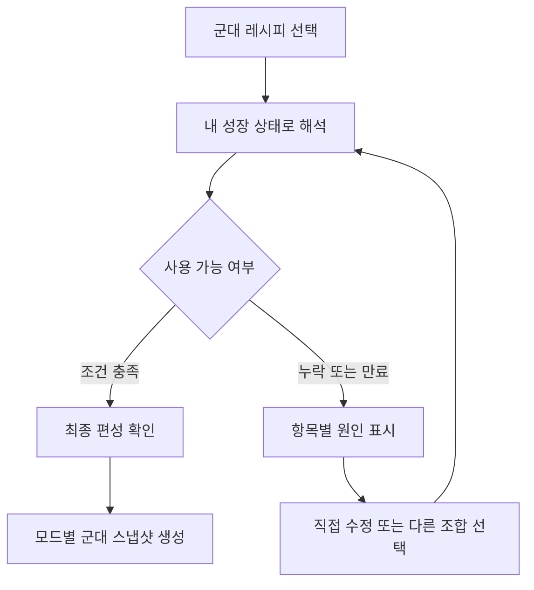

# 05. 군대 편성·병력 수용량·군대 레시피

> 분석 기준: 2026-11-13 KST. 본 마을 중심. `[확인]`은 공개 근거가 있는 규칙, `[해석]`은 설계 분석, `[제안]`은 재구현 명세, `[미확인]`은 실기 검증이 필요한 항목이다. 아래 데이터 구조와 검증 순서는 Supercell 내부 구현을 뜻하지 않는다.

## 1. 시스템의 역할

군대 편성은 성장 결과를 한 번의 공격에 사용할 전투 자원으로 바꾸는 과정이다. 플레이어는 병력 수용량 안에서 유닛 조합을 정하고, 마법·영웅·장비·펫·시즈 머신·클랜 성 지원 병력을 결합한다. 전투 중 생산보다는 **전투 전 조합과 전투 중 투입 순서**에 선택을 집중시키는 구조다. 병력의 레벨을 올리는 성장과 같은 레벨에서 조합을 바꾸는 전술을 별도 축으로 취급해야 한다. [해석]

### 현행과 과거의 차이

| 항목 | 확인한 변화 | 설계상 영향 |
|---|---|---|
| 병력·마법·시즈 생산 자원 | 2022년 훈련 자원 비용 제거 | 공격 조합을 바꾸는 직접 자원 손실이 줄어듦 |
| 훈련 대기 | 2025년 Clash Anytime에서 제거 | 연속 공격과 조합 실험이 쉬워짐 |
| 영웅 전투 후 회복 | 같은 개편에서 제거 | 전투 사이 회복 대기와 영웅 업그레이드 대기를 분리해야 함 |
| 군대 레시피 | 저장·편집·공유 기능 도입 | 조합을 반복 입력하는 비용 감소 |
| 추천 조합 | Cookbook의 Starter/Featured 계열 | 신규 플레이어의 선택 범위를 안내하고 이벤트 조합을 노출 |

위 표의 변경 사실은 [C01](https://supercell.com/en/games/clashofclans/blog/news/home-village-changes-2/), [C02](https://supercell.com/en/games/clashofclans/blog/release-notes/welcome-to-clash-anytime-update/), [C03](https://supercell.com/en/games/clashofclans/blog/release-notes/welcome-to-lets-get-crafty-update/)에 근거한다. **훈련 무료는 성장·슈퍼 유닛 활성화·지원 보충까지 모두 무료라는 뜻이 아니다.** 개별 비용 원장은 분리한다. [해석]

## 2. 편성 제약 모델

| 편성 자원 | 제약의 의미 | 서로 합산하면 안 되는 항목 |
|---|---|---|
| 일반 병력 수용량 | 유닛별 점유량의 합이 집합소 용량 이내 | 마법 슬롯, 영웅 수 |
| 마법 수용량 | 마법별 점유량의 합이 보유 한도 이내 | 클랜 성에서 받은 마법 |
| 시즈 선택 | 공격에 사용할 시즈 종류를 선택 | 자기 제작 시즈와 지원 시즈의 동시 사용 |
| 영웅 슬롯 | 활성 공격 영웅을 선택 | 잠금 해제한 영웅 전체 수 |
| 장비 슬롯 | 선택한 영웅별 장비 구성 | 일반 유닛의 수용량 |
| 펫 배정 | 영웅과 펫의 연결 관계 | 펫 하우스 레벨과 영웅 슬롯 수 |
| 클랜 성 지원 | 수신 가능한 병력·마법·시즈 한도 | 자기 집합소의 병력 용량 |
| 모드 허용 목록 | 임시 유닛·이벤트 효과의 입장 가능 여부 | 계정에서 보유하고 있다는 사실 |

시즈는 일반 병력 수용량과 분리되고 공격 시 자기 시즈와 지원 시즈 중 하나를 선택한다. 영웅은 보유 수와 별개로 최대 네 공격 슬롯을 쓴다. [확인: C04](https://sc-clashofclans.zendesk.com/hc/en-us/articles/49529091698587-Siege-Machines), [C05](https://sc-clashofclans.zendesk.com/hc/en-us/articles/49529108034843-About-Heroes-Pets)

병력 레벨별 HP·공격력, 회관별 집합소 최대 용량 전체는 별도 버전 데이터로 관리한다. 이 문서는 최신 숫자를 추정해 도감으로 채우지 않는다. [미확인]

## 3. 편성의 전술적 분해

다음 표는 공식 병과 분류가 아니라 조합을 설계·평가하기 위한 역할 분류다. 같은 유닛도 배치·장비·마법에 따라 여러 역할을 수행할 수 있다. [해석]

| 역할 | 해결하려는 문제 | 과도하게 편성했을 때의 손실 |
|---|---|---|
| 진입로 정리 | 주력 부대가 외곽을 돌지 않도록 주변 목표 제거 | 본대 화력·회복·마법 부족 |
| 전열 유지 | 핵심 딜러가 공격하는 시간을 확보 | 피해를 버텨도 시간 내 완파하지 못함 |
| 주요 방어 제거 | 중심부의 고위험 방어를 빠르게 제거 | 비핵심 건물 정리 속도 부족 |
| 벽 통과·돌파 | 지상군이 핵심 구역에 도달 | 공중군 위주 조합에서 가치 감소 |
| 유지력 | 지속 피해를 회복·완화 | 급격한 순간 피해에 대응하지 못함 |
| 방어 병력 대응 | 클랜 성 병력·방어 영웅 때문에 본대가 정지하는 문제 | 상대 지원 병력이 약하면 투자 효율 감소 |
| 마무리 | 모서리 건물·잔여 외곽을 제한 시간 내 정리 | 초반 생존력이 모자라면 투입할 기회 상실 |
| 유인·탐색 | 숨은 함정과 타깃 반응을 작은 비용으로 확인 | 탐색 병력이 불필요하게 소모되면 본대 약화 |

좋은 조합은 개별 유닛의 DPS 합계보다 **위험한 구간에 필요한 기능이 도착하는가**로 평가한다. 예를 들어 높은 화력이 있어도 진입로 정리가 실패하면 주요 방어에 닿지 못한다. 반대로 탱킹이 충분해도 마지막 건물까지의 이동 시간이 길면 시간 초과가 발생한다. [해석]

## 4. 레시피의 데이터 계약

다음은 공유 가능한 편성 정의와 실제 공격 시작 시의 군대를 분리한 제안이다. [제안]

```yaml
ArmyRecipe:
  recipeId: string
  schemaVersion: integer
  title: string
  allowedModeTags: [home_battle, ranked]
  troops: [{definitionId: string, count: integer}]
  spells: [{definitionId: string, count: integer}]
  heroes:
    - heroId: string
      equipmentIds: [string, string]
      petId: string_or_null
  preferredSiegeId: string_or_null
  requestedReinforcements: object
  authorContentRevision: string

ResolvedArmy:
  recipeId: string
  attackerProgressRevision: string
  battleRulesVersion: string
  resolvedTroopLevels: map
  resolvedHeroLevels: map
  activeTemporaryModifiers: array
  availabilityErrors: array
  committedAt: timestamp
```

레시피에 작성자의 실제 레벨을 영구 고정하면 다른 플레이어가 공유받았을 때 잘못된 병력이 생긴다. 레시피는 종류·수량·선택을 저장하고, 실제 레벨과 사용 권한은 수신자의 계정에서 해석하는 편이 안전하다. 다만 친선·공식 챌린지처럼 미리 정해진 군대를 제공하는 모드는 `FixedArmyScenario`를 별도 계약으로 둔다. [제안]

## 5. 편성 검증 순서

1. 레시피 형식·버전·중복 ID를 검증한다.
2. 유닛·마법·영웅·장비·펫의 계정별 해금 여부를 확인한다.
3. 현재 모드의 허용 목록을 적용한다.
4. 업그레이드·부스트 만료·지원 부족 등 일시적인 사용 불가를 확인한다.
5. 일반 병력·마법·지원 병력의 용량을 각각 계산한다.
6. 영웅 중복, 장비 중복, 펫 중복, 시즈 선택 충돌을 확인한다.
7. 최종 군대 스냅샷을 만들고 공격 입장과 함께 고정한다. [제안]

```text
validate(recipe, account, mode, revision):
    errors = validate_schema(recipe)
    for entry in recipe.entries:
        errors += check_unlock(entry, account)
        errors += check_mode_permission(entry, mode, revision)
    errors += check_capacity_by_bucket(recipe, account)
    errors += check_unique_assignments(recipe)
    errors += check_transient_availability(recipe, account)
    return ValidatedRecipe(recipe, errors, revision)
```

`check_mode_permission`은 존재하지 않는 유닛을 조용히 다른 유닛으로 바꾸면 안 된다. 공식 Ranked 안내는 임시 유닛이 포함된 군대가 해당 유닛 없이 입장할 수 있다고 설명한다. 따라서 역기획에서는 **실제 동작의 재현**과 **부족한 군대를 사전 경고하는 개선 제안**을 구분한다. [확인: C06](https://sc-clashofclans.zendesk.com/hc/en-us/articles/49529109982875-Ranked-Leagues) [제안: 경고 UI]

## 6. 편성 UX와 상태 흐름



편성 화면에서는 수용량 초과, 소유하지 않은 장비, 사용 불가 영웅을 같은 빨간 경고 하나로 뭉치지 않는다. 각 원인의 해결 방법이 다르기 때문이다. `용량 4 초과`는 병력 감소, `영웅 업그레이드 중`은 교체 또는 완료, `이벤트 종료`는 일반 조합 선택으로 이어져야 한다. [제안]

저장 레시피가 유효하다는 표시와 즉시 공격 가능한 상태도 분리한다. 레시피 자체는 합법적이어도 현재 지원 병력이 없을 수 있다. 이를 `구성 유효 / 출전 준비 미완료`의 두 상태로 표현하면 저장 실패와 준비 실패를 혼동하지 않는다. [제안]

## 7. 정상 시나리오와 실패 시나리오

| 시나리오 | 기대 동작 | 설계 의도 |
|---|---|---|
| 공유 링크를 낮은 회관 계정에서 열기 | 잠금·용량 부족 항목을 표시하고 저장 초안을 제공 | 링크 자체의 오류와 성장 부족을 분리 |
| 영웅 한 명 업그레이드 시작 | 해당 영웅의 출전 상태를 다시 평가 | 회복 대기 제거와 성장 대기를 혼동하지 않음 |
| 슈퍼 유닛 활성화 만료 | 입장 시점의 정책에 따라 검증·안내 | 편성 시각과 전투 시각 사이 상태 변화 대응 |
| 이벤트 전용 레시피로 Ranked 선택 | 제한되는 요소를 명시 | 무효 군대가 실전 성과에 주는 손실 최소화 |
| 지원 병력만 다르게 보충 | 같은 레시피를 유지하되 실제 지원 내역 표시 | 선호 구성과 현재 인벤토리 구분 |
| 밸런스 패치로 점유량 변경 | 저장 조합을 삭제하지 않고 초과 항목 표시 | 사용자 편성 의도 보존 |
| 빠른 연속 공격 | 새 군대의 준비 상태와 직전 전투 결과를 독립 처리 | 중복 전투·이전 군대 재사용 오류 방지 |

이 표는 재구현 시 요구되는 제품 동작 제안이며 모든 행의 세부 UI가 실제 게임에 구현되어 있다는 주장은 아니다.

## 8. 밸런스 분석 모델

### 8.1 한계 효용

편성에 유닛 하나를 더 넣는 가치는 다음처럼 분해할 수 있다. 실제 게임 공식이 아니라 분석용 모델이다. [제안]

`추가 가치 ≈ 핵심 구간 성공률 증가 + 마무리 성공률 증가 - 대체한 역할의 손실`

병력 수용량은 강력한 단일 유닛을 제한하지만, 특정 마법·영웅 장비와 결합할 때 생기는 비선형 상승까지 자동으로 제어하지는 못한다. 따라서 개별 유닛 지표와 조합 지표를 함께 봐야 한다. [해석]

### 8.2 측정할 지표

| 지표 | 구분 조건 | 읽을 수 있는 문제 |
|---|---|---|
| 조합 선택률 | 회관·랭크·공격 목표 | 특정 조합에 선택이 집중되는가 |
| 완파율 | 동회관·실력대·장비 레벨 | 조합 자체의 힘과 성장 격차를 혼동하지 않는가 |
| 첫 레시피 수정률 | 신규·복귀·숙련 | 추천 조합이 학습 출발점으로 작동하는가 |
| 군대 준비 오류율 | 잠금·만료·지원 부족 | 공격 직전 마찰이 어디서 발생하는가 |
| 미투입 병력 비중 | 성공·실패·시간 초과 | 군대가 과도하게 복잡하거나 조작 시간이 부족한가 |
| 레시피 다양성 | 정규화된 수용량 조합 | 이름만 다르고 실질적으로 같은 군대인지 |
| 전환 비용 | 편성 시작부터 입장까지 시간 | 즉시 훈련의 장점이 UI에서 사라지는가 |

## 9. 검수 조건

1. 병력 수용량이 정확히 상한일 때 허용되고 1을 초과하면 원인을 표시한다.
2. 일반 마법과 지원 마법이 서로의 한도를 잘못 차감하지 않는다.
3. 영웅 보유 수가 활성 슬롯 수보다 많아도 전체 영웅을 출전시키지 않는다.
4. 같은 펫 또는 장비의 금지된 중복 배정이 공유 링크로 우회되지 않는다.
5. 지원 시즈와 자기 시즈를 한 전투에서 모두 사용할 수 없다.
6. 계정 성장·부스트·모드가 바뀌면 캐시된 유효성 결과를 다시 계산한다.
7. 레시피를 저장한 뒤 패치되어도 기존 구성 의도를 복구할 수 있다.
8. 편성 불가 원인을 숨긴 채 병력을 임의로 대체하지 않는다.
9. 전투 시작 후 레시피를 수정해도 이미 시작한 공격의 군대가 바뀌지 않는다.

## 10. 연결 문서와 출처

- 전투 중 소모·투입: [06. 전투 규칙](06_battle_rules_and_resolution.md)
- 특수 편성 요소: [08. 마법·시즈·슈퍼 유닛](08_spells_siege_and_super_troops.md)
- 영웅 구성: [09. 영웅·장비·펫](09_heroes_equipment_and_pets.md)
- C01: [Home Village Changes, 2022-06-26](https://supercell.com/en/games/clashofclans/blog/news/home-village-changes-2/) — 훈련 비용 제거의 변경 근거.
- C02: [Welcome to Clash Anytime Update!, 2025-03-24](https://supercell.com/en/games/clashofclans/blog/release-notes/welcome-to-clash-anytime-update/) — 훈련·회복 시간 제거, 레시피.
- C03: [Welcome to Let’s Get Crafty Update!, 2025-06-16](https://supercell.com/en/games/clashofclans/blog/release-notes/welcome-to-lets-get-crafty-update/) — 추천 레시피 구조.
- C04: [Siege Machines, 공식 Support](https://sc-clashofclans.zendesk.com/hc/en-us/articles/49529091698587-Siege-Machines) — 시즈 선택·용량 분리. 방어 관련 모호한 문장은 이 문서에서 채택하지 않음.
- C05: [About Heroes & Pets, 공식 Support](https://sc-clashofclans.zendesk.com/hc/en-us/articles/49529108034843-About-Heroes-Pets) — 활성 영웅 슬롯.
- C06: [Ranked Leagues, 공식 Support](https://sc-clashofclans.zendesk.com/hc/en-us/articles/49529109982875-Ranked-Leagues) — Ranked의 임시 유닛 제한.

모든 출처 접근일: 2026-11-13. 역사 자료의 당시 레벨·비용·시간 수치는 현행 수치로 전용하지 않는다.
