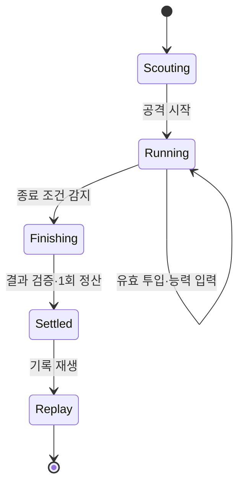

# 06. 공격 전투·판정·종료·결과 정산

> 기준일: 2026-11-13 KST. 본 마을 전투의 공통 규칙과 재구현 가능한 판정 모델을 다룬다. `[확인]`은 공식 근거, `[해석]`은 설계 분석, `[제안]`은 구현안, `[미확인]`은 별도 측정이 필요한 값이다. 서버의 실제 실행 위치·틱률·재현 방식은 공개 문서만으로 확정하지 않는다.

## 1. 전투의 핵심 계약

공격자는 사전에 편성한 군대를 공간과 시간에 배분한다. 방어자는 실시간으로 조작하지 않고 배치·방어 레벨·지원 병력·영웅 구성으로 공격자의 선택에 대응한다. 따라서 전투는 **실시간 투입 결정을 하는 공격자와 사전 설계된 방어 모델의 비대칭 대결**로 해석할 수 있다. [해석]

일반 Battle과 Ranked는 경쟁·자원 처리 계약이 다르다. 같은 파괴 결과를 얻어도 보상·트로피·방어 스냅샷 규칙은 모드 서비스가 결정해야 한다. [확인: C07](https://sc-clashofclans.zendesk.com/hc/en-us/articles/49529096972059-Battle-vs-Ranked-Battle-What-s-the-Difference) [해석]

## 2. 승리·완파 판정

| 성취 조건 | 부여되는 별 | 주의할 점 |
|---|---:|---|
| 파괴율 50% 도달 | 1 | 회관 파괴 여부와 독립 조건 |
| 마을회관 파괴 | 1 | 파괴율이 50% 미만이어도 별을 얻을 수 있음 |
| 파괴율 100% 도달 | 1 | 총점은 최대 3별 |

별 조건은 공식 전쟁 결과 문서가 멀티플레이와 같은 방식으로 설명한다. [확인: C08](https://sc-clashofclans.zendesk.com/hc/en-us/articles/49529080382363-Clan-War-Results)

### 판정 함수 제안

```text
stars = (destructionReached50 ? 1 : 0)
      + (townHallDestroyed ? 1 : 0)
      + (destructionReached100 ? 1 : 0)
```

계산 기준은 UI에 반올림해 표시한 숫자가 아니라 원본 파괴 상태여야 한다. `49.6%`가 화면에서 `50%`로 표시되는 경우가 있더라도 표시 반올림이 별 판정에 영향을 주면 안 된다. 실제 게임의 표시 반올림 규칙은 별도 측정 대상이다. [제안·미확인]

**벽·함정·장식·임시 소환물·영웅을 모두 같은 분모에 넣으면 안 된다.** 재구현에서는 공격 시작 시점에 `countsForDestruction`이 켜진 구조물 집합을 확정하고, 구조물 하나가 파괴될 때 한 번만 증가시킨다. 각 특수 객체의 현행 집계 포함 여부는 실제 클라이언트 관찰로 채워야 한다. [제안]

## 3. 전투 상태와 시계

| 상태 | 입력 | 다음 상태 | 영속 데이터 변경 |
|---|---|---|---|
| 준비 | 군대·모드 선택 | 상대 탐색 | 편성만 저장 |
| 정찰 | 화면 이동·공격 시작 | 진행 | 아직 전투 결과 없음 |
| 진행 | 유닛 투입·마법·영웅 능력 | 진행·종료 | 전투 이벤트 기록 |
| 종료 판정 | 시간·파괴·공격 지속 가능 여부 | 결과 확정 | 결과 후보 생성 |
| 결과 확정 | 권위 있는 결과 검증 | 정산 | 보상·트로피·퀘스트 반영 |
| 리플레이 | 재생·배속 | 종료 | 게임 경제 변경 없음 |

이 상태표는 재구현 제안이다. 일반 본 마을의 공격 제한 시간을 통상적인 3분 전투 모델로 설명할 수 있으나, 이벤트·친선·특수 모드별 시간표는 `ModeRuleSet`에서 별도로 검증한다. 정찰 시간, 시작 입력에 따른 타이머 전환의 세부 경계는 모든 모드에 일괄 적용하지 않는다. [제안·미확인]

### 실제 시간과 시뮬레이션 시간

2026년 6월에는 공격 시작 후 120초가 지나면 1배속/4배속을 선택하는 Live Fast Forward가 일부 모드에 추가되었다. [확인: C09](https://supercell.com/en/games/clashofclans/blog/release-notes/the-anime-fury-update-is-here/)

이 기능을 재구현할 때는 `wallClockTime`과 `battleSimulationTime`을 분리한다. 배속은 남은 공격 기회를 새로 만들거나 마법 시간을 늘리지 않고 전투 시계의 진행 속도를 바꾸어야 한다. 모드별 허용 여부, 관전 표시, 리플레이 시간축까지 같은 규칙을 공유한다. 실제 입력 처리 방식과 네트워크 동기화 방식은 공개되지 않았다. [제안·미확인]



## 4. 투입 규칙의 재구현

### 4.1 입력 검증

투입 요청은 `{battleId, sequence, unitId, count, position, simulationTime}`으로 모델링한다. 서버 또는 권위 있는 판정 계층은 다음을 확인한다. [제안]

1. 해당 전투가 진행 상태인가.
2. 사용 가능한 병력·마법·능력이 남았는가.
3. 위치가 해당 투입 유형의 유효 영역인가.
4. 같은 입력 번호가 이미 처리되었는가.
5. 해당 효과가 이 모드에서 허용되는가.
6. 입력 시각이 전투의 허용 범위에 있는가.

맵의 투입 금지 영역은 렌더링의 빨간 테두리와 판정 데이터가 같아야 한다. 클라이언트에서는 가능해 보이는데 실제로 거절되는 구간이 생기면 전술 실패와 조작 실패를 구분하기 어렵다. [제안]

### 4.2 투입과 소환의 구분

| 구분 | 예 | 설계상 별도 처리 이유 |
|---|---|---|
| 플레이어 직접 투입 | 병력 카드, 영웅 카드 | 편성 수량·투입 위치 검사 |
| 능력으로 생성 | 영웅 장비 소환물 | 직접 수용량 소모와 다른 원천 |
| 시즈에서 방출 | 클랜 성 지원 병력 | 시즈 수명·방출 상태와 연결 |
| 사망·분열 생성 | 자식 유닛·부활 객체 | 동일 전투 객체 계보 추적 |
| 회수 후 재투입 | Recall 계열 | 기존 체력·효과의 보존 정책 필요 |

모든 생성 이벤트에 `spawnOrigin`과 `parentEntityId`를 남기면 수용량 기반 능력, 퀘스트, 통계가 서로 다른 의미의 병력 수를 잘못 섞지 않는다. 최근 공식 수정에서도 소환물의 수용량 분류가 다른 능력 판정에 영향을 준 사례가 확인된다. [확인: C10](https://supercell.com/en/games/clashofclans/blog/release-notes/august-update-3/) [제안]

## 5. 피해·회복·사망의 처리 모델

다음 식은 실제 CoC 피해 공식을 복원한 것이 아니라 재현 가능한 기본 계약이다. [제안]

`적용 피해 = 효과별 기본 피해 × 공격 보정 × 대상 보정 × 방어 보정`

여기에 보호막, 무적, 최대 HP 비례 피해, 연쇄 감쇠, 치유 차단, 고정 피해 등이 있으면 서로 다른 단계로 명시한다. 모든 효과를 단일 `damageMultiplier`에 넣으면 적용 순서에 따른 버그를 설명하기 어렵다.

| 처리 단계 | 필요한 판정 | 대표 경계 사례 |
|---|---|---|
| 타격 성립 | 타깃 생존·사거리·대상 층 | 발사 후 비행/지상 상태 변화 |
| 피격 위치 결정 | 단일·범위·연쇄 | 범위 경계에 걸친 큰 객체 |
| 면역·감쇠 | 피해 유형별 태그 | 피해는 막지만 상태 이상은 남는가 |
| HP 변경 | 고정 정밀도·하한·상한 | 치유와 피해가 같은 시점에 도착 |
| 사망 확정 | 중복 방지 | 여러 투사체 동시 명중 |
| 후속 이벤트 | 폭발·소환·부활·잔해 | 사망 이벤트가 새로운 사망을 유발 |
| 목표 재탐색 | 사망·투명·회수 | 이미 발사된 공격의 처리 |

디자인 단계에서 `피해 접수 → HP 반영 → 사망 확정 → 후속 효과 예약`처럼 한 가지 순서를 정하고 리플레이에서도 동일하게 쓴다. 실제 게임의 동시 사건 우선순위는 미공개이므로 별도 실험 없이 단정할 수 없다. [제안·미확인]

## 6. 전투 종료와 결과의 원자성

종료 후보는 시간 만료, 완파, 자발적 종료, 더 이상 전투를 진행할 수 없는 상태 등이다. **현재 살아 있는 유닛이 없다는 사실만으로 즉시 끝내면 안 된다.** 대기 중인 소환, 진행 중인 투사체, 부활 가능 상태, 아직 투입하지 않은 유닛의 정책을 함께 고려해야 한다. [제안]

```text
try_finish(context):
    if context.state != Running:
        return
    reason = evaluate_end_conditions(context)
    if reason is None:
        return
    freeze_external_commands()
    resolve_events_allowed_at_boundary(reason)
    result = build_result_from_authoritative_state()
    settle_once(result.battleId, result)
```

`settle_once`는 같은 전투 ID의 정산이 재전송되어도 보상이 다시 생기지 않게 한다. 재접속·클라이언트 종료·결과 화면 재열기 모두 같은 결과 레코드를 읽어야 한다. 실제 CoC가 정확히 이 API 구조를 쓰는지는 확인되지 않았으며, 관찰 가능한 서비스 동작을 구현하기 위한 요구사항이다. [제안]

## 7. 결과 데이터 모델

```yaml
BattleResult:
  battleId: string
  modeId: string
  rulesVersion: string
  attackSnapshotId: string
  defenseSnapshotId: string
  endReason: enum
  simulationDuration: fixed_point
  destroyedCount: integer
  destructionDenominator: integer
  townHallDestroyed: boolean
  stars: integer_0_to_3
  lootEvents: array
  usedArmySummary: object
  questEvidence: array
  replayReference: string
  settlementRevision: integer
```

결과 데이터에 트로피를 직접 계산해 넣기보다, 별·파괴율·시간·공격 모드 같은 원본 결과와 모드 서비스의 `rewardDecision`을 나누는 편이 운영상 유리하다. 전투 시뮬레이션이 바뀌지 않은 상태에서 보상표를 조정하거나 시즌 전환을 처리할 수 있기 때문이다. [제안]

## 8. 대표 전투 시나리오

### A. 회관만 제거한 공격

회관 파괴 별은 획득하지만 50% 조건에 도달하지 못한 상태를 유지한다. 결과 화면은 별과 자원 획득을 별도 정보로 보여야 한다. 이를 단순한 성공/실패 bool 하나로 저장하면 퀘스트·랭크·전쟁 점수의 차이를 표현할 수 없다. [해석]

### B. 외곽 제거 후 본대 진입 실패

외곽 정리로 50%를 넘었더라도 회관을 남기면 별이 제한된다. 이 구조는 안전한 파괴율 확보와 중심부 위험 감수 사이에 선택을 만든다. 방어 설계에서는 회관 접근 비용과 외곽 파괴율 제공량을 함께 다룬다. [해석]

### C. 마지막 투사체와 제한 시간 동시 도달

시간 경계에서 이미 예약된 타격을 어디까지 인정할지 명시해야 한다. `impactTime <= battleEndTime`과 같은 규칙을 채택할 수 있으나 실제 값은 실기 검증이 필요하다. 경계 처리의 일관성이 중요하며, 화면 FPS 차이가 결과를 바꾸어서는 안 된다. [제안]

### D. 화면 종료 후 결과 조회

표시 클라이언트가 끊겨도 진행 중인 전투의 정산 상태는 추적 가능해야 한다. `진행 중 / 결과 대기 / 확정`을 구분하고, 결과가 확정되지 않은 상태에서 다른 제한 공격을 중복 차감하지 않는다. 2026년 2월 공식 변경은 Ranked에서 직전 전투를 끝내야 다음 공격을 시작하도록 명시한다. [확인: C11](https://supercell.com/en/games/clashofclans/blog/release-notes/the-february-update-has-escaped/) [제안]

## 9. 난이도와 실력 표현

전투 결과는 공격 전 준비, 진입 각도, 투입 간격, 영웅 능력 시점, 마법 위치, 남은 시간 관리가 합성된 결과다. 완파율 하나만으로 조작 난이도나 전략 다양성을 판단하기 어렵다. 예컨대 같은 완파율이라도 특정 구간의 실수 한 번이 전투 전체를 결정하는 조합과 작은 실수를 여러 번 허용하는 조합은 접근성이 다르다. [해석]

| 지표 | 의미 | 세분화 축 |
|---|---|---|
| 0·1·2·3별 비율 | 실패 형태의 분포 | 회관·리그·모드·부스트 |
| 파괴율 분포 | 2별 내 성과의 차이 | 50~74·75~89·90~99 등 분석 구간 |
| 시간 초과율 | 이동·마무리의 병목 | 생존 유닛 수·남은 건물 위치 |
| 첫 핵심 방어 제거 시점 | 진입 성공 여부 | 조합·배치·시즈 |
| 영웅 능력 미사용 비율 | 조작 부담 또는 타이밍 실패 | 숙련도·기기·프레임 |
| 투입 거절 비율 | 입력·판정 불일치 | 가장자리·금지 영역 |
| 정산 중복/지연 | 서비스 안정성 | 재접속·버전·지역 |

## 10. 핵심 검수 시나리오

1. 50%와 회관 파괴가 같은 시점에 발생하면 두 조건을 독립 반영한다.
2. 마지막 집계 대상 건물의 파괴 이벤트가 두 번 들어와도 100%를 초과하지 않는다.
3. UI 표시 반올림이 별 판정을 바꾸지 않는다.
4. 투입 실패가 병력·마법 수량을 차감하지 않는다.
5. 배속 변경이 전투 제한 시간, 효과 지속 시간, 리플레이 결과를 바꾸지 않는다.
6. 사망 직후 예약된 소환과 부활을 종료 판정에서 누락하지 않는다.
7. 마지막 타격과 시간 만료가 경합해도 기기·FPS에 따라 결과가 달라지지 않는다.
8. 결과 재전송·앱 종료·재접속으로 보상이나 공격 횟수가 중복 처리되지 않는다.
9. 전투 중 적용된 밸런스 패치가 진행 중 전투의 규칙 버전을 바꾸지 않는다.
10. 일반·랭크·전쟁·친선의 동일 별 결과에 서로 다른 보상 정책을 적용할 수 있다.

## 11. 연결 문서와 출처

- 입력 전 준비: [05. 군대 편성](05_army_composition.md)
- 자동 전투 행동: [07. 유닛 AI·경로 탐색](07_unit_ai_and_pathfinding.md)
- 특수 효과: [08. 마법·시즈·슈퍼 유닛](08_spells_siege_and_super_troops.md)
- 방어 모델: [10. 방어·함정·배치](10_defenses_traps_and_layout.md)
- C07: [Battle vs Ranked Battle, 공식 Support](https://sc-clashofclans.zendesk.com/hc/en-us/articles/49529096972059-Battle-vs-Ranked-Battle-What-s-the-Difference).
- C08: [Clan War Results, 공식 Support](https://sc-clashofclans.zendesk.com/hc/en-us/articles/49529080382363-Clan-War-Results) — 별 조건만 사용. 공격 횟수 관련 모호한 문장은 다른 근거와 분리.
- C09: [The Anime Fury Update, 2026-06-15](https://supercell.com/en/games/clashofclans/blog/release-notes/the-anime-fury-update-is-here/) — 일부 전투의 Live Fast Forward.
- C10: [August Update, 2026-08-30](https://supercell.com/en/games/clashofclans/blog/release-notes/august-update-3/) — 소환물 집계·전투 효과 버그 수정 사례.
- C11: [The February Update has escaped!, 2026-02-23](https://supercell.com/en/games/clashofclans/blog/release-notes/the-february-update-has-escaped/) — Ranked 공격 진행 제한.

접근일: 2026-11-13. 모든 수식·이벤트 처리 순서는 이 문서의 재구현 제안이다.
