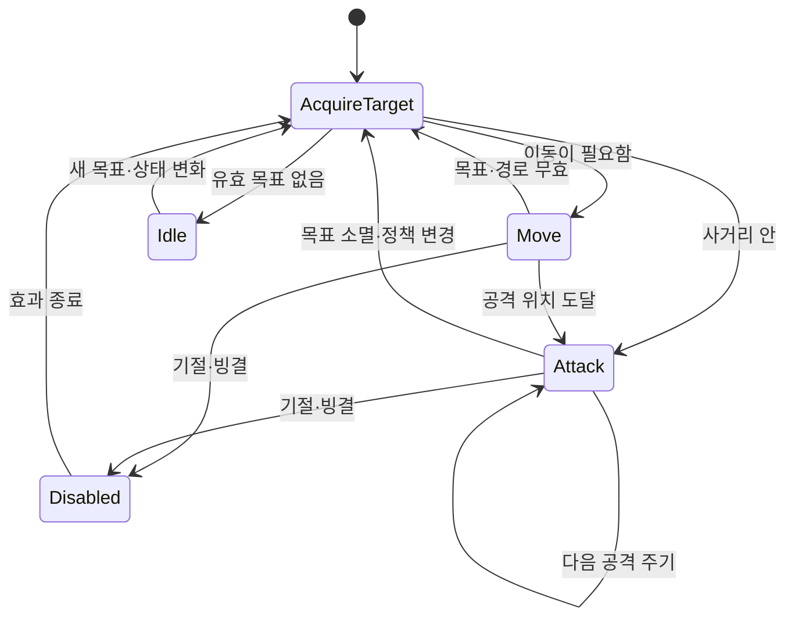

# 07. 유닛 AI·타깃 선택·경로 탐색·길 정리

> 기준일: 2026-11-13 KST. 이 문서는 공개된 행동 특성과 그것을 설명하는 재구현 모델을 분리한다. `[확인]`은 공식 자료의 외부 규칙, `[해석]`은 플레이 설계 분석, `[제안]`은 알고리즘 설계, `[미확인]`은 실험이 필요한 부분이다. **CoC가 A*, 특정 후보 개수, 특정 가중치, 특정 틱률을 사용한다고 단정하지 않는다.**

## 1. AI가 플레이어에게 제공하는 조작 방식

공격자는 모든 병력에 목적지와 타깃을 반복 명령하는 대신 투입 위치, 주변 건물 제거, 마법, 영웅 능력으로 자동 행동의 조건을 바꾼다. 이 구조에서 AI는 단순한 자동 전투 편의 기능이 아니라 플레이어의 간접 조작을 해석하는 규칙이다. [해석]

`플레이어 입력 → 후보 목표·이동 조건 변경 → 유닛의 자율 선택 → 예상 경로 확인 → 다음 입력`의 순환이 성립해야 한다. 규칙이 지나치게 무작위이면 배치와 길 정리의 의미가 약해지고, 너무 완벽하게 최적화하면 공격자의 준비 실수를 AI가 대신 해결한다. [해석]

## 2. 외부 규칙과 내부 가설의 경계

| 구분 | 확인할 수 있는 것 | 공개 자료만으로 확정할 수 없는 것 |
|---|---|---|
| 선호 목표 | 방어 시설·자원·벽·특정 객체를 선호하는 유닛이 존재 | 모든 예외의 정확한 우선순위 표 |
| 목표 변경 | 투명화·파괴·특수 마법 등이 타깃 행동에 영향 | 재탐색 주기·동률 처리 방식 |
| 지원 AI | 힐러·그랜드 워든 등의 선택 행동이 조정된 이력 | 평가 함수 계수와 그룹 형성 코드 |
| 경로 | 벽·파괴·통과 능력의 영향 | A*·NavMesh·그리드 등 실제 알고리즘 |
| 반복성 | 같은 규칙을 일관되게 재현해야 한다는 요구 | 실제 RNG 시드·수치 정밀도·서버 틱률 |

공식 2020 패치에는 그랜드 워든의 추종 대상, 힐러의 치유 대상, 벽 파괴 후 타깃 전환을 각각 수정한 이력이 있다. 이는 유닛별 정책과 재평가 조건이 존재한다는 근거이며, 당시 정책의 세부 수치를 현행 알고리즘으로 가져오는 근거는 아니다. [확인: C12](https://supercell.com/en/games/clashofclans/blog/news/the-spring-update-is-here-2/)

## 3. 행동 정책 분해

다음은 동일한 전투 코어 위에서 여러 유닛을 표현하기 위한 제안이다. [제안]

| 정책 | 입력 | 출력 | 분리하는 이유 |
|---|---|---|---|
| TargetEligibility | 대상 종류·상태·지상/공중 | 후보 포함 여부 | 공격 불가능한 목표를 점수화하지 않음 |
| TargetPreference | 유닛 고유 성향·현재 효과 | 후보 그룹 우선순위 | 방어 우선·자원 우선·분노 효과 분리 |
| TargetScoring | 거리·도달 가능성·전환 비용 | 목표 ID | 개별 목표 선택 |
| NavigationPolicy | 이동 층·벽 통과·굴착 | 이동 경로 | 같은 목표라도 유닛별 경로가 달라짐 |
| AttackPolicy | 사거리·주기·발사체 | 타격 이벤트 | 경로 결정과 공격 판정 분리 |
| SupportPolicy | 아군 HP·집단 상태 | 추종·치유 대상 | 적 목표 선택과 별도 가치 함수 |
| RetargetPolicy | 사망·가림·경로 변화 | 재평가 여부 | 불필요한 목표 흔들림 방지 |

후보 집합은 먼저 공격 가능한지 검사한 후 선호 그룹을 좁히고, 마지막에 거리·경로 비용을 비교한다. 단순히 모든 건물의 직선거리만 정렬하면 벽, 다중 타일 건물, 장거리 공격, 공격 불가능한 대상에서 잘못된 행동이 나온다. [제안]

## 4. 기본 상태 전이



사망·회수·부활은 위 그림과 별개인 생명 상태로 관리할 수 있다. 예를 들어 `Alive + Disabled`는 제어 불능이지만 살아 있는 상태이며, `Recalled`는 맵에서 빠졌지만 편성에 재투입 객체가 남는 상태다. 하나의 거대한 enum으로 모든 조합을 만들기보다 행동·생명·이동 층을 분리한다. [제안]

## 5. 목표 평가와 벽 비용

분석용 목적 함수의 한 예는 다음과 같다. **실제 게임 공식이 아니다.** [제안]

`Cost(target) = 이동시간 + 필요한 벽 파괴시간 + 목표 전환 페널티 + 정책별 비용`

이동시간은 건물 중심까지의 거리가 아니라 유닛이 공격할 수 있는 위치까지의 경로 길이로 계산한다. 원거리 유닛은 건물에 인접하지 않아도 되고, 건물의 크기와 공격 반경에 따라 후보 접근점이 여러 개 생긴다. [제안]

벽 파괴시간을 대략 `벽 HP / 유효 벽 DPS`로 두면, 같은 배치에서도 벽에 강한 유닛과 그렇지 않은 유닛의 접근 선택이 달라진다. 다만 이 목적 함수를 너무 넓은 범위에서 최적화하면 유닛이 멀리 떨어진 약한 벽을 찾아 비현실적으로 긴 우회를 할 수 있다. 후보 범위·재평가 간격·기존 목표 유지 조건을 함께 조정해야 한다. [제안]

### 경로망에 필요한 정보

| 필드 | 용도 |
|---|---|
| `occupancy` | 건물·벽의 이동 점유 |
| `attackApproachRegion` | 목표를 때릴 수 있는 영역 |
| `movementLayer` | 지상·공중·굴착 등 |
| `wallInteraction` | 차단·점프·파괴·관통 등 정책 |
| `topologyRevision` | 건물·벽 파괴 후 캐시 무효화 |
| `temporaryTraversalZones` | 일시적인 이동 조건 변경 |
| `navigationExclusionTags` | 특정 유닛만 피하거나 접근하지 못하는 영역 |

장식과 장애물을 모두 지상 경로 차단물로 취급하면 실제 전투와 차이가 난다. 공식 2024 변경은 공격 중 장식·장애물 통과를 허용하면서 클랜 수도는 예외로 명시했다. 이 때문에 본 마을과 수도의 공간 규칙을 같은 테이블로 합치지 않는다. [확인: C13](https://supercell.com/en/games/clashofclans/blog/release-notes/february-2024-update-patch-notes/)

## 6. 길 정리, 이른바 퍼널링의 해석

길 정리는 유닛을 직접 조종하는 대신 **원하지 않는 방향의 목표를 먼저 제거해 다음 후보의 상대적인 매력을 바꾸는 행위**다. [해석]

| 배치·공격 상황 | 발생하는 선택 압력 | 공격자의 대응 |
|---|---|---|
| 외곽 건물이 연속 배치 | 주력이 바깥쪽 목표를 계속 선택하기 쉬움 | 진입 전 양쪽 외곽을 일부 제거 |
| 입구 뒤에 넓은 빈 공간 | 다음 목표까지 이동 시간이 증가 | 진입 지점·투입 간격 조절 |
| 중심부와 외곽 거리 비슷함 | 작은 제거 순서 차이가 경로 분기를 만듦 | 주력 투입 전 목표 상태 확인 |
| 구획 사이에 고위험 방어 | 진입 성공 후에도 군대가 분산 | 벽 통과·보호 효과를 병행 |
| 외곽 모서리에 잔여 건물 | 완파 직전 긴 이동 발생 | 마무리 병력을 남겨 별도 투입 |

방어 설계도 반대로 같은 원리를 사용한다. 공격자에게 많은 저가치 후보를 제공하거나, 목표를 따라가면 방어 사거리 중첩에 들어가도록 유도한다. 다만 실제 유닛의 목적지를 특정 좌표로 강제하는 보장된 공식으로 설명해서는 안 된다. [해석]

## 7. 특수 AI 사례

### 7.1 파멸 마녀: 전투 후 부산물을 목표로 삼는 유닛

파멸 마녀(Ruin Witch)는 파괴된 건물의 잔해를 소비해 파멸 기사를 소환한다. 벽 잔해는 제외하고, 접근할 수 있는 잔해가 없으면 일반 건물을 공격하지 않는다. 소환 확정 뒤 본체가 쓰러져도 예약된 기사가 나오는 단계가 있다. [확인: C09](https://supercell.com/en/games/clashofclans/blog/release-notes/the-anime-fury-update-is-here/)

2026년 8월 변경은 소환 상한을 10으로 늘리고 파멸 기사의 시간 경과 HP 감소를 제거했다. 6월 최초 발표의 8기 상한을 현행값으로 사용하지 않는다. [확인: C10](https://supercell.com/en/games/clashofclans/blog/release-notes/august-update-3/)

**재구현 요구:** 잔해는 단순한 시각 이펙트가 아니라 수명·예약·소비 상태가 있는 전투 객체가 된다. 두 마녀가 같은 잔해를 선택할 때 `예약 후 접근` 또는 `도착 시 선점` 중 하나의 정책을 명시해야 한다. 실제 동시 선점 우선순위는 공개 자료로 확인하지 못했으므로 임의의 현행 규칙으로 서술하지 않는다. [제안·미확인]

### 7.2 지원 유닛

지원 유닛의 좋은 타깃은 가장 가까운 아군과 항상 같지 않다. 힐러는 회복 가치, 워든은 자신이 지원할 집단의 전투 가치가 중요하다. 재구현에서는 그룹의 총 병력, 거리, 체력 손실, 이미 배정된 지원 수를 평가 요소로 둘 수 있다. 이것은 공식 가중치 복원이 아니라 설계 제안이다. [해석·제안]

### 7.3 임시 목표 정책 덮어쓰기

Angry Spell은 일반 선호 목표를 임시로 방어 시설 쪽으로 바꾸며, 종료 후 원래 행동으로 돌아간다. 시즈 머신은 예외다. 공격 능력을 높이는 Rage Spell과 다른 마법이다. [확인: C09](https://supercell.com/en/games/clashofclans/blog/release-notes/the-anime-fury-update-is-here/)

이를 `targetPolicyOverride`로 표현하면 기본 AI를 영구 변경하지 않고 효과 종료 시 원래 정책을 복구할 수 있다. 단순히 현재 목표 ID만 바꾸면 다음 탐색에서 원래 목표를 다시 잡아 효과가 무시될 수 있다. [제안]

## 8. 경로 재탐색과 성능

매 틱 모든 유닛이 모든 건물을 검색하는 설계는 객체 수가 늘어날수록 비용이 커진다. 재구현에서는 공간 색인, 목표 후보 캐시, 지형 revision, 이벤트 기반 재탐색을 조합할 수 있다. [제안]

```text
update_ai(unit, context):
    if unit.lifeState != Alive:
        return
    if unit.isDisabled:
        update_control_timers(unit)
        return
    if policy_changed(unit) or target_invalid(unit) or path_invalid(unit):
        candidates = query_eligible_targets(unit, context.spatialIndex)
        target = select_target(candidates, unit.currentPolicy)
        path = build_path_to_attack_region(unit, target)
    execute_current_action(unit, path, target)
```

최적화가 결과에 영향을 주지 않도록 캐시 무효화 기준을 정확히 한다. 다른 스레드의 처리 완료 순서에 따라 목표를 고르면 같은 입력을 재생했을 때 전투가 달라질 수 있다. 구현을 멀티스레드로 하더라도 결과 병합 순서와 동률 해소를 고정하는 것이 안전하다. 이는 CoC의 스레딩 방식에 대한 주장이 아니다. [제안]

## 9. 동작 추론을 위한 실험 설계

| 검증 질문 | 통제 조건 | 관찰할 결과 |
|---|---|---|
| 직선거리와 경로거리 중 무엇이 우세한가 | 같은 건물·다른 벽 배치 | 최초 타깃·이동 경로 |
| 목표 유지가 얼마나 강한가 | 이동 중 더 가까운 건물 추가 노출 | 재탐색 시점 |
| 공중·지상 좌표 판정이 다른가 | 같은 배치의 상응 유닛 | 접근 위치·함정 반응 |
| 벽 파괴 즉시 경로가 갱신되는가 | 동일 프레임 근처 벽 제거 | 우회 지속 여부 |
| 투명화 종료 때 원래 목표로 돌아오는가 | 동일한 마법 시각 | 목표 복구·재선택 |
| 지원 대상의 선택 요소는 무엇인가 | 거리 동일·체력/병력만 변경 | 힐러·워든의 선택 |

한 번의 리플레이로 규칙을 확정하지 않는다. 병력 레벨, 투입 시각, 초기 좌표, 방어 병력, 장비, 배속, 패치 버전을 기록하고 조건 하나씩 바꾸어 비교한다. [제안]

## 10. 밸런스·품질 지표

- **무행동 시간 비율:** 살아 있으나 이동·공격·지원하지 않는 시간. 설계된 대기와 경로 오류를 분리한다.
- **경로 초과율:** 실제 이동 거리와 가능한 짧은 경로의 차이. 자동 최적화 목표가 아니라 이상치 탐지에 사용한다.
- **목표 전환 빈도:** 잦은 전환으로 공격이 취소되는지 확인한다.
- **공격 취소율:** 사거리 경계·넉백·대상 소멸 때문에 잃은 공격 주기.
- **길 정리 민감도:** 외곽 건물 하나의 변화가 결과를 얼마나 바꾸는가.
- **재현 실패율:** 같은 버전·초기 상태·입력에서 결과가 달라지는 빈도.
- **단위 유닛당 AI 비용:** 평균만 아니라 대규모 소환 순간의 상위 백분위 비용을 본다. [제안]

## 11. 검수 시나리오

1. 목표가 사라진 프레임에 유닛이 무한히 원래 위치를 공격하지 않는다.
2. 벽 파괴 직후 통과 가능한 경로가 갱신된다.
3. 회수·재투입 후 유닛이 벽 안이나 충돌면에 갇히지 않는다.
4. 타깃 정책 변경이 끝나면 기본 정책을 복구한다.
5. 전투 중 장식 처리 규칙이 본 마을과 클랜 수도에서 혼동되지 않는다.
6. 동일 잔해를 두 소환자가 동시에 소비해 이중 보상을 만들지 않는다.
7. 소환 확정 뒤 본체 사망·기절·회수가 예약 이벤트를 정책대로 처리한다.
8. 공중 전용 공격이 지상만 가능한 대상에게 잘못 적용되지 않는다.
9. 다수 유닛이 같은 목표를 잃어도 한 프레임의 과도한 탐색으로 멈추지 않는다.
10. 프레임레이트·카메라·이펙트 품질이 AI 선택에 영향을 주지 않는다.

## 12. 연결 문서와 출처

- [06. 전투 판정](06_battle_rules_and_resolution.md), [08. 마법과 특수 개입](08_spells_siege_and_super_troops.md), [10. 배치·방어](10_defenses_traps_and_layout.md).
- C09: [Anime Fury, 2026-06-15](https://supercell.com/en/games/clashofclans/blog/release-notes/the-anime-fury-update-is-here/) — 파멸 마녀·Angry Spell의 외부 행동.
- C10: [August Update, 2026-08-30](https://supercell.com/en/games/clashofclans/blog/release-notes/august-update-3/) — 소환 상한·회수 유닛의 벽 끼임 수정.
- C12: [Spring Update, 2020-03-30](https://supercell.com/en/games/clashofclans/blog/news/the-spring-update-is-here-2/) — 과거 AI 조정 사례. 당시 시간·비용·레벨은 현행값으로 사용하지 않음.
- C13: [February 2024 Update, 2024-02-27](https://supercell.com/en/games/clashofclans/blog/release-notes/february-2024-update-patch-notes/) — 장식·장애물 이동 규칙과 모드 예외.

접근일: 2026-11-13. 내부 AI를 검증하려면 통제된 실기 실험이 추가로 필요하다.
