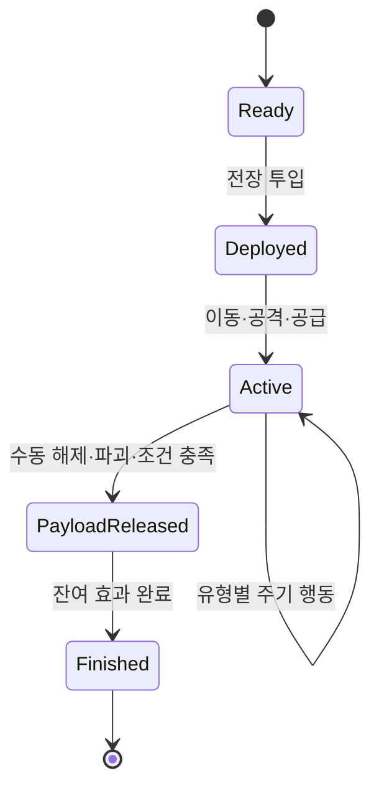

# 08. 마법·시즈 머신·슈퍼 유닛

> 기준일: 2026-11-13 KST. `[확인]`은 공식 자료에 기초한 규칙, `[해석]`은 전술·설계 분석, `[제안]`은 재구현안, `[미확인]`은 수치 또는 예외의 추가 검증 대상이다. 새로운 마법과 시즈는 원문 영문명을 병기해 번역 혼동을 줄였다.

## 1. 세 시스템을 함께 보는 이유

일반 병력은 전투의 지속적인 전력이고, 마법·시즈·슈퍼 유닛은 기본 전투 규칙을 특정 조건에서 바꾸는 도구다. 마법은 공간과 시간의 조건을 바꾸고, 시즈는 진입과 병력 전달 방식을 바꾸며, 슈퍼 유닛은 익숙한 병과의 특성을 확장한다. 단순히 더 높은 DPS를 제공하는 세 종류의 성장 수단으로 합치면 각 시스템의 선택 의미가 사라진다. [해석]

## 2. 마법의 기능 분류

다음은 전술 분석용 분류다. 레벨별 반경·지속 시간·점유량은 버전 테이블에서 별도로 확인한다. [해석]

| 기능 | 대표 마법 | 플레이어가 바꾸는 조건 | 실패가 생기는 방식 |
|---|---|---|---|
| 직접 파괴 | 번개·지진 | 전투 시작 전후의 방어 구성 | 필요한 피해 임계값 미달 |
| 생존·화력 지원 | 치유·분노·신속 | 특정 구간의 버티는 시간·공격 효율 | 병력이 효과 범위를 지나감 |
| 공격 정지 | 얼음 등 | 적의 유효 공격 시간 | 위험 구간보다 너무 일찍 사용 |
| 경로 변경 | 점프·Overgrowth | 통과 경로·선택 가능한 목표 | 의도한 경로와 실제 타깃 선택 불일치 |
| 대상 은폐 | 투명 | 일시적인 타깃 가능 여부 | 보호하려는 병력과 공격하려는 건물을 함께 가림 |
| 병력 생성·복제 | 해골·박쥐·복제 | 순간 병력 밀도·공격 방향 | 범위 방어에 동시 소멸 |
| 재배치 | Recall | 같은 전력을 다른 구역에 재사용 | 회수 용량·재투입 위치·남은 시간 부족 |
| 영웅 재진입 | Revive | 쓰러진 영웅의 추가 기회 | 부활 직후 같은 위험에 다시 노출 |
| 탱킹·대상 전환 | Totem·Angry·Ice Block | 누가 맞고 무엇을 공격하는가 | 지원 대상·지속 구간·면역 판정 실수 |

후반의 특수 마법 기능은 [C13](https://supercell.com/en/games/clashofclans/blog/release-notes/february-2024-update-patch-notes/), [C14](https://supercell.com/en/games/clashofclans/blog/release-notes/full-release-notes-2/), [C03](https://supercell.com/en/games/clashofclans/blog/release-notes/welcome-to-lets-get-crafty-update/), [C15](https://supercell.com/en/games/clashofclans/blog/release-notes/town-hall-18-crash-lands-update/), [C09](https://supercell.com/en/games/clashofclans/blog/release-notes/the-anime-fury-update-is-here/)로 확인한다. 표의 실패 해석은 독자적 분석이다.

## 3. 범위 효과의 명세

마법은 최소한 다음 세 시계를 구분해야 한다. [제안]

| 시계 | 예 | 질문 |
|---|---|---|
| 필드 존재 시간 | 지도에 남아 있는 마법 영역 | 늦게 들어온 유닛도 적용되는가 |
| 대상별 효과 시간 | 대상에 부착된 버프·디버프 | 영역 밖으로 나가면 즉시 종료되는가 |
| 주기 효과 시간 | 일정 간격의 피해·회복 | 처음 들어갈 때 즉시 1회 적용되는가 |

```yaml
SpellDefinition:
  spellId: string
  targetingMode: area_or_entity_or_special
  radiusByLevel: array
  fieldLifetimeByLevel: array
  targetEffectLifetimeByLevel: array
  targetFilter: tags
  applicationPolicy: on_cast_or_on_enter_or_periodic
  reapplyPolicy: once_per_cast_or_refresh_or_stack
  stackingGroup: string
  immunityTags: array
  onExitPolicy: enum
  effectPriority: integer
```

`fieldLifetime`와 `targetEffectLifetime`를 하나로 합치면 늦게 범위에 들어온 병력, 밖으로 나간 병력, 중복 시전이 틀어질 수 있다. 효과를 화면 이펙트가 살아 있는 시간으로 판단하지 않고 게임플레이 상태를 렌더러가 표시하도록 한다. [제안]

## 4. 핵심 마법의 상세 해석

### 4.1 Overgrowth: 잠시 제거하는 목표

Overgrowth는 범위 안의 관련 건물을 얼리고 투명·무적 상태로 만들어 공격 병력이 건물을 무시하게 한다. 방어 영웅과 클랜 성 병력을 정지시키거나 클랜 성 병력 출현을 막는 효과로 일반화하면 안 된다. [확인: C13](https://supercell.com/en/games/clashofclans/blog/release-notes/february-2024-update-patch-notes/)

따라서 이것은 화력 억제이면서 경로 설계 도구다. 위험 구역을 건너뛰는 대신 그 구역의 건물은 살아 있으므로, 나중에 되돌아올 시간과 화력을 남겨야 한다. 영구 제거와 임시 제외의 차이가 마법의 비용이 된다. [해석]

### 4.2 Recall: 동일 개체의 회수와 재투입

Recall은 병력을 회수해 유효 투입 지점에 다시 배치하는 구조이며, 수용량 제한과 재투입 시 상태 보존을 가진다. [확인: C14](https://supercell.com/en/games/clashofclans/blog/release-notes/full-release-notes-2/)

재구현에서는 새 유닛 생성으로 처리하지 않고 기존 `entityId`의 생명 상태를 `OnMap → Recalled → OnMap`으로 옮긴다. HP·사용한 능력·펫 연결·현재 효과·소환 계보의 보존 정책을 명시한다. 마법을 사용했다고 체력이 초기화되거나 일회성 능력이 복구되면 전혀 다른 시스템이 된다. [제안]

### 4.3 Ice Block과 Totem: 공격 지속을 위한 시선 분산

Ice Block은 아군을 강하게 보호하는 대신 이동과 공격을 멈추게 하고, Totem은 적의 공격을 받아낼 객체를 만든다. [확인: C03](https://supercell.com/en/games/clashofclans/blog/release-notes/welcome-to-lets-get-crafty-update/), [C15](https://supercell.com/en/games/clashofclans/blog/release-notes/town-hall-18-crash-lands-update/)

두 도구는 아군 전체를 무조건 강화하기보다 누가 탱킹할지 바꾼다. 보호한 유닛의 공격이 멈추는 손실과 다른 유닛이 얻는 공격 시간을 비교해야 한다. 소환 객체의 타깃 층·집계 수용량·사망 효과는 일반 병력과 별도 정의한다. [해석·제안]

### 4.4 Angry Spell: 전술적 목표 덮어쓰기

Angry Spell의 세부는 [07. AI](07_unit_ai_and_pathfinding.md)를 참조한다. 구현 핵심은 피해 버프와 구분된 `targetPolicyOverride`다. `효과 범위에 한 번 진입 → 대상별 효과 지속 → 종료 후 고유 정책 복구`를 추적하고, 중첩 시 우선순위를 데이터에 둔다. [제안]

## 5. 시즈 머신의 역할

시즈 머신은 본 마을 TH12의 작업장에서 제작을 시작할 수 있고, TH10·클랜 성 6레벨부터 지원받을 수 있다. 병력 수용량과 별도이며 한 공격에서 자기 시즈와 지원 시즈를 동시에 쓰지 않는다. 파괴 또는 수동 해제 시 내부 병력이 나오는 구조가 기본이다. [확인: C04](https://sc-clashofclans.zendesk.com/hc/en-us/articles/49529091698587-Siege-Machines)

| 시즈 역할 | 대표 사례 | 전투에서의 질문 |
|---|---|---|
| 지상 돌파 | Wall Wrecker·Log Launcher | 벽을 언제 열고 어디까지 전진하는가 |
| 공중 전달 | Battle Blimp | 핵심 위치까지 생존할 수 있는가 |
| 방어 추적 | Stone Slammer·Battle Drill | 주력과 다른 방향으로 분리되지 않는가 |
| 외곽 지원 | Siege Barracks·Flame Flinger | 안전 구간을 얼마나 오래 활용하는가 |
| 병력 공급 | Troop Launcher·Sky Wagon | 아군 진행 방향과 방출 시점이 맞는가 |

Sky Wagon은 2026년 4월 추가된 공중 지원 시즈다. 기존의 즉시 진입·일회성 전달만으로 시즈를 모델링하면 단계적 병력 공급을 표현하기 어렵다. [확인: C16](https://supercell.com/en/games/clashofclans/blog/release-notes/the-sound-of-clash-update/) [해석]

### 시즈 상태 모델



`payloadReleased`는 한 번만 true가 되는 값으로 관리한다. 수동 해제와 마지막 피격이 같은 시각에 발생해도 지원 병력이 두 번 생성되면 안 된다. 단계적 공급 시즈는 `payloadSegments`와 `remainingPayload`를 별도로 관리하고, 중간 파괴 때의 방출 정책을 시즈별로 정의한다. [제안]

시즈의 기본 마법 면역 안내를 모든 장비·오라·모드 보정까지 무조건 차단하는 규칙으로 확장하지 않는다. `immuneToSpellTags`와 `immuneToAbilityTags`를 분리하고 각 예외는 실기·해당 패치 문서로 검증한다. [확인: C04의 기본 안내 / 제안: 구현 분리]

## 6. 슈퍼 유닛의 현행 활성화 규칙

| 항목 | 확인한 규칙 |
|---|---|
| 직접 활성화 | TH11부터, 원본 유닛의 요구 레벨 충족 필요 |
| 대가 | 다크 엘릭서 또는 슈퍼 포션 |
| 기간 | 3일 |
| 동시 활성 종류 | 기본 2종, 해당 이벤트 추가 활성 시 최대 3종 |
| 일반형 | 슈퍼형 활성 중에도 일반형 사용 가능 |
| 만료·취소 | 해당 슈퍼형을 다시 쓰려면 재활성화, 군대의 해당 종류 제거, 비용 미환급 |

현행 표는 [C17 공식 Support](https://sc-clashofclans.zendesk.com/hc/en-us/articles/49529095172251-About-Super-Troops)에 근거한다. **2020 최초 도입의 7일·1종·만료 후 잔존 규칙은 역사 규칙이다.** 2020년 말 개편도 확인되지만 당시 상점 가격까지 현재 가격으로 복사하지 않는다. [확인: C18](https://supercell.com/en/games/clashofclans/blog/game-updates/new-super-potion/)

### 설계 의미

일반 훈련이 즉시·무료인 현재에도 슈퍼 유닛의 활성화는 기간 제한 선택이다. 매 전투의 생산 비용 대신 며칠 동안 사용할 전략의 범위를 정하는 비용을 남긴다. 클랜 지원을 포함하면 본인의 활성 슬롯과 타인의 활성 상태가 사회적 교환으로 연결된다. [해석]

슈퍼 유닛을 단순한 원본 유닛의 레벨 업으로 저장하면 일반형과 동시 편성, 임시 권한, 이벤트 추가 슬롯을 표현하기 어렵다. `baseTroopId`를 참조하는 별도 정의와 `ActivationEntitlement`를 둔다. [제안]

```yaml
SuperActivation:
  activationId: string
  superTroopId: string
  source: dark_elixir_or_potion_or_event
  consumesRegularSlot: boolean
  startedAt: timestamp
  expiresAt: timestamp
  canceledAt: timestamp_or_null
  paidTransactionId: string_or_null
```

## 7. 효과 중첩·예외의 명세 표

다음 표는 반드시 결정해야 하는 구현 질문이다. 표의 질문을 게임의 확인된 답으로 오해해서는 안 된다. [제안·미확인]

| 상호작용 | 명세할 질문 | 오류 위험 |
|---|---|---|
| 같은 계열 마법 중첩 | 합산·최대값·시간 갱신 중 무엇인가 | 무한 피해 또는 과도한 버프 |
| 투명화와 이미 날아온 발사체 | 타깃 해제와 명중을 어떻게 분리하는가 | 시각적으로 피했는데 피해가 남는 혼란 |
| Recall과 지속 효과 | 필드 이탈·부착 효과의 유지 여부 | 재투입으로 효과가 중복 복구 |
| Revive와 Phoenix | 임시 부활과 일반 부활의 순서 | 동일 영웅의 다중 생성 |
| 시즈 수동 해제와 파괴 | 하나의 방출 이벤트로 합치는가 | 지원 병력 복제 |
| 슈퍼 활성 만료와 전투 입장 | 스냅샷 확정 전후 어디서 반영하는가 | 시작한 전투의 군대가 중간에 사라짐 |
| 마법으로 생성한 객체 | 집계·타깃·피해·퀘스트에서 어떤 태그인가 | 수용량 기반 능력 오작동 |

공식 2025년 2월에는 Revive와 Phoenix의 상호작용 수정이 있었고, 2026년 8월에는 토템 수용량 집계 수정이 있었다. 예외가 실제 운영 품질에 중요한 영역이라는 근거다. [확인: C19](https://supercell.com/en/games/clashofclans/blog/news/get-geared-up-for-the-latest-update--3/), [C10](https://supercell.com/en/games/clashofclans/blog/release-notes/august-update-3/)

## 8. 밸런스 평가

마법의 가치는 피해량뿐 아니라 막은 피해, 확보한 이동 시간, 바뀐 목표, 재활용한 병력 가치로 나뉜다. 시즈는 회관 도달률, 핵심 방어 제거 기여, 지원 병력 방출 생존률로 평가한다. 슈퍼 유닛은 자체 선택률뿐 아니라 동일 원본 유닛과 다른 조합을 열어주는지 확인한다. [해석]

| 지표 | 해석 시 주의점 |
|---|---|
| 마법 한 칸당 제거 가치 | 위험 구역을 회피하는 마법의 간접 가치를 빠뜨리지 않음 |
| 미사용 마법 비중 | 쉬운 승리와 조작 실패를 구분 |
| 시즈 종류별 완파율 | 군대·영웅 장비·공격자 실력 통제 |
| 시즈 조기 파괴 비율 | 정찰 정보·진입 각도·함정 배치 영향 |
| 슈퍼 활성화 후 실제 사용 횟수 | 잘못된 활성화·이벤트 변화·전략 전환 비용 탐지 |
| 효과 조합 집중도 | 특정 조합이 모든 배치에 유효한지 확인 |

## 9. 검수 시나리오

1. 범위에 늦게 들어온 유닛과 처음부터 있던 유닛의 효과 시간이 명세와 일치한다.
2. 중복 시전의 합산·갱신·비중첩 정책이 같은 계열 전체에 일관되게 적용된다.
3. Recall 재투입으로 HP·능력 사용 횟수·펫 연결이 초기화되지 않는다.
4. 시즈 파괴와 수동 해제가 겹쳐도 지원 병력을 한 번만 방출한다.
5. 단계적 공급 시즈의 남은 병력 수가 음수가 되지 않는다.
6. Angry Spell이 끝난 유닛은 원래 목표 정책으로 돌아간다.
7. 슈퍼 활성화 만료와 취소가 레시피 유효성·군대 표시·출전 권한에 함께 반영된다.
8. 이벤트 슈퍼 슬롯이 종료되어도 일반 활성 슬롯을 임의로 없애지 않는다.
9. 임시 유닛·효과의 Ranked 허용 여부를 일반 Battle과 별도로 검증한다.
10. 부활·분열·회수·배속을 조합해도 동일 객체가 복제되지 않는다.

## 10. 연결 문서와 출처

- [05. 편성](05_army_composition.md), [06. 전투 판정](06_battle_rules_and_resolution.md), [07. AI](07_unit_ai_and_pathfinding.md), [09. 영웅](09_heroes_equipment_and_pets.md).
- C03: [Let’s Get Crafty, 2025-06-16](https://supercell.com/en/games/clashofclans/blog/release-notes/welcome-to-lets-get-crafty-update/) — Ice Block.
- C04: [Siege Machines, Support](https://sc-clashofclans.zendesk.com/hc/en-us/articles/49529091698587-Siege-Machines) — 기본 시즈 계약. 방어 관련 모호한 표현은 채택하지 않음.
- C09: [Anime Fury, 2026-06-15](https://supercell.com/en/games/clashofclans/blog/release-notes/the-anime-fury-update-is-here/) — Angry Spell.
- C10: [August Update, 2026-08-30](https://supercell.com/en/games/clashofclans/blog/release-notes/august-update-3/) — 상호작용 수정.
- C13: [February 2024 Update](https://supercell.com/en/games/clashofclans/blog/release-notes/february-2024-update-patch-notes/) — Overgrowth.
- C14: [Full Release Notes, 2022-10-10](https://supercell.com/en/games/clashofclans/blog/release-notes/full-release-notes-2/) — Recall 개념. 당시 훈련 시간은 폐지됨.
- C15: [TH18 Update, 2025-11-17](https://supercell.com/en/games/clashofclans/blog/release-notes/town-hall-18-crash-lands-update/) — Totem.
- C16: [Sound of Clash, 2026-04-27](https://supercell.com/en/games/clashofclans/blog/release-notes/the-sound-of-clash-update/) — Sky Wagon.
- C17: [About Super Troops, Support](https://sc-clashofclans.zendesk.com/hc/en-us/articles/49529095172251-About-Super-Troops) — 현행 활성화·만료 규칙.
- C18: [Super Troops Changes, 2020-11-23](https://supercell.com/en/games/clashofclans/blog/game-updates/new-super-potion/) — 역사적 개편.
- C19: [A New Update is Here!, 2025-02-10](https://supercell.com/en/games/clashofclans/blog/news/get-geared-up-for-the-latest-update--3/) — 부활 상호작용 수정.

모든 출처 접근일: 2026-11-13. 표에 고정하지 않은 수치는 게임 내 최신 정보와 모드별 규칙으로 채워야 한다.
