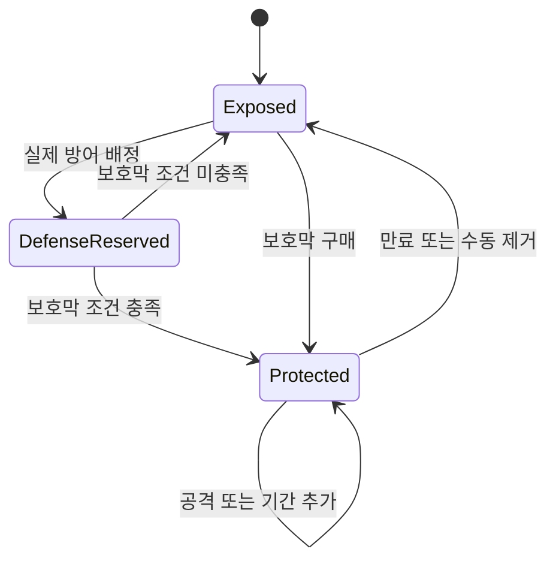

# 11. 매치메이킹·보호막·복수

> 기준일: 2026-11-13 KST. 현재의 일반 Battle/Ranked 분리 체계를 다룬다. 매칭 가중치·DB 잠금 방식·복제 객체 구조는 공개되지 않았으므로 **[제안]**으로 구분한다.

## 1. 시스템 목적 [해석]

매칭의 첫 번째 임무는 공격할 대상을 충분히 공급하면서, 성장도가 다른 사용자에게 납득 가능한 난이도와 보상을 제공하는 것이다. 두 번째 임무는 공격자에게 반복 플레이를 허용하면서 방어자의 손실을 제한하는 것이다. 공격 대기 제거로 공격 수요가 늘어날수록 이 두 문제는 더 중요해진다.

보호막은 단순한 대전 차단 타이머가 아니라 **방어자 자산 손실과 공격 대상 공급을 분리하는 경제 규칙**으로 해석할 수 있다. 복수는 방어 손실을 능동적인 재도전 목표로 전환한다.

## 2. 일반·랭크·복수의 요청 구분

| 요청 | 주목적 | 대상을 고르는 기준 | 경쟁 점수 | 방어자 실자산과의 관계 |
|---|---|---|---|---|
| 일반 Battle | 자원·이벤트·연습 | TH 중심, 세부 범위 비공개 | 일반 공격으로 랭크 점수 변화 없음 | 실제 약탈 또는 복제 대상 규칙에 따름 |
| Ranked | 제한된 기회에서 경쟁 | 주간형: TH 범위·리그 / Legend I: 트로피 중심 | 랭크 점수 정산 | 일반 약탈과 분리된 보상 정책 |
| Revenge | 방어 손실에 대한 재공격 | 방어 기록에 연결된 대상 | 일반 복수 규칙 | Shadow Base이므로 상대에게 새 피해를 주지 않음 |

[확인] 모드 분리와 일반 매칭의 TH 중심 방향은 [설계 발표](https://supercell.com/en/games/clashofclans/blog/news/battle-and-ranked-modes-are-coming-to-clash-/), 랭크 매칭의 TH 범위 및 리그 기준은 [공식 점수·매칭 설명](https://support.supercell.com/clash-of-clans/en/articles/trophy-matchmaking-and-calculation-in-multiplayer-2.html), 복수의 Shadow Base는 [2025-10-06 릴리스](https://supercell.com/en/games/clashofclans/blog/release-notes/get-ready-for-ranked-update/)에서 확인했다.

**[미확인]** 검색 범위를 넓히는 시간, 대상의 가중치, 동일 상대 재등장 제한, 매칭 풀 분할, 봇 배정 조건, 서버 지역 선택은 공식을 재구성할 근거가 부족하다. 오래된 “트로피가 유일한 일반 매칭 기준” 설명을 적용하지 않는다.

[확인] Legend I의 공식 매칭 안내는 트로피 수를 주요 기준으로 설명한다. 따라서 주간형 랭크의 TH·리그 설명을 모든 Legend I 대전에 동일하게 적용하지 않는다. [Legend 매칭 상세](https://sc-clashofclans.zendesk.com/hc/en-us/articles/49529122458779-Tournaments-Matchmaking-in-Legend-League)

## 3. 실제 기지와 복제 기지

[확인·변경 이력] 2025년 Clash Anytime 공지는 보호막 획득 시 기지 복제를 매칭 풀에 넣고, 복제 기지 공격에서는 방어자 자산·트로피를 차감하지 않는 구조를 설명했다. 이는 당시의 일반 경쟁 체계에서 발표된 설명이다. 2025년 10월 이후 랭크 분리와 복수 Shadow Base 규칙이 추가되었으므로, 당시의 트로피 설명까지 그대로 현행 일반 전투에 대입하지 않는다. [Clash Anytime](https://supercell.com/en/games/clashofclans/blog/release-notes/welcome-to-clash-anytime-update/)

**[제안] 두 가지 데이터를 분리한다.**

| 데이터 | 의미 | 수명 |
|---|---|---|
| `VillageState` | 소유자의 실제 건물·자산·업그레이드 상태 | 계정과 함께 영구 유지 |
| `AttackableSnapshot` | 특정 전투가 사용할 배치·건물 상태·노출 전리품 | 배정·전투·리플레이 기간 |

복제 대상이라고 해서 “상대가 가짜 사용자”라는 뜻은 아니다. 실제 계정에서 유래한 배치 사본과 실제 계정의 경제 상태를 분리하는 개념이다. 원작이 내부적으로 이 이름의 구조체를 사용한다는 주장은 아니다.

```text
AttackableSnapshot [제안]
  snapshotId, ownerId, layoutRevision, combatRulesVersion
  mode: CASUAL | RANKED | REVENGE
  economicOrigin: REAL_VILLAGE | GENERATED_COPY | FIXED_REWARD
  exposedLootByCurrency
  originalDefenseEventId?
  validUntil, consumedAt?, battleLeaseId?
```

`economicOrigin`은 계정 소유권과 별개다. 같은 배치를 공격해도 실제 약탈과 복수 보상은 지급 재원이 다르다. 이를 구분하지 않으면 복수 공격으로 상대 자산을 이중 차감하거나 재화를 무제한 생성하는 결함이 생긴다.

## 4. Magic Shield의 확인 규칙

[확인] 일반 전투에서 노출 전리품의 30% 이상을 잃으면 8시간 Magic Shield를 얻는다고 공식 지원 문서가 설명한다. 마을회관 파괴만으로 발생하지 않으며, 공격해도 보호막 시간이 줄지 않는다. [Shields](https://support.supercell.com/clash-of-clans/en/articles/multiplayer-attacking-defending-2.html)

| 조건 | 처리 |
|---|---|
| 일반 공격에서 보호막 발급 조건 충족 | 해당 방어 결과에 보호막 획득 기록 |
| 보호막 보유 중 내가 공격 | 기존 만료 시각 유지 |
| 랭크 방어 | Magic Shield가 랭크를 차단한다고 가정하지 않음 |
| 마을회관만 파괴되고 약탈 조건 미충족 | TH 파괴를 이유로 무조건 발급하지 않음 |
| 보석으로 보호막 구매 | 상품별 기간·재구매 대기 정책 적용 |
| 수동 제거 | 확인 화면에서 보호 종료를 명확히 안내 |

Legend I에서 하루의 공격·방어를 함께 건너뛰는 Legend Shield는 다른 규칙이다. 다음 League Day 적용과 일반 전투 보호의 차이는 [12 랭크의 Legend Shield](12_ranked_leagues_and_tournaments.md)를 따른다.

**[미확인]** 서로 다른 화폐의 “30%”를 내부적으로 어떤 방식으로 종합하는지, 표시 반올림이 경계 판정에 어떤 영향을 주는지는 공식 설명만으로 확정하지 않았다. Gold·Elixir·Dark Elixir를 가치가 동일한 하나의 숫자로 합치는 코드를 사실로 제시하지 않는다.

**[제안] 계산 인터페이스**

```text
ShieldEligibility evaluateDefense(
  exposedLoot: CurrencyVector,
  stolenLoot: CurrencyVector,
  shieldRuleVersion
)
// 반환: eligible, reasonCode, exactMetric, threshold, duration
```

실제 금액이 0인 자원은 분모에서 어떻게 처리할지 정해야 한다. 출시 전 인게임 관찰로 원작을 더 가깝게 재현하려면 Gold만, Elixir만, 혼합 자원을 각각 약탈하는 통제 실험이 필요하다.

## 5. 보호막 상태 전이 [제안]



이 상태도는 실제 약탈 대상 자격을 위한 모델이다. 보호 중 사본이 공격 대상이 되는 것은 별도 스냅샷 공급 흐름이다. 사용자가 온라인이라는 이유만으로 어떤 공격도 절대 배정되지 않는다는 구버전 전제를 넣지 않는다.

### 경계 처리 [제안]

- 전투가 배정된 직후 보호막을 구매하면, “이미 시작된 방어”에 소급 적용하는지 상품 계약을 먼저 정한다.
- 보호막이 만료되어도 이미 생성한 복수권의 만료 시각은 별도로 유지한다.
- 방어 결과 제출이 지연되어도 동일 방어 이벤트에서 보호막·보상을 두 번 발급하지 않는다.
- 클라이언트 시각 변경은 만료 판정에 영향을 주지 않는다.
- 재접속 시 남은 시간은 서버의 종료 시각을 기준으로 다시 계산한다.

## 6. 복수 흐름

[확인] 자원 손실로 Magic Shield가 발급된 방어에는 복수 선택지가 생긴다. [Shields](https://support.supercell.com/clash-of-clans/en/articles/multiplayer-attacking-defending-2.html)

[확인] 2025년 10월 릴리스는 복수 유효시간을 12시간으로 설명하며, 대상이 보호막을 가지고 있어도 Shadow Base를 공격하도록 했다. 노출 자원은 이전에 빼앗긴 양 이상을 제공하도록 안내한다. **공격 기회와 노출량의 보장이지 전액 자동 환급의 보장은 아니다.** [공식 릴리스](https://supercell.com/en/games/clashofclans/blog/release-notes/get-ready-for-ranked-update/)

**[제안] 복수권 상태**

```text
Available -> Reserved -> Started -> Settled
Available -> Expired
Reserved -> Available     // 전투 시작 전 서버 준비 실패에 한정
Started -> Settled        // 앱 종료도 결과 정산 정책으로 처리
```

| 필드 | 역할 |
|---|---|
| `revengeTicketId` | 한 방어에 대응하는 복수권 식별 |
| `defenseEventId` | 복수 생성 근거 |
| `attackerId/targetOwnerId` | 원래 방어자와 원래 공격자 연결 |
| `minimumOfferedLoot` | 보장하는 노출량, 실제 획득량과 구분 |
| `expiresAt` | 복수권 만료 |
| `state/battleId` | 중복 사용 방지 |
| `rewardPolicyVersion` | 일반 약탈과 다른 정산을 재현 |

### 예시 [제안]

이전 방어에서 금 100만을 잃었다고 가정한다. 복수 화면에는 최소 그만큼 획득 가능한 금이 제공된다. 그러나 공격자가 해당 자원이 있는 건물을 충분히 공략하지 못하면 실제 획득량은 더 적을 수 있다. 보상 설계에서 `offeredLoot`와 `earnedLoot`를 같은 필드로 두면 전투 성과가 의미 없어지고 복수 버튼 자체가 환급 버튼이 된다.

복수는 Shadow Base를 사용하므로 새 방어 피해를 만들어 다시 복수를 유발하는 무한 사슬로 구현하지 않는다. 원작의 숨은 재복수 금지 알고리즘을 안다는 뜻이 아니라, 공개된 Shadow Base 동작을 따르는 결과다.

## 7. 매칭 서비스 설계 [제안]

```text
requestBattle(player, mode):
  rules = currentRules(mode)
  assert eligible(player, rules)
  assert noIncompatibleActiveBattle(player)
  requestId = createRequestOnce()
  pool = filterCandidates(mode, player.progression, rules)
  candidate = choose(pool, policyVersion)
  snapshot = acquireBattleSnapshot(candidate)
  return createBattleContract(requestId, snapshot, rules)
```

`filterCandidates`는 최소 조건을, `choose`는 후보 중 선택 정책을 담당한다. 실력이 다른 플레이어를 구별할 때 TH만으로 충분하지 않을 수 있지만, “원작은 숨은 실력 MMR을 이렇게 사용한다”고 단정할 근거는 없다. 재구현에서는 TH, 주요 공격 해금, 방어 수준, 검색 대기시간을 실험 변수로 둘 수 있다.

### 공정성의 두 방향

- 공격자: 검색 대기·실패율·노출 전리품·상대 성장 격차가 감당 가능해야 한다.
- 방어자: 실자산 손실이 약속한 보호 규칙을 넘지 않아야 한다.

공격자 만족도를 위해 사본을 늘리면 경제에는 새 재화가 공급된다. 따라서 매칭과 경제는 별도 조직의 완전히 독립된 시스템으로 관리하기 어렵다. [04 경제](04_resources_loot_and_economy.md)의 생성·소멸 원장을 함께 검토한다.

## 8. QA 시나리오 [제안]

| ID | 상황 | 기대 결과 |
|---|---|---|
| MM-01 | 보호막 상태로 일반 공격을 반복 | 보호막 만료 시각이 공격 때문에 당겨지지 않음 |
| MM-02 | TH만 파괴하고 약탈 기준 미충족 | TH 파괴만으로 보호막을 무조건 발급하지 않음 |
| MM-03 | 보호막 경계 바로 아래·같음·위 | 표시 반올림과 무관한 정책상 경계 처리 |
| MM-04 | 복수 대상에 보호막 존재 | 유효 복수권으로 사본 공격 가능 |
| MM-05 | 같은 복수권을 두 기기에서 사용 | 하나의 전투만 시작, 이중 보상 없음 |
| MM-06 | 복수 마감 직전 예약 후 시작 지연 | 사전에 정한 승인 시점 기준으로 일관 처리 |
| MM-07 | 사본 공격을 완료 | 원본 계정 자원과 방어 횟수를 잘못 차감하지 않음 |
| MM-08 | 실방어 결과가 중복 도착 | 손실·보호막·복수권이 각 한 번만 기록 |
| MM-09 | 일반과 랭크 메뉴를 동시에 요청 | 모드별 공격권과 보상 정책이 섞이지 않음 |
| MM-10 | 자원 없는 기지가 매칭됨 | 0 분모·음수 전리품·비정상 보호막 방지 |

## 9. 운영 지표 [제안]

검색 소요시간 p50/p95, TH 차이 분포, 일반 전투의 노출 전리품 분포, 실기지/사본 공급 비율, 보호막 발급 전 손실량, 복수권 사용률·만료율을 함께 본다. 전체 평균만 보면 저 TH·복귀 유저·인구가 적은 지역의 문제를 놓칠 수 있다.

복수 사용률이 높아도 성공을 단정하지 않는다. 적은 보상을 되찾기 위해 강박적으로 접속하게 된 것인지, 방어 손실에 대응할 선택권이 생긴 것인지 활동 지속·피로도·반복 접속 분포를 함께 조사해야 한다.

## 10. 관련 문서

[04 자원과 약탈](04_resources_loot_and_economy.md) · [06 전투 정산](06_battle_rules_and_resolution.md) · [12 랭크](12_ranked_leagues_and_tournaments.md) · [24 서버·스냅샷](24_data_architecture_and_network.md) · [25 QA·지표](25_qa_and_analytics.md)
