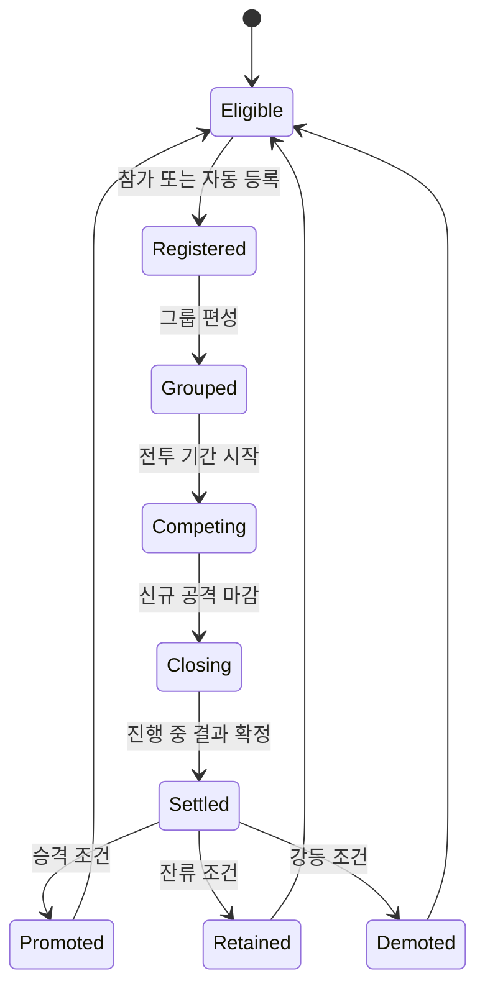

# 12. 개인 랭크·리그·토너먼트

> 기준일: 2026-11-13 KST. **개인 Ranked와 클랜전 리그(CWL)는 서로 다른 경쟁 체계**다. CWL은 [15번 문서](15_clan_war_leagues.md)를 따른다. 미공개 동률 규칙·정확한 점수 곡선·일부 배치 고정 시점은 검증 대상으로 남긴다.

## 1. 설계 목적 [해석]

랭크는 제한된 공격 기회 안에서 공격 숙련과 방어 설계의 일관성을 겨루는 시스템이다. 일반 전투 횟수와 경쟁 순위를 분리하면 플레이 시간이 긴 사람에게만 유리한 누적형 경쟁을 줄이고, 중요한 공격 전에 편성·배치·리플레이를 검토할 동기를 만든다.

승강이 주기적으로 일어나므로 “당장 한 판 이겼다”와 “이번 주 성적이 좋다”를 구분한다. UI는 한 전투 점수뿐 아니라 남은 공격, 아직 받지 않은 방어, 승격 예상 위치를 함께 보여줘야 한다.

## 2. 확인된 기본 구조

[확인] Ranked는 TH7부터 참가하며 리그별 토너먼트에 등록한다. 임시 병력은 랭크에 사용할 수 없고, 일반 전투와 별도 편성 저장이 가능하다. [Ranked Leagues](https://support.supercell.com/clash-of-clans/en/articles/ranked-leagues-4.html)

[확인] 2026년 4월 개편 후 Legend III·II는 주간, Legend I은 4주 대회다. Legend I에는 일일 공격·방어 주기와 주간 강등 판정이 함께 존재한다. [정식 업데이트](https://supercell.com/en/games/clashofclans/blog/release-notes/the-sound-of-clash-update/)

| 경쟁 단위 | 플레이어가 관리하는 것 | 결과를 확정하는 시점 |
|---|---|---|
| 개별 공격 | 편성·타이밍·목표 달성 | 전투 완료 |
| 개별 방어 | 미리 고정한 배치·방어 구성 | 상대 전투 완료 |
| 주간 그룹 | 제한된 공격과 방어의 합산 | 토너먼트 마감 |
| Legend I 하루 | 배정된 일일 공격·방어 | League Day 경계 |
| Legend I 주간 | 잔류 순위 | 주간 경계 |
| Legend I 4주 시즌 | 누적 경쟁 성과·기록 | 시즌 경계 |

## 3. 리그별 공격 예산

아래는 열람 당시 공식 지원 표의 공격 수를 재구성한 것이다. 승격·강등 비율은 세부 단계와 개편에 따라 달라져 현재 리그의 정보 화면을 최종 확인하도록 한다. [공식 리그 표](https://support.supercell.com/clash-of-clans/en/articles/ranked-leagues-4.html)

| 리그 계열 | 단계 | 공격 예산 |
|---|---|---|
| Skeleton | 1–3 | 주 6회 |
| Barbarian | 4–6 | 주 6회 |
| Archer | 7–9 | 주 8회 |
| Wizard | 10–12 | 주 8회 |
| Valkyrie | 13–15 | 주 10회 |
| Witch | 16–18 | 주 10회 |
| Golem | 19–21 | 주 12회 |
| P.E.K.K.A | 22–24 | 주 12회 |
| Titan | 25–27 | 주 12회 |
| Dragon | 28–30 | 주 14회 |
| Electro | 31–33 | 주 18회 |
| Legend III | 최상위 진입 | 주 24회 |
| Legend II | 중간 레전드 | 주 30회 |
| Legend I | 최상위 | 일 8회 |

**[해석]** 기회 수는 단순 보상이 아니라 시간 부담 조절 수단이다. 더 많은 공격이 반드시 더 좋은 경험은 아니다. 반복 횟수가 늘면 실력 추정은 안정될 수 있지만, 전투 준비 시간과 의무감도 커진다. 대회 참여율과 공격 소진율을 함께 측정해야 한다.

## 4. 점수 계산: 일반 주간 랭크와 Legend I을 분리

### 4.1 주간 랭크의 기본 트로피 구조

[확인] 공식 설명은 한 공격에 최대 40점을 배분한다. 3별은 40점, 2별은 파괴율에 따라 16–32점, 1별은 5–15점, 0별은 0–4점이다. 방어자는 공격자가 가져가지 못한 나머지를 얻는 방식으로 안내한다. [Ranked Battles & Trophy Calculation](https://support.supercell.com/clash-of-clans/en/articles/trophy-matchmaking-and-calculation-in-multiplayer-2.html)

```text
공격 점수 A = TrophyCurve(stars, destruction)
방어 점수 D = 40 - 상대의 공격 점수
주간 그룹 성적 = 자신의 공격 점수 합 + 자신의 방어 점수 합
```

위 식은 공개된 구조를 설명한다. `TrophyCurve`의 모든 파괴율별 절삭·반올림은 확인하지 않았으므로 임의 선형식으로 바꾸지 않는다. 실제 게임과 수치까지 같게 만들려면 별별 모든 정수 파괴율을 확인해 버전이 있는 룩업 테이블로 기록해야 한다.

**예시:** 자신의 완파 공격은 40점이다. 자신의 기지를 상대가 완파했다면 그 방어에서 남는 점수는 0점이다. “방어에서 점수를 못 얻음”과 “기존 누적 점수를 잃음”은 다른 모델이다.

### 4.2 Legend I의 별도 모델

[확인] Legend I은 5,000 트로피에서 시작하고 공격으로 획득, 방어에서는 상대가 얻은 만큼 잃는다. 최대 변동은 공격·방어 각각 40점이며, 일일 최대 8회 공격·8회 방어가 기본이다. 주말 순위가 10,000위 밖이면 Legend II로 강등되고, 잔류자 중 5,000 미만은 다음 주 시작 시 복구된다. [Intro to Legend League](https://support.supercell.com/clash-of-clans/en/articles/legend-league-4.html)

```text
LegendI_Trophies = 시작 트로피
                  + 공격 획득 합
                  - 방어 손실 합
```

**[제안]** 두 모델을 `weeklyScoreMode = COMPLEMENT_GAIN`, `legendScoreMode = NET_DELTA`처럼 별도 설정으로 둔다. 같은 `trophy += 40 - attackScore` 코드를 모든 리그에 적용하면 Legend I 방어에서 오히려 점수가 증가하는 오류가 생길 수 있다.

## 5. 참가·대회·승강의 상태 전이 [제안]



마감 처리에서 “아직 끝나지 않은 합법적인 공격”과 “마감 이후 새 요청”을 분리해야 한다. 최종 순위가 화면에 잠시 보였다는 이유만으로 보상을 먼저 지급하면 늦게 확정된 방어가 순위를 바꾸는 문제가 발생한다.

### 승강 계산 [제안]

```text
closeTournament(group):
  lockNewAttackRequests(group)
  settleAdmittedBattles(group)
  applyMissingDefensePolicyIfRequired(group)
  standings = sortByVersionedTieBreakRules(group.results)
  movements = promotionPolicy(group.league, group.size, standings)
  persistFinalResultOnce(group.id, movements)
```

**[미확인]** 동점 시 모든 우선순위, 최소 그룹 인원 미달 시 승강 반올림, 특정 시즌 이관 예외는 공개 근거가 충분하지 않다. 파괴율·방어율·공격 시간 등을 임의로 원작 확정 규칙으로 쓰지 않는다. 재구현에서는 모두 `TieBreakPolicy`와 `PromotionPolicy`로 명세해야 한다.

## 6. 방어 스냅샷과 적용 시점

랭크에서는 플레이어가 현재 편집하는 배치와 이번 대회에 사용되는 방어 배치를 구분해야 한다. 편집 가능 여부와 실제 적용 시점을 함께 보여주지 않으면 유저는 수정한 함정이 방어 리플레이에 없는 것을 버그로 받아들인다.

### 공식 설명의 충돌

| 근거 | 설명 | 이 문서의 판정 |
|---|---|---|
| 2026-04-27 릴리스 | 전투 시작 전 배치 변경 가능, 시작 이후는 다음 대회 적용 | 날짜가 있는 공개 변경 |
| 현재 Ranked 지원 페이지 | 월요일 그룹 편성 시 스냅샷, 이후 수정 미반영 | 현행 안내지만 수정일 미표기 |
| Legend 상세 지원 | 배치·방어 지원군 변경은 다음 League Day 적용 | Legend I의 일일 경계로 분리 |

출처: [4월 업데이트](https://supercell.com/en/games/clashofclans/blog/release-notes/the-sound-of-clash-update/), [Ranked 지원](https://support.supercell.com/clash-of-clans/en/articles/ranked-leagues-4.html), [Legend 지원](https://support.supercell.com/clash-of-clans/en/articles/legend-league-4.html).

**[미확인]** 일반 주간 대회의 최종 잠금이 그룹 편성 시점인지 전투 시작 시점인지는 현행 빌드 관찰이 필요하다. 사용자 운영 관점에서는 그룹 편성 전 수정 완료가 보수적이다. 재구현에서는 `layoutLockAt`를 하나로 정하고 UI·서버·리플레이가 같은 값을 사용해야 한다.

### 저장할 정보 [제안]

| 필드 | 필요 이유 |
|---|---|
| `sourceLayoutId/sourceRevision` | 어떤 편집본에서 유래했는지 추적 |
| `lockedAt/effectiveFrom` | 수정 가능 시간과 실제 반영 시간 구분 |
| `buildings/traps/guardians` | 방어 객체 상태 고정 |
| `defensiveHeroes/defensiveClanCastle` | 공격 편성과 독립된 방어 선택 |
| `battleModifierVersion` | 동일 배치라도 리그 보정이 다름 |
| `combatDataVersion` | 패치 전후 능력치 재현 |

## 7. 대회 시간과 한국 시간

[확인] 4월 업데이트는 주간 대회의 전투 시작을 월요일 17:00 UTC로 안내했다. 현재 지원은 월요일 05:00 UTC의 주간 승강·대회 경계를 설명한다. 개별 그룹 편성 시각과 배치 잠금은 §6의 검증 대상으로 별도 취급한다. 두 시각을 같은 “시즌 리셋”으로 합치지 않는다. [4월 업데이트](https://supercell.com/en/games/clashofclans/blog/release-notes/the-sound-of-clash-update/), [Ranked 지원](https://support.supercell.com/clash-of-clans/en/articles/ranked-leagues-4.html)

| UTC | 한국 시간(KST) | 용도 |
|---|---|---|
| 월요일 05:00 | 월요일 14:00 | 안내된 주간 승강·대회 경계 |
| 월요일 17:00 | 화요일 02:00 | 안내된 주간 전투 시작 |
| 매일 05:00 | 매일 14:00 | Legend I League Day 경계 |

UTC→KST 변환은 +9시간이다. 서버 정기 점검·특수 시즌은 게임의 현재 대회 타이머를 우선한다. 클라이언트 로컬 날짜만으로 “월요일”을 계산하면 한국 사용자에게 12시간의 준비 구간을 잘못 표시할 수 있다.

### Legend Shield

[확인] Legend Shield는 Legend I 전용이며 구매한 당일 진행 중인 League Day를 건너뛰지 않는다. 다음 League Day부터 공격과 방어를 함께 생략한다. Magic Shield는 Legend I 경쟁 방어를 막지 않고 일반 Battle 자원 보호에만 쓰인다. [Legend League 공식 안내](https://support.supercell.com/clash-of-clans/en/articles/legend-league-4.html)

[제안] `shieldPurchasedAt`, `effectiveLeagueDay`, `skipAttackAndDefense`를 명시적으로 저장한다. 일반 보호막의 남은 초를 그대로 랭크에 적용하면 구매 직후 이미 배정된 상대·공격권·일일 순위 처리에 불일치가 생길 수 있다.

## 8. 비활동·리그 하한·복귀

[확인] 현재 지원은 대회 미등록을 비활동으로 보며, 4주 비활동 후 강등과 이후 4주 단위 감소, TH별 하한, 추가 비활동에 따른 미배치 상태를 설명한다. 단순히 일반 전투를 플레이했다는 사실만으로 랭크 참가가 유지되는 것은 아니다. [Ranked Leagues](https://support.supercell.com/clash-of-clans/en/articles/ranked-leagues-4.html)

**[제안]** `lastLoginAt`, `lastCasualBattleAt`, `lastTournamentRegisteredAt`, `lastRankedBattleAt`를 구분한다. 자동 참가 설정이 있는 계정은 “등록했으나 공격하지 않음”과 “등록 자체를 하지 않음”이 같은 상태가 아니다. 휴면 경고에는 실제 강등 예정 시각과 그 근거를 보여준다.

## 9. 리그 보정과 보상 연결

[확인] 최상위 리그에는 공격·방어 조건을 바꾸는 Battle Modifiers가 존재한다. 정확한 계수는 개편되므로 본 문서는 버전이 있는 설정으로 취급한다. [4월 개편](https://supercell.com/en/games/clashofclans/blog/news/big-changes-are-coming-to-ranked-this-april/)

**[해석]** 보정은 난이도와 공정성에 다른 효과를 준다. 동일 리그에서 동일 보정이면 비교는 일관될 수 있지만, 일반 전투에서 연습한 전략이 그대로 성공하지 않아 학습 비용이 늘어난다. 편성 화면에서 현재 모드 보정을 숨기지 않아야 한다.

**[예고]** 2026-11-10 발표의 Ranked Medals·Prestige Shop은 기준일 이후 적용 대상으로 기록한다. 공지는 11월 16일 주부터 획득, 23일 첫 지급을 안내한다. 따라서 이 문서의 현행 랭크 정산에 해당 재화를 즉시 포함하지 않는다. [공식 예고](https://supercell.com/en/games/clashofclans/blog/news/stars-snacks-and-showing-off/)

## 10. 데이터 모델 [제안]

```text
LeagueRule
  leagueId, periodType, attackBudget, defenseBudget
  scoreMode, trophyCurveId, promotionPolicyId, tieBreakPolicyId
  modifierSetId, inactivityPolicyId, rewardPolicyId

TournamentEntry
  tournamentId, playerId, leagueId, groupId
  registeredAt, layoutSnapshotId
  attacksUsed, defensesResolved, score, entryState

RankedBattleResult
  battleId, entryId, opponentSnapshotId
  stars, destructionBasisPoints, simulationTime
  trophyDelta, resultVersion, finalizedAt
```

파괴율은 화면의 정수 퍼센트와 내부 비교 정밀도를 분리한다. 원작이 어떤 정밀도를 쓰는지 미확인이므로 `destructionBasisPoints`는 제안이다. 같은 표시 99%라도 내부 점수가 달라질 수 있는 설계라면 동률 UI가 이를 설명해야 한다.

## 11. QA와 운영 지표 [제안]

| ID | 검사 | 기대 결과 |
|---|---|---|
| RK-01 | TH 해금 직전·직후 | 참가 자격과 UI 잠금 일치 |
| RK-02 | 허용 공격 수 소진 후 재요청 | 공격권 추가 차감·새 전투 없음 |
| RK-03 | 3별 및 0~2별 경계 | 정책표와 점수 일치, 범위 초과 없음 |
| RK-04 | 같은 방어 성과를 주간/Legend I에 적용 | 양수 보완점과 음수 손실을 올바르게 구분 |
| RK-05 | 방어 배치 수정 후 현재·다음 대회 조회 | 각 스냅샷의 유효 시점 일치 |
| RK-06 | 마감 직전 승인된 공격 완료 | 사전 정의된 정산 유예 처리 |
| RK-07 | 임시 병력 포함 저장 편성 | 금지 항목을 출전 전에 표시·제거 |
| RK-08 | 월요일 UTC/KST 날짜 경계 | 그룹·전투·일일 리셋 타이머 각각 정확 |
| RK-09 | 자동 등록·비활동 4주 | 실제 등록 상태로 경고·강등 판정 |
| RK-10 | 점수·순위·보상 지급 재시도 | 최종 승강과 보상이 중복되지 않음 |

핵심 지표는 리그별 공격 소진율, 승격·강등 후 다음 주 참가율, 동일 TH의 3별 분포, 방어 미매칭률, 미사용 공격 때문에 생긴 순위 차이, 배치 적용 관련 문의율이다. “3별률이 높다”만으로 공격력을 낮추지 말고 조합 편중·플레이어 숙련·수정 전후 리그 보정을 함께 본다.

## 12. 관련 문서

[05 편성](05_army_composition.md) · [06 전투 결과](06_battle_rules_and_resolution.md) · [11 일반 매칭](11_matchmaking_shields_and_revenge.md) · [15 CWL](15_clan_war_leagues.md) · [23 운영·밸런스](23_liveops_and_balance.md) · [24 데이터](24_data_architecture_and_network.md)
