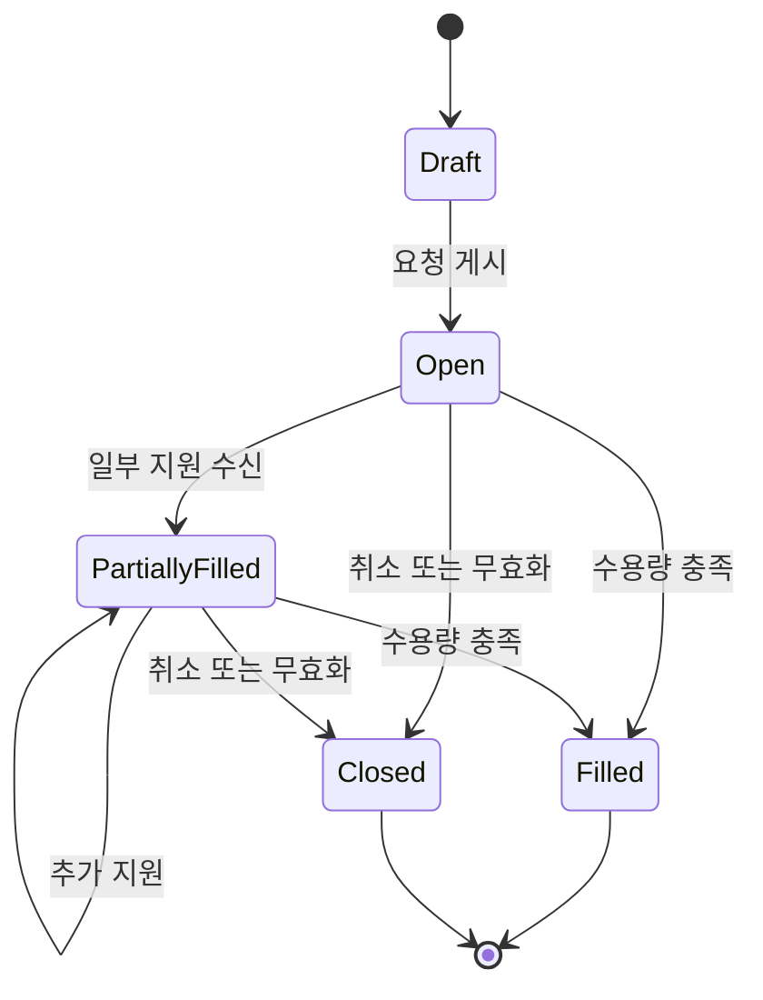

# 13. 클랜·소셜·지원 병력 시스템 역기획

> 기준일: 2026-11-13 KST. **[확인]** 공식 자료로 확인한 외부 규칙, **[해석]** 설계 의도, **[제안]** 재구현 모델, **[미확인]** 추가 플레이 검증이 필요한 항목을 뜻한다. 데이터 구조와 의사코드는 Supercell 내부 구현을 설명하지 않는다.

## 1. 목적과 시스템 경계

클랜은 개인 계정의 성장을 상호 지원, 공동 목표, 장기 소속감으로 연결하는 조직 단위다. 클랜 가입 그 자체보다 **도움을 요청하고, 도움을 받은 상태로 전투하며, 결과를 조직에 돌려주는 행동**이 반복되도록 설계되어 있다. [해석]

| 구성요소 | 입력 | 결과 | 다른 시스템과의 경계 |
|---|---|---|---|
| 가입·모집 | 가입 조건, 초대, 신청 | 소속과 역할 | 전쟁·게임·습격의 참가 기록과 소속은 별도 |
| 채팅 | 텍스트, 지원 요청, 리플레이 | 조율과 정보 공유 | 전투 실행 결과 자체를 수정하지 않음 |
| 병력 지원 | 요청 내용, 수용량, 지원자 자격 | 클랜 성 병력·마법·시즈 | 개인 군대와 전쟁 방어군은 구분 |
| 클랜 성장 | 공동 활동의 XP | 특전 및 정체성 | 개인 경험치와 별개 |
| 권한 | 역할, 대상, 작업 | 멤버·전쟁·배치 관리 | 서버에서 행동별 권한 검증 필요 [제안] |

## 2. 공개 규칙과 현행 주의점

| 항목 | 규칙 | 상태·근거 |
|---|---|---|
| 정원·역할 | 최대 50명, 멤버·장로·공동 대표·대표 | [확인] [역할 안내](https://support.supercell.com/clash-of-clans/en/articles/clan-roles-3.html) |
| 재가입 | 과거 직급과 별개로 멤버로 가입 | [확인] 같은 자료 |
| 모집 | 공개·초대 전용·비공개 설정, 가입 조건과 초대 경로 | [확인] [모집 안내](https://support.supercell.com/clash-of-clans/en/articles/recruiting-clan-members-3.html) |
| 공고 | 대표·공동 대표가 게시; 공고 노출은 필터에 따라 달라짐 | [확인] 같은 자료 |
| 지원 요청 | 병력·마법·시즈의 종류를 지정하고 수신 가능한 최고 레벨 조건 설정 가능 | [확인] [클랜 성 안내](https://support.supercell.com/clash-of-clans/en/articles/clan-castle-troops-and-spells-2.html) |
| 지원 레벨 | 클랜 특전으로 증가하더라도 수신자 클랜 성의 허용 상한을 넘지 못함 | [확인] [클랜 특전](https://support.supercell.com/clash-of-clans/en/articles/clan-perks-3.html) |
| 지원 비용 | 2025년 3월 개편 후 지원 시 병력·마법 종류에 따라 엘릭서/다크 엘릭서 소비 | [확인] [Clash Anytime](https://supercell.com/en/games/clashofclans/blog/release-notes/welcome-to-clash-anytime-update/) |
| 요청 대기 | 같은 개편에서 기본 요청 간격 10분으로 변경; 패스 등 적용값은 별도 설정 | [확인] 같은 자료 |

본인 군대의 훈련 비용이 사라졌다고 지원 경제까지 무료인 것은 아니다. 지원은 다른 계정의 전투 선택지를 만들어 주는 별도 거래다. 따라서 `TrainingCost`, `DonationCost`, `SelfReinforcementCost`를 서로 다른 데이터로 관리해야 한다. [해석·제안]

## 3. 역할과 권한 모델

다음 표는 공개 역할의 핵심 차이를 요약한 것이다. 세부 쿨다운·특수 조건은 현행 설정을 따른다. [확인, 역할 안내]

| 작업 | 멤버 | 장로 | 공동 대표 | 대표 |
|---|---:|---:|---:|---:|
| 지원·채팅·공동 활동 | 가능 | 가능 | 가능 | 가능 |
| 초대·가입 승인 | 불가 | 가능 | 가능 | 가능 |
| 일반 멤버 추방 | 불가 | 제한적 가능 | 가능 | 가능 |
| 장로 관리 | 불가 | 불가 | 가능 | 가능 |
| 일반 클랜전 시작·참가자 선정 | 불가 | 불가 | 가능 | 가능 |
| 대표 권한 이전 | 불가 | 불가 | 불가 | 가능 |

[제안] `role >= requiredRole` 하나로 전부 처리하지 않는다. 공동 대표가 다른 공동 대표를 임의 강등하는 것처럼 역할 서열만으로 허용하면 안 되는 작업이 있기 때문이다. `CanAct(actorRole, targetRole, action)`을 독립 테이블로 정의하고, UI 표시와 실제 승인 로직에서 같은 정책 버전을 사용한다.

장기 부재 시 대표 승계가 존재한다는 공식 규칙은 조직의 영속성 장치다. 승계 대상·예고·취소를 포함한 별도 상태로 구현하고, 특정 역할의 단순 마지막 접속 순서만으로 대표를 바꾸지 않는다. [확인·해석, 역할 안내]

## 4. 지원 병력의 동작 흐름



이 상태도는 재구현 제안이다. 요청 종료와 실제 클랜 성 병력 소유권을 분리해야 한다. 채팅에서 요청 카드가 오래되어 사라져도 이미 수신한 병력을 제거해서는 안 된다. 새 요청을 게시할 때 기존 잔여 병력, 저장 공간, 요청 종류를 다시 검증한다.

### 수용량과 레벨

[제안] 병력·마법·시즈는 다른 슬롯 차원을 사용한다.

```text
remainingTroopSpace = troopCapacity - sum(receivedTroop.housingSpace)
remainingSpellSpace = spellCapacity - sum(receivedSpell.housingSpace)
remainingSiegeSlots = siegeCapacity - receivedSiegeCount
receivedLevel = min(donorLevel + applicableClanPerk,
                    receiverCapByType,
                    contentMaxLevel)
```

위 레벨식은 공개된 상한 규칙을 표현한 개념 모델이다. 슈퍼 유닛, 임시 유닛, 특정 시즈와 이벤트 지원권의 예외는 `DonationEligibility`에서 추가 처리한다. 공개 자료로 모든 예외의 현재 조합을 확정하지 않았으므로 실제 상용 데이터처럼 배포하지 않는다. [미확인]

### 트랜잭션

```text
Donate(requestId, donorId, selections, expectedVersion):
  load request and receiver capacity
  verify request is active and donor belongs to allowed clan
  verify type, level, request constraints, donor quota
  calculate exact resource or gem cost from ruleset
  atomically:
    debit donor cost
    append accepted reinforcement units
    increment request version
    record donation credit and receipt
  return actual accepted count and remaining capacity
```

동시에 두 사람이 마지막 공간에 지원할 때 한 명만 성공해야 한다. UI에서 남은 공간을 미리 봤다는 이유로 자원부터 빼지 않는다. 요청자가 병력을 삭제하거나 클랜을 이동하는 경우도 하나의 확정 시점으로 직렬화한다. [제안]

## 5. 채팅을 작업 화면으로 쓰는 이유

[해석] 클랜 채팅은 단순 대화창과 작업 알림 목록이 겹친다. 지원 요청, 친선 도전, 전쟁 참여 조사, 리플레이가 같은 맥락에서 보이므로 사회적 대화가 실제 플레이 행동으로 연결된다.

[제안] 메시지 본문과 작업 상태를 분리한다.

| 데이터 | 핵심 필드 | 불변 조건 |
|---|---|---|
| `Clan` | id, name, rolePolicy, settingsVersion | 대표 1명; 정원 한도 준수 |
| `ClanMembership` | playerId, clanId, role, joinedAt | 한 시점의 활성 소속 1개 |
| `ClanActivityEnrollment` | eventId, playerId, enrolledClanId | 탈퇴로 과거 참가 소속 변경 금지 |
| `ChatEntry` | type, author, payloadId, createdAt | 채팅 삭제와 보상 권리 분리 |
| `DonationRequest` | desiredTypes, caps, version, state | 모든 공간 차원 음수 금지 |
| `DonationReceipt` | donor, receiver, units, cost, requestVersion | 중복 요청 키로 이중 지급 금지 |
| `ClanPermissionAudit` | actor, action, target, outcome | 중요한 관리 행위 추적 |

채팅 카드를 누르면 현재 서버 상태를 다시 읽는다. 이미 채워진 요청 카드에는 지원 완료를 보여주고, 이미 끝난 전투에는 관전 대신 리플레이를 노출한다. 일회성 알림 이벤트를 실제 데이터 원본으로 사용하지 않는 것이 핵심이다.

## 6. 동기와 밸런스 분석

클랜 지원의 공급은 높은 성장도뿐 아니라 접속 시간대와 자원 여유에 좌우된다. 요청 충족률이 낮은 클랜은 구성원 수가 충분해도 기능적으로 비활성일 수 있다. [해석]

| 지표 | 해석 | 함께 볼 조건 |
|---|---|---|
| 요청 후 첫 지원까지의 중앙값·상위 95% 시간 | 도움을 받는 속도 | 시간대, 언어, 지원 난이도 |
| 완전 충족률 | 원하는 군대 준비 가능성 | 지정 요청 대 자유 요청 |
| 지원자 집중도 | 소수 헌신자 의존 | 상위 지원자 이탈 후 변화 |
| 신규 가입 7일 잔존율 | 실제 소속 형성 | 첫 지원·첫 전쟁 경험 |
| 공고 조회→가입→활동 전환 | 모집 질 | 높은 가입 수만 최적화 금지 |
| 역할 변경·추방 후 이탈 | 조직 안정성 | 전쟁 진행·시즌 종료 시점 |

[제안] 새 클랜의 열세를 분석할 때 지원 레벨 특전과 모집 효과를 분리한다. 전투력 격차가 큰 것인지, 필요한 유닛을 제때 받지 못하는 것인지에 따라 해결책이 달라진다. 지원 보상을 무제한 늘리면 여러 계정 간 반복 요청으로 XP를 생산할 유인이 생기므로 보상 한도·일일 과제·요청 쿨다운을 함께 설계한다.

## 7. 예외 처리와 수용 테스트

| ID | 상황 | 기대 결과 [제안] |
|---|---|---|
| CL-01 | 마지막 공간을 두 지원자가 동시에 채움 | 공간을 초과하지 않고 실제 성공분만 차감 |
| CL-02 | 최고 레벨 조건을 만족하지 못하는 유닛 지원 | 거절 사유에 수신 상한과 지원 레벨 표시 |
| CL-03 | 지원 직전 요청자가 탈퇴 | 소속 정책에 따라 명확히 승인/거절; 부분 차감 금지 |
| CL-04 | 직급 강등 직후 이전 화면에서 추방 클릭 | 최신 권한으로 거절 |
| CL-05 | 가득 찬 클랜에 여러 가입 승인 동시 도착 | 정원 50을 초과하지 않음 |
| CL-06 | 전쟁 방어 클랜 성에 지원 | 개인 공격 군대 수신 목록과 섞이지 않음 |
| CL-07 | 이미 지급된 지원 응답 재전송 | 동일 영수증 반환, XP·병력 중복 없음 |
| CL-08 | 클랜게임 참가 후 탈퇴·재가입 | 이벤트 참가 소속과 보상 권리 유지 |
| CL-09 | 지원 레벨 특전이 전쟁 중 증가 | 전쟁 적용 시점 정책 준수; 소급 변조 없음 |

## 8. 미확인 항목과 연계 문서

지원 가능한 각 유닛의 현재 비용, 정확한 종류별 레벨 상한, 패스별 최종 요청 대기 시간, 특정 가입 조건의 초대 예외는 실제 계정 UI로 보완해야 한다. 공식 지원 문서의 잠금 해제 설명을 모든 지원 유형의 공통 조건으로 확대 해석하지 않는다.

연계: [자원 경제](04_resources_loot_and_economy.md), [군대 편성](05_army_composition.md), [클랜전](14_clan_wars.md), [클랜게임](18_clan_games.md), [데이터 구조](24_data_architecture_and_network.md).

### 근거 목록

- Supercell Support, [Clan Roles](https://support.supercell.com/clash-of-clans/en/articles/clan-roles-3.html), 열람 2026-11-13.
- Supercell Support, [Recruiting Clan Members & Clan Notices](https://support.supercell.com/clash-of-clans/en/articles/recruiting-clan-members-3.html), 열람 2026-11-13.
- Supercell Support, [Clan Castle Troops & Spells](https://support.supercell.com/clash-of-clans/en/articles/clan-castle-troops-and-spells-2.html), 열람 2026-11-13.
- Supercell Support, [Clan Perks](https://support.supercell.com/clash-of-clans/en/articles/clan-perks-3.html), 열람 2026-11-13.
- Supercell, [Welcome to Clash Anytime Update!](https://supercell.com/en/games/clashofclans/blog/release-notes/welcome-to-clash-anytime-update/), 2025-03-24.
