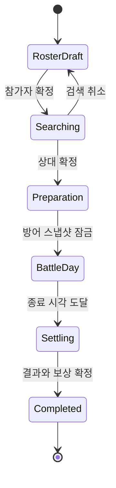

# 14. 일반 클랜전 시스템 역기획

> 기준일: 2026-11-13 KST. [확인]은 공개 규칙, [해석]은 설계 분석, [제안]은 재구현 모델, [미확인]은 추가 검증 항목이다. 일반 클랜전과 월간 클랜전 리그(CWL)의 공격 횟수·매칭을 혼용하지 않는다.

## 1. 핵심 경험

일반 클랜전은 제한된 공격권을 조직 차원에서 배분하는 비동기 팀 전략 게임이다. 개인은 하나의 공격을 실행하지만, 좋은 결정인지의 기준은 팀 전체가 아직 얻지 못한 별을 얼마나 추가했는가다. 이미 완파된 적을 다시 완파하는 행동과 미완료 대상을 개선하는 행동은 개인 전투 결과가 같아도 팀 가치가 다르다. [해석]

팀의 계획은 `참가 명단 → 상대 파악 → 목표 배정 → 첫 시도 → 잔여 목표 정리 → 결과 회고`로 반복된다. 같은 번호를 자동으로 공격하는 방식은 커뮤니티 운영 관행일 수 있으나 필수 게임 규칙으로 구현하지 않는다. [해석·제안]

## 2. 공개 규칙

| 항목 | 규칙 | 근거 |
|---|---|---|
| 개시 | 대표·공동 대표가 참가자를 선택; 최소 5명의 클랜 필요 | [확인] [시작 안내](https://support.supercell.com/clash-of-clans/en/articles/starting-a-clan-war-2.html) |
| 매칭 | 같은 참가 인원, 공격·방어 성장과 전적 등을 고려; 트로피 제외 | [확인] [매칭](https://support.supercell.com/clash-of-clans/en/articles/clan-wars-matchmaking.html) |
| 준비 | 23시간, 전쟁 배치 준비·방어 지원군 구성 | [확인] [소개](https://support.supercell.com/clash-of-clans/en/articles/about-clan-wars-2.html) |
| 전투 | 24시간; 개인별 2회 공격, 같은 사람이 같은 적 기지를 2회 공격 불가 | [확인] [주간 전쟁 시간 설명](https://support.supercell.com/clash-of-clans/en/articles/cwl-week-of-wars.html), 일반 클랜전 소개 |
| 기록 | 적 기지마다 최대 별 3개; 반복 공격의 최고 성과 반영 | [확인] [결과](https://sc-clashofclans.zendesk.com/hc/en-us/articles/49529080382363-Clan-War-Results) |
| 승패 | 총별 우선, 같으면 총파괴율 비교 | [확인] 같은 자료 |
| 방어 기록 | 전투일 시작 후 배치·건물 레벨 변경을 해당 전쟁에 반영하지 않음 | [확인] 일반 클랜전 소개 |
| 임시 병력 | 사용 불가 | [확인] 일반 클랜전 소개 |

규모별 전체 허용 목록과 이벤트 특수 규칙은 `WarFormatConfig`로 관리한다. 최소 5명이라는 규칙만으로 모든 5명 단위 크기가 현재 지원된다고 가정해서는 안 된다. [제안]

## 3. 참가와 방어군의 분리

일반 마을의 클랜 성과 전쟁 방어 클랜 성은 별개다. 준비일에 넣은 전쟁 방어군을 공격 병력으로 꺼내 쓰는 구조가 아니다. 공격 시에는 자신의 공격 군대와 별도로 준비한 지원 병력을 사용한다. [확인, 일반 클랜전 소개]

[해석] 방어 편성은 팀 전체가 유지하는 사전 약속이고, 공격 편성은 각 전투에서 바꿀 수 있는 선택이다. 둘을 한 인벤토리로 표현하면 공격 한 번으로 전쟁 방어군이 소진되는 오류가 발생한다.

[제안] 다음 스냅샷을 구별한다.

| 스냅샷 | 잠금 시점 | 담는 내용 |
|---|---|---|
| `WarRoster` | 전쟁 매칭 확정 | 참가 계정·기지 연결 |
| `WarDefenseSnapshot` | 전투일 시작 | 배치, 레벨, 함정 모드, 방어군, 규칙 버전 |
| `AttackLoadoutSnapshot` | 각 공격 시작 | 공격군, 영웅·장비·펫, 사용 가능 지원 |
| `WarResultLedger` | 결과 확정마다 | 공격 기록과 기지별 최고 기록 |

공식 자료는 외부의 적용 시점을 설명한다. 실제 게임이 이 네 구조를 사용한다는 의미는 아니다.

## 4. 전쟁 상태 전이



[제안] 종료 직전에 시작된 공격을 어떤 기준으로 인정하는지는 전투 시작 허용 시간과 결과 정산 마감 시간을 구분해 다룬다. 실제 늦은 공격의 정산 정책은 플레이로 검증해야 한다. 서버가 이미 승인한 전투를 UI 카운트다운이 0이 되었다는 이유만으로 삭제하지 않는다.

## 5. 점수 집계 모델

**[확인]** 별은 적 기지별 최고 기록을 합산한다. 전쟁 지도상의 별을 각 공격에서 얻은 별의 총합으로 계산하면 같은 기지를 여러 번 공격해 점수를 복제하는 오류가 생긴다. 별이 같을 때는 파괴율이 승패를 가른다. [결과 안내](https://sc-clashofclans.zendesk.com/hc/en-us/articles/49529080382363-Clan-War-Results)

[제안] 기지별 최고 기록을 다음과 같이 모델링한다.

```text
best[target] = BestAttackRecord(attacksAgainstTarget, comparisonPolicy)
warStars = sum(best[target].stars for each enemy target)
warDestruction = aggregate(best[target].destruction, allEnemyTargets)
winner = compare((warStars, warDestruction), opponentScore)
```

`BestAttackRecord`의 구현 후보는 `(별, 파괴율)` 사전식 비교다. 다만 별이 높은 공격의 파괴율과 별이 낮지만 파괴율이 높은 공격이 공존하는 경계 사례의 실제 집계는 별도 검증 대상으로 남긴다. `comparisonPolicy`와 `aggregatePolicy`를 분리하면 확인 후 수정하기 쉽다. [제안·미확인]

### 수치 예시

적 기지 A가 이미 2별일 때 다시 2별을 기록하면 팀 별 증가는 0이다. 3별로 개선하면 팀에 1별이 추가된다. A가 완파되면 별 증가의 상한은 이미 소진되므로 다른 기지의 개선 가능성을 검토해야 한다. [확인된 집계 규칙을 적용한 계산]

목표 배정을 위한 분석 모델은 다음처럼 둘 수 있다. [제안]

```text
expectedGain(player, target)
 = sum over outcomes [ P(outcome) × max(0, outcomeStars - currentStars[target]) ]
```

확률은 공격자 숙련도, 조합 경험, 대상 배치 난도, 성장 차이의 실제 기록으로 추정한다. 별 기대값만 최적화하면 파괴율 동률을 놓치므로 목표별 완파 확률과 실패 시 안전한 2별 가능성을 함께 보여준다. 확률값은 게임의 공개 수치가 아니다.

## 6. 정보 공개와 협력 전략

| 단계 | 주요 결정 | 전술적 의미 [해석] |
|---|---|---|
| 준비 | 방어군 배치, 역할 조율 | 낮은 접속 빈도에서도 팀 준비 가능 |
| 초반 | 첫 공격 대상·정찰 역할 | 함정·수비 병력 등 실전 정보 확보 |
| 중반 | 기존 결과의 개선 여부 | 공격권을 중복 사용하지 않도록 조정 |
| 후반 | 안전한 추가 별과 고위험 완파 중 선택 | 남은 시간·상대 점수에 따른 위험 선호 |
| 종료 | 실패 유형과 배치 분석 | 다음 전쟁의 학습 자료 축적 |

[제안] 목표 예약은 단단한 공격 금지와 부드러운 팀 조율을 구분한다. 사용자가 예약했더라도 급하게 떠난 경우 남은 팀원이 영원히 공격하지 못하는 구조는 피한다. 예약에 만료 시각·요청자·해제권자를 저장하고, 실제 전투가 시작되면 별도의 실행 중 상태로 표시한다.

## 7. 보상과 경제

공식 현행 보상 표는 승리 100%, 무승부 75%, 패배 50%의 War Win Bonus를 안내한다. 2026년 2월 패치에서 무승부 비율이 이전 57%에서 75%로 조정되었다. 일반 자원과 광석, 공격 중 획득분, 전쟁 종료 보너스를 구분해야 한다. [확인] [보상 안내](https://support.supercell.com/clash-of-clans/en/articles/clan-war-rewards-2.html), [2026년 2월 패치](https://supercell.com/en/games/clashofclans/blog/release-notes/the-february-update-has-escaped/)

[제안] `attackLoot`, `earnedWarBonus`, `resultMultiplier`, `treasuryCapacity`, `oreCapacity`를 각각 계산한다. 저장고 초과분과 광석의 보관 방식은 자원 종류별 정책으로 처리한다. 보상 총액을 개인 클라이언트가 제출하도록 두지 않는다.

[해석] 패배 보상은 공격에 실패한 팀의 다음 성장 기회를 유지한다. 반면 승리 보너스 차이는 팀 조율의 가치다. 무승부 보상이 너무 낮으면 높은 실력으로 양쪽 모두 완파한 전쟁이 낮은 실력의 승패전보다 경제적으로 손해가 커진다.

## 8. 데이터·예외·QA

| 구조 [제안] | 핵심 필드 | 목적 |
|---|---|---|
| `WarMatch` | id, format, start/end, clanIds, ruleset | 전체 전쟁 수명 |
| `WarParticipant` | playerId, attackBudget, usedTargets | 공격 횟수·중복 대상 제한 |
| `WarDefenseSnapshot` | layoutHash, levelMap, reinforcement | 방어 상태 고정 |
| `WarAttack` | commandLogId, targetId, outcome, approvedAt | 재현·정산 |
| `WarSettlement` | score, result, rewardReceipts | 멱등 보상 확정 |

| ID | 검증 상황 | 기대 결과 [제안] |
|---|---|---|
| WAR-01 | 한 사용자가 같은 적을 두 번째 공격 | 남은 공격권이 있어도 시작 거절 |
| WAR-02 | 두 번째 공격권을 두 기기에서 동시 요청 | 한 전투만 승인 |
| WAR-03 | 같은 적을 서로 다른 팀원이 개선 | 팀 점수는 최고 기록만 반영 |
| WAR-04 | 전투일 중 방어 건물 업그레이드 완료 | 해당 전쟁 스냅샷 유지 |
| WAR-05 | 별 동률·파괴율 차이 | 규칙에 따른 파괴율 우승 |
| WAR-06 | 전쟁 종료 응답 재전송 | 보상 영수증 중복 생성 금지 |
| WAR-07 | 준비일 종료 직전 방어 지원 | 서버 확정 시각으로 포함 여부 결정 |
| WAR-08 | 참가 후 탈퇴 | 명단·기록·보상 권리와 현재 소속을 별개 처리 |
| WAR-09 | 공격별 별·파괴율 우열이 엇갈림 | 현행 실측과 집계 정책 일치 확인 |

## 9. 운영 지표와 미확인 항목

[제안] 평균 완파율만 보지 않고 TH 매치업별 완파율, 미사용 공격권 비율, 같은 적에 대한 중복 공격 비용, 전쟁 전적별 매칭 대기 시간, 마지막 2시간 공격 집중도를 본다. 팀 성과의 분산이 큰지, 게임 난도가 높은지, 참가자 부재가 큰지를 분리해야 한다.

정확한 매칭 가중치와 탐색 반경 확장 함수는 공개되지 않았다. Support의 특정 기지 공격자 수 설명에는 개인 2회 공격 제한과 혼동될 여지가 있어, 이를 임의로 ‘적 기지당 최대 2명’이라는 공통 상한으로 확정하지 않았다. 해당 제한과 최고 파괴율 집계의 경계값은 실측 목록에 포함한다.

연계: [전투 판정](06_battle_rules_and_resolution.md), [클랜·지원](13_clans_social_and_donations.md), [클랜전 리그](15_clan_war_leagues.md), [QA](25_qa_and_analytics.md).

### 근거 목록

- [Starting a Clan War](https://support.supercell.com/clash-of-clans/en/articles/starting-a-clan-war-2.html), [Intro to Clan Wars](https://support.supercell.com/clash-of-clans/en/articles/about-clan-wars-2.html), 열람 2026-11-13.
- [Clan War Matchmaking](https://support.supercell.com/clash-of-clans/en/articles/clan-wars-matchmaking.html), [Clan War Results](https://sc-clashofclans.zendesk.com/hc/en-us/articles/49529080382363-Clan-War-Results), 열람 2026-11-13.
- [The Week of Wars](https://support.supercell.com/clash-of-clans/en/articles/cwl-week-of-wars.html), [Clan War Rewards](https://support.supercell.com/clash-of-clans/en/articles/clan-war-rewards-2.html), 열람 2026-11-13.
- [The February Update has escaped!](https://supercell.com/en/games/clashofclans/blog/release-notes/the-february-update-has-escaped/), 2026-02-23.
