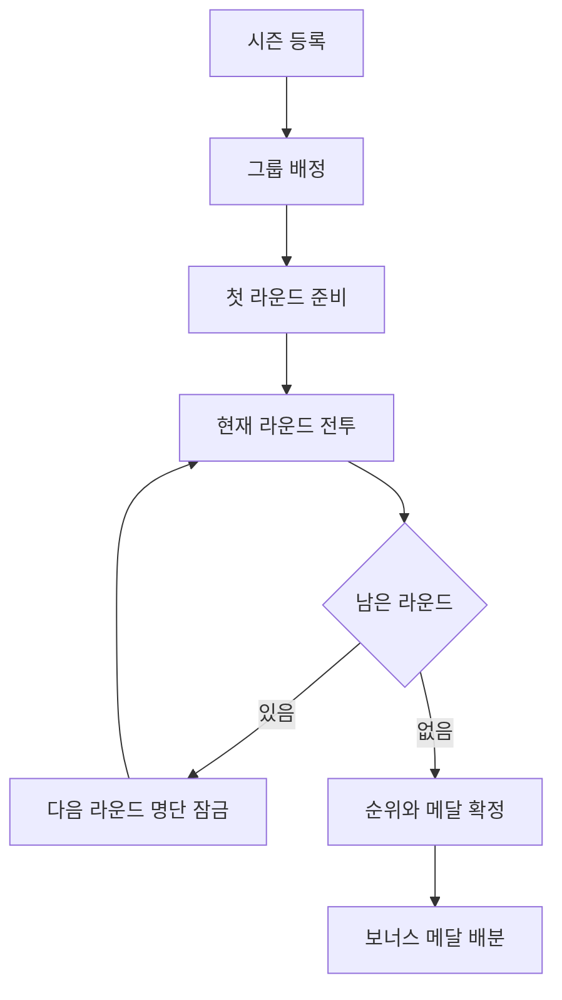

# 15. 클랜전 리그(CWL) 시스템 역기획

> 기준일: 2026-11-13 KST. [확인] 공개 규칙, [해석] 설계 해석, [제안] 구현 모델, [미확인] 추가 검증 항목. 월간 팀 리그인 CWL은 개인 Ranked 리그와 다른 시스템이다.

## 1. 일반 클랜전과 구별되는 설계 목표

일반 클랜전이 비슷한 성장도의 두 클랜을 매칭해 한 차례 경쟁하게 한다면, CWL은 시즌 누적 성과에 따라 조직의 위치가 올라가거나 내려가는 장기 경쟁이다. 하루 한 번의 공격, 여러 날에 걸친 선수 교체, 시즌 보상 분배가 각각 전투 정확도·조직 운영·기여 평가를 요구한다. [해석]

| 구분 | 일반 클랜전 | CWL |
|---|---|---|
| 개인 공격권 | 전쟁당 2회 | 전투일당 1회 |
| 기본 상대 결정 | 성장·전적 등 | 배치 후 리그와 같은 전쟁 규모 |
| 조직의 결정 | 이번 전쟁 참가 명단 | 시즌 로스터와 날짜별 출전 명단 |
| 성과 누적 | 한 전쟁 승패 | 여러 전쟁의 시즌 순위 |
| 고유 보상 | 전쟁 보너스·광석·클랜 XP | 추가로 리그 메달과 보너스 배분 |

[확인] [일반 클랜전](https://support.supercell.com/clash-of-clans/en/articles/about-clan-wars-2.html), [CWL 매칭](https://support.supercell.com/clash-of-clans/en/articles/cwl-matchmaking-and-groups.html), [주간 전쟁](https://support.supercell.com/clash-of-clans/en/articles/cwl-week-of-wars.html), [리그 보상](https://support.supercell.com/clash-of-clans/en/articles/clan-war-leagues-rewards-2.html).

## 2. 2026년 변경 이력과 자료 충돌

| 시점 | 확인한 변경 | 문서 적용 |
|---|---|---|
| 2026-02-23 | 5v5 CWL 지원 추가 | 전쟁 크기를 15·30만으로 고정하지 않음 |
| 2026-04-27 | Titan III·II·I와 Legend 추가 | Champion I을 최상위라고 쓰지 않음 |
| 2026-08-30 | Titan I의 modifier는 Legend II, Titan II·III는 Legend III로 변경 | 난이도 정책을 시즌별 데이터로 분리 |

[확인] [2월 패치](https://supercell.com/en/games/clashofclans/blog/release-notes/the-february-update-has-escaped/), [4월 패치](https://supercell.com/en/games/clashofclans/blog/release-notes/the-sound-of-clash-update/), [8월 패치](https://supercell.com/en/games/clashofclans/blog/release-notes/august-update-3/).

공식 Support의 [About CWL](https://support.supercell.com/clash-of-clans/en/articles/about-cwl-3.html)과 신규 배치 설명에는 여전히 15/30명만 등장한다. 이 부분은 5v5 추가 패치와 맞지 않으므로 최신 패치를 우선하고, **각 리그에서 허용하는 5/15/30 크기 조합과 5인 신규 배치 방식은 미확인**으로 남긴다. 패치의 존재를 근거로 모든 리그에서 모든 크기를 지원한다고 확대하지 않는다.

## 3. 시즌과 참가자 모델

[확인] 일반적인 그룹은 8개 클랜이며 6개 그룹도 존재한다. 표준 8개 그룹은 7번의 전쟁을 치른다. 준비일은 23시간, 전투일은 24시간이며 다음 전쟁 준비와 현재 전쟁 전투를 병행한다. 일별 출전자는 시즌 로스터 내에서 선택한다. 상대의 실제 전쟁 기지는 전투일에 공개된다. [매칭·그룹](https://support.supercell.com/clash-of-clans/en/articles/cwl-matchmaking-and-groups.html), [주간 전쟁](https://support.supercell.com/clash-of-clans/en/articles/cwl-week-of-wars.html)

[제안] 참가 명단을 세 층으로 나눈다.

| 층 | 데이터 | 변경 정책 |
|---|---|---|
| 시즌 등록 | `SeasonRoster[playerId]` | 등록 마감 후 참가 자격의 기준 |
| 날짜별 출전 | `RoundLineup[roundId]` | 해당 전투일 시작 전까지만 수정 |
| 현재 소속 | `ClanMembership` | 탈퇴·추방으로 변동 가능, 시즌 기록과 별도 |

로스터에 포함됐지만 한 번도 출전하지 않은 플레이어와, 출전했지만 공격을 못 한 플레이어는 다르다. 전자는 보상 자격이 있을 수 있고 후자는 팀의 공격 기회를 소진한 자리다. 분석 지표에서는 둘을 분리한다. [해석]

### 상태 흐름



그림은 논리 흐름이다. 구현은 준비와 전투가 겹칠 수 있도록 라운드별 상태를 병렬 보관해야 한다. 전역 상태 하나를 `Preparation` 또는 `Battle`로만 두면 다음 날짜 출전 명단 수정이 막힌다. [제안]

## 4. 매칭과 경쟁 공정성

**[확인]** 초기 배치 이후 매칭은 리그 기반이다. 일반 클랜전처럼 매번 TH·영웅·병력 레벨을 맞추는 구조가 아니다. 신규 클랜의 첫 배치에는 공격·방어 성장도가 사용된다. [공식 매칭 설명](https://support.supercell.com/clash-of-clans/en/articles/cwl-matchmaking-and-groups.html)

[해석] 같은 리그에서 성장도가 다른 팀을 만나는 현상은 리그가 장기 성과를 분류하기 때문에 발생할 수 있다. 이를 모두 매칭 오류로 처리하면 리그가 실력과 조직 성과를 표현하지 못한다. 반대로 신규 클랜의 첫 배치 오차는 여러 시즌의 일방적 경기로 이어질 수 있어 따로 측정해야 한다.

[제안] 최초 배치는 `PlacementPolicy`; 이후 매칭은 `LeagueMatchPolicy`로 분리한다. 내부 가중치·랜덤 시드·대기열 알고리즘은 공개되지 않았으므로 원작 알고리즘을 복원했다고 주장하지 않는다.

## 5. 공격과 라운드 점수

일별 출전자는 한 번만 공격할 수 있으므로 실패한 전략을 같은 사람이 바로 수정해 재시도할 여지가 없다. 팀 내 다른 사용자가 같은 목표를 마무리하면 그 공격권으로 얻을 수 있었던 다른 기지의 점수를 포기한다. [확인·해석, 주간 전쟁]

[제안] 점수는 다음 세 축을 별개로 저장한다.

```text
roundBattleStars = sum(bestStarsByEnemyBase)
seasonBattleStars = sum(roundBattleStars)
seasonScore = seasonBattleStars + sum(configuredRoundWinBonus)
```

리그 순위에는 전쟁에서 얻은 별과 승리 보너스가 섞일 수 있으므로 UI에 분리 항목을 둔다. 현행 승리당 보너스 별의 정확한 상수, 규모별 예외, 완전 동률의 처리 순서는 이번에 확보한 최신 공식 문장만으로 모두 확정하지 못했다. `RoundWinBonusStars`를 설정값으로 두고 현재 게임 그룹 화면의 상세 점수와 대조해야 한다. [제안·미확인]

공식 결과 안내는 상위 클랜 순위를 별·파괴율로 비교하며 완전 동률의 최종 순위에 별도 처리가 있음을 설명한다. 이를 임의로 ‘빠른 공격 시간이 항상 우선’으로 바꾸지 않는다. [확인] [리그 결과](https://support.supercell.com/clash-of-clans/en/articles/clan-war-leagues-promotion-demotion.html)

## 6. 리그 메달과 선수 운영

| 항목 | 외부 규칙 | 설계 의미 |
|---|---|---|
| 기본 메달 | 리그와 그룹 최종 순위에 따라 결정 | 조직 성과 보상 |
| 개인 참가율 | 0별이면 가능한 보상의 20%, 8별 이상이면 전체 | 후보 선수도 일부 혜택, 실제 공격 기여 유도 |
| 후보 선수 | 로스터에만 등록된 경우도 20% 지급 대상 | 로스터 확대와 교체 부담 완화 |
| 추가 메달 | 승리 수가 추가 보너스 지급 인원에 영향 | 조직 목표와 분배 재량 |
| 배분 기한 | 전쟁 주간 종료 후 21일 | 무기한 분배 대기 방지 |
| 탈퇴·추방 | 등록에 따른 기본 보상 및 보너스 자격을 유지 가능 | 현재 소속과 이미 취득한 권리 구분 |

[확인] [CWL Rewards](https://support.supercell.com/clash-of-clans/en/articles/clan-war-leagues-rewards-2.html). 중간 별 수별 지급 비율과 반올림, 규모별 보너스 인원 테이블은 UI 데이터로 검증하고 테이블화한다.

[해석] 모든 날 같은 최강자만 기용하면 승률은 높아질 수 있지만 후보 선수의 개인 보상·학습·잔존이 낮아질 수 있다. 반대로 각자 8별 달성만 최적화하면 중요한 승리 라운드를 놓칠 수 있다. 따라서 로스터 운영은 ‘오늘 기대 팀 점수’와 ‘시즌 전체 참여 기회’의 다목적 문제다.

[제안] 출전 추천 화면은 자동 선발 대신 다음 정보를 제공한다.

- 남은 출전 가능일과 개인 누적 별.
- 같은 TH·배치 유형에서의 최근 성과와 미공격 빈도.
- 현재 영웅·장비 준비 상태와 예정된 접속 시간.
- 목표 상대의 분포와 안전한 별 확보 후보.

## 7. 데이터 설계

| 구조 [제안] | 주요 필드 |
|---|---|
| `CwlSeasonConfig` | seasonId, validFormatsByLeague, registrationEnd, rankPolicy |
| `CwlEnrollment` | clanId, rosterIds, selectedFormat, initialLeague |
| `CwlGroup` | clanIds, schedule, league, groupSize |
| `CwlRound` | prepWindow, battleWindow, lineups, snapshots, outcome |
| `CwlPlayerContribution` | attackCount, battleStars, missedRounds |
| `CwlRewardEntitlement` | placementTableKey, personalFactor, claimedAt |
| `CwlBonusAllocation` | allocator, recipient, amount, deadline, receiptId |

`seasonId`를 달 문자열 하나로만 두지 않는다. 특별 시즌이나 같은 달 추가 대회가 열릴 수 있는 구조를 위해 독립 ID를 사용한다. 승급·강등 인원은 고정 2팀이라고 가정하지 않고 리그·시즌·그룹 크기 테이블에서 읽는다. [제안]

## 8. 수용 테스트와 운영 지표

| ID | 상황 | 기대 결과 [제안] |
|---|---|---|
| CWL-01 | 일별 공격 완료 후 다시 공격 시도 | 두 번째 공격 거절 |
| CWL-02 | 현재 전투 중 다음 날 선발 변경 | 다음 라운드에만 반영 |
| CWL-03 | 시즌 로스터 밖 계정 출전 신청 | 현재 클랜원이어도 거절 |
| CWL-04 | 등록 뒤 탈퇴한 후보의 정산 | 확보된 참가 자격에 따라 지급 |
| CWL-05 | 6클랜 그룹 | 실제 라운드 수와 보상·승강 규칙으로 진행 |
| CWL-06 | 5v5 신청 | 해당 리그 허용 여부를 서버 설정으로 검증 |
| CWL-07 | 추가 메달을 두 관리자가 동시에 배분 | 수량 초과·동일 수령인 중복 정책 검증 |
| CWL-08 | 시즌 도중 패치 | 고정 규칙 버전 또는 공지된 전환 정책 준수 |
| CWL-09 | 전투 별과 승리 보너스 합산 | 개인 별 기여도에 팀 보너스를 더하지 않음 |

[제안] 핵심 지표는 일별 출전자의 실제 공격률, 로스터 내 출전 분포, TH 격차별 승률, 신규 배치 후 이동 시즌 수, 승강 후 다음 시즌 참여율이다. 상위 리그의 완파 포화도를 보면서 modifier가 변별력은 늘리고 특정 유닛 하나만 강제하지 않는지 측정한다.

연계: [개인 랭크](12_ranked_leagues_and_tournaments.md), [클랜전](14_clan_wars.md), [시즌 운영](23_liveops_and_balance.md), [데이터 구조](24_data_architecture_and_network.md).

### 근거 목록

- [About CWL](https://support.supercell.com/clash-of-clans/en/articles/about-cwl-3.html), [Matchmaking & Groups](https://support.supercell.com/clash-of-clans/en/articles/cwl-matchmaking-and-groups.html): 15/30 전용 서술은 최신 패치와 충돌.
- [The Week of Wars](https://support.supercell.com/clash-of-clans/en/articles/cwl-week-of-wars.html), [CWL Results](https://support.supercell.com/clash-of-clans/en/articles/clan-war-leagues-promotion-demotion.html), [CWL Rewards](https://support.supercell.com/clash-of-clans/en/articles/clan-war-leagues-rewards-2.html), 열람 2026-11-13.
- [2026-02-23 패치](https://supercell.com/en/games/clashofclans/blog/release-notes/the-february-update-has-escaped/), [2026-04-27 패치](https://supercell.com/en/games/clashofclans/blog/release-notes/the-sound-of-clash-update/), [2026-08-30 패치](https://supercell.com/en/games/clashofclans/blog/release-notes/august-update-3/).
