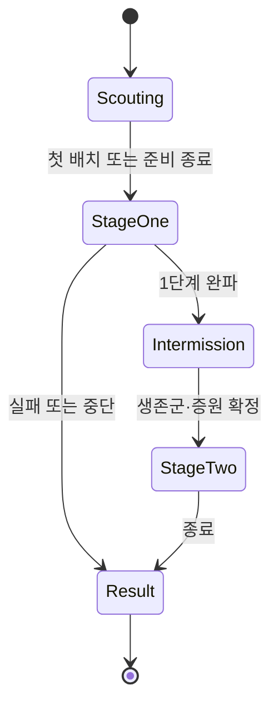

# 16. 장인 기지 시스템 역기획

> 기준일: 2026-11-13 KST. 현행 분석의 중심은 Builder Base 2.0의 비동기 공격·방어와 다단계 전투다. [확인] 외부 규칙, [해석] 설계 분석, [제안] 재구현 모델, [미확인] 검증 필요 항목.

## 1. 본마을과 다른 핵심 경험

장인 기지는 작은 병력 묶음과 직접 사용하는 유닛 능력을 통해 전투 중 판단 밀도를 높인다. 첫 구역을 이기는 것뿐 아니라 얼마나 좋은 상태의 생존 전력을 다음 구역으로 넘기는가가 중요하다. [해석]

| 차원 | 장인 기지의 역할 |
|---|---|
| 전투 | 적은 유닛 슬롯, 개별 능력, 2단계 생존 관리 |
| 경제 | 장인 골드와 장인 엘릭서의 별도 성장 경제 |
| 방어 | 공격 시 방어 상대 풀에 노출, 방어 성과로 엘릭서 획득 |
| 성장 연결 | B.O.B 등을 통해 본마을 장인 성장과 연결 |
| 학습 | 본마을과 다른 유닛 조작·배치 실험 |

2023년 개편 전의 ‘서로 맞붙어 결과를 비교하는 대전’과 ‘하루 3승 보너스’를 현행 규칙으로 사용하지 않는다. 공식 개편 설명은 별 보너스와 단계별 전투로의 전환을 명시한다. [확인] [공격·방어 개편](https://supercell.com/en/games/clashofclans/blog/news/attacking-and-defending-in-builder-base-2-0/)

## 2. 전투 규칙

| 항목 | 확인 규칙 | 근거 |
|---|---|---|
| 매칭 | 비슷한 장인 기지 트로피 | [Builder Battles](https://support.supercell.com/clash-of-clans/en/articles/builder-base-versus-battles-3-2.html) |
| 비동기 | 내가 공격한 계정이 내 기지를 공격하는 일대일 교환이 아님 | 같은 자료 |
| 준비 | 60초 정찰, 준비 중 유닛 유형 변경 가능 | 같은 자료 |
| 2단계 | 상대 장인회관 6 이상, 1단계 완파 후 진입 | 같은 자료 |
| 별 | 1단계 동별 최대 3개, 2단계 은별 최대 3개 | [2023년 개편](https://supercell.com/en/games/clashofclans/blog/news/attacking-and-defending-in-builder-base-2-0/) |
| 최대 결과 | 총 6별, 두 단계 합계 200% 파괴 | 같은 자료 |
| 금·엘릭서 | 공격에서 장인 골드, 방어에서 장인 엘릭서 | Builder Battles |
| 별 보너스 | 리그에 따라 필요 별 수가 달라지며 두 종류 별 모두 기여 | Builder Battles |

원작의 전투마다 정확한 공격·방어 매칭 예약 방식과 내부 대기열은 미공개다. 다음 절의 방어 기회 큐는 비동기 규칙을 만족시키는 구현 제안이다.

## 3. 다단계 상태 전이



### 단계 사이에 넘기는 것

[확인] 생존군은 치유소 레벨에 따른 회복을 받고, 영웅 능력은 충전 레벨 1로 초기화된다. 재사용 능력의 쿨다운은 초기화되지만 단발성 능력을 이미 썼다면 다시 받지 않는다. 증원 슬롯에서 추가 병력이 온다. [Builder Battles](https://support.supercell.com/clash-of-clans/en/articles/builder-base-versus-battles-3-2.html)

[제안] 체력과 능력 상태는 별도 필드로 유지한다.

```text
carryUnit.hp = min(carryUnit.maxHp, carryUnit.hp + healByHutLevel)
if ability.kind == Repeatable: ability.cooldown = Ready
if ability.kind == SingleUse: preserve ability.used
hero.chargeTier = 1
stageTwoArmy = livingStageOneUnits + configuredReinforcements
```

치유량 방식이 고정치인지 비율인지, 생존하지 않은 특정 소환체를 어떻게 처리하는지는 해당 버전의 실제 플레이로 확인해야 한다. 위 식은 회복 상한의 예시이며 원작 회복식을 확정한 것이 아니다. [미확인]

## 4. 유닛 슬롯과 능력 설계

[확인] 장인 기지 병력은 자동 효과·한 번 쓰는 능력·반복 능력으로 나뉘고, 일부 병력은 모드를 전환한다. 배틀 머신과 배틀콥터의 영웅 능력은 충전 단계를 가진다. 신규 병력은 모두 레벨 1부터 시작하지 않고 정해진 기본 레벨로 해제될 수 있다. [유닛·영웅](https://support.supercell.com/clash-of-clans/en/articles/builder-base-heroes-troops.html), [레벨 개편](https://supercell.com/en/games/clashofclans/blog/news/builder-base-2-0-layouts-troop-levels-and-bob/)

| 유형 | 플레이어 결정 | 구현 시 중요한 상태 [제안] |
|---|---|---|
| 배치 후 자동 효과 | 언제 첫 교전에 투입할 것인가 | spawnTime, remainingDuration |
| 단발 보호·폭발 | 지금 살릴 것인가, 2단계에 남길 것인가 | used, activationTick |
| 반복 능력 | 전투 흐름 중 사용 간격 | cooldown, charges |
| 공격 모드 전환 | 사거리·이동성·표적 밀도에 따른 선택 | mode, transitionLock |
| 영웅 단계 충전 | 즉시 생존과 고단계 효율의 교환 | chargeTier, progress |

[해석] 단발 능력의 소모 상태가 2단계에도 남으므로 단순한 ‘쿨다운이 끝나면 누른다’보다 자원 배분 문제가 강해진다. 반면 유닛 종류가 너무 많으면 아이콘 관리가 어려워지므로 전투 난도를 병력 수 증가만으로 올릴 수 없다.

### 예시 판단

1단계에서 탱커가 위험하지만 살아남을 수 있다면 단발 보호를 아껴 2단계의 집중 포화에 쓰는 것이 유리할 수 있다. 그러나 능력을 아끼다가 탱커가 죽으면 2단계 진입 전력 자체가 줄어든다. 이를 분석할 때 `남은 체력 가치 + 다음 단계 기대 기여 - 이번 단계 사망 위험`을 비교한다. 수치는 플레이 기록으로 추정하는 설계 모델이다. [해석·제안]

## 5. 공격·방어 경제

[제안] 공격 보상과 방어 보상을 하나의 승패 이벤트에 묶지 않는다.

```text
AttackCompleted → grant BuilderGold by attack result
DefenseCompleted → accrue BuilderElixir in ElixirCart
StarProgressAdded → evaluate daily StarBonus
```

공격 결과를 보고도 ‘나의 최종 승패’를 상대 결과가 나올 때까지 기다리지 않는 구조가 비동기의 핵심이다. 방어 엘릭서 수령은 방어 완료와 별개 UI 흐름이므로 공격 직후 방어 수입이 보이지 않아도 미지급 오류라고 단정하지 않게 한다. [해석]

| 지표 | 위험 신호 |
|---|---|
| 공격당 골드·분당 골드 | 너무 짧은 포기 공격이 최적 행동이 되는지 |
| 방어당 엘릭서 | 방어 개선의 경제적 보상이 보이는지 |
| 1단계→2단계 진입률 | 단순한 입구 장벽이 높은지 |
| 2단계 진입 후 추가 별 분포 | 생존군 보존 전략이 의미 있는지 |
| 일일 별 보너스 완료 시간 | 리그별 요구량 증가가 부담을 과도하게 높이는지 |
| 공격·방어 결과 도착 지연 | 보상 오해·공정성 불신이 생기는지 |

리그별로 별 보너스 요구량이 7~12별이라는 공개 범위가 있다. 운영 데이터는 리그별 보상과 목표를 테이블로 관리하며, 현재 리그를 올렸을 때 추가 보상이 실제 플레이 시간 증가를 보상하는지 측정한다. [확인·해석, Builder Battles]

## 6. 건설·본마을 연계

[확인] 장인회관 6에서 O.T.T.O가 장인 기지 건설을 돕고, 장인회관 9에서 B.O.B 관련 과제를 통해 본마을의 추가 장인을 해제할 수 있다. 과제는 본마을 건물 3개 개조, 장인 기지 병력 하나 레벨 18, 방어 하나 레벨 9, 장인 기지 영웅 합계 45레벨이다. 현재 Support에는 B.O.T.O의 장인 기지 지원도 추가되어 있다. [장인 이동 안내](https://support.supercell.com/clash-of-clans/en/articles/builder-base-getting-master-builder-to-home-village-3.html)

[미확인] B.O.T.O의 ‘본마을 모든 장인의 집 완료’라는 문장은 정확한 구매·레벨·젬 조건까지 설명하지 않는다. 따라서 본 문서는 최대 장인 수를 과거의 2명으로 고정하지 않으며, B.O.T.O의 세부 해제 조건은 라이브 UI 확인 대상으로 둔다.

[해석] 본마을의 영구 생산 능력과 연결된 보상은 장인 기지를 플레이할 강한 외적 이유가 된다. 다만 B.O.B 획득 후 플레이가 급감한다면 모드 자체의 재미보다 장인 획득 작업으로 인식되는 것이다. B.O.B 전후의 전투·배치 편집·복귀율을 비교해야 한다.

## 7. 데이터 구조와 QA

| 구조 [제안] | 핵심 필드 |
|---|---|
| `BuilderBaseAccount` | builderHallLevel, wallets, unitLevels, builders |
| `BuilderBattleSnapshot` | twoStageLayouts, defenseLevels, ruleset |
| `StageCarryState` | unitInstances, hp, usedAbilities, heroCharge |
| `BuilderMatchLedger` | attackId, result, stars, goldReceipt |
| `BuilderDefenseLedger` | defenseId, result, elixirEntitlement |
| `BuilderStarBonus` | cycleId, requiredStars, progress, claimed |
| `CrossVillageUnlock` | taskDefinitions, progress, grantedBuilderId |

| ID | 상황 | 기대 결과 [제안] |
|---|---|---|
| BB-01 | 1단계 99%로 시간 종료 | 2단계 진입 불가 |
| BB-02 | 1단계 완파와 마지막 유닛 사망이 같은 시점 | 정해진 이벤트 순서로 전이·증원 여부 일관 |
| BB-03 | 단발 능력 소모 후 2단계 이동 | 단발 상태 유지 |
| BB-04 | 반복 능력이 쿨다운 중 2단계 이동 | 정책에 맞게 준비 상태로 초기화 |
| BB-05 | 공격 결과보다 방어 결과가 늦게 도착 | 각 보상 정확히 한 번 지급 |
| BB-06 | 동별 3개·은별 2개 획득 | 보너스에 5별 누적 |
| BB-07 | 증원 선택 직전 연결 끊김 | 확정 군대 상태 재접속 복구 |
| BB-08 | B.O.B 과제 완료 알림 재전송 | 추가 장인 중복 해제 금지 |
| BB-09 | 리그 변경과 별 보너스 완료 동시 발생 | 스냅샷된 보상 정책으로 일관 정산 |

연계: [마을 건설](02_village_builders_and_construction.md), [자원 경제](04_resources_loot_and_economy.md), [전투 판정](06_battle_rules_and_resolution.md), [AI](07_unit_ai_and_pathfinding.md).

### 근거 목록

- [Builder Battles](https://support.supercell.com/clash-of-clans/en/articles/builder-base-versus-battles-3-2.html), [Builder Base Heroes & Troops](https://support.supercell.com/clash-of-clans/en/articles/builder-base-heroes-troops.html), [Builder Base Leagues](https://support.supercell.com/clash-of-clans/en/articles/builder-base-leagues.html), 열람 2026-11-13.
- [Attacking and Defending in Builder Base 2.0!](https://supercell.com/en/games/clashofclans/blog/news/attacking-and-defending-in-builder-base-2-0/), 2023-05-13.
- [Layouts, Troop Levels and B.O.B!](https://supercell.com/en/games/clashofclans/blog/news/builder-base-2-0-layouts-troop-levels-and-bob/), 2023-05-03.
- [Sending Builders to Home Village](https://support.supercell.com/clash-of-clans/en/articles/builder-base-getting-master-builder-to-home-village-3.html), 열람 2026-11-13.
