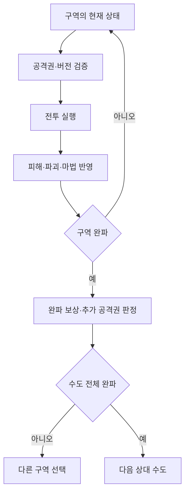

# 17. 클랜 수도·습격전 주말 시스템 역기획

> 기준일: 2026-11-13 KST. [확인] 공개 규칙, [해석] 설계 분석, [제안] 재구현 모델, [미확인] 추가 확인 사항. 클랜 수도는 개인 마을의 복제물이 아니라 공동 성장·누적 전투 상태를 갖는 별도 모드다.

## 1. 시스템의 핵심

클랜 수도는 ‘내가 완파하지 못한 공격도 다음 팀원에게 남는다’는 구조로 협력의 의미를 바꾼다. 일반 클랜전에서는 매 공격마다 온전한 기지를 다시 상대하지만, 수도에서는 파괴·피해·사용한 마법의 일부 상태를 다음 공격이 이어받는다. 팀 기여는 완파 횟수뿐 아니라 중요한 방어 제거, 진입 경로 개방, 다음 공격을 위한 지속 마법 배치로 발생한다. [확인·해석]

[확인] 수도 참여는 TH6 이상이며 클랜 XP 레벨 2 이상이 필요하다. 개인의 병력 레벨 대신 클랜이 수도에서 해제·성장시킨 병력과 마법을 이용한다. [수도 소개](https://sc-clashofclans.zendesk.com/hc/en-us/articles/49529136842779-What-Is-the-Clan-Capital), [Raid Weekends](https://sc-clashofclans.zendesk.com/hc/en-us/articles/49529095020443-Raid-Weekends)

## 2. 공동 건설과 권한

| 항목 | 공개 규칙 | 설계 의미 |
|---|---|---|
| 성장 재화 | 캐피탈 골드를 건물·폐허에 기부 | 개인 보유 재화가 공동 자산으로 전환 |
| 완료 | 필요한 기부가 채워지면 건물 즉시 레벨업 | 건설 완료까지 여러 기여자 참여 |
| 해제 | 구역회관·캐피탈회관 성장에 따라 폐허·구역 확장 | 단계적 콘텐츠 노출 |
| 우선 목표 | 대표·공동 대표가 구역별 최대 3개 표시 | 지시와 자율 기부의 절충 |
| 배치 | 대표·공동 대표가 편집 | 공동 자산에 대한 관리 권한 |
| 개인 소유 | 개인 집 장식과 기여 명성은 소속 이동 후 유지 | 공동 자산과 개인 이력 분리 |

[확인] [Building the Capital](https://sc-clashofclans.zendesk.com/hc/en-us/articles/49529090979227-Building-the-Capital).

[제안] 건설 상태는 `Ruins → Fundable → Funding → Complete`로 모델링한다. 건물의 레벨은 캐피탈 골드 기부액이 합계 목표를 넘는 원자적 순간에 한 번만 바꾼다. 두 명이 동시에 마지막 금액을 기부하면 남은 필요량만 수락하고 초과분 반환 또는 다음 단계 처리 여부를 정책으로 명시한다. 원작의 초과 처리 세부값은 미확인이므로 자의적으로 소각하지 않는다.

## 3. 습격전 주말의 참가·공격권

| 항목 | 확인 규칙 | 근거 |
|---|---|---|
| 참전 개시 | 대표·공동 대표·장로가 클랜 참가 처리 가능 | [Raid Weekends](https://sc-clashofclans.zendesk.com/hc/en-us/articles/49529095020443-Raid-Weekends) |
| 개인 참가 확정 | 첫 공격으로 참가 슬롯 사용 | 같은 자료 |
| 정원 | 주말당 최대 50명의 참가자 | 같은 자료 |
| 공격권 | 주말 전체에 기본 5회, 구역 마지막 건물을 파괴한 플레이어는 추가 1회 가능 | [FAQ](https://support.supercell.com/clash-of-clans/en/articles/frequently-asked-questions.html) |
| 클랜 이동 | 한 번 공격하면 해당 주말 다른 클랜에서 공격 불가 | 같은 자료 |
| 상대 관계 | 공격한 클랜과 나를 공격하는 클랜이 같을 필요 없음 | Raid Weekends |
| 후속 수도 | 적 수도의 모든 구역을 파괴하면 다른 수도에 도전 | [수도 소개](https://sc-clashofclans.zendesk.com/hc/en-us/articles/49529136842779-What-Is-the-Clan-Capital) |

‘5회’는 개인 공격 횟수다. 상대 클랜 수를 5개로 제한한다는 의미가 아니다. 추가 공격은 구역마다 계속 획득하는 무제한 자원이 아니라 개인의 주말 보너스 한도에 묶인다. [확인, FAQ]

공개 클랜에는 주말 시작 후 가입한 일반 멤버의 참여를 제한하는 규칙도 있다. 기존 50인 슬롯 규칙만 구현하면 늦게 들어온 계정의 참가 판정이 달라질 수 있으므로 `joinedAt`, `roleAtEnrollment`, `clanJoinPolicy`를 보관한다. [확인·제안, Raid Weekends]

## 4. 누적 전투 상태



[확인] 공격에서 준 피해는 다음 공격에 남는다. 배치한 마법은 현재 공격과 다음 공격까지 유지되는 규칙이 있다. [Raid Weekends](https://sc-clashofclans.zendesk.com/hc/en-us/articles/49529095020443-Raid-Weekends)

[제안] 영속 구역 상태와 전투 내 임시 개체를 분리한다.

| 상태 | 다음 공격에 넘길 데이터 후보 | 주의점 |
|---|---|---|
| 건물 | 파괴 여부, 남은 체력, 모드 | 체력·파괴 정보의 일관성 |
| 마법 | 종류, 위치, 잔여 공격 수 | 실제 시전한 공격도 수명에 포함 |
| 배치 영역 | 파괴 결과에 따른 유효 영역 | 렌더링 표시와 서버 검증 동일화 |
| 정보 공개 | 발견된 방어 정보 | 숨겨진 정보 노출 범위 확인 |
| 공격 유닛 | 원칙적으로 해당 전투 인스턴스 | 생존군을 다음 공격 병력으로 잘못 영속화 금지 |

마법마다 효과 영역·대상·지형 변경을 같은 틀로 다루되, ‘두 공격 유지’와 전투 안의 틱별 지속시간을 혼동하지 않는다. 함정의 소모 상태·소환물·특수 방어의 내부 충전이 공격 사이에 어떻게 유지되는지는 별도 실측 항목이다. [제안·미확인]

### 동시 공격과 충돌

[제안] 같은 구역을 동시에 서로 다른 이전 상태에서 공격하면 두 결과를 단순 합칠 수 없다. 원작 내부 방식은 공개되지 않았지만 재구현에서는 `DistrictRevision`과 단일 실행권을 사용해 시작 시점을 직렬화하는 방법이 안전하다. 사용자는 공격 중인 구역의 잠금 이유와 예상 해제 시간을 볼 수 있어야 한다. 연결 끊김으로 잠금을 영구 유지하지 않도록 전투 수명·회수 정책을 정한다.

## 5. 지형·진입 공간·전술

[확인] 수도에는 물·바위·언덕 등 지형이 있고, 건물을 파괴할수록 병력 배치 영역이 확대된다. Frost와 Jump 계열 효과는 물·장벽을 통과하는 경로를 만들 수 있다. [Defending the Capital](https://support.supercell.com/clash-of-clans/en/articles/defending-the-capital-2.html)

[해석] 입구의 건물을 제거하는 공격은 남은 방어에 직접 준 피해보다 큰 후속 가치를 가질 수 있다. 배치 범위가 넓어지면 다음 공격자는 우회로에서 핵심 방어에 접근할 수 있기 때문이다. 다음과 같은 단계별 역할이 성립한다.

| 역할 | 주요 목적 | 기여 평가 후보 [제안] |
|---|---|---|
| 개척 | 초반 배치 제약 해소 | 새 배치 가능 면적, 핵심 경로 도달 가능성 |
| 방어 해체 | 큰 광역·장거리 방어 제거 | 예상 후속 생존시간 증가 |
| 지원 | 다음 공격을 위한 마법 배치 | 이어진 공격의 마법 활용률 |
| 마무리 | 적은 공격권으로 완파 | 남은 건물당 소모 공격권, 생존 인구 |

별·골드만으로 기여를 평가하면 마무리 공격 선호가 강해질 수 있다. 설계 분석에서는 전투 시작 상태를 포함해야 한다. 95%가 이미 파괴된 구역을 마무리한 기록과 온전한 구역을 80% 파괴한 기록을 그대로 비교하지 않는다. [해석]

## 6. 보상 경제와 제작소

**[확인]** 수도 보상은 캐피탈 골드, 습격전 메달, 수도 트로피, 명성으로 나뉜다. 파괴한 건물로 골드를 얻고, 완파 시 생존한 배치·미배치 병력의 인구 공간에 따른 추가 골드가 있다. 미사용 마법은 이 보너스에 포함되지 않는다. 주말 메달은 참가자에게 동일한 양으로 지급되며 탈퇴한 참가자의 권리도 유지된다. [Rewards](https://support.supercell.com/clash-of-clans/en/articles/rewards-2.html)

[확인] 제작소는 본마을·장인 기지 자원을 캐피탈 골드로 바꾸며 일부 슬롯은 장인을 점유한다. 무료 생성 슬롯과 자원 변환 슬롯을 분리해야 한다. [The Forge](https://support.supercell.com/clash-of-clans/en/articles/the-forge.html)

[해석] 수도 투자에는 장인 점유와 개인 성장 지연이라는 기회비용이 생긴다. 개인 성장의 막바지 계정이 팀 자산에 기여할 통로를 제공하지만, 성장 중인 계정에게 과도한 기부를 강요하는 조직 압박도 생길 수 있다.

[제안] 보상 계산을 다음처럼 분리한다.

```text
personalCapitalGold = buildingLoot + eligibleClearBonus
clanOffenseMedals = f(destroyedDistricts, completeCapitals, attackEfficiency)
clanDefenseMedals = g(defensePerformance, eligibility)
participantRaidMedals = configuredEqualShare(clanOffenseMedals, clanDefenseMedals)
```

`f`, `g`, 분배 함수의 정확한 내부 상수는 미확인이다. 공평한 동일 지급이라는 공개 결과만으로 단순히 총메달을 참가 인원수로 나누는 구현이라고 단정해서는 안 된다.

## 7. 데이터와 핵심 불변 조건

| 구조 [제안] | 핵심 필드 |
|---|---|
| `CapitalClanState` | districtUnlocks, buildingLevels, contributionTotals |
| `CapitalContribution` | playerId, buildingId, acceptedAmount, receipt |
| `RaidWeekendEnrollment` | eventId, clanId, participantIds |
| `PlayerRaidBudget` | used, bonusGranted, enrolledClanId |
| `DistrictPersistentState` | revision, buildingHp, destroyed, spellResidues |
| `DistrictAttackLease` | attackId, owner, revision, expiresAt |
| `CapitalRewardEntitlement` | playerId, eventId, gold, medals, claimed |

불변 조건은 개인 주말 공격 한도 준수, 기여금 이중 차감 금지, 구역 상태 버전의 단조 증가, 동일 파괴 보상의 이중 지급 금지, 탈퇴에 따른 이미 확정된 보상 삭제 금지다. 이것이 지켜져야 공동 전투가 다른 사람의 행동을 신뢰할 수 있는 시스템이 된다. [제안]

## 8. QA와 운영 지표

| ID | 상황 | 기대 결과 [제안] |
|---|---|---|
| CAP-01 | 동시에 동일 구역 공격 시작 | 한 개 상태 버전에서 한 전투만 승인 |
| CAP-02 | 마법 사용 후 다음 두 공격 진행 | 명세의 공격 횟수 경계에서 제거 |
| CAP-03 | 기본 5회 사용 후 최초 구역 완파 조건 | 보너스 1회만 추가, 중복 부여 금지 |
| CAP-04 | 다음 구역도 완파 | 주말 보너스 한도 유지 |
| CAP-05 | 전투 후 다른 클랜으로 이동 | 같은 주말 다른 클랜 공격 거절 |
| CAP-06 | 50번째와 51번째 참가 동시 도착 | 하나만 신규 슬롯 확보 |
| CAP-07 | 습격 도중 방어 배치 변경 | 현재 상대에는 고정, 다음 매칭 정책에 반영 |
| CAP-08 | 기여 목표 잔여 100에 두 명이 100씩 기부 | 수락 금액·반환을 원자적으로 처리 |
| CAP-09 | 탈퇴 후 주말 종료 | 이전 참가의 보상 영수증 정상 제공 |

[제안] 구역당 평균 소모 공격권, 첫 공격 기여율, 마무리만 선택하는 비중, 역할별 자원 수입, 참가 슬롯 점유 후 미사용 공격률, 공동 성장 완료 후 참여 변화를 본다. 메달 총액만 높여도 공격 횟수 낭비와 팀 내 역할 갈등은 해결되지 않는다.

연계: [클랜·지원](13_clans_social_and_donations.md), [자원 경제](04_resources_loot_and_economy.md), [장인 기지](16_builder_base.md), [데이터 구조](24_data_architecture_and_network.md).

### 근거 목록

- [What Is the Clan Capital?](https://sc-clashofclans.zendesk.com/hc/en-us/articles/49529136842779-What-Is-the-Clan-Capital), [Building the Capital](https://sc-clashofclans.zendesk.com/hc/en-us/articles/49529090979227-Building-the-Capital).
- [Raid Weekends](https://sc-clashofclans.zendesk.com/hc/en-us/articles/49529095020443-Raid-Weekends), [Frequently Asked Questions](https://support.supercell.com/clash-of-clans/en/articles/frequently-asked-questions.html).
- [Defending the Capital](https://support.supercell.com/clash-of-clans/en/articles/defending-the-capital-2.html), [Rewards](https://support.supercell.com/clash-of-clans/en/articles/rewards-2.html), [The Forge](https://support.supercell.com/clash-of-clans/en/articles/the-forge.html). 모두 열람 2026-11-13.
