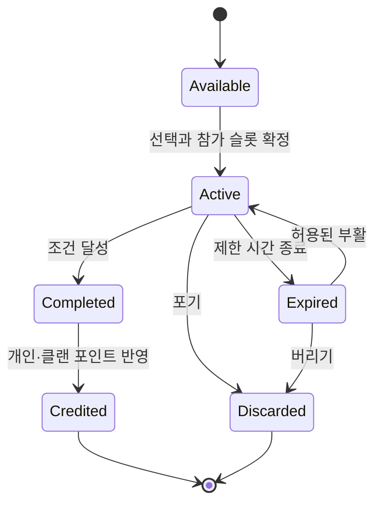

# 18. 클랜게임 시스템 역기획

> 기준일: 2026-11-13 KST. [확인] 공식 규칙, [해석] 설계 분석, [제안] 재구현 모델, [미확인] 검증할 시즌 조건. 개인 포인트 상한, 추가 보상 기준, 클랜 목표는 서로 다른 변수다.

## 1. 목표와 플레이 루프

클랜게임은 여러 플레이어가 각자 가능한 과제를 골라 공동 보상 단계를 여는 이벤트다. 동시에 접속하거나 같은 적을 공격할 필요가 없으므로 클랜전보다 낮은 시간 조율 비용으로 공동 성취를 만든다. 본마을과 장인 기지 등 여러 시스템의 행동을 하나의 이벤트 진행으로 연결한다. [해석]

`과제 선택 → 기존 플레이에서 조건 달성 → 개인 포인트 획득 → 클랜 총점 증가 → 공동 단계 해제 → 종료 후 보상 선택`이 핵심 루프다. 과제 완료와 실제 보상 선택을 다른 시점에 배치하기 때문에 종료 후 재방문을 유도한다. [해석]

## 2. 참여 자격과 소속 잠금

| 항목 | 공개 규칙 | 근거 |
|---|---|---|
| 참여 TH | TH6 이상 | [About Clan Games](https://support.supercell.com/clash-of-clans/en/articles/clan-games.html) |
| 클랜 정원 | 이벤트 참가 슬롯 50개 | 같은 자료 |
| 참가 잠금 | 첫 과제 선택으로 현재 클랜 이벤트에 등록 | 같은 자료 |
| 탈퇴·추방 | 기존 포인트와 자격 유지; 다른 클랜 이벤트로 갈아타기 불가 | 같은 자료 |
| 기본 보상 자격 | 과제 최소 하나 완료 필요 | [Rewards](https://sc-clashofclans.zendesk.com/hc/en-us/articles/49529078545691-Clan-Games-Rewards) |
| 공동 진행 | 완료 과제 포인트를 합산해 보상 단계 해제 | [Challenges and Points](https://sc-clashofclans.zendesk.com/hc/en-us/articles/49529033821723-Clan-Games-Challenges-and-Points) |

‘등록’과 ‘보상 자격 획득’을 구분한다. 과제를 시작하고 완료하지 못한 플레이어도 슬롯을 차지할 수 있지만 보상 자격은 별도다. UI가 가입 상태 하나만 표시하면 왜 참가했는데 보상이 없는지 설명하지 못한다. [해석]

## 3. 포인트 상한과 시즌 차이

공식 2025년 12월 공지는 그 시즌의 개인 상한을 4,000에서 10,000으로 올리고, 추가 보상을 위한 기준은 4,000으로 유지한다고 밝혔다. 따라서 과거의 ‘최대 포인트=추가 보상 포인트’ 가정을 일반화하면 안 된다. [확인] [A Frost Age Has Come](https://supercell.com/en/games/clashofclans/blog/news/a-frost-age-has-come/)

| 변수 [제안] | 의미 | 별도여야 하는 이유 |
|---|---|---|
| `personalContributionCap` | 클랜 총점에 기여 가능한 개인 최대 | 소규모 활성 클랜의 달성 가능성 조정 |
| `extraRewardThreshold` | 개인 추가 선택권을 얻는 점수 | 개인 목표를 과도하게 늘리지 않음 |
| `tierThresholds` | 클랜 보상 단계별 필요 총점 | 공동 규모·활동 설계 |
| `challengeRewardPoints` | 과제 완료당 점수 | 과제 난도와 소요 시간 |
| `claimDeadline` | 획득한 보상을 선택할 마지막 시각 | 종료 후 수령 창 관리 |

**[미확인]** 10,000 상한이 영구 규칙이라고 발표된 근거는 이번 조사에서 확보하지 못했다. 따라서 2026년 11월의 정확한 포인트 상한·보상표는 해당 회차 UI를 확인해야 한다. 오래된 Support의 ‘최대치 달성 시 추가 보상’ 문장은 최신 시즌의 두 기준 분리를 표현하지 못하므로 시즌 공지를 우선한다.

### 활성 인원 수 계산 예시

[제안] 목표 총점 `T`와 개인 상한 `C`일 때 이론상 최소 완주 인원은 `ceil(T / C)`다. **가상 예시**로 `T=50,000`이면 `C=4,000`일 때 13명, `C=10,000`일 때 5명이다. 이는 실제 이번 회차 보상표를 주장하는 수치가 아니라 상한 변경이 소규모 클랜에 미치는 영향을 보여주는 계산이다.

## 4. 과제 정의와 이벤트 집계

공식 과제 안내는 본마을·장인 기지·클랜전 등 특정 모드에서만 완료 가능한 과제가 있고, 제한 시간에 실패한 과제는 젬으로 되살리거나 버릴 수 있다고 설명한다. [확인] [Challenges and Points](https://sc-clashofclans.zendesk.com/hc/en-us/articles/49529033821723-Clan-Games-Challenges-and-Points)

[제안] 과제를 자연어 문장만으로 저장하지 않는다.

| 필드 | 예시 의미 | 잘못 구현하면 생기는 문제 |
|---|---|---|
| `modeFilter` | 본마을 일반 전투·장인 기지 등 | 친선·연습에서 무제한 점수 발생 |
| `eventType` | 별 획득·건물 파괴·자원 획득 | 배치만 했는데 파괴 과제 완료 |
| `targetFilter` | 특정 건물·유닛·자원 | 비슷한 이름의 다른 엔티티 오인 |
| `quantityRule` | 누적 수량·한 전투 달성 | 여러 실패 공격을 합쳐 단판 목표 완료 |
| `timeWindow` | 시작부터 만료까지 | 과제 시작 전 행동 소급 반영 |
| `progressCap` | 목표 진행량 | 중복 이벤트로 무한 점수 |
| `rewardPoints` | 과제 종료 시 일회 지급 | 진행 중 매번 총 보상 지급 |

예를 들어 ‘특정 유닛을 포함해 승리’는 단순히 편성 화면에 있는지, 실제 배치했는지, 일정 수량 이상 사용했는지 조건이 다를 수 있다. 이러한 문구 차이는 서버의 조건과 UI 설명을 같은 데이터에서 생성해야 한다. [제안]

## 5. 과제 상태와 점수 원장



[제안] 과제 완료 트랜잭션은 개인 포인트, 클랜 포인트, 보상 선택권의 상태를 일관되게 바꾼다.

```text
CompleteChallenge(eventId, playerId, challengeId):
  verify active challenge and accepted gameplay events
  if completionReceipt exists: return same receipt
  acceptedPoints = applyPersonalCap(rawPoints, currentPoints, capPolicy)
  update player total and clan total
  unlock tiers by thresholds
  set extraRewardEligible when threshold reached
  persist completionReceipt
```

개인 상한 직전에 큰 과제를 완료했을 때 넘친 포인트가 프로필 누적 통계에 반영되는지, 클랜 총점에 얼마가 들어가는지는 개별 정책으로 검증한다. 모든 통계를 하나의 숫자로 갱신하면 현재 이벤트 상한과 평생 업적을 혼동하게 된다. [제안·미확인]

## 6. 과제 선택의 경제와 UX

[해석] 과제의 효율은 `포인트 / 소요 시간`만이 아니다. 자신의 정상 성장 루프와 얼마나 겹치는지도 중요하다. 이미 필요한 자원 파밍을 하면서 끝나는 과제는 별도 시간 비용이 낮다. 반대로 특정 유닛 때문에 덱을 바꾸거나 높은 레벨의 적 건물을 찾아야 하는 과제는 숨은 준비 비용이 크다.

[제안] 과제 분석은 다음과 같이 분해한다.

```text
effectiveEffort = setupTime + expectedBattleTime + searchTime + failureRetryTime
personalValue = rewardPoints + overlapBenefit - opportunityCost
```

최적 과제 하나만 반복하는 현상이 생기면 점수를 무조건 낮추기보다 해당 과제의 모드, 정찰 비용, 실패 확률을 확인한다. 도전 다양성은 선택 폭과 실제 선택 분포로 측정한다.

| UI 위치 | 필요한 정보 |
|---|---|
| 과제 카드 | 모드, 조건, 점수, 제한 시간 |
| 시작 확인 | 현재 클랜에 참가가 고정됨, 남은 개인 상한 |
| 진행 화면 | 완료 수량과 아직 인정되지 않은 전투 상태 |
| 총점 화면 | 공동 다음 단계와 개인 추가 보상 기준을 별도 표시 |
| 수령 화면 | 단계별 선택, 추가 선택권, 저장 공간, 만료 시각 |

## 7. 보상 선택과 재화 처리

[확인] 이벤트가 끝나면 해제한 각 단계에서 보상을 선택한다. 자원 보상량은 금고 용량에 영향을 받고 마법 아이템 수량은 같은 조건으로 제공된다. 자원은 금고, 아이템은 해당 인벤토리에 들어간다. 공간이 없는 마법 아이템은 판매가에 해당하는 젬을 선택할 수 있으며, 미수령 보상은 종료 후 7일이 지나면 사라진다. [Rewards](https://sc-clashofclans.zendesk.com/hc/en-us/articles/49529078545691-Clan-Games-Rewards)

[제안] 선택 확정은 `ChoiceReceipt(eventId, tierId, optionId)`로 기록하고, 기본 선택권과 추가 선택권의 소비를 분리한다. 다른 기기에서 같은 단계를 중복 선택해 보상을 두 번 얻지 못하도록 한다. 창을 닫았다는 이유로 선택이 취소되는지, 이미 확정됐는지 즉시 복구 가능해야 한다.

## 8. QA·측정 지표

| ID | 상황 | 기대 결과 [제안] |
|---|---|---|
| CG-01 | 과제만 시작하고 미완료 | 참가 슬롯은 사용, 완료 보상 자격은 미획득 |
| CG-02 | 타 클랜으로 옮겨 과제 시작 | 해당 이벤트 기존 소속 잠금 적용 |
| CG-03 | 포인트 4,000·개인 상한 10,000 회차 | 추가 보상 자격과 남은 기여량을 구분 |
| CG-04 | 과제 만료 직전 시작한 전투 | 정의한 시간 판정으로 일관 처리 |
| CG-05 | 결과 이벤트 두 번 도착 | 포인트 1회만 반영 |
| CG-06 | 다른 모드의 동일한 건물 파괴 | modeFilter에 따라 인정 여부 결정 |
| CG-07 | 금고·아이템 공간 부족 | 수령 가능량과 대안을 명확히 표시 |
| CG-08 | 수령 마감 직전 동시 요청 | 서버 시간으로 한 번만 승인 |
| CG-09 | 클랜이 해산 | 공개 규칙에 맞는 권리 처리와 사전 안내 검증 |

[제안] 참여자 수보다 ‘등록→첫 과제 완료 전환’, 개인 추가 보상 달성률, 활성 클랜 규모별 최종 단계 도달률, 과제별 실제 분당 포인트, 완료 후 보상 미수령률을 본다. 상위 소수의 기여 집중이 커지면 총점은 잘 나오더라도 공동 성취 체감은 낮을 수 있다.

연계: [클랜](13_clans_social_and_donations.md), [장인 기지](16_builder_base.md), [시즌 과제](20_quests_achievements_and_pass.md), [마법 아이템](21_monetization_and_magic_items.md), [라이브 운영](23_liveops_and_balance.md).

### 근거 목록

- [About Clan Games](https://support.supercell.com/clash-of-clans/en/articles/clan-games.html), 열람 2026-11-13.
- [Clan Games Challenges and Points](https://sc-clashofclans.zendesk.com/hc/en-us/articles/49529033821723-Clan-Games-Challenges-and-Points), 열람 2026-11-13.
- [Clan Games Rewards](https://sc-clashofclans.zendesk.com/hc/en-us/articles/49529078545691-Clan-Games-Rewards), 열람 2026-11-13. 추가 보상 문구는 시즌 공지와 교차 확인 필요.
- [A Frost Age Has Come](https://supercell.com/en/games/clashofclans/blog/news/a-frost-age-has-come/), 2025-12-01. 해당 시즌 상한·추가 보상 기준의 변경 근거.
