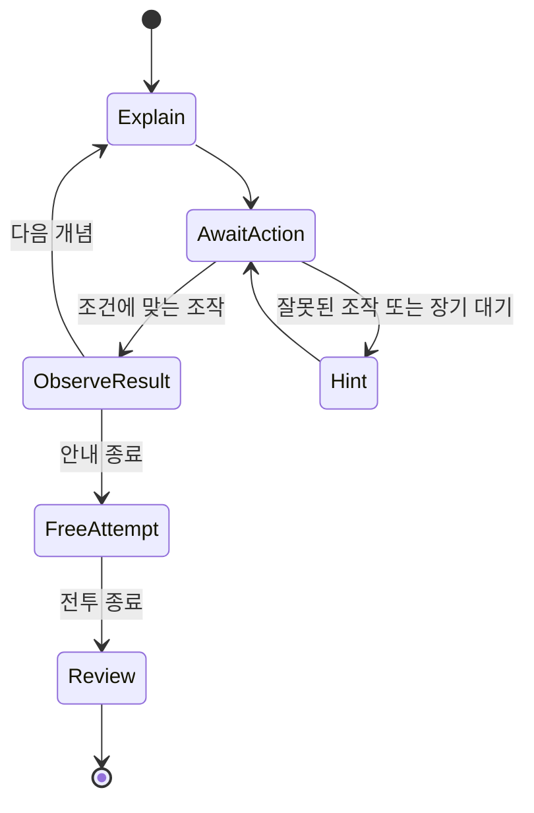

# 19. 싱글플레이·연습·도전·친선전 시스템 역기획

> 기준일: 2026-11-13 KST. [확인] 공개 동작, [해석] 설계 목적, [제안] 재구현 모델, [미확인] 추가 검증 사항. 이 문서는 학습·실험 모드를 다루며 시즌 포인트 과제 자체는 20번 문서에서 설명한다.

## 1. 네 가지 경험의 구분

| 유형 | 주된 목적 | 콘텐츠 작성자 | 핵심 상태 |
|---|---|---|---|
| 싱글플레이 고블린 지도 | 전투 학습·순차 공략·일회 성장 보상 | 개발팀 | 레벨 해제·최고 별·보상 잔여량 |
| 연습 모드 | 특정 조합과 운용법을 단계적으로 학습 | 개발팀 | 튜토리얼 진행·전략별 완료 |
| 기간 한정 도전 | 새로운 조합·특수 배치 체험과 이벤트 참여 | 개발팀·협업 콘텐츠 | 이벤트 기간·조건·보상 수령 |
| 친선 도전·친선전 | 자신의 조합·배치를 경쟁 손실 없이 시험 | 플레이어·클랜 | 배치 스냅샷·난이도·전투 기록 |

이 구분은 시스템 책임을 정리한 분석이다. 실제 게임의 메뉴명과 UI 배치는 업데이트에 따라 달라질 수 있다. [해석]

공식 앱 설명은 싱글플레이, 연습, 친선 도전과 특별 이벤트를 별도로 소개한다. [확인] [Supercell의 Google Play 설명](https://play.google.com/store/apps/details?id=com.supercell.clashofclans)

## 2. 싱글플레이의 공개 규칙

현재 공식 안내는 90개의 고블린 마을을 설명한다. 1별 이상 승리하면 다음 레벨로 진행할 수 있으며, 제한시간 없이 반복 도전해 3별을 노릴 수 있다. 트로피와 보호막에 영향을 주지 않는다는 점도 명시한다. [확인] [Single Player Attacks](https://sc-clashofclans.zendesk.com/hc/en-us/articles/49529122807323-Single-Player-Attacks)

[해석] 제한시간을 제거하면 전투 순서와 사거리 같은 개념을 배우는 동안 시간 압박이 낮아진다. 반면 실전 시간 관리까지 자동으로 배우게 되지는 않는다. 학습 모드에서 얻은 성공을 실제 PvP의 성공과 동일하게 취급해서는 안 된다.

[제안] 레벨의 메타 진행과 전투 인스턴스 상태를 분리한다.

```text
CampaignProgress[levelId] = {
  unlocked,
  bestStars,
  bestDestruction,
  rewardLedger,
  tutorialHintsSeen
}
```

보상 재획득을 막기 위해 `최고 별 갱신`과 `이미 얻은 자원`을 다른 필드로 보관한다. 재도전으로 별이 늘더라도 이미 받은 일회성 보상을 통째로 반복 지급하지 않는다. 정확한 레벨별 약탈 잔량·초회 보상 구분은 라이브 레벨 데이터 검증이 필요하다. [제안·미확인]

## 3. 연습 모드의 학습 구조

공식 과거 패치는 연습 모드가 특정 TH 수준에 맞춰 열리고, 제공된 연습 군대가 개인의 최근 군대 기록으로 잘못 반영되던 문제 등을 수정했다. 이는 연습 전투의 편성과 영구 계정 상태를 분리해야 함을 보여준다. [확인·해석] [2019년 연습 모드 수정](https://supercell.com/en/games/clashofclans/blog/news/june-update-bugs-fixes/), [2021년 패치](https://supercell.com/en/games/clashofclans/blog/release-notes/full-patch-notes-th14-update/)

다음은 원작의 전체 연습 레벨을 복사한 것이 아니라, 같은 전투를 가르치는 **커리큘럼 재구성 제안**이다.

| 학습 단계 | 성공해야 하는 판단 | 확인할 행동 |
|---|---|---|
| 배치 | 병력이 진입할 방향과 경로 예상 | 지정 구역 밖 잘못된 투입 감소 |
| 길 정리 | 바깥 건물 제거로 주력의 이동 유도 | 핵심 부대가 중앙으로 들어감 |
| 탱킹 | 방어 공격이 어떤 병력에 집중되는지 이해 | 후열이 먼저 맞지 않음 |
| 돌파 | 벽·지형·방어 우선순위 처리 | 진입 소모가 줄어듦 |
| 지원 | 마법과 영웅 능력의 효과 시간 활용 | 효과가 필요한 병력·시점에 작동 |
| 마무리 | 잔여 병력과 건물 분산 고려 | 고립 건물 때문에 실패하지 않음 |

[제안] 튜토리얼은 ‘아무 곳이나 누를 수 없는 강제 따라하기’와 ‘목표만 제시하는 자유 실행’을 단계적으로 섞는다. 처음에는 핵심 효과를 보여주고, 이후에는 힌트 없이 같은 원리를 다른 배치에 적용하게 해야 실제 전이 학습을 확인할 수 있다.

### 학습 상태 기계



[제안] 튜토리얼 조건은 단일 좌표 클릭만 요구하지 않고 의미 기반 이벤트를 사용할 수 있다. 예를 들어 `핵심 탱커가 배치됨`, `지정 방어가 타깃을 잡음`, `주력 병력이 진입 구역에 도착함`이다. 단, 밸런스 패치로 병력 속도나 사거리가 변하면 스크립트가 영원히 기다리지 않도록 타임아웃·건너뛰기·대체 힌트를 둔다.

## 4. 기간 한정 도전의 콘텐츠 구조

[확인] 2026년 11월 공식 캘린더에는 ‘Last Town Hall 18 Challenge’와 이후 ‘Fully Forged Challenge’가 따로 발표되어 있다. 이는 독립 전투 콘텐츠가 시즌 캘린더의 구성 요소임을 보여준다. 예고된 도전은 기준일에 이미 플레이 가능한 규칙으로 혼합하지 않는다. [11월 공식 공지](https://supercell.com/en/games/clashofclans/blog/news/clash-of-titans-is-hot-off-the-press/)

[제안] 이벤트 도전은 다음 데이터로 구성한다.

| 데이터 | 용도 |
|---|---|
| `challengeId`와 `contentVersion` | 콘텐츠와 패치 버전 식별 |
| `startsAt`, `endsAt`, `claimEndsAt` | 도전 가능 기간과 보상 수령 기간 분리 |
| `mapSnapshot`, `armyProvider` | 고정 배치와 제공 군대 또는 개인 군대 정책 |
| `modifiers` | 특수 난이도·체력·공격·장비 규칙 |
| `victoryCondition` | 별·파괴율·특정 목표 |
| `rewardPolicy` | 초회·단계별·반복 보상 제한 |
| `sharePayload` | 성공 기록·리플레이·콘텐츠 링크 |

기간 한정이라도 종료 시각을 플레이어 기기 시간으로 판정하지 않는다. 전투 진입 허용 마감, 이미 시작된 전투의 결과 인정, 보상 수령 마감은 각각 명세해야 한다. ‘월말에 종료’ 같은 날짜 문장만으로 실제 서버의 분 단위 경계를 만들지 않는다. [제안]

## 5. 친선 도전과 자기 배치 테스트

**[확인]** 친선 도전에서는 클랜 성 병력·배치·메시지·난이도 modifier를 선택하고 클랜 채팅을 통해 관전·리플레이를 공유할 수 있다. 트로피나 자원을 잃을 걱정 없이 실험하는 모드다. [Friendly Challenges](https://support.supercell.com/clash-of-clans/en/articles/friendly-challenges-3.html)

**[확인]** 2023년 12월 패치는 본마을·장인 기지에서 자신의 마을에 친선 도전할 수 있도록 변경했다. 2026년 4월 패치는 업그레이드 중인 영웅과 펫도 친선 도전·친선전에서 사용할 수 있게 했다. [2023년 패치](https://supercell.com/en/games/clashofclans/blog/release-notes/full-patch-notes-th16/), [2026년 4월 패치](https://supercell.com/en/games/clashofclans/blog/release-notes/the-sound-of-clash-update/)

[해석] 업그레이드로 인한 영웅 부재를 친선 실험에서 제거하면 성장과 숙련 연습의 충돌을 줄일 수 있다. 이를 일반 랭크나 클랜전에 자동 적용되는 규칙으로 해석하면 안 된다.

[제안] 친선 환경도 실제 경쟁 조건과 최대한 동일한 전투 엔진·AI·충돌·장비 효과를 사용하되 경제·공격권·트로피 정산만 분기한다.

```text
BattleContext {
  simulationRuleset,
  armySnapshot,
  defenseSnapshot,
  modifierProfile,
  economyPolicy = NoCompetitiveSettlement,
  progressionPolicy = ExplicitOptInOnly
}
```

보상이 없다는 이유로 전투 결과 기록을 생략하지 않는다. 자신의 배치를 개선하고 조합별 실패 원인을 비교하려면 결과와 리플레이가 필요하다.

### 변경 배치의 연습 제한

[미확인] 배치 수정 뒤 친선 도전까지의 정확한 대기 조건, TH별 예외, 수도·장인 기지의 차이를 이번 최신 공식 자료만으로 완전히 확정하지 못했다. 즉시 테스트가 모든 모드에서 가능한 것으로 가정하지 않고 `layoutTestEligibility` 정책으로 분리한다. 배치 복제 후 적 클랜전 기지를 무제한 연습하는 상황과 순수한 자기 배치 검증을 함께 고려해야 한다. [해석·제안]

## 6. 공통 구현과 경제 오염 방지

| 공통 모듈 | 재사용할 내용 | 모드별로 분기할 내용 |
|---|---|---|
| 전투 실행 | 타깃·경로·피해·마법 | 시간제한·제공 병력·난이도 |
| 전투 결과 | 별·파괴율·원인 기록 | 승패 정의·보상 여부 |
| 계정 상태 | 읽기용 성장 스냅샷 | 병력 소비·업적·과제 인정 |
| 리플레이 | 입력 기록·콘텐츠 버전 | 공개 대상·보관기간 |
| 학습 UI | 강조·힌트·속도 제어 | 허용 조작·중단 지점 |

[제안] 보상 정책을 `mode != Friendly` 같은 부정 조건으로 만들지 않는다. 새 연습 모드가 추가됐을 때 자동으로 실전 보상 경로를 통과할 수 있기 때문이다. `RewardPolicyId`와 `ProgressionEventAllowlist`를 명시하여 무엇에 영향을 줄 수 있는지를 데이터로 지정한다.

2019년 공식 수정 내역의 연습 별 업적 누적 문제는 이러한 경계 검증이 왜 필요한지 보여주는 실제 사례다. [확인·해석] [June Update - Bugs & Fixes](https://supercell.com/en/games/clashofclans/blog/news/june-update-bugs-fixes/)

## 7. QA와 성공 측정

| ID | 상황 | 기대 결과 [제안] |
|---|---|---|
| PVE-01 | 싱글플레이 1별 획득 | 다음 레벨 해제, 최고 별 기록 유지 |
| PVE-02 | 이미 보상을 받은 레벨 재도전 | 명시한 잔여·반복 정책만 지급 |
| PVE-03 | 연습용 영웅 모드 변경 | 개인 군대·영웅 설정에 의도치 않은 누출 없음 |
| PVE-04 | 튜토리얼 목표 대상이 먼저 파괴 | 영구 대기 대신 대체 진행 |
| PVE-05 | 패치 후 스크립트의 타이밍 불일치 | 버전 검증·오류 안내·우회 경로 |
| PVE-06 | 친선 완파 | 랭크 트로피·실전 공격권 변동 없음 |
| PVE-07 | 업그레이드 중 영웅으로 친선전 | 친선 허용 정책만 적용, 실제 업그레이드 유지 |
| PVE-08 | 이벤트 종료 직전 시작 | 명시한 인정 기간 안에서 결과 확정 |
| PVE-09 | 동일 도전 보상 재요청 | 일회 보상 중복 없음 |
| PVE-10 | 친구의 리플레이를 구버전으로 재생 | 규칙 버전 불일치 시 잘못된 재현 방지 |

[제안] 완료율만으로 학습 성과를 판단하지 않는다. 안내 없는 재도전 성공률, 다른 배치에 같은 조합을 사용했을 때의 개선, 연습 후 실제 전투에서의 이탈·실패 감소, 반복 시도당 조작 변화, 영상 공략을 그대로 따라 해야만 성공하는 도전의 비중을 함께 본다.

힌트 사용량이 많더라도 다음 실전의 판단이 좋아졌다면 학습은 성공일 수 있다. 반대로 모든 사용자가 3별을 받았지만 같은 안내 클릭만 반복했다면 전이 학습이 일어났다고 보기 어렵다. [해석]

연계: [전투 판정](06_battle_rules_and_resolution.md), [AI·경로](07_unit_ai_and_pathfinding.md), [배치](10_defenses_traps_and_layout.md), [온보딩](22_ui_ux_and_onboarding.md), [QA](25_qa_and_analytics.md).

### 근거 목록

- [Single Player Attacks](https://sc-clashofclans.zendesk.com/hc/en-us/articles/49529122807323-Single-Player-Attacks), [Friendly Challenges](https://support.supercell.com/clash-of-clans/en/articles/friendly-challenges-3.html), 열람 2026-11-13.
- [Clash of Clans 공식 앱 설명](https://play.google.com/store/apps/details?id=com.supercell.clashofclans), 열람 2026-11-13.
- [June Update - Bugs & Fixes](https://supercell.com/en/games/clashofclans/blog/news/june-update-bugs-fixes/), 2019-06-19. 역사적 경계 오류 사례로만 사용.
- [Full Patch Notes TH14](https://supercell.com/en/games/clashofclans/blog/release-notes/full-patch-notes-th14-update/), 2021-04-11. 연습 레벨 해제·XP 분리 사례.
- [Full Patch Notes TH16](https://supercell.com/en/games/clashofclans/blog/release-notes/full-patch-notes-th16/), 2023-12-12. 자기 마을 친선 도전 도입.
- [The Sound of Clash Update](https://supercell.com/en/games/clashofclans/blog/release-notes/the-sound-of-clash-update/), 2026-04-27. 업그레이드 중 영웅·펫의 친선 사용.
- [Clash of Titans Is Hot Off The Press](https://supercell.com/en/games/clashofclans/blog/news/clash-of-titans-is-hot-off-the-press/), 2026-11-01. 이번 달 도전 일정의 발표 근거.
