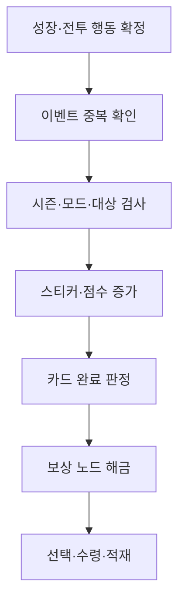

# 20. 퀘스트·업적·시즌 패스 역기획

> 기준일: 2026-11-13 KST. 2026년 패스 개편을 반영한다. [확인]은 공식 공개 규칙, [해석]은 설계 의미, [제안]은 구현 모델이다. 지원문서에만 있는 최신 내용은 배포 범위가 모든 계정에서 같은지 추가 확인이 필요하다.

## 1. 서로 다른 보상 시간축

[해석] 전투의 즉시 보상만으로는 플레이어에게 다음 행동을 충분히 설명하기 어렵다. 퀘스트와 패스는 기존 행동에 추가 목표를 얹고, 업적은 계정 전체의 장기 흔적을 만든다.

| 계열 | 진행 기준 | 반복 주기 | 중심 목적 |
| --- | --- | --- | --- |
| 시즌 과제 | 일반 플레이 행동 | 시즌 | 지속 참여와 선택 가능한 일상 목표 |
| 시즌 보상 트랙 | 시즌 점수 | 시즌 | 단기 목표와 보상의 가시화 |
| 장기 업적 | 누적 성취 | 계정 | 숙련·헌신·도전의 기록 |
| Hero Journey | 영웅 성장과 전용 과제 | 장기 | 영웅·장비 성장의 연결 |
| 클랜 게임 | 공동 과제 점수 | 이벤트 | 개인 행동을 공동 목표로 연결 |
| 특별 이벤트 | 특정 재화·목표 | 기간 한정 | 전술 변화와 새로운 경험 |

클랜 게임 세부는 별도 [18. 클랜 게임](18_clan_games.md)을 따른다. 본 문서는 서로 다른 진행도를 한 개의 “퀘스트 완료 수”로 합치지 않는 것을 핵심 원칙으로 삼는다.

## 2. 2026년 패스 구조

[확인] 2026-03 개편은 누적 가능한 과제 카드와 선택형 보상, TH·BH 기준 보상 스케일을 도입했다. 보상 기준 레벨은 시즌 시작에 고정되므로 시즌 도중 회관을 올려도 해당 시즌 트랙 보상이 자동 상향되지 않는다. [개편 공지](https://supercell.com/en/games/clashofclans/blog/news/big-changes-are-coming-to-gold-pass/)

현행 공식 지원문서의 핵심은 다음과 같다. [Season Tasks](https://sc-clashofclans.zendesk.com/hc/en-us/articles/49529097715611-Season-Tasks)

| 항목 | [확인] 지원문서 규칙 |
| --- | --- |
| 최초 카드 | 첫날 4장 |
| 추가 카드 | 접속하지 않아도 매일 추가, 시즌 기본 최대 31장 안내 |
| 카드 만료 | 당일 종료로 소멸하지 않음 |
| 카드 구성 | 8개 행동 과제 |
| 카드 완료 | 7개 스티커, 같은 행동 반복 가능 |
| 보상 | 과제 점수와 카드 완료 보너스 |
| 유료 구매 시점 | 완료한 카드의 프리미엄 보너스 소급 |
| 연속 구매 | 추가 과제 카드 혜택 안내 |

[버전 주의] 2월 발표는 이전 연속 구매 보너스를 제거한다고 설명했지만, 현재 지원문서는 연속 구매 추가 카드를 명시한다. “연속 구매 혜택이 전혀 없다”로 단정하지 않는다. 8월 패치는 TH3 패스를 테스트 배포로 설명했고, 현재 지원문서는 TH3 접근을 안내한다. 실계정의 노출 여부는 배포 조건과 함께 기록한다.

## 3. 과제 판정 규칙

[확인] 현재 과제는 건물·연구·영웅 또는 펫 성장 시작, 별 보너스 완료, 전투 승리, 회관 파괴, 지원과 지원 요청 같은 일반 행동을 사용한다. 건물 성장 과제의 장벽 제외, 회관 파괴 과제의 일부 모드 제외처럼 행동마다 유효 범위가 다르다. [Season Tasks](https://sc-clashofclans.zendesk.com/hc/en-us/articles/49529097715611-Season-Tasks)

[제안] 모든 과제를 UI 버튼 클릭 횟수로 세지 않는다. 서버에서 확정한 행동 이벤트에 필터를 적용한다.

```text
QuestRule:
  questId, eventType, eligibleModes[], eligibleEntityTags[]
  excludedTags[], targetCount, repeatWithinCard
  requiresVictory, minDamage, availabilityRule

QuestEvent:
  eventId, accountId, eventType, occurredAt, settledAt
  modeId, entityId, battleId, seasonId, ruleVersion
```

같은 “승리”라도 연습 전투, 친선전, 경쟁전의 허용 여부는 과제 정의에 있어야 한다. 다른 퀘스트에서 친선전이 인정된다고 모든 승리 조건에 인정하면 보상 우회가 생긴다.

### 확정 이벤트 흐름



[제안] 전투 결과가 늦게 도착했을 때 시즌 귀속은 완료 시각과 정산 시각 중 어떤 것을 쓰는지 보상별로 정의한다. 은행의 시즌 귀속 규칙과 과제 귀속 규칙이 같다고 가정하지 않는다.

## 4. 카드 누적과 복귀 경험

[해석] 당일 과제를 놓치면 사라지는 구조는 접속을 의무처럼 느끼게 할 수 있다. 카드 누적은 참여 총량을 요구하면서도 일정을 유연하게 만든다. 같은 과제를 반복할 수 있다는 점은 성장이 막힌 계정이나 특정 행동을 선호하는 사용자에게 대체 경로를 준다.

[제안] 카드 수가 많아졌을 때 전부 동시에 표시하지 않는다. 현재 카드, 남은 카드 수, 최종 완료까지 필요한 행동량을 보여준다. 사용자가 아직 해금하지 않은 기능은 활성 과제로 제시하지 않거나 수행 가능한 행동을 함께 제시한다.

“오늘 하지 않아도 카드가 남는다”와 “시즌이 끝나도 영원히 남는다”는 다른 안내다. 카드가 쌓이는 범위와 시즌 종료 시 처리 정책을 별도로 표기해야 한다.

## 5. 선택 보상과 수령 상태

```text
RewardNode:
  nodeId, requiredPoints, trackType, choiceOptions[]
  selectedOptionId, claimedAt, autoClaimPolicy
  snapshotTier, rewardRuleVersion

RewardReceipt:
  receiptId, nodeId, selectedOptionId
  grantedItems[], overflowItems[], convertedGems
```

[제안] 선택형 보상은 한 번 확정한 뒤 재접속이나 두 기기의 동시 요청으로 다른 선택을 받을 수 없어야 한다. 선택 전 정보에는 현재 보유량, 수량, 보관 한도, 즉시 사용 가능 여부를 함께 보여준다.

[확인] 시즌 종료 미수령 선택 보상은 첫 번째 선택지로 처리되거나 용량 문제 시 보석으로 전환될 수 있다. 미수령 상자는 로그인 후 열 수 있도록 처리한다. [Gold Pass 지원문서](https://sc-clashofclans.zendesk.com/hc/en-us/articles/49529123544091-Gold-Pass)

이 규칙은 선택하지 않은 사용자를 위해 서버에 자동 처리 경로가 필요하다는 뜻이다. UI에만 선택 로직을 두면 앱을 열지 않은 계정의 시즌 결산이 누락된다.

## 6. 업적과 Hero Journey

[해석] 업적의 가치는 보상 외에 계정 이력의 설명에 있다. 반복 활동 업적, 특정 결과 업적, 시스템 발견 업적을 나눠야 사용자가 진행할 방법을 이해한다. 현재 달성 가능하지 않은 기록은 삭제하기보다 과거 업적으로 보존하는 설계가 적합하다.

[확인] Hero Journey는 영웅 레벨 합으로 진행되며 장비 획득과 과제를 연결한다. 보유한 장비가 보상 풀을 모두 채웠을 때 대체 보상을 주는 구조도 존재한다. 구체 보상은 [03. 성장](03_progression_research_and_unlocks.md)과 [09. 영웅](09_heroes_equipment_and_pets.md)을 참고한다. [공식 영웅 안내](https://sc-clashofclans.zendesk.com/hc/en-us/articles/49529108034843-About-Heroes-Pets)

[제안] 업적을 레벨 1~3으로 확장하더라도 누적값과 현재 목표를 분리한다. 상위 목표 추가 시 이미 누적한 값으로 재평가하되, 각 보상 수령 ID는 보존한다. 목표 수치 변경 후 “완료 표시만 남고 보상을 두 번 받는” 상태를 방지한다.

## 7. 은행과 패스 가치의 연결

[확인] Hoggy Bank는 시즌 종료 지급을 만들며, 유료 패스는 해당 지급의 5배 배수 혜택을 제공한다. 구매 자체가 은행을 채우지는 않는다. [Hoggy Bank](https://sc-clashofclans.zendesk.com/hc/en-us/articles/55600634183451-Hoggy-Bank)

[해석] 성장 부스트는 남은 시즌 동안의 이용 시간에 영향을 받고, 소급 가능한 보상은 구매 시점에 이미 쌓인 행동에 영향을 받는다. 따라서 같은 패스라도 “지금 받는 보상”과 “앞으로 활용할 혜택”을 나눠 설명해야 한다. 늦은 구매에 대한 보상 소급과 남은 기간 표시가 함께 필요하다.

[제안] 패스 진행 예상치를 제공한다면 플레이어에게 관찰된 활동량을 사용하고, 완료 가능성을 보장하지 않는다. 시즌 종료 직전에 새 과제를 강요하기보다 남은 카드·미수령 보상을 명확히 보여준다.

## 8. 정량 지표와 수용 기준

[제안] 일별 접속률만 높으면 성공이라고 평가하지 않는다. 카드 누적 구조에서는 3일에 한 번 충분히 플레이하는 사용자도 의도한 경험일 수 있다. 아래 지표를 계정 성장 단계별로 본다.

| 지표 | 해석 |
| --- | --- |
| 카드 완료까지의 유효 행동 수 | 과제 판정의 이해도 |
| 반복 선택한 행동 비중 | 자율적 선호 또는 대체 과제 부족 |
| 시즌 후반 미완료 카드 분포 | 누적 과제가 과도한 부채가 되는지 |
| 선택 보상별 실제 수령률 | 두 선택지의 실질 가치 |
| 미수령 자동 처리 비중 | 보상 인지·접근성 문제 |
| 중도 패스 구매 후 완료율 | 소급 지급과 잔여 과제의 균형 |
| 과제 시작 후 모드 이탈률 | 과제가 본래 플레이를 왜곡하는 정도 |

| ID | 시험 | 기대 결과 |
| --- | --- | --- |
| QUEST-01 | 3일 미접속 후 복귀 | 일일 카드 누적 정책대로 표시 |
| QUEST-02 | 같은 유효 행동 7회 | 카드의 반복 허용 규칙대로 완료 |
| QUEST-03 | 장벽 업그레이드 | 장벽 제외 과제에 점수 미지급 |
| QUEST-04 | 전투 결과 재전송 | 스티커·점수·카드 보너스 중복 없음 |
| QUEST-05 | 시즌 중 TH 상승 | 시즌 보상 스케일 임의 변경 없음 |
| QUEST-06 | 완료 카드 이후 패스 구매 | 프리미엄 보너스 한 번 소급 |
| QUEST-07 | 두 기기에서 다른 보상 선택 | 하나의 선택만 확정 |
| QUEST-08 | 시즌 종료 미수령 상자 | 상자가 다른 보상으로 잘못 변환되지 않음 |

## 9. 출처·연결

[04. 경제](04_resources_loot_and_economy.md), [21. 수익화](21_monetization_and_magic_items.md), [22. UX](22_ui_ux_and_onboarding.md)와 함께 검토한다.

출처: [2026-03 패스 개편](https://supercell.com/en/games/clashofclans/blog/news/big-changes-are-coming-to-gold-pass/), [Season Tasks](https://sc-clashofclans.zendesk.com/hc/en-us/articles/49529097715611-Season-Tasks), [Gold Pass](https://sc-clashofclans.zendesk.com/hc/en-us/articles/49529123544091-Gold-Pass), [Hoggy Bank](https://sc-clashofclans.zendesk.com/hc/en-us/articles/55600634183451-Hoggy-Bank), [2026-08 테스트 배포](https://supercell.com/en/games/clashofclans/blog/release-notes/august-update-3/). 열람일 2026-11-13.
