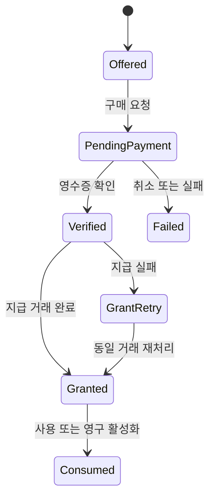

# 21. 수익화·마법 아이템·상점 역기획

> 기준일: 2026-11-13 KST. [확인]은 공개 상품 기능, [해석]은 가치 구조, [제안]은 서비스 설계다. 지역·스토어별 현금 가격과 실제 구매 전환율은 확인하지 않았으므로 수익 수치로 단정하지 않는다.

## 1. 판매하는 가치의 구조

[해석] 클래시 오브 클랜은 같은 성장 목표에 도달하는 시간, 자원 편의, 반복 수령 가치, 외형 표현을 서로 다른 상품으로 제공한다. 상품 가치는 가격만으로 정해지지 않는다. 플레이어에게 지금 어떤 성장 병목이 있고, 해당 기능을 얼마나 사용할 수 있는지가 결정한다.

| 상품 가치 | 대표 구조 | 가치가 커지는 계정 상태 |
| --- | --- | --- |
| 영구 처리량 | 장인 확보 | 자원은 충분하지만 작업 슬롯 부족 |
| 시간 단축 | 책·물약·즉시 완료 | 완료까지 남은 작업량이 큼 |
| 자원 충당 | 룬·자원 묶음 | 빈 저장 공간과 확실한 소비처가 있음 |
| 참여 누적 보상 | 시즌 패스 | 시즌 내 꾸준한 플레이 |
| 유연성 | 조력자·변환 | 재화 간 수급 불균형 |
| 외형 | 영웅 스킨·배경·장식 | 성능 외 계정 표현 욕구 |

공격 한 번의 비용이 사라진 이후 수익화 분석에서 훈련 비용 회수 모델을 중심에 두지 않는다. [2022 무료 훈련](https://supercell.com/en/games/clashofclans/blog/news/home-village-changes-2/), [2025 준비 시간 제거](https://supercell.com/en/games/clashofclans/blog/release-notes/welcome-to-clash-anytime-update/)

## 2. 마법 아이템을 기능 계약으로 분류

[확인] 공식 목록은 물약, 책, 룬, 망치 등 서로 다른 작동 방식을 구분한다. 장인 물약은 1시간 동안 장인 작업 10배, 연구 물약은 1시간 동안 연구 24배로 안내한다. 책은 진행 작업의 시간을 끝내며, 룬은 해당 자원 창고를 채운다. 건물 망치는 유휴 장인을 요구한다. [Magic Items & The Trader](https://sc-clashofclans.zendesk.com/hc/en-us/articles/49529083243291-Magic-Items-The-Trader)

| 분류 | [제안] 사용 전제 | 소비 후 효과 | 주요 예외 |
| --- | --- | --- | --- |
| 시간 가속 물약 | 대상 작업과 허용 버프 | 시간당 처리량 증가 | 남은 버프·추가 큐·점검 |
| 완료 책 | 유효한 진행 작업 | 해당 타이머 완료 | 잘못된 성장 계열 선택 |
| 자원 룬 | 대상 지갑에 빈 용량 | 설정된 상한까지 충당 | 가득 찬 창고 사용 차단 |
| 레벨 상승 망치 | 선행 조건·필요 슬롯 | 다음 레벨 즉시 적용 | 진행 중 작업과 경쟁 |
| 장벽 링 | 유효한 장벽 성장 | 지정 레벨 상승 | 필요 링 수·장인 요구 예외 |
| 장애물 삽 | 대상 장애물 존재 | 이동 가능 속성 부여 | 이동과 삭제의 구분 |
| 임시 전투 강화 | 허용 병력·영웅 | 일정 기간 유효 레벨 변경 | 영구 성장·장비 레벨과 구분 |

표는 구현 계약 분류다. 망치의 비용 면제 범위, 물약 중첩 한도, 아이템별 보유 상한은 각 아이템 정의와 실제 사용 확인을 통해 확정해야 한다.

[확인] 2026-08 이후 장벽 링 사용에는 유휴 장인이 필요 없다. 이를 건물 망치의 장인 조건까지 일괄 제거하는 규칙으로 확장하지 않는다. [August Update](https://supercell.com/en/games/clashofclans/blog/release-notes/august-update-3/)

## 3. 가속 가치의 수학적 해석

[제안] 1시간 동안 속도 m배가 되면, 평상시에도 진행됐을 1시간을 제외한 추가 절약량은 최대 m−1시간이다.

```text
additionalTimeSaved = min(remainingWork, m * duration)
                    - min(remainingWork, duration)
# 평상시 속도를 작업량 1/시간으로 정규화한 단일 작업 예시
```

장인 물약을 모든 장인이 1시간 내내 활용한다고 가정하면 장인 1명당 추가 9 장인시간, 5명이면 45 장인시간이다. 연구 물약의 추가 연구량은 같은 가정에서 23시간이다. 작업이 일찍 끝나거나 빈 슬롯이 있으면 실제 이득은 줄어든다. “10시간 절약”과 “10시간 분량 진행”을 같은 문구로 쓰면 사용자의 기대가 달라진다.

책의 가치도 남은 시간이 기준이다. 남은 10분 작업과 남은 10일 작업에 같은 책을 쓸 수 있어도 체감 편익은 다르다. [제안] 확인 창에는 남은 작업량과 이번 사용으로 즉시 완료되는 대상을 표시하고, 일반적인 판매 가격만으로 가치를 과장하지 않는다.

## 4. 시즌 패스의 여러 가치층

[확인] Gold Pass는 보상 트랙 외에 건설·연구 부스트, 지원 편의, 은행 지급 배수, 시즌 광석 변환 조력자 등을 제공한다. 시즌 중 구매해도 혜택의 유효기간은 시즌 끝까지다. [공식 Gold Pass](https://sc-clashofclans.zendesk.com/hc/en-us/articles/49529123544091-Gold-Pass)

[제안] 패스 엔타이틀먼트를 한 개 불리언으로만 저장하지 않는다.

```text
PassEntitlement:
  seasonId, purchaseReceiptId, activatedAt, expiresAt
  unlockedPerks[], claimableRewardNodes[]
  retroactiveBonusGranted, bankMultiplierUnlocked
```

패스를 샀다는 사실과 특정 혜택을 트랙에서 해금했다는 사실은 다른 상태일 수 있다. 구매를 먼저 했지만 점수가 부족하거나, 충분히 플레이한 뒤 구매하여 여러 보상이 동시에 소급되는 상황을 처리해야 한다.

[해석] 성장 부스트는 남은 시즌 기간에 비례한 가치가 있고, 스킨·수령 보상은 남은 기간이 짧아도 보유 가치가 남는다. UI에서 둘을 나눠 보여주면 늦은 구매 사용자가 무엇을 얻는지 이해하기 쉽다. 자세한 진행 규칙은 [20. 퀘스트·패스](20_quests_achievements_and_pass.md)를 따른다.

## 5. 상점 제안·가격·재고 데이터

[제안] 상점 상품은 Offer, Purchase, Grant 세 객체로 나눈다.

| 객체 | 주요 필드 | 필요한 이유 |
| --- | --- | --- |
| Offer | offerId, catalogVersion, currency, price | 표시 가격과 결제 가격 연결 |
| Availability | startAt, endAt, accountConditions | 기간·TH·보유 여부 검증 |
| Purchase | purchaseId, providerReceipt, state | 결제 재시도와 복구 |
| Grant | grantId, items, overflowPolicy | 결제와 실제 지급 분리 |
| Stock | limit, consumedCount, resetAt | 주간·시즌 구매 한도 |
| Choice | options, selectionId, lockAt | 선택 상품 중복 수령 방지 |

[제안] 현재 보유한 외형, 미해금 영웅의 스킨, 만료 직전 상품, 창고가 찬 상태에서 받는 자원은 다른 사전 안내를 제공한다. 실제 결제 금액은 플랫폼에서 받은 가격 문자열을 사용하고 통화 기호·세금·소수점 규칙을 임의로 다시 만들지 않는다.

[확인] Trader는 이벤트 재화·습격전 메달·보석에 연계된 교환 창구이며 공식 안내에는 주간 제안 갱신이 있다. 구체 품목·한도는 현재 카탈로그를 기준으로 해야 한다. [공식 Trader](https://sc-clashofclans.zendesk.com/hc/en-us/articles/49529083243291-Magic-Items-The-Trader)

## 6. 구매와 사용의 상태 기계



[제안] 결제 성공 응답을 못 받았다고 새 purchaseId를 발급해 재결제하지 않는다. 스토어 영수증과 지급 거래를 연결하고 복구 요청은 동일 grantId를 찾아야 한다. 아이템 사용은 결제와 별도 거래이며, 사용 실패에 구매 취소가 자동 발생하지 않는다.

### 아이템 사용 원자성

1. 아이템 보유량과 대상 상태를 같은 버전으로 읽는다.
2. 효과를 적용할 수 있는지 검사한다.
3. 아이템 차감·효과 적용·사용 이력을 함께 확정한다.
4. 응답 유실 시 같은 useRequestId로 결과를 복구한다.
5. 완료 직전 타이머가 자연 종료됐으면 소모 여부를 재검증한다.

## 7. 수익과 경험의 균형 분석

[해석] 단기 구매 전환만 높이면 일부 병목을 과도하게 강화할 유인이 생긴다. 그러나 전투 학습과 다양한 조합 실험이 줄면 장기 콘텐츠 가치가 약해질 수 있다. 비용·준비 시간 제거는 반복 전투의 접근성을 높인 사례이며, 남은 성장·외형 상품의 역할을 다시 평가하게 한다.

[제안] 다음 지표를 함께 본다.

| 지표 | 평가 질문 |
| --- | --- |
| 구매 후 실제 사용률 | 가치가 있는 아이템을 제공했는가 |
| 가속 후 유휴율 | 단축한 시간이 다른 병목에 막히는가 |
| 자원 상품의 초과 손실률 | 필요한 만큼 지급되는가 |
| 패스 구매일별 만족·환불 지표 | 남은 혜택을 정확히 설명하는가 |
| 외형 구매 후 적용률 | 소유에서 사용으로 이어지는가 |
| 무료·유료 계정의 모드 참여율 | 성장 차이가 참여 자체를 막는가 |
| 상품별 30일 유지율 | 일시 수익이 장기 경험을 해치지 않는가 |

이 표는 실제 Supercell 내부 지표를 인용한 것이 아닌 재구현 시 운영 제안이다.

## 8. QA·경계 사례

| ID | 시험 | 기대 결과 |
| --- | --- | --- |
| SHOP-01 | 결제 성공 후 앱 강제 종료 | 복구 시 지급 1회 |
| SHOP-02 | 두 기기에서 같은 한정 상품 구매 | 구매 한도 초과 방지 |
| SHOP-03 | 룬 대상 창고가 가득 참 | 사용 차단, 아이템 보존 |
| SHOP-04 | 책 사용과 자연 완료가 동시 | 효과 없는 소비 방지 |
| SHOP-05 | 모든 장인 유휴 상태에 물약 사용 | 효과·시간을 정확히 안내 |
| SHOP-06 | 장벽 링과 건물 망치 | 서로 다른 장인 조건 유지 |
| SHOP-07 | 시즌 중 패스 구매 | 소급 보상과 종료일 정확 |
| SHOP-08 | 아이템 보관량 초과 보상 | 보상 원천별 대체·즉시 사용 정책 |
| SHOP-09 | 가격 변경 중 구입 | 최신 가격 동의 없이 임의 청구 금지 |

## 9. 자료 한계·출처

현금 가격표, 지역별 할인, 결제 사업자 계약, 실제 ARPDAU·전환율은 공개 확인 범위에 포함하지 않았다. 가격 변수가 없는 상태에서 투자 회수 기간을 실제 계정에 확정적으로 제시하지 않는다.

출처: [마법 아이템](https://sc-clashofclans.zendesk.com/hc/en-us/articles/49529083243291-Magic-Items-The-Trader), [Gold Pass](https://sc-clashofclans.zendesk.com/hc/en-us/articles/49529123544091-Gold-Pass), [2022 무료 훈련](https://supercell.com/en/games/clashofclans/blog/news/home-village-changes-2/), [2025 Clash Anytime](https://supercell.com/en/games/clashofclans/blog/release-notes/welcome-to-clash-anytime-update/), [장벽 링 변경](https://supercell.com/en/games/clashofclans/blog/release-notes/august-update-3/). 관련: [02. 건설](02_village_builders_and_construction.md), [04. 경제](04_resources_loot_and_economy.md), [23. 운영](23_liveops_and_balance.md). 열람일 2026-11-13.
