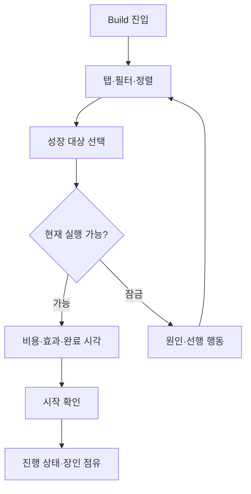

# 22. UI·UX·온보딩 역기획

> 기준일: 2026-11-13 KST. 2026-10 공개된 UI 개편을 기준으로 구조를 분석한다. 실제 단말 화면 녹화·터치 영역 측정은 수행하지 않았다. [확인] 공식 설명, [해석] 경험 분석, [제안] 재구현·검증 설계다.

## 1. 주 화면의 핵심 정보 구조

[확인] 2026-10 UI 개편은 Battle과 Build를 주 행동으로 배치한다. Battle에는 전투·군대 편집·전투 기록이 모이고, Build에는 건물·영웅, 군대 연구, 장비, 펫 성장이 모인다. 성장 메뉴는 탭에 맞는 재화를 노출한다. [UI 개편 공식 설명](https://supercell.com/en/games/clashofclans/blog/news/weve-revamped-the-clash-of-clans-user-interface/)

[해석] 마을에서 할 일을 “전투한다”와 “성장시킨다”로 먼저 나누고 세부 시설 위치를 기억하지 않아도 접근하게 만든다. 기존 건물 직접 선택 경로도 공간을 이해하는 방법으로 가치가 있다. 두 경로가 같은 상태와 동일한 견적을 보여주는 것이 중요하다.

| 주 행동 | 사용자의 질문 | 중심 정보 |
| --- | --- | --- |
| Battle | 지금 어디에서 무엇으로 싸울까? | 모드, 편성, 제한, 예상 보상 |
| Build | 지금 무엇을 발전시킬까? | 가능한 성장, 비용, 시간, 잠금 이유 |
| Clan/Social | 누구와 무엇을 같이 할까? | 지원 요청, 공동 일정, 참여 상태 |
| Reward/Event | 지금 받을 것과 곧 끝날 것은? | 보상 수령, 남은 목표, 종료 시각 |
| Profile | 내 상태와 설정은? | 계정, 기록, 설정, 연결 |

공식 메뉴 배치는 개편 시점의 설명이다. 후속 미세 조정이나 계정별 노출 실험까지 실제 단말에서 동일하다고 확인한 것은 아니다.

## 2. 두 핵심 사용자 흐름

### 성장 시작



[제안] “가능하지 않음”은 행동 종료가 아니다. 자원 부족이면 획득 경로, 용량 부족이면 저장 시설, 선행 레벨 부족이면 해당 시설, 장인 부족이면 다음 완료 정보를 제공한다. 원인을 하나의 빨간 버튼으로 합치면 사용자는 다른 화면을 반복 탐색하게 된다.

### 공격 시작

[제안] 전투 버튼 → 모드 선택 → 편성 점검 → 상대·규칙 확인 → 전투 → 결과 해석 → 다음 행동으로 이어진다. 각 단계에서 과거 단계의 정보를 다시 입력하게 하지 않는다. 예를 들어 전투 결과에서 군대 수정으로 이동하면 직전에 사용한 편성을 불러온다. 실제 이동 단축 제공 여부는 클라이언트로 검증해야 하는 설계 제안이다.

## 3. 정보 우선순위와 피드백

[해석] 주 화면은 전부 중요한 정보를 동시에 보여주기 어렵다. 즉시 행동에 영향을 주는 상태, 시간 제한, 단순 수집 알림의 우선순위를 나눠야 한다.

| 정보 | 우선순위 예 | 부적절한 표시의 결과 |
| --- | --- | --- |
| 전투 불가 조건·편성 오류 | 행동 직전 최우선 | 실패 후 뒤늦게 알게 됨 |
| 진행 중 전쟁의 남은 공격 | 공동 일정 맥락에서 높음 | 팀 목표 누락 |
| 빈 장인·완료 연구 | 성장 맥락에서 높음 | 성장 가동률 저하 |
| 곧 종료되는 미수령 보상 | 실제 마감이 있을 때 높음 | 회복 불가능한 보상 누락 |
| 새 외형 제안 | 자율 탐색 | 핵심 행동 방해 가능 |
| 항상 존재하는 메뉴 안내 | 초기 학습 때 높음 | 장기 사용자에게 반복 소음 |

[제안] 알림 점은 읽지 않은 콘텐츠와 즉시 수령 가능 보상을 구분한다. 알림을 눌렀는데 할 수 있는 일이 없으면 향후 모든 점의 신뢰가 떨어진다. 빨간 점의 수를 성과 지표로 사용하지 않고 해결률·오작동률을 본다.

[확인] 공식 개편에는 전투 버튼에서 복수·라이브 리플레이 상태를 전달하는 아이콘과, 잠긴 성장 대상을 누르면 제한 시설로 시점을 옮기는 동작이 포함된다. [공식 UX 설명](https://supercell.com/en/games/clashofclans/blog/news/weve-revamped-the-clash-of-clans-user-interface/)

## 4. 전투 UI의 입력 계약

[제안] 전투 입력은 시각 반응과 실제 명령 수락을 구분한다.

| 입력 | 즉시 보여줄 피드백 | 확정 데이터 |
| --- | --- | --- |
| 병력 선택 | 선택 강조·잔여 수량 | selectedSlot |
| 배치 지점 터치 | 유효/금지 표시 | deployCommandId |
| 길게 눌러 연속 배치 | 반복 간격·배치 수량 | 개별 또는 묶음 명령 |
| 마법 사용 | 범위·영향 영역 | castPosition, spellId |
| 영웅 능력 | 준비/사용/불가 상태 | abilityUseId |
| 중단·종료 | 위험을 설명하는 확인 | surrenderCommand |

금지된 배치 위치를 눌렀을 때 선택이 풀리는지, 병력 수량이 줄었다가 복원되는지, 애니메이션만 나오는지에 따라 오입력 체감이 달라진다. 재구현에서는 검증 실패를 정상 배치처럼 표현하지 않는다.

다수 유닛과 이펙트가 겹칠 때 영웅 아이콘, 체력, 능력 사용 여부가 배경에 묻히지 않아야 한다. 세밀한 터치 판정 크기·반복 배치 속도는 원작 수치로 단정하지 않고 사용자 시험으로 결정한다.

## 5. 온보딩과 복귀 흐름

[해석] 신규 사용자는 “이 버튼이 어디에 있는가”보다 “왜 이 행동을 하는가”를 먼저 이해해야 한다. 본마을의 첫 학습 사이클은 자원 수집 → 성장 시작 → 공격 배치 → 결과 → 성장 재투자가 자연스럽게 이어지는 것이 적합하다.

[제안] 튜토리얼 상태를 하나의 선형 단계 번호로만 저장하지 않는다.

```text
TutorialState:
  observedConcepts[], completedActions[], currentPrompt
  prerequisiteKnowledge[], skipPolicy, resumePoint
  accountUnlockSnapshot, tutorialRuleVersion
```

사용자가 튜토리얼이 요구한 행동을 미리 수행했거나, 다른 기기에서 진행했거나, 오래 쉬어 계정 상태가 바뀌었을 때 현재 개념 이해와 실제 기능 해금을 기준으로 이어가야 한다.

### 신규·복귀·숙련 사용자별 목표

| 사용자 | 최소 설명 | 과도한 설명의 문제 |
| --- | --- | --- |
| 신규 | 자원·장인·배치·승리 기준 | 많은 시스템 용어로 인지 과부하 |
| 복귀 | 지난 이용 이후 바뀐 규칙 | 이미 아는 기초 행동 반복 |
| 숙련 | 위치 변경·단축 경로·고급 옵션 | 기본 툴팁이 조작을 가림 |
| 여러 계정 사용자 | 계정 전환·현재 계정 확인 | 잘못된 계정에서 행동 |
| 상위 TH 진입 | 새 선택지와 선행 조건 | 신규 항목이 목록에 묻힘 |

[확인] 2026-08 업데이트는 신규·복귀 경험 조정과 TH3 패스의 테스트 배포를 안내했다. 모든 계정에서 동일한 온보딩 분기를 경험한다고 가정하지 않는다. [August Update](https://supercell.com/en/games/clashofclans/blog/release-notes/august-update-3/)

## 6. 결과 화면과 설명 가능한 보상

[확인] 2026-08 패치는 본마을 전투 종료 화면의 전리품·보너스 구분을 개선했다고 설명한다. [동일 패치](https://supercell.com/en/games/clashofclans/blog/release-notes/august-update-3/)

[제안] 결과 화면은 별·파괴율과 경제적 보상을 분리한다. 표시 항목은 모드에 맞게 구성한다.

- 전투 결과: 승패, 획득 별, 파괴율, 시간.
- 직접 보상: 약탈량, 실제 적재량, 용량 때문에 적재되지 않은 양.
- 추가 진행: 별 보너스, 과제, 이벤트 재화.
- 경쟁 변화: 해당 모드의 순위·점수 변화.
- 다음 행동: 재도전, 편성 수정, 클랜 공유, 성장.

일반 전투와 랭크전의 화면 틀을 공유하더라도 일반 전투에 의미 없는 트로피 증감 칸을 남기지 않는다. 과제 여러 개가 동시에 완료되어도 핵심 결과를 가리는 긴 연출을 강제하지 않는 것이 좋다.

## 7. 접근성·상태 복원 제안

[제안] 아래 항목은 원작에 모두 존재한다고 주장하는 목록이 아니라 재구현의 수용 조건이다.

| 분야 | 제안 |
| --- | --- |
| 색상 | 가능/불가를 색만으로 구분하지 않고 아이콘·문구 병행 |
| 글자 | 한글·영문 길이 차이, 큰 글자 설정에서 잘림 확인 |
| 숫자 | 큰 자원 수량의 축약과 정확한 값 함께 접근 가능 |
| 시간 | 남은 기간과 실제 종료 시각을 구분 |
| 조작 | 드래그 취소, 연속 배치 중 화면 이동 오작동 방지 |
| 모션 | 반복 강조·깜박임·가속 재생 옵션 검토 |
| 상태 복원 | 다시 열린 메뉴에서 선택·스크롤·필터 복원 정책 명시 |
| 오디오 | 중요한 행동 실패가 소리로만 전달되지 않음 |

공식 10월 설명의 필터 재접속 유지 규칙은 이후 개선 예고와 혼동될 수 있다. 본 문서는 “현재 모든 계정에서 세션 간 유지된다/초기화된다”를 확정하지 않는다. 실행 빌드별로 확인한다.

## 8. 사용성 지표와 QA

[제안] 메뉴의 총 탭 수보다 목표 달성 시간과 되돌아감 횟수를 우선 측정한다. 성장에 필요한 행동이 1탭 줄었어도 잘못된 항목 선택이 늘었다면 개선으로 보기 어렵다.

| ID | 시나리오 | 수용 기준 |
| --- | --- | --- |
| UX-01 | 신규 사용자가 첫 연구 찾기 | 시설 위치 암기 없이 경로 이해 |
| UX-02 | 잠긴 성장 항목 선택 | 부족 원인과 실행 가능한 다음 행동 |
| UX-03 | 짧은·긴 한국어 건물명 | 버튼·비용·타이머가 겹치지 않음 |
| UX-04 | 전투 중 빠른 병력 선택 | 잘못된 슬롯 사용률 측정 |
| UX-05 | 네트워크 지연 중 배치 | 입력 수락과 실제 소비가 일치 |
| UX-06 | 결과 보상과 창고 잔액 확인 | 적재 차이를 화면에서 설명 |
| UX-07 | 앱 재시작 후 편집 복귀 | 저장·미저장 상태 명확 |
| UX-08 | 여러 퀘스트 동시 완료 | 전투 결과를 확인할 수 있음 |
| UX-09 | 복귀 계정의 예전 훈련 지식 | 현재 준비 방식의 변경 안내 |

측정 대상은 첫 성장 시작 시간, 기능 찾기 실패율, 잠금 설명 후 해결률, 편성 수정 완료율, 전투 오입력률, 미수령 보상 비중이다. 실제 원작 실험 데이터는 수집하지 않았다.

## 9. 출처·연결

출처: [2026-10 UI 개편](https://supercell.com/en/games/clashofclans/blog/news/weve-revamped-the-clash-of-clans-user-interface/), [2026-08 신규·복귀 및 결과 화면](https://supercell.com/en/games/clashofclans/blog/release-notes/august-update-3/). 열람일 2026-11-13.

연결: [02. 건설](02_village_builders_and_construction.md), [05. 군대 편성](05_army_composition.md), [20. 퀘스트·패스](20_quests_achievements_and_pass.md), [23. 운영](23_liveops_and_balance.md).
