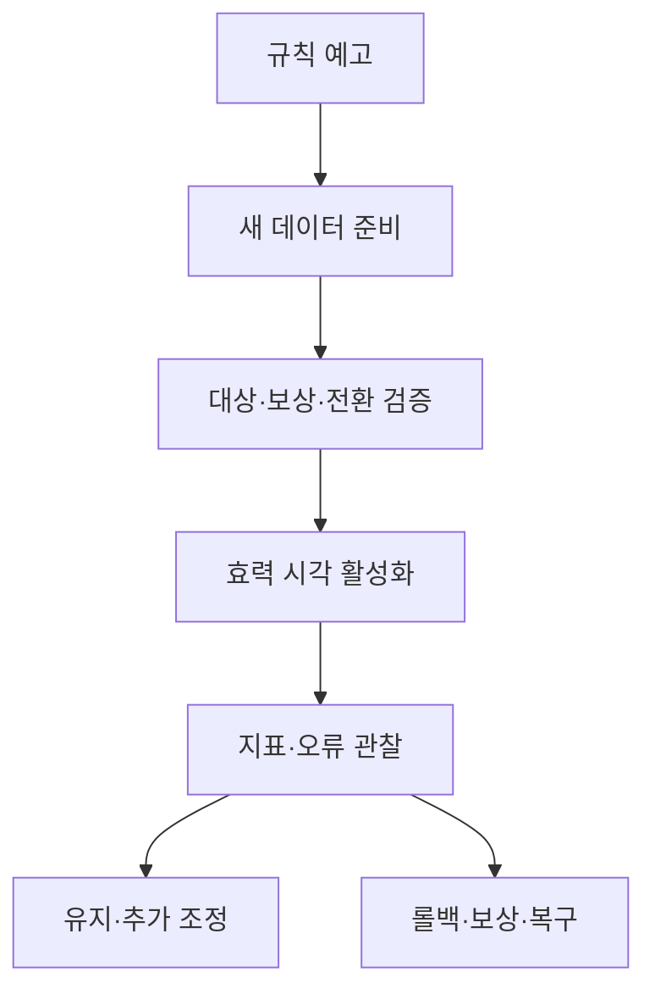

# 23. 라이브 운영·콘텐츠 갱신·밸런스 역기획

> 기준일: 2026-11-13 KST. 현행 규칙, 기간 한정 이벤트, 향후 예고를 분리한다. [확인] 공식 자료, [해석] 인과관계 분석, [제안] 운영·구현 모델이며 실제 내부 운영 절차를 공개한 문서가 아니다.

## 1. 운영의 네 가지 시간축

[해석] 이 게임은 동일한 전투·성장 루프에 서로 다른 속도의 갱신을 얹는다. 모든 갱신을 콘텐츠 추가라고 묶으면 플레이어가 느끼는 변화와 시스템 위험을 구별하기 어렵다.

| 시간축 | 대상 | 주된 경험 | 주요 위험 |
| --- | --- | --- | --- |
| 즉시·일일 | 과제·보너스·지원·상점 상태 | 다음 행동 제시 | 마감 혼란·알림 피로 |
| 주간·이벤트 | 습격전·도전·특별 병력 | 공동 목표·전술 변화 | 참여 일정 충돌 |
| 월간·시즌 | 패스·리그·스킨 | 진행 리셋과 새 보상 | 시즌 경계 정산 |
| 대형 업데이트 | TH·새 시스템·성장 압축 | 장기 목표 재생성 | 마이그레이션·메타 급변 |

[제안] LiveOpsCalendar는 시작일뿐 아니라 종료·수령 유예·상점 종료·보상 결산·모드 허용 범위를 모두 담아야 한다. 이벤트 종료와 재화 상점 종료가 같은 시각이라는 가정은 피한다.

## 2. 기준일의 현행·이벤트·예고 구분

| 분류 | 2026-11-13 기준 취급 |
| --- | --- |
| 현행 기반 | 2025 훈련 대기 제거, Battle/Ranked 분리, 2026 패스·성장·UI 개편 |
| 진행 중 이벤트 | 11월 Hammer Jam의 적용 대상 할인·생산 강화 |
| 예고 | 이달 중순 TH19, 11월 후반 보상·표현 시스템 변경 |
| 실측 필요 | 계정별 테스트 노출, 지원문서가 선반영한 세부 수치 |

[확인] 2026-11-01 공식 시즌 공지는 TH19의 이달 중순 출시를 예고한다. 기준일에 출시된 것으로 처리하지 않는다. [Clash of Titans](https://supercell.com/en/games/clashofclans/blog/news/clash-of-titans-is-hot-off-the-press/)

[확인] Hammer Jam은 대상 본마을 성장의 자원 비용과 시간을 각각 50% 낮추고 생산 시설을 강화한다. Supercharge·Crafted Defenses는 해당 할인에서 제외된다. 상세 공지의 종료는 11월 16일 08:00 UTC, 한국 시각 17:00이다. 일반 시즌 달력의 날짜 범위와 상세 시각이 다르면 상세 이벤트 규칙을 우선한다. [Hammer Jam](https://supercell.com/en/games/clashofclans/blog/news/hammer-jam-is-here-backup-has-arrived/)

[해석] 이 이벤트는 상위 TH 진입 직전에 기존 성장 부담을 낮추고, 생산·공격·장인 소모를 동시에 늘리는 역할을 한다. 이를 평상시 경제 수치로 사용하면 성장 기간을 크게 과소 추정한다.

## 3. 이벤트 정의와 적용 순서

```text
LiveEventDefinition:
  eventId, activeFrom, activeUntil, claimUntil, shopUntil
  eligibleTownHalls, eligibleModes, eligibleEntityTags
  costModifiers[], workModifiers[], productionModifiers[]
  rewardTrackId, temporaryContentIds[], ruleVersion
```

[제안] 할인·가속·보상 배수는 서로 다른 계산 단계에 적용한다.

1. 기본 정의와 계정의 해금 상태를 확인한다.
2. 가격에 영향을 주는 영구·시즌·이벤트 조건을 수집한다.
3. 중첩 규칙에 따라 최종 견적을 계산한다.
4. 실제 지불값과 적용 규칙 버전을 거래에 기록한다.
5. 작업 시작 후 종료되는 이벤트는 이미 확정된 거래와 분리한다.
6. 보상 결산 시 지급 기준 버전을 다시 확인한다.

[미확인] Gold Pass와 Hammer Jam의 모든 항목별 실제 중첩 공식은 이 문서에서 수치로 확정하지 않는다. “50% + 20% = 70%” 또는 “0.5 × 0.8” 중 어느 쪽이라고 임의로 정하지 않고 현재 UI 견적·공식 세부 규칙을 통해 검증한다.

## 4. 밸런스를 바꾸는 근거

[확인] 2026-10 공식 밸런스 글은 최근 4주간 TH18 대 TH18의 클랜전·CWL 데이터를 분석 범위로 명시했다. Dragon Duke와 Fire Heart 조합의 3별률 약 66%, 해당 장비 없는 Duke 약 56%, 전체 약 53%를 제시했다. [October 2026 Balance](https://supercell.com/en/games/clashofclans/blog/news/balance-changes-incoming-october-2026/)

[해석] 이 수치는 특정 표본의 관측 차이이며 게임 전체 승률이나 장비의 순수 인과 효과가 아니다. 숙련자가 특정 장비를 더 많이 고르거나 다른 강한 유닛과 함께 사용하는 선택 편향이 있다. 장비 사용률과 3별률을 함께 보는 이유는 강하지만 거의 사용되지 않는 옵션과 널리 쓰이며 강한 옵션의 영향 범위가 다르기 때문이다.

### 재구현 시 밸런스 분석 단위

| 차원 | 분리 이유 |
| --- | --- |
| TH 공격자/방어자 조합 | 성장 격차와 전술 성능 분리 |
| 모드 | 보정치·공격 제한·의도 차이 |
| 플레이어 숙련 | 조작 난도와 순수 수치 분리 |
| 병력 조합 | 단일 유닛 효과와 조합 효과 분리 |
| 영웅 장비·펫 | 군대 외 성능 기여 분리 |
| 방어 배치 | 특정 메타 대응 구조 식별 |
| 패치·시즌 | 서로 다른 규칙 표본 혼합 방지 |

[제안] 표본수가 작은 옵션에 대해 단순 순위를 발표하지 않는다. 사용률, 평균 결과, 분산, 전후 변화, 신뢰 구간을 함께 검토하고 메타가 적응할 시간을 둔다.

## 5. 수치 변경과 규칙 변경

[해석] 공격력 5% 조정과 타깃 선택·함정 판정 변경은 위험 수준이 다르다. 전자는 대체로 피해 효율을 이동시키지만 후자는 승패의 원인과 플레이어가 배운 전술을 바꿀 수 있다.

| 변경 종류 | 우선 검증 |
| --- | --- |
| HP·공격력·공격 주기 | TTK, 주요 임계 피해량 |
| 사거리·이동 속도 | 공격 가능한 경로·재타깃 시점 |
| 소환·수용 인구 | 함정·누적 능력·병력 제한 |
| 목표 선호·AI | 기존 배치 전략·리플레이 재현 |
| 자원 비용·시간 | 성장 경로·자원 잔액·가동률 |
| 보상·매칭 | 참여 부담·공정성·경제 공급 |

[제안] 패치 설명은 숫자 나열 외에 의도, 영향 대상, 적용 시각, 과거 전투·리플레이 영향 범위를 설명한다. 특정 유닛의 상대 승률을 낮추려는 변경이 관련 소환물이나 함정 상호작용까지 일관되게 반영됐는지 확인한다.

## 6. 시즌·패치 경계의 상태 보존



[제안] 계정은 새 규칙을 쓰지만 과거 전투는 당시 규칙을 참조할 수 있도록 ruleVersion과 snapshotVersion을 보존한다. 서버의 현재 데이터만 바꿔 과거 리플레이가 다른 결과를 내면 사용자가 방어 성공·실패를 검증하기 어렵다.

시즌 종료는 하나의 “전체 초기화” 함수가 아니다. 랭크 정산, 패스 보상, 은행 지급, 임시 병력 제거, 상점 재고 갱신은 각자 중복 방지 ID와 재시도 경로가 있어야 한다. 일부 지급이 실패했을 때 전체 시즌 처리를 다시 실행해 다른 보상을 중복 지급하면 안 된다.

## 7. 따라잡기와 실험

[확인] 2026-06 Hero Journey 발표는 장비·광석 경제에서 뒤처진 신규·복귀 계정의 보정 보상을 설명하고, 광석 가격을 일부 계정에서 달리 평가할 수 있다고 밝혔다. 이는 특정 테스트가 기준일에도 동일하게 진행 중이라는 의미는 아니다. [Anime Fury Update](https://supercell.com/en/games/clashofclans/blog/release-notes/the-anime-fury-update-is-here/)

[제안] 실험 데이터에는 cohortId, assignmentTime, exposureTime, experimentVersion을 남긴다. 상품을 실제 보지 못한 사용자를 본 사용자와 섞으면 결과 해석이 흔들린다. 경제 실험은 같은 기간의 이벤트·신규 TH·반환 보상과 겹칠 수 있으므로 상호작용을 기록한다.

따라잡기는 전체 성장 시간을 줄이는 비용·시간 조정, 특정 병목을 보충하는 광석·장비 보상, 사용 방법을 알려주는 복귀 안내로 나눠 설계한다. 자원만 충분하게 만들어도 필수 연구·주력 조합 학습이 없으면 전투 성과는 따라오지 않을 수 있다.

## 8. 운영 지표

| 목표 | 핵심 지표 | 함께 볼 보조 지표 |
| --- | --- | --- |
| 전술 다양성 | 조합 점유율·사용 집중도 | 숙련별 3별률 |
| 전투 즐거움 | 재전투·편성 수정·모드 이동 | 조기 종료·전투 불가 |
| 성장 건강성 | 큐 가동·자원 부족·단계 체류 | 초과 저장·가속 소비 |
| 공동 참여 | 전쟁 공격·습격전 기여 | 특정 인원 편중 |
| 이벤트 만족 | 목표·보상 수령·후속 참여 | 종료 직전 과밀·미수령 |
| 안정성 | 정산 실패·중복·롤백 | 복구까지 시간 |
| 수익 지속성 | 상품 사용·기간별 유지 | 환불·불만·공정성 지표 |

모든 수치는 [제안] 분석 항목이다. 실제 이용자 유지율, 수익, 매칭 코드, 내부 목표치는 확보하지 않았다.

## 9. 수용 기준·QA

| ID | 시험 | 기대 결과 |
| --- | --- | --- |
| LIVE-01 | 이벤트 시작·종료 정확한 경계 | 서버 시각 기준 한 가지 가격 |
| LIVE-02 | 이벤트 종료 직전 시작한 성장 | 거래 기록과 완료 시간이 일치 |
| LIVE-03 | 할인 제외 시설 선택 | 동일 이벤트여도 예외 유지 |
| LIVE-04 | 시즌 보상 지급 재시도 | 노드·은행·점수 각각 1회 |
| LIVE-05 | 패치 전 전투 리플레이 | 당시 데이터 또는 명확한 만료 처리 |
| LIVE-06 | 진행 중 연구의 비용표 변경 | 이미 지불한 거래 임의 재차감 없음 |
| LIVE-07 | 임시 병력 이벤트 종료 | 저장 편성의 유효성 재검사 |
| LIVE-08 | 실험 대상 변경·재설치 | 배정·노출 이력 일관성 |
| LIVE-09 | 예고 기능이 문서에만 존재 | 라이브 메뉴에 존재한다고 잘못 안내하지 않음 |

## 10. 출처·연결

출처: [2026-11 시즌](https://supercell.com/en/games/clashofclans/blog/news/clash-of-titans-is-hot-off-the-press/), [Hammer Jam 상세](https://supercell.com/en/games/clashofclans/blog/news/hammer-jam-is-here-backup-has-arrived/), [2026-10 밸런스 근거](https://supercell.com/en/games/clashofclans/blog/news/balance-changes-incoming-october-2026/), [Hero Journey·광석 경제](https://supercell.com/en/games/clashofclans/blog/release-notes/the-anime-fury-update-is-here/). 열람일 2026-11-13.

연결: [03. 성장](03_progression_research_and_unlocks.md), [04. 경제](04_resources_loot_and_economy.md), [20. 패스](20_quests_achievements_and_pass.md), [21. 수익화](21_monetization_and_magic_items.md).
