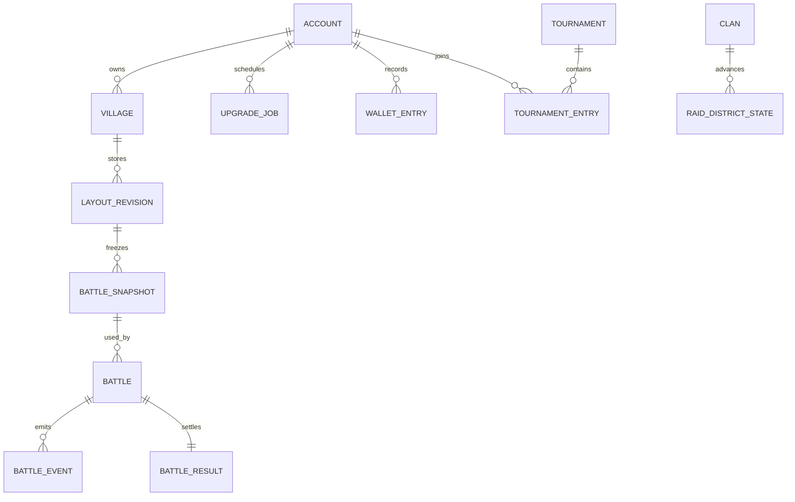

# 24. 데이터·전투 스냅샷·서버·동기화 구조

> **이 문서의 아키텍처 전체는 [제안]이다.** 공개 게임 규칙을 모순 없이 구현하기 위한 참조 모델이며, Supercell의 실제 서버 구성·엔진·DB·네트워크 프로토콜을 설명하지 않는다. 기준 규칙: 2026-11-13 KST.

## 1. 설계 목표

클래시 오브 클랜과 같은 구조를 재구현할 때 어려운 부분은 짧은 공격 전투와 수개월 지속되는 계정 상태를 연결하는 일이다. 전투는 시작 시점의 배치·능력치로 진행되어야 하고, 그동안 본 마을의 업그레이드가 완료되거나 클랜 명단이 바뀔 수 있다. 다른 플레이어가 같은 목표에 기여하는 모드까지 포함하면 단일 “현재 게임 상태”로 표현하기 어렵다.

따라서 다음 세 범주를 나눈다.

1. **영구 상태:** 계정 자원, 성장, 보유 아이템, 클랜 소속.
2. **기간 상태:** 랭크 등록, 전쟁 명단, 시즌 진행, 수도 주말 공격권.
3. **전투 상태:** 고정된 공격·방어 사본과 해당 전투에서 발생한 이벤트.

배치를 복제하거나 주기별로 고정해야 한다는 설계 동기는 [공식 랭크 지원](https://support.supercell.com/clash-of-clans/en/articles/ranked-leagues-4.html)과 [복수 Shadow Base 설명](https://supercell.com/en/games/clashofclans/blog/release-notes/get-ready-for-ranked-update/)에서 확인할 수 있다. 아래의 기술 선택은 독립적인 구현 제안이다.

## 2. 논리 모듈과 소유권

| 모듈 | 소유하는 상태 | 외부에 제공하는 명령 |
|---|---|---|
| Account/Progression | 건물·연구·영웅·해금·작업 | 업그레이드 시작/완료, 성장 조회 |
| Economy/Inventory | 자원·메달·아이템·거래 원장 | 차감/지급/사용/교환 |
| Layout | 편집 배치·슬롯·배치 검증 | 저장, 유효성 검사, 스냅샷 생성 |
| Army | 편성 템플릿·현재 출전 가능 상태 | 편성 저장, 출전 계약 생성 |
| Battle | 시뮬레이션·입력·결과·리플레이 | 시작, 명령, 결과 확정 |
| Competition | 랭크·전쟁·리그의 참가·점수 | 등록, 공격권 예약, 대회 정산 |
| Clan/Capital | 클랜 권한·기부·공동 성장·수도 진행 | 기부, 명단 변경, 구역 전투 적용 |
| LiveOps/Store | 규칙 버전·기간·상품 권한 | 시즌 활성화, 보상 청구, 구매 반영 |

이는 논리적 경계다. 초기 구현부터 각 모듈을 독립 네트워크 서비스로 나눌 필요는 없다. 먼저 하나의 서버 프로세스 안에서 명확한 소유권과 트랜잭션 경계를 가진 모듈로 시작하고, 병목이 측정된 부분을 분리한다.

## 3. 주요 엔터티



### 3.1 영구 식별자

콘텐츠 종류를 가리키는 `definitionId`와 계정에 놓인 개별 건물을 가리키는 `instanceId`를 구분한다. 대포 두 개의 레벨·위치·업그레이드 상태가 다를 수 있기 때문이다. 장비처럼 종류별 단일 보유 개체인 콘텐츠와 건물처럼 같은 종류가 여러 개인 콘텐츠에 같은 키 정책을 강제하지 않는다.

### 3.2 버전 계층

| 버전 | 바뀌는 것 | 왜 별도로 필요한가 |
|---|---|---|
| `schemaVersion` | 저장 데이터 구조 | 마이그레이션 |
| `contentVersion` | 비용·HP·DPS·레벨 표 | 밸런스 재현 |
| `ruleVersion` | 점수·타깃·효과·참가 규칙 | 같은 수치라도 동작이 달라짐 |
| `layoutRevision` | 배치·함정 위치 | 편집본과 전투본 추적 |
| `eventVersion` | 시즌·기간·보상 조건 | 이벤트 정산 |
| `snapshotVersion` | 특정 전투용 고정 상태 | 진행 중 계정 변경과 격리 |

하나의 `gameVersion` 문자열만으로는 중간 밸런스 패치, 서버 설정 변경, 클라이언트 업데이트를 구분하기 어렵다.

## 4. 출전 계약

공격 화면에 보인 정보와 서버가 실제 사용하는 조건을 `BattleContract`로 묶는다.

```text
BattleContract
  battleId, attackerId, mode, createdAt
  targetSnapshotId, attackerLoadoutSnapshotId
  contentVersion, ruleVersion, modifierSetId
  allowedDeploymentRegion, battleDuration
  attackTicketId?, revengeTicketId?, raidDistrictRevision?
  lootPolicyId, scorePolicyId, rewardPolicyId
  inputSequenceStart, contractHash
```

군대 스냅샷에는 병력 종류와 수뿐 아니라 영웅·장비·펫·지원군·적용된 일시 강화의 계산 결과가 필요하다. 화면의 편성 템플릿은 해금 여부를 실시간 확인해야 하지만, 이미 시작한 전투의 상태는 도중에 덮어쓰지 않는다.

### 만료와 전투 시작의 경계

슈퍼 유닛·이벤트 병력·시간형 아이템이 출전 직전 만료되면 계약을 만들기 전에 재검증한다. 계약이 확정된 뒤 효과를 유지할지 종료할지는 각 효과 정책으로 정해야 한다. 일반적으로 예측 가능한 전투를 위해 시작 시점에 고정하는 모델이 합리적이지만, 이를 원작의 모든 효과에 대한 확인 사실로 주장하지 않는다.

## 5. 전투 명령과 시뮬레이션

### 5.1 입력 중심 인터페이스

```text
DeployUnit(battleId, seq, unitSlot, position, requestedTick)
CastSpell(battleId, seq, spellSlot, position, requestedTick)
ActivateHeroAbility(battleId, seq, heroId, requestedTick)
ReleaseSiegePayload(battleId, seq, siegeId, requestedTick)
EndAttack(battleId, seq)
```

클라이언트가 “적 건물 HP를 0으로 바꾼다”를 보내는 대신 합법적인 명령을 보내고, 결과는 검증 가능한 시뮬레이션에서 얻는다. 입력 번호와 중복 방지 키를 두어 재전송이 같은 병력을 두 번 배치하지 않게 한다.

### 5.2 권위 모델 선택

| 모델 | 장점 | 비용·위험 |
|---|---|---|
| 서버 실시간 시뮬레이션 | 결과·시간 검증이 명확 | 지속 계산 비용·입력 지연 대응 |
| 클라이언트 진행 + 서버 입력 재생 검증 | 부드러운 조작, 사후 재현 | 결정론·지연된 확정·검증 처리량 |
| 혼합 모델 | 상황에 따라 비용 조절 | 두 경로의 결과 일치와 운영 복잡도 |

어느 모델이 원작에 쓰이는지는 이 조사로 확인하지 않았다. 재구현 시에는 첫 번째 프로토타입부터 같은 입력 로그를 반복 실행해 동일 결과를 얻는지 확인하면 선택의 폭을 유지할 수 있다.

### 5.3 시간의 세 종류

| 시간 | 쓰임 | 예시 |
|---|---|---|
| 서버 절대 시각 | 기간·작업·보호막 종료 | `endsAtUtc` |
| 전투 시뮬레이션 시간 | 이동·공격·효과·전투 제한 | `simulationTick` |
| 화면 재생 시간 | 리플레이·연출·배속 | `playbackTime` |

[확인] 2026년 6월에는 일부 전투에 Live Fast Forward가 도입되었다. 이런 기능은 화면 시간과 시뮬레이션 시간의 혼동을 특히 위험하게 만든다. [Anime Fury 업데이트](https://supercell.com/en/games/clashofclans/blog/release-notes/the-anime-fury-update-is-here/)

4배 재생을 켰다고 건설 타이머·보호막·시즌 종료 시간이 4배 흐르면 안 된다. 또한 클라이언트가 보내는 시각을 그대로 신뢰해 조기 전투 종료나 더 많은 공격을 허용해서도 안 된다.

## 6. 전투 종료와 보상 정산

```text
settleBattle(battleId):
  result = loadValidatedResult(battleId)
  if settlementExists(battleId):
    return existingSettlement(battleId)
  beginTransaction()
    assert result.status == FINAL
    settlement = evaluatePolicies(result, result.contract)
    applyWalletEntriesOnce(settlement.entries)
    applyProgressAndScoresOnce(settlement.progress)
    consumeOrReleaseReservedTickets(settlement)
    writeSettlementReceipt(battleId, settlement)
  commit()
  publishResultAvailable(battleId)
```

**핵심 불변식**

- 전투 하나의 보상 영수증은 최대 하나다.
- 지급·차감에는 화폐 종류, 원인 이벤트, 규칙 버전이 남는다.
- 일반 약탈·복수·랭크·전쟁의 경제 정책을 같은 계산으로 처리하지 않는다.
- 결과 화면 재조회는 계산 재실행이 아니라 확정 영수증 조회다.
- 지급 실패 후 재시도는 이미 성공한 부분을 중복 적용하지 않는다.

클라이언트가 종료 화면을 못 보았다고 공격권을 자동 반환하면 불리한 전투를 강제 종료하는 이익이 생긴다. 반대로 서버가 계약 생성에 실패한 요청까지 소모시키면 정상 사용자를 벌한다. 승인 전 실패와 시작 후 이탈을 나눠야 한다.

## 7. 모드별 동시성: 같은 기지를 공격해도 의미가 다르다

| 모드 | 같은 목표에 여러 공격 | 합칠 데이터 | 피해야 할 구현 |
|---|---|---|---|
| 일반 전투 | 배정 정책에 따라 제어 | 해당 공격의 약탈 거래 | 같은 실자산의 이중 약탈 |
| 일반 클랜전 | 서로 다른 공격 인스턴스 | 기지 최고 별·파괴율 | 이전 공격의 HP 손실을 다음 공격에 유지 |
| 개인 랭크 | 대회 고정 방어본 | 각각의 공격·방어 점수 | 편집 중 배치를 즉시 반영 |
| 클랜 수도 | 구역 진행도를 공유 | 누적 파괴·잔여 HP·지속 효과 | 동일 revision 결과를 두 번 적용 |

### 7.1 클랜전의 최고 기록 갱신

```text
currentBest = loadWarBaseBest(baseId)
newBest = maxByModeRanking(currentBest, completedAttack)
saveBestWithCompareAndSwap(baseId, currentBest.revision, newBest)
```

`maxByModeRanking`은 별 우선 등 모드 규칙을 사용한다. 더 늦게 완료되었다는 이유만으로 이전의 더 좋은 공격을 덮어쓰면 안 된다.

### 7.2 수도 구역의 누적 진행

```text
lease = reserveDistrict(raidId, districtId, expectedRevision)
result = simulate(snapshotAt(lease.revision), inputLog)
commitDistrictDeltaOnce(lease, result.delta)
```

구역이 이미 완파된 경우 새 전투를 시작할 수 없도록 한다. 전투 중 접속 종료로 잠금이 영구 유지되지 않게 복구 정책도 필요하다. 구체적인 원작 동시 공격 허용 범위는 [17 수도](17_clan_capital_and_raid_weekends.md)의 공개 규칙과 별도로 관찰한다.

## 8. 장기 작업과 클라이언트 오프라인

업그레이드는 매초 서버에서 카운터를 감소시키는 대신 `startedAt`, `workRequired`, `speedSchedule`, `completedAt` 모델로 표현할 수 있다. 가속 아이템이 중간에 들어오면 과거 진행량과 새 속도를 정확히 연결한다.

| 사건 | 해야 할 일 |
|---|---|
| 오프라인 중 완료 | 다음 조회 시 완료를 확정하거나 백그라운드 완료 이벤트 처리 |
| 가속 도중 완료 | 초과 가속을 어떻게 처리하는지 아이템 규칙 적용 |
| 점검 중 완료 | 서버 시간 기준으로 손실 없이 처리 |
| 완료 직후 다음 작업 요청 | 직전 작업 완료와 장인 반환을 같은 상태에서 판단 |
| 취소 재전송 | 환급·장인 반환을 한 번만 적용 |

시간 비교는 서버에서 수행한다. 화면은 종료 시각을 받아 카운트다운을 표현하되 재접속 시 보정한다.

## 9. 리플레이 계약

```text
ReplayManifest
  battleId, ruleVersion, contentVersion
  initialSnapshotHash, rngSeedAndAlgorithmVersion?
  orderedInputEvents, terminalResultHash
  rendererCompatibilityVersion
```

RNG가 필요 없는 규칙에는 억지로 난수를 넣지 않는다. 난수를 사용한다면 하나의 시드만 기록하고 엔티티 순회 순서가 바뀌어 결과가 달라지는 함정을 피하도록 호출 영역을 분리한다.

패치 후 예전 전투 재생이 불가능할 수 있다. 선택지는 구버전 시뮬레이터 유지, 확정 이벤트 스트림 재생, 구간별 상태 체크포인트다. 각각의 저장 비용·유지 비용·재현력을 비교하고 리플레이 보존 기간을 정책으로 정한다. 원작의 보존 기간을 임의 숫자로 제시하지 않는다.

## 10. 언리얼로 재구현할 때의 연결 예시

아래는 숙련된 UE 개발자를 위한 선택지이며 원작 사용 기술의 설명은 아니다.

| 역할 | UE 구현 후보 | 주의점 |
|---|---|---|
| 전투 규칙 | 렌더링에 독립적인 C++ 시뮬레이션 모듈 | `UWorld` 시간과 서버 경제 시간을 혼합하지 않음 |
| 콘텐츠 편집 | Data Asset·Data Table + 버전 있는 배포 카탈로그 | 클라이언트 에셋을 서버 정산의 유일한 권위로 삼지 않음 |
| 전장 표현 | 시각 객체 풀·컴포넌트, 필요 시 인스턴싱 | 화면 객체 수명과 시뮬레이션 엔티티 수명 구분 |
| 명령 처리 | 플레이어 입력→전투 명령 큐 | `Tick` 순서에 따라 타깃 선택이 바뀌지 않게 정렬 |
| UI 상태 | ViewModel 또는 별도 상태 모델 | 메뉴마다 자원·완료 시간을 제각각 계산하지 않음 |
| 관전·리플레이 | 이벤트 스트림·스냅샷 재생 | 시각 최적화가 결과를 바꾸지 않게 분리 |

멀티플레이 게임이라는 이유만으로 모든 병력 Actor의 Transform을 상시 복제할 필요가 있는 것은 아니다. 방어자가 직접 조종하지 않는 비동기 전투의 요구, 관전 지연 허용치, 검증 모델을 먼저 정하고 전송 대상을 선택한다.

## 11. 기술 QA [제안]

1. 동일 계약·입력·규칙 버전으로 반복 실행한 전투 결과가 일치한다.
2. 전투 진행 중 업그레이드 완료가 이미 고정된 전투 HP를 바꾸지 않는다.
3. 패킷 중복·재전송에도 병력·마법·공격권을 한 번만 소비한다.
4. 수도 구역의 같은 revision을 두 결과가 동시에 갱신하면 하나만 확정된다.
5. 클랜전 후발 저성과가 선행 최고 기록을 덮어쓰지 않는다.
6. 지급 직후 통신 단절 후 재접속해도 자원이 복제되지 않는다.
7. 콘텐츠 패치 후 과거 전투는 해당 버전 또는 명시적 재생 제한으로 처리한다.
8. 앱 배속·일시정지·단말 시각 변경이 영구 타이머를 바꾸지 않는다.
9. 클랜 이동과 보상 청구가 경합해도 참가 시점의 귀속 정책을 유지한다.
10. 결과·원장·순위가 불일치할 때 원인 이벤트까지 추적 가능하다.

## 12. 관련 문서

[02 건설](02_village_builders_and_construction.md) · [06 전투](06_battle_rules_and_resolution.md) · [11 매칭](11_matchmaking_shields_and_revenge.md) · [12 랭크](12_ranked_leagues_and_tournaments.md) · [14 전쟁](14_clan_wars.md) · [17 수도](17_clan_capital_and_raid_weekends.md) · [25 검증](25_qa_and_analytics.md)
