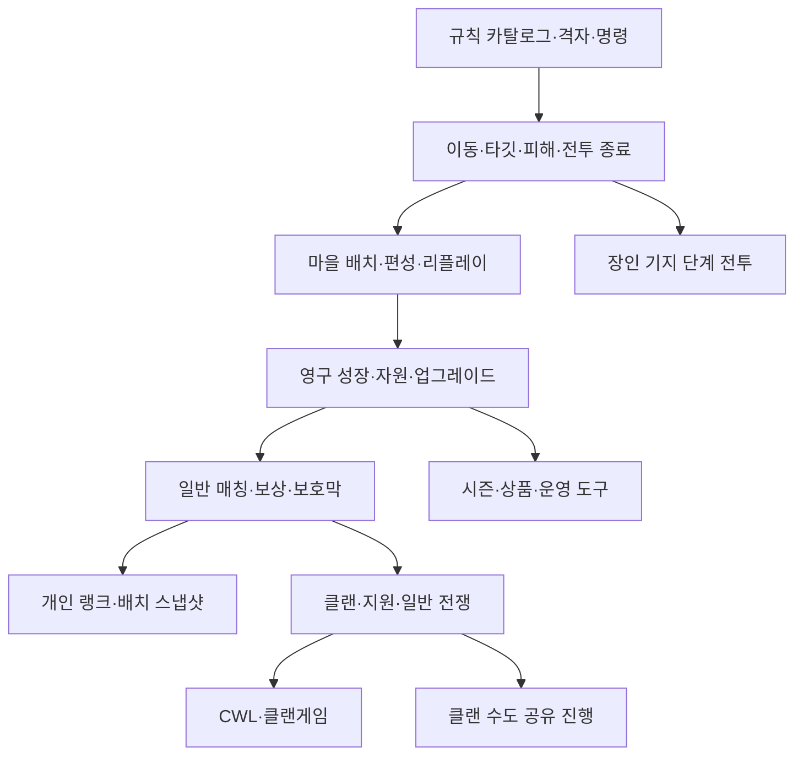

# 26. 재구현 범위·의존성·구현 작업 계획

> **[제안]** 역기획을 개발 가능한 작업 단위로 변환한 계획이다. 실제 프로토타입을 구현·배포했거나 원작과 동일성이 검증되었다는 의미는 아니다. 추정 인력·일정은 팀 규모가 정해지지 않아 제시하지 않는다.

## 1. 개발 목표를 먼저 고정하기

이 문서 묶음은 본 마을 전투부터 장인 기지·클랜 수도·시즌 운영까지 폭넓게 분석했다. 하지만 구현 순서는 기능 개수보다 의존성과 검증 위험으로 정해야 한다.

첫 프로토타입의 핵심 질문은 세 가지다.

1. 같은 편성이라도 투입 위치와 순서에 따라 결과가 달라지는가?
2. 마을 배치를 바꾸면 공격자가 다른 공략을 고민하게 되는가?
3. 전투 결과가 다음 성장·편성 선택으로 연결되는가?

이 세 가지가 성립한 뒤 경쟁·클랜·장기 운영을 연결한다. 상점과 시즌 화면부터 완성하면 전투 문법이 바뀔 때 모든 콘텐츠를 다시 맞춰야 한다.

## 2. 기능 의존성



화살표는 최소 기술 의존성이다. 기획·아트·UI 설계까지 순차로 기다려야 한다는 뜻은 아니다. 예를 들어 랭크 UI는 전투 API 계약이 정해지면 서버 구현과 병행할 수 있다.

## 3. 단계별 완료 조건

### P0. 규칙과 전장 최소 모델

**범위:** 격자, 건물 점유, 배치 금지 영역, 유닛 정의, 지상/공중 구분, 타깃 후보 필터, 이동, 공격 주기, 피해, 사망.

**콘텐츠 샘플:** 근접 일반 공격, 원거리 공격, 방어시설 우선 공격, 장벽 대응, 비행, 치유처럼 서로 다른 행동 계약을 대표하는 소수 유닛을 선택한다. 샘플 수를 늘리기 위해 같은 AI에 능력치만 다른 캐릭터를 반복 구현하지 않는다.

**완료 조건:** 같은 입력 로그를 재생하면 같은 파괴 결과가 나오고, 외곽 건물을 제거했을 때 본대 진입 경로가 달라지는 예제를 설명할 수 있다. 경로를 찾지 못했을 때 무한 정지하지 않는다.

참조: [06 전투](06_battle_rules_and_resolution.md), [07 AI](07_unit_ai_and_pathfinding.md), [10 배치](10_defenses_traps_and_layout.md).

### P1. 한 판의 전투 완성

**범위:** 정찰→투입→능력 사용→종료→결과, 별·파괴율, 마법 범위 효과, 영웅 능력, 지원군·시즈의 방출, 기초 리플레이.

**완료 조건:** 성공·실패·시간 초과·강제 종료가 명확하게 구분된다. 같은 마법을 같은 영역에 중복 사용했을 때 합성 규칙을 설명할 수 있다. 마지막 건물 파괴와 전투 종료가 겹쳐도 별이 흔들리지 않는다.

**판단:** 여기서 재미가 약하다면 성장 속도나 보상량으로 가리지 않고 타깃 유도·진입·위험 대응을 다시 조정한다.

참조: [05 편성](05_army_composition.md), [08 마법·시즈](08_spells_siege_and_super_troops.md), [09 영웅](09_heroes_equipment_and_pets.md).

### P2. 영구 마을과 경제 연결

**범위:** 마을 편집, 자원 지갑, 건설·연구 작업, 장인 슬롯, 해금 그래프, 전투 보상, 접속 종료 후 복구.

**완료 조건:** 업그레이드의 선행조건·비용·예상 완료를 확인하고 시작할 수 있다. 완료 시 공격 선택지가 바뀐다. 전투 결과 중복 제출·오프라인 완료·시간 변경에도 자산이 일관된다.

**현행 반영:** 기본 병력 훈련 대기를 성장 루프의 전제로 새로 넣지 않는다. 이 프로젝트가 별도로 다른 게임 규칙을 택한다면 원작 재현과 변형 설계를 문서에서 구분한다. 현행 기준은 [00](00_scope_and_version_baseline.md)을 따른다.

참조: [02 건설](02_village_builders_and_construction.md), [03 성장](03_progression_research_and_unlocks.md), [04 경제](04_resources_loot_and_economy.md).

### P3. 비동기 대전과 개인 경쟁

**범위:** 기지 스냅샷, 일반 대전 대상, 실제 약탈/사본 경제 분리, 보호막, 복수, 대회 등록, 제한 공격, 방어 점수, 승강.

**완료 조건:** 일반 전투가 랭크 점수를 바꾸지 않고, 대회용 배치의 적용 시점을 UI에서 알 수 있다. 주간 랭크와 Legend I 점수 정책을 각각 테스트할 수 있다. 대회 마감과 진행 중 공격의 정산 경계가 정해져 있다.

참조: [11 매칭](11_matchmaking_shields_and_revenge.md), [12 랭크](12_ranked_leagues_and_tournaments.md), [24 서버](24_data_architecture_and_network.md).

### P4. 클랜 협동과 다인 경쟁

**범위:** 클랜 권한, 지원 요청·기부, 전쟁 참가 명단, 전쟁용 배치, 기지별 최고 기록, CWL 라운드, 클랜게임 과제.

**완료 조건:** 지원의 비용·용량·레벨 제한이 양쪽 계정에서 맞는다. 전쟁 후속 공격이 최고 기록을 훼손하지 않는다. 시즌 명단과 라운드 명단을 구분하며, 탈퇴·재가입 중에도 보상 귀속이 명확하다.

참조: [13 클랜](13_clans_social_and_donations.md), [14 전쟁](14_clan_wars.md), [15 CWL](15_clan_war_leagues.md), [18 클랜게임](18_clan_games.md).

### P5. 별도 전장과 라이브 운영 확장

**범위:** 장인 기지의 단계별 전투, 수도의 공유 구역 피해, 기간 이벤트, 패스·아이템 권한, 복귀 안내, 운영 설정 배포.

**완료 조건:** 본 마을 전투 규칙을 재사용하면서도 단계 전환·누적 피해·전용 재화를 독립적으로 표현한다. 시즌을 중간에 변경하거나 종료해도 기존 전투·완료 작업·미수령 보상이 설명 가능한 상태로 남는다.

참조: [16 장인 기지](16_builder_base.md), [17 수도](17_clan_capital_and_raid_weekends.md), [19 PvE](19_single_player_practice_and_challenges.md), [20 패스](20_quests_achievements_and_pass.md), [21 아이템](21_monetization_and_magic_items.md), [23 운영](23_liveops_and_balance.md).

## 4. 구현 작업 패키지

| ID | 작업 | 입력 계약 | 산출물 | 핵심 수용 기준 |
|---|---|---|---|---|
| WP-01 | 콘텐츠 카탈로그 | 종류·레벨·해금·규칙 정의 | 버전 있는 정적 데이터 | 참조 누락·순환 선행조건 검출 |
| WP-02 | 전투 시뮬레이션 | 배치·편성·입력 명령 | 결과·이벤트 로그 | 반복 실행 동일 결과 |
| WP-03 | AI·경로 | 목표 필터·전장 상태 | 이동·공격 의도 | 막힘·재선정·사거리 경계 |
| WP-04 | 효과 시스템 | 피해·버프·소환·제어 | 중첩·만료·사망 이벤트 | 동시 효과의 정해진 순서 |
| WP-05 | 배치 편집기 | 소유 건물·배치 제약 | 유효 배치 revision | 저장본·전투본 구분 |
| WP-06 | 경제 원장 | 원인 이벤트·화폐 벡터 | 거래·잔고·영수증 | 중복 지급·음수·용량 오류 방지 |
| WP-07 | 성장 작업 | 대상·비용·장인·시간 | 작업·완료·해금 | 취소·가속·오프라인 일관성 |
| WP-08 | 비동기 대전 | 출전 계약·대상 사본 | 정산된 전투 | 원본·사본 경제 분리 |
| WP-09 | 개인 대회 | 등록·그룹·리그 정책 | 점수·승강·기록 | 모드별 방어 점수 정확 |
| WP-10 | 클랜/전쟁 | 권한·명단·배치·공격 | 최고 기록·클랜 결과 | 참가·기부·정산 귀속 |
| WP-11 | 수도/장인 기지 | 모드별 상태 기계 | 단계·공유 진행 | 다른 모드에 부작용 없음 |
| WP-12 | 시즌/상품 | 기간·권한·보상 설정 | 청구·소비·만료 | 기준 버전과 기간 경계 일치 |
| WP-13 | 운영·분석 | 표준 이벤트·규칙 카탈로그 | 대시보드·설정 검토 | 표본 범위·버전 추적 |

이 표는 티켓으로 옮기기 위한 시작점이다. 개별 유닛 구현과 UI 화면은 해당 패키지의 계약이 정해진 뒤 병렬 하위 작업으로 분해한다.

## 5. 재사용 가능한 규칙과 모드 전용 규칙

| 공통으로 재사용 | 모드별 정책으로 분리 |
|---|---|
| HP·피해·효과·타깃 필터 | 최대 별·시간·단계 전환 |
| 격자·배치·장벽·이동 | 투입 가능 영역·확장 방식 |
| 전투 입력·리플레이 | 공격 횟수·실패 시 소비 |
| 자원 원장·보상 영수증 | 실제 약탈·생성 보상·전용 재화 |
| 스냅샷·버전 | 배치 고정 시점·현재 구역 피해 |
| 참가 권한·역할 | 클랜전/CWL/수도 참가 조건 |

`if (isBuilderBase)` 같은 분기가 전투 전체로 퍼지기 전에 `BattleModeRule`이 제공할 정책 목록을 정한다. 다만 모든 작은 차이를 추상화한 범용 엔진부터 만들 필요는 없다. 실제 두 번째 모드에서 확인된 차이를 추출하는 방식으로 확장한다.

## 6. 최소 데이터 예시 [제안]

아래 값은 **구조 예시이며 원작 수치가 아니다.** 실제 레벨·성능 표처럼 사용하면 안 된다.

```yaml
mode:
  id: sample_async_raid
  rules_version: sample-v1
  max_stars: 3
  snapshot_policy: freeze_at_start
  progression_damage_persists: false
  score_policy: stars_and_destruction
  reward_policy: configured_loot_policy

unit_behavior:
  id: sample_defense_seeker
  movement_layer: ground
  preferred_target_tag: defense
  fallback_target_tag: attackable_building
  path_policy: reachable_goal_with_wall_fallback
  attack_policy: configured_by_unit_level
```

타깃 선택과 경로 정책을 원작이 공개한 정확한 알고리즘처럼 이름 붙이지 않는다. 재현할 관찰 행동을 만족하는 구현이라는 점을 명세에 남긴다.

## 7. 완료 정의

기능이 메뉴에서 실행된다는 것만으로 완료로 판단하지 않는다.

- 기획: 입력·출력·제약·종료·예외가 문서로 연결된다.
- 데이터: 콘텐츠 버전과 선행조건이 유효하다.
- 시뮬레이션: 정상 사례와 동시 사건의 결과가 설명 가능하다.
- 서버: 재시도·중복·오프라인·마감에서 자산과 점수가 일관된다.
- UI: 현재 상태, 불가능한 이유, 실제 적용 시점을 알 수 있다.
- 분석: 성공률의 분모와 대상 버전을 복원할 수 있다.

성능 목표는 대상 단말, 화면 최대 유닛 수, 서버 검증 방식이 정해진 뒤 설정한다. 원작의 tick rate나 네트워크 전송 주기를 임의로 선택해 “역기획 확인값”으로 기록하지 않는다.

## 8. 요구사항 추적 예시

| 요구사항 | 관련 문서 | 구현 경계 | 검증 |
|---|---|---|---|
| 배치로 공격 경로를 유도한다 | 05·07·10 | 전장·AI·편성 | QA-C03~C05 |
| 성장 결과가 출전 선택지에 반영된다 | 02·03·09 | Progression·Army | QA-E01·E05 |
| 일반/랭크를 다른 정책으로 처리한다 | 11·12 | Matchmaking·Competition | QA-M10·M11 |
| 전투 결과는 한 번만 지급한다 | 04·24 | Battle·Economy | QA-E08 |
| 전쟁은 최고 기록, 수도는 누적 진행이다 | 14·17·24 | ClanWar·Capital | QA-M03·M06 |
| 시즌과 보상 청구 기간을 구분한다 | 20·21·23 | LiveOps·Inventory | QA-E09·M12 |
| 기준일 이후 발표를 현행과 분리한다 | 00·23 | RuleCatalog | 버전 활성화 검토 |

## 9. 추가 확인이 필요한 핵심 질문

1. **정확한 AI 동률 규칙:** 같은 거리·같은 우선순위의 목표에서 무엇이 먼저 선택되는가?
2. **랭크 배치 잠금:** 그룹 편성과 전투 시작 사이 변경이 현행 빌드에서 반영되는가?
3. **혼합 자원 보호막 경계:** 30% 약탈 판정은 화폐별·전체 중 어떤 모델인가?
4. **능력치 절삭:** 공격 간격·회복·비율 피해·별 점수의 정밀도는 무엇인가?
5. **효과 만료:** 시작 직전/도중 임시 강화의 만료를 어디에서 고정하는가?
6. **라이브 적용 범위:** 시험 도입·계정별 UI·미리 갱신된 지원 설명은 어디까지 적용되었는가?

이 질문의 답을 확보하면 각 시스템의 [미확인]을 [확인]으로 승격하고, 관련 데이터·QA·출처를 함께 갱신한다. 하나의 숫자를 수정할 때도 문서 전체를 무조건 다시 쓰지 않고 영향을 받는 규칙 계약을 따라 변경한다.

## 10. 관련 문서

[전체 목차](../README.md) · [00 기준과 한계](00_scope_and_version_baseline.md) · [22 UX](22_ui_ux_and_onboarding.md) · [24 아키텍처](24_data_architecture_and_network.md) · [25 검증](25_qa_and_analytics.md) · [출처와 충돌 목록](../references/01_sources_and_evidence.md)
