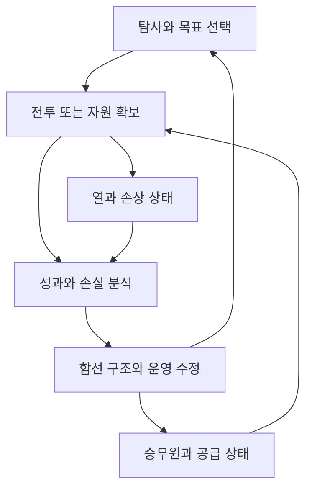

# 01. 코어 루프와 시스템 관계

[전체 목차](README.md) · 문서 ID: SYS-01 · 작성: 2026-11-13 · 기준: 0.30.5a 문헌

## 1. 핵심 경험

**[확인]** Cosmoteer는 부품 배치를 통해 함선을 설계하고, 개별 승무원이 장치 운용과 운반을 수행하며, 부위 파괴가 가능한 전투를 진행하는 게임이다. Career에는 탐사·계약·획득물·함선 확장이 연결된다. [P01]

**[해석]** 중심 재미는 “좋은 부품을 소유했다”보다 “여러 부품이 함께 제 성능을 내도록 만들었다”에 있다. 플레이어는 전투 전에 구조를 설계하고, 전투 중에는 방향·거리·집중 표적을 선택하며, 전투 후에는 실패의 원인을 구조와 운영 설정에 반영한다. 설계와 조종이 같은 결과를 서로 다른 시간 규모에서 바꾸는 구조다.

### 핵심 질문

| 플레이어 질문 | 실제로 비교하는 것 | 담당 시스템 |
| --- | --- | --- |
| 무기를 더 달까? | 순간 화력과 지속 공급 능력 | 무기·전력·물류 |
| 장갑을 두껍게 할까? | 생존성과 질량·가동면적 | 방어·기동·설계 |
| 원자로를 가까이 둘까? | 운반 거리와 손상 위험 집중 | 전력·피해·배치 |
| 승무원을 더 고용할까? | 인력 여유와 고용 가능 범위·공간 | 승무원·명성·경제 |
| 수송함을 따로 만들까? | 전투 집중도와 함대 관리 비용 | 자원·함대·전술 |
| 오버클럭을 쓸까? | 순간 또는 지속 이득과 열 처리 | 열·전력·무기 |

## 2. 세 가지 반복 루프 [해석]

### 2.1 전술 루프

적 상태를 읽고, 접근 방향과 거리 또는 부위 표적을 정하며, 공격 결과를 확인한다. 손상이 전투 중의 기동·화력·공급 상태를 바꾸므로 명령을 반복해서 수정해야 한다. 조준을 잘해도 무기 운용이 중단되면 계획대로 진행되지 않는다.

### 2.2 운용 루프

승무원 배치, 공급 설정, 재고, 운송 거리, 열 상태를 관찰하고 병목을 제거한다. 이 루프의 결과는 한 발의 피해보다 발사 간격, 복구 시간, 후퇴 가능성에서 드러난다. 무기의 툴팁과 교전 기록의 차이가 운용 개선의 단서가 된다.

### 2.3 성장 루프

탐사·교전·임무를 통해 얻은 성과를 자원·설계 해금·인력·함선 변경으로 전환한다. 새 부품은 답을 완성하는 보상인 동시에 기존 구조의 재배치를 요구하는 새로운 문제다. 모듈 수가 늘어날수록 운영 관계가 복잡해져 성장과 설계 학습이 함께 진행된다.

이 다이어그램은 보상이 항상 전투에서만 발생한다는 뜻이 아니다. 채굴·회수·거래도 다음 설계 변경을 가능하게 하는 자원 획득 경로로 읽는다.

## 3. 시스템 경계와 상태 [제안]

| 상태 계층 | 주요 상태 | 변경 원인 | 외부에 제공하는 결과 |
| --- | --- | --- | --- |
| 세계·커리어 | 위치, 소속, 임무, 명성, 해금 | 이동·임무·거래 | 선택 가능한 목표·부품·인원 |
| 함선 설계 | 부품, 회전, 연결, 문, 설정 | 편집·건조·파괴 | 이동 경로·질량·장치 집합 |
| 함선 운영 | 승무원 작업, 자원 예약, 재고 | 명령·장치 수요 | 공급량·가동 상태 |
| 전투 시뮬레이션 | 위치, 투사체, 표적, 방어, 피해 | 시간 진행·명령 | 피해·손상·전술 우위 |
| 열·복구 | 열 상태, 냉각, 화재, 수리 계획 | 작동·피격·복구 | 성능 변화·위험·생존 상태 |
| 표시·저장 | 오버레이, 경고, 설계·세이브 | 상태 변화·저장 명령 | 이해 가능한 결과와 재시작점 |

설계 상태와 실행 상태를 구분하는 것이 중요하다. 설계에는 무기가 존재하지만 실행 상태에는 승무원과 재고가 부족할 수 있다. UI가 설계상 가능과 현재 가능을 같은 초록색으로 표시하면 플레이어는 실패 원인을 찾을 수 없다.

## 4. 함선 성능을 구성하는 네 가지 축 [해석]

### 4.1 잠재 성능

부품이 이상적인 조건에서 제공할 수 있는 화력, 방어, 추력, 저장 용량이다. 가격표와 부품 설명을 통해 비교하기 쉽다. 하지만 서로 다른 부품의 최대값을 단순 합산하면 실제 성능을 과대평가하기 쉽다.

### 4.2 지속 성능

일정한 교전 구간 동안 유지되는 평균 출력이다. 탄약과 전지 전달, 조작 인력, 냉각, 타격 가능한 표적의 존재가 제약한다. 초기 비축이 큰 함선은 짧은 테스트에서 강해 보이지만 재고가 고갈된 뒤 다른 결과를 보일 수 있다.

### 4.3 손상 후 성능

중요 부품이나 통로 하나가 사라진 뒤 남는 성능이다. 초기 DPS가 같아도 좌우 공급 구역의 독립성, 기동 장치의 분산, 유효 사격면의 수에 따라 피해 이후의 역량은 달라진다.

### 4.4 임무 성능

한 번의 결투가 아니라 목표를 끝내고 회수·복귀·보충할 수 있는 능력이다. 전투 승리 비용이 보상보다 크거나, 승리 후 이동·회수가 어려우면 커리어 운영 측면의 성과는 낮을 수 있다.

## 5. 병목을 설명하는 최소 모델 [제안]

다음 모델은 원작의 계산식이 아니라 설계를 비교하기 위한 근사다.

$$
\lambda_{effective}=\min(\lambda_{device},\lambda_{material},\lambda_{power},\lambda_{crew},\lambda_{thermal})
$$

각 항은 같은 단위인 `가능한 작동 횟수/초`로 변환한 뒤 비교한다. 예를 들어 초당 탄약량과 초당 발사 횟수를 그대로 비교하지 말고 발사당 탄약을 사용해 환산한다. 열 제한이 작동을 단순히 중단시키는 형태가 아닌 경우에는 해당 장치의 성능 모델로 먼저 환산한다.

피해량의 관측 모델은 다음처럼 나눌 수 있다.

$$
Damage(T)=\sum_{k \in hits[0,T]} ResolvedDamage_k
$$

유효 DPS는 `Damage(T)/T`다. 여기에 무기가 작동한 시간 비율, 유효 사격 기회, 명중·방어 결과가 모두 섞여 있으므로 하나의 숫자로 원인을 설명하지 않는다. 최소한 다음 항목을 함께 기록한다.

| 측정값 | 구분하려는 원인 |
| --- | --- |
| 표적 획득 가능 시간 | 거리·사각·명령 문제 |
| 발사 준비 완료 시간 | 전력·탄약·인력·열 문제 |
| 실제 발사 횟수 | 장치 운용 결과 |
| 유효 타격 횟수 | 선회·탄속·방어·가림 결과 |
| 주요 기능 상실 시점 | 단순 피해량과 무력화 효과의 차이 |

### 5.1 공급 병목 예시

**[가정 예시]** 전담 운반자 8명, 한 번 운송하는 표준 화물 1개, 왕복과 처리까지 10초라고 하자. 단순 정상상태 공급 능력은 `8 × 1 / 10 = 0.8개/초`다. 소비 장치가 1개/초를 요구하면 초기 비축이 있는 동안만 정상 작동하고, 장기 평균은 공급의 제약을 받는다.

동선을 줄여 왕복을 8초로 만들면 같은 인원으로 1개/초가 된다. 반대로 장치만 두 배로 증설해 소비가 2개/초가 되어도 운반 능력은 그대로다. 이것이 장치 증설과 함선 개선이 항상 같지 않은 이유다. 실제 게임의 운반량·대기·통로 효과는 [05](05_Internal_Logistics_and_Supply.md)에서 별도로 다룬다.

## 6. 설계 선택의 상충 관계 [해석]

| 선택 | 얻는 것 | 부담이 생기는 위치 | 확인할 지표 |
| --- | --- | --- | --- |
| 중앙에 자원원 집중 | 공유와 공간 효율 | 운반 거리·단일 손상 지점 | 구역별 공급 지연 |
| 공급을 여러 구역으로 분산 | 짧은 동선·독립성 | 추가 공간·건조 부담 | 손상 이후 유지율 |
| 높은 순간 출력 | 빠른 무력화 기회 | 비축·열·회복 시간 | 첫 교전과 재교전 성능 |
| 두꺼운 방어면 | 특정 방향의 생존성 | 질량·면적·사격 통로·다른 방향의 방어 | 노출 각도별 손실 |
| 단일 대형 함선 | 관리 집중·공유 자원 | 선회·집중 위험 | 다방향 대응 시간 |
| 역할별 여러 함선 | 포위·분업·리스크 분산 | 개별 생존·함대 운영 | 손실당 임무 달성률 |

모든 설계에 동일한 정답이 생기지 않도록 목표 함수가 여러 개여야 한다. 전투 예산만 같은 실험, 인력까지 같은 실험, 커리어에서 실제 복구 비용까지 포함한 실험을 나누어야 결과를 해석할 수 있다.

## 7. 대표 플레이 시나리오 [해석·제안]

### 시나리오 A: 무기는 충분하지만 전투 중 화력이 줄어든다

관측: 첫 교전에서는 정상적으로 발사하지만 시간이 지나면 간격이 벌어진다. 가능한 원인은 비축 소진, 전지 공급 지연, 인력의 다른 작업 배정, 열 상태, 사격각 이탈이다. 우선 발사 불가 사유를 분리하고 공급 쪽을 확인한다. 결과를 보지 않고 원자로부터 늘리면 운반 병목이 남을 수 있다.

### 시나리오 B: 같은 비용의 두 함선이 번갈아 우세하다

좁은 전방의 집중 화력은 정면 교전에 강할 수 있고, 기동성이 높은 상대는 노출 각도를 바꿀 수 있다. 비교할 때 초기 방향과 진입 거리, 명령 정책을 고정한 결투와 실제 플레이에 가까운 자유 전술을 분리한다. 설계와 조작의 기여를 따로 읽기 위해서다.

### 시나리오 C: 승리했지만 다음 교전을 못 한다

남은 자원량보다 자원의 위치, 저장 가능 공간, 회수 인력, 기동 상태를 확인한다. 전투 결과 화면은 “승리”와 함께 전력·탄약 회복 예상, 회수 가능성, 복구 비용을 보여 주는 것이 유용하다. 이러한 정보 표현은 [18](18_UI_UX_and_Player_Feedback.md)의 재구현 제안이다.

## 8. 시스템 간 불변 조건 [제안]

1. 소유하고 있는 자원과 장치가 지금 사용할 수 있는 자원을 구분한다.
2. 한 자원 또는 승무원을 서로 다른 작업에 중복 확정하지 않는다.
3. 부품 파괴는 연결·경로·가동 상태에 반영된다.
4. 플레이어 명령은 의도이며 장치별 실행 가능 조건을 건너뛰지 않는다.
5. 설계 예측값에는 초기 상태와 관측 조건을 붙인다.
6. 커리어 보상·세이브·공유 설계는 서로 다른 상태 범위를 가진다.

## 9. 수용 시나리오 [제안·미실행]

| ID | 조건 | 기대 결과 |
| --- | --- | --- |
| CORE-01 | 같은 부품 수로 통로·공급 배치만 변경 | 작동량 차이를 원인 지표로 설명 가능 |
| CORE-02 | 비축이 있는 경우와 없는 경우 비교 | 순간 성능과 지속 성능이 구분되어 기록 |
| CORE-03 | 핵심 공급 구역만 손상 | 관련 장치가 영향받고 독립 구역은 정상 유지 |
| CORE-04 | 다수 함선 중 수송 역할만 제거 | 전투 판정과 경제·회수 손실이 따로 집계 |
| CORE-05 | 설계는 합법이지만 운영 인력 부족 | 건조 가능과 가동 준비 상태를 각각 표시 |
| CORE-06 | 같은 기록을 다른 배속에서 재생 | 게임 시간 기준 결과가 정책대로 일관됨 |

## 10. 다음 문서

기초 구조는 [02 함선 편집](02_Ship_Construction_and_Blueprints.md)과 [03 연결·분리](03_Modules_Connectivity_and_Ship_Splitting.md), 운용은 [04 승무원](04_Crew_Roles_and_Task_AI.md)과 [05 물류](05_Internal_Logistics_and_Supply.md), 통합 구현은 [20](20_Technical_Architecture_and_Data_Model.md)으로 이어진다.

## 출처

- [P01] [Cosmoteer 공식 홈페이지](https://cosmoteer.net/): 함선 설계·승무원·부위 파괴·Career의 제품 설명. 직접 열람. 문서의 성능 모델과 의사결정 표는 이를 토대로 작성한 독립 분석이다.

<!-- 문서 내 출처 링크 -->
[P01]: https://cosmoteer.net/
