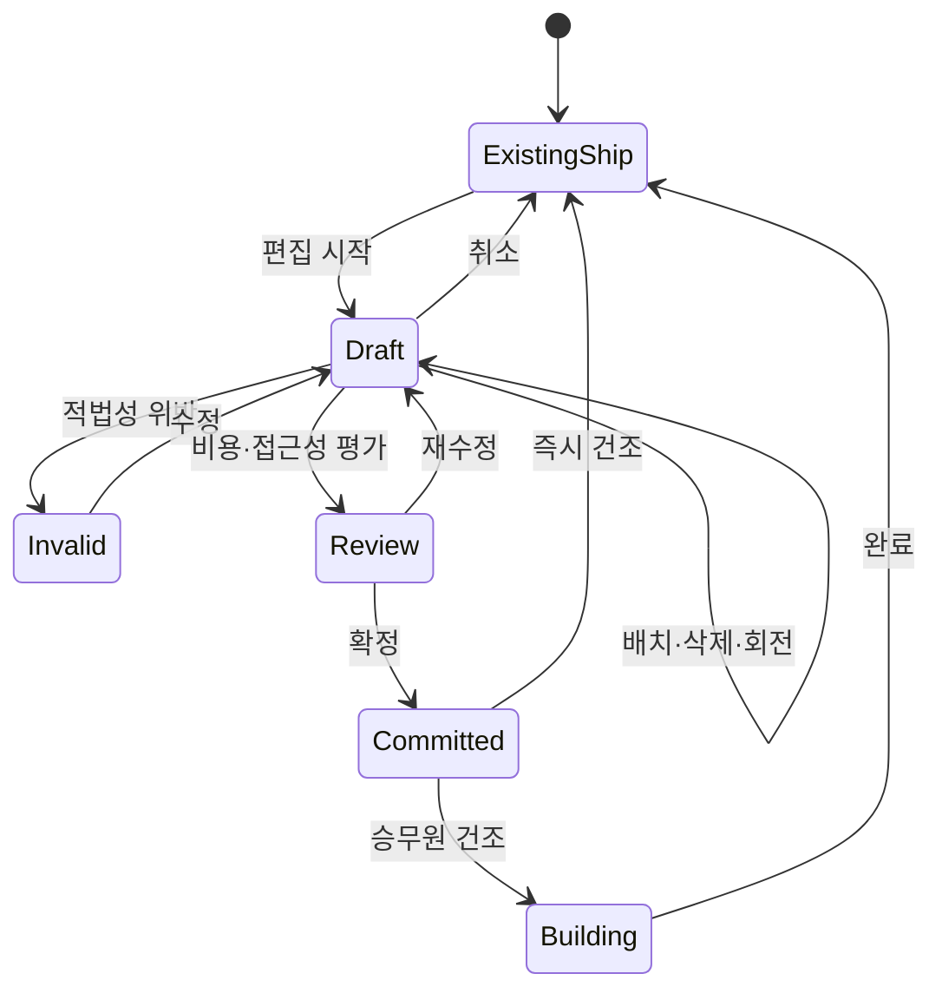

# 02. 함선 건조·편집·설계도 시스템 역기획

[전체 목차](README.md)

| 항목 | 내용 |
| --- | --- |
| 문서 ID | SYS-02 |
| 대상 | Cosmoteer: Starship Architect & Commander 상용판 |
| 조사 기준 | 0.30.5a 공개 공지 기준, 2026-11-13 |
| 검증 방식 | 공개 문헌·검색 색인 교차 확인. 게임 실행 및 원본 코드 검증은 수행하지 않음 |
| 표기 | **[확인]** 공개 자료의 규칙, **[해석]** 설계 의도 분석, **[제안]** 재구현 명세, **[검증 필요]** 실행 확인이 필요한 항목 |

## 1. 시스템의 목적

**[해석]** 건조 시스템은 캐릭터 장비창에 해당하는 기능을 공간 설계 문제로 바꾼다. 플레이어가 무엇을 장착했는지뿐 아니라, 그 부품을 어디에 놓고 어느 방향으로 돌렸으며 어떻게 승무원과 자원을 연결했는지가 성능을 결정한다. 같은 예산과 같은 무장을 사용해도 내부 동선, 방호 깊이, 추력 방향이 다르면 다른 전투 단위가 된다.

설계에서 발생하는 주요 선택은 다음과 같다.

| 선택 | 얻는 것 | 함께 발생하는 비용·위험 |
| --- | --- | --- |
| 무기 추가 | 이론상 순간 화력 | 인력·탄약·전력·노출 면적 증가 |
| 장갑 증설 | 피격 여유와 중요 부품 보호 | 질량과 필요한 추진 능력 증가 |
| 중앙 집중 배치 | 공유 자원 활용, 공간 절약 | 한 구역 손상으로 여러 기능 동시 상실 |
| 기능별 구획 분리 | 국소 손상에 대한 독립성 | 연결 구조·통로·중복 설비 비용 |
| 큰 원자로·기관실 활용 | 운반 및 설비 집약 가능성 | 중요 거점에 대한 의존도 상승 |
| 외관 대칭 유지 | 배치 이해와 일부 기동 특성 예측 용이 | 특정 무장·사격 방향에 대한 최적화 제한 |

이 표는 최적 해답이 아니라 선택의 교환 관계를 정리한 **분석**이다. 실제 성능 평가는 전투와 보급을 함께 실행한 결과로 판단해야 한다.

## 2. 확인된 플레이 규칙과 용어

**[확인]** Ship Editor는 기존 함선을 수정하거나 새 함선을 만드는 인터페이스다. 일반 편집과 Blueprint 편집을 구분하며, Blueprint에서는 최종 결과의 적법성을 기준으로 변경안을 구성한다. 건조 방식은 즉시 건조와 승무원이 수행하는 건조로 나뉘고, 선택 가능한 방식은 게임 모드·설정에 영향을 받는다. [S-SC02-1]

**[확인]** Career의 Blueprints는 정거장에서 구매하는 **부품 건조 해금 권한**이다. 물리적인 화물 아이템이 아니며, 일부 해금에는 선행 설계도가 필요하다. [S-SC02-2]

두 가지 Blueprint를 다음처럼 구분해서 사용한다.

| 용어 | 이 문서의 한국어 | 지속되는 대상 |
| --- | --- | --- |
| Blueprint Mode | 설계안 편집 모드 | 현재 함선에 적용할 변경안 |
| Part Blueprint | 부품 설계도·해금 | 캠페인의 부품 건조 가능 집합 |
| Saved Ship Design | 저장된 함선 설계 | 배치·설정 등 재사용 가능한 함선 구성 |

**[확인]** 에디터에는 승무원·전력·탄약 권장 표시와 공급원까지의 가까운 경로를 보이는 설정이 있다. 지휘 점수 부족 상태의 배치를 허용하는 설정도 별도로 존재한다. 따라서 모든 경고를 무조건 건조 불가로 취급하면 실제 설정에 따른 동작을 놓친다. [S-SC02-3]

**[검증 필요]** 정확한 단축키, 기본 격자 한계, 전투 중 변경 제한, 환급 비율, 중간 건조 단계의 자원 소유권은 대상 빌드·캠페인 설정을 고정한 뒤 검증해야 한다. 이 문서는 위키의 예전 기본값을 현재 상수로 복제하지 않는다.

## 3. 입력과 출력

| 구분 | 내용 |
| --- | --- |
| 플레이어 입력 | 부품 선택·배치·회전·제거, 문 배치, 대칭 편집, 영역 복사, 설계안 확정·취소 |
| 게임 상태 입력 | 현재 부품과 손상, 보유·주변 자원, 건조 해금, 승무원 접근성, 활성 게임 모드 |
| 분석 입력 | 부품 면적, 연결면, 출입구, 금지 공간, 요구 인력·자원, 지휘 점수 |
| 즉각 출력 | 배치 미리보기, 오류 위치, 비용 차이, 자원 부족, 운용 위험 경고 |
| 확정 출력 | 부품 배치 변경 또는 건조 작업 집합, 관련 그래프 무효화, 자원 예약·소비 |
| 이후 출력 | 실제 기능 변화, 승무원 재배치, 질량·추력·방어·보급 성능 변화 |

**[제안]** 입력과 출력은 “설계 상태”와 “현재 실물 상태”를 분리하여 관리한다. 미리보기는 실제 포탑의 작동, 승무원 이동, 전력 잔량을 바꾸지 않는다. 확정 후에도 승무원 건조가 남아 있으면 목표 형상과 완공 형상이 일시적으로 다를 수 있다.

## 4. 편집·확정·완공 상태 모델

다음 상태도는 공개 동작을 재현하기 위한 **[제안]** 모델이다. 실제 게임의 클래스나 내부 상태 이름이 아니다.



### 4.1 적법성과 성능 경고를 나누는 이유

**[제안]** 검증 결과를 세 가지로 나눈다.

1. **형상 오류:** 허용하지 않는 겹침, 잘못된 회전, 배치 금지 공간 침범 등이다. 적용 가능한 완성 형상을 만들지 못하면 확정을 막는다.
2. **운용 불능:** 지휘·승무원·공급·통로 요구가 충족되지 않는 경우다. 대상 게임의 설정에 따라 차단 또는 강한 경고로 처리한다.
3. **성능 위험:** 평균 전력은 충분하지만 수송 거리가 긴 경우, 후진 추력이 약한 경우처럼 적법해도 약한 설계다. 숫자와 원인을 보여주되 플레이어의 실험은 허용한다.

이 구분은 “우주에서 움직일 수 없는 구조물”과 “성능이 떨어지는 함선”을 같은 빨간 오류로 표현하는 문제를 줄인다. 창작 모드에서는 의도적으로 비정상 형상을 만들고 파괴 실험을 할 수도 있으므로 강제 제한은 모드 정책과 연결해야 한다.

### 4.2 변경의 최소 단위

**[제안]** 편집 동작은 `AddPart`, `RemovePart`, `RotatePart`, `SetDoor`, `SetPartOption` 같은 명령으로 기록한다. 대칭 배치와 다중 선택은 사용자 관점에서 하나의 되돌리기 단위로 묶는다. 내부적으로는 개별 부품의 안정적인 식별자를 유지하여 승무원 할당·공급망 연결·무기 그룹이 불필요하게 소실되지 않게 한다.

부품을 이동한 것인지 철거하고 새로 만든 것인지에 따라 비용과 상태 승계가 달라질 수 있다. 실제 게임의 세부 동작은 **[검증 필요]**이며, 재구현에서는 이를 명시적 정책으로 정한다. 현재 에너지·탄약·손상까지 복사하는 편집은 자원 복제 경로가 될 수 있으므로 설계 데이터와 실행 데이터를 함께 복사하지 않는다.

## 5. 검증 파이프라인

**[제안]** 완성 설계안의 검증 순서는 다음과 같다.

| 단계 | 검사 내용 | 실패 시 표시 |
| --- | --- | --- |
| 1. 기하 | 점유 셀, 허용 회전, 크기 한계, 전용 연결 조건 | 잘못된 셀·연결면 강조 |
| 2. 구조 | 같은 함선으로 유지되는 연결 관계 | 분리되는 덩어리의 윤곽 |
| 3. 접근 | 문·통행 가능 셀·작업 지점 접근 | 접근 불가 부품과 원인 |
| 4. 정책 | 부품 해금, 모드 허용 여부, 지휘 점수 정책 | 미해금·모드 제한 안내 |
| 5. 자원 | 건조에 필요한 자원과 확보 가능한 자원 | 자원별 부족량 |
| 6. 운용 | 공급 거리, 인력 배치, 지휘·추진·냉각 상태 | 성능 경고와 관련 화면 연결 |

“구조로 붙어 있음”은 “승무원이 걸어서 들어갈 수 있음”을 의미하지 않는다. 문을 설치하지 않은 방은 앞 단계가 통과해도 접근 단계에서 문제가 생긴다. 전력 역시 인접 배치만으로 자동 공급된다고 가정하지 않는다. 이 차이는 [구조 연결](03_Modules_Connectivity_and_Ship_Splitting.md), [물류](05_Internal_Logistics_and_Supply.md), [전력](06_Power_Generation_and_Distribution.md)에서 각각 다룬다.

```text
제안: EvaluateDraft(liveShip, draft, modePolicy)
    geometry = ValidatePlacement(draft)
    structure = BuildStructuralComponents(draft)
    access = BuildWalkableRegions(draft)
    permissions = ValidateUnlockedParts(draft, modePolicy)
    delta = CompareDesigns(liveShip.design, draft)
    quote = QuoteResourceDelta(delta, currentRefundPolicy)
    warnings = AnalyzeOperation(draft, access)
    return Report(geometry, structure, permissions, quote, warnings)
```

이 함수는 비용을 **계산**할 뿐 지불하지 않는다. 확정 순간에는 함선 상태 버전과 자원 가용량을 다시 확인한다. 다른 작업이나 협동 플레이가 같은 자원을 먼저 사용했다면 새 견적을 보여주거나 가능한 작업만 큐에 넣는 방식 중 하나를 정책으로 정해야 한다.

## 6. 대표 플레이 시나리오

### 시나리오 A: 초반 함선에 무장을 하나 더 추가

**[해석]** 플레이어의 첫 판단은 보유 크레딧과 공간이다. 실제 검토는 부품 해금, 건조 자원, 지휘 점수, 조작 인력, 재보급 인력, 기존 통로의 여유까지 이어져야 한다. 에디터는 이 연쇄 요구를 한 번에 암기시키기보다 사용자가 추가하려는 부품과 관련된 문제를 바로 드러내는 편이 학습에 유리하다.

확정 직후 작동하지만 장기 사격에서 멈춘다면 건조 자체의 오류보다 운반 처리량 부족일 가능성을 먼저 조사한다. 역기획의 핵심은 “추가 버튼을 눌렀다”에서 끝내지 않고, 추가 부품이 다른 시스템의 수요를 어떻게 바꾸는지 기록하는 것이다.

### 시나리오 B: 중앙 원자로를 옮기는 대규모 개장

**[해석]** 원자로 이동은 단일 부품 편집처럼 보여도 공급 거리, 방폭 여유, 통로, 냉각 접점과 무게 분포가 바뀌는 사건이다. 일시적으로 불완전한 중간 형상을 허용하는 설계안 편집은 이런 대규모 변경의 인지 부담을 줄인다.

**[제안]** 변경 전후를 부품 가격만으로 비교하지 않고 “가장 먼 소비처 공급 시간”, “국소 전원 상실 시 정지 부품 수”, “완공까지 필요한 외부 작업”으로 비교한다. 이 지표는 원작의 확정 UI가 아니라 역기획 검토용 지표다.

### 시나리오 C: 전투 후 설계를 복원

**[해석]** 손상된 실물 상태와 목표 설계가 분리되어야 반복 복원이 자연스럽다. 그러나 원래 설계대로 복구하는 것과 전투에서 드러난 약점을 개장하는 것은 다른 선택이다. 회복 비용을 줄이는 것, 다음 전투의 손실을 줄이는 것, 새로운 역할로 바꾸는 것을 동시에 최적화하기 어렵게 만들면 설계 반복에 의미가 생긴다.

## 7. 데이터 구조 제안

| 데이터 | 주요 필드 | 설계 이유 |
| --- | --- | --- |
| PartDefinition | footprint, allowedRotations, connectors, walkMask, cost, requirements | 에디터와 실행 규칙의 공통 기준 |
| ShipDesign | designVersion, parts, doors, groups, roleConfig, supplyLinks | 저장·공유하는 목표 구성 |
| EditTransaction | baseRevision, commands, validation, quotedCost | 취소·되돌리기·동시 편집 충돌 처리 |
| ConstructionOrder | partId, reservedResources, workRemaining, status | 설계 확정과 실물 완공 분리 |
| BuildPolicy | instantBuild, unlockRequired, warningOverrides | Career·Creative·PvP 차이의 명시화 |

**[제안]** 부품 정의와 저장 파일은 형식 버전을 가진다. 사라진 부품이나 모드 의존성이 있으면 임의의 기본 부품으로 바꾸기보다 누락 목록을 보여준다. 함선 디자인의 “예산”은 부품 자체 비용, 포함 자원, 해금 비용, 현재 상태에 따라 서로 다른 의미가 될 수 있으므로 각 지표의 포함 범위를 저장한다.

## 8. 튜닝·평가 항목

건조 시스템의 품질은 가능한 조합 수만으로 평가하지 않는다. **[제안]** 다음 항목을 별도로 측정한다.

- 새 부품 배치 후 첫 원인 경고까지 걸리는 시간.
- 공급 불가 상태에서 사용자가 잘못된 원인을 선택한 비율.
- 같은 비용의 두 설계가 실험에서 서로 다른 장단점을 보이는 정도.
- 대규모 설계안의 연속 편집 지연과 되돌리기 신뢰성.
- 부품 삭제 이후 사라진 할당·연결 설정을 설명할 수 있는 정도.
- 저장한 설계를 다른 모드로 불러올 때 필요한 제한 변환의 명확성.

숫자 목표는 프로젝트의 플랫폼과 함선 규모를 정한 뒤 설정한다. 원작의 프레임 예산이나 최대 부품 수를 확인하지 않은 상태에서 성능 보증처럼 제시하지 않는다.

## 9. 수용·재현 테스트

아래 테스트는 **실행하지 않은 검증 명세**다. 원작의 실제 결과가 미확정인 항목은 기록해 명세를 보정한다.

| ID | 구분 | 절차 | 확인할 결과 |
| --- | --- | --- | --- |
| BLD-01 | 재현 관찰 | Blueprint에서 일시적 불완전 배치 후 완성 | 중간 단계와 확정 단계의 제한 차이 |
| BLD-02 | 재현 관찰 | 미해금 부품을 포함한 저장 설계 불러오기 | 필요한 해금·자원 표시와 확정 가능 여부 |
| BLD-03 | 재현 관찰 | 닿아 있지만 문이 없는 부품 배치 | 구조 연결과 승무원 접근 경고 구분 |
| BLD-04 | 재현 관찰 | 지휘 점수 부족 허용 설정을 바꾸어 같은 편집 수행 | 설정에 따른 차단·경고 동작 |
| BLD-05 | 제안 검증 | 다중·대칭 배치 후 되돌리기 | 사용자가 실행한 한 작업 단위로 복원 |
| BLD-06 | 제안 검증 | 견적 후 다른 작업이 자원을 소비한 상태에서 확정 | 자원 음수·중복 소비 없는 재검증 |
| BLD-07 | 제안 검증 | 건조 중 저장·불러오기 후 취소 | 완공·미완공·예약 자원의 일관성 |
| BLD-08 | 재현 관찰 | 손상 함선에서 삭제·복원·개장을 각각 수행 | 환급·복원 비용·완공 시간이 정책대로 구분 |

## 10. 출처와 적용 범위

| ID | 출처 | 사용 범위·제한 |
| --- | --- | --- |
| S-SC02-1 | [Ship Editor — Official Cosmoteer Wiki](https://cosmoteer.wiki.gg/wiki/Ship_Editor) | 편집 모드·건조 방식. 2026-11-13 검색 색인 확인. 페이지 자체가 작성 중임을 명시 |
| S-SC02-2 | [Blueprints — Official Cosmoteer Wiki](https://cosmoteer.wiki.gg/wiki/Blueprints) | Career 부품 해금 의미·선행 조건. 검색 색인 확인 |
| S-SC02-3 | [Settings — Official Cosmoteer Wiki](https://cosmoteer.wiki.gg/wiki/Settings) | 권장 표시·경로 표시·지휘 점수 부족 설정. 검색 색인 확인 |

공식 위키의 직접 페이지 열람이 403을 반환하는 경우 검색 제공 본문으로 확인했다. 해당 페이지의 최신 게임 데이터와 완전히 일치한다고 보증하지 않는다. 본문의 상태도·데이터 모델·평가 지표·테스트는 별도 표기가 없는 한 저자가 작성한 재구현 제안이다.

관련 문서: [구조·분리](03_Modules_Connectivity_and_Ship_Splitting.md) · [승무원](04_Crew_Roles_and_Task_AI.md) · [물류](05_Internal_Logistics_and_Supply.md) · [전력](06_Power_Generation_and_Distribution.md)

<!-- 문서 내 출처 링크 -->
[S-SC02-1]: https://cosmoteer.wiki.gg/wiki/Ship_Editor
[S-SC02-2]: https://cosmoteer.wiki.gg/wiki/Blueprints
[S-SC02-3]: https://cosmoteer.wiki.gg/wiki/Settings
