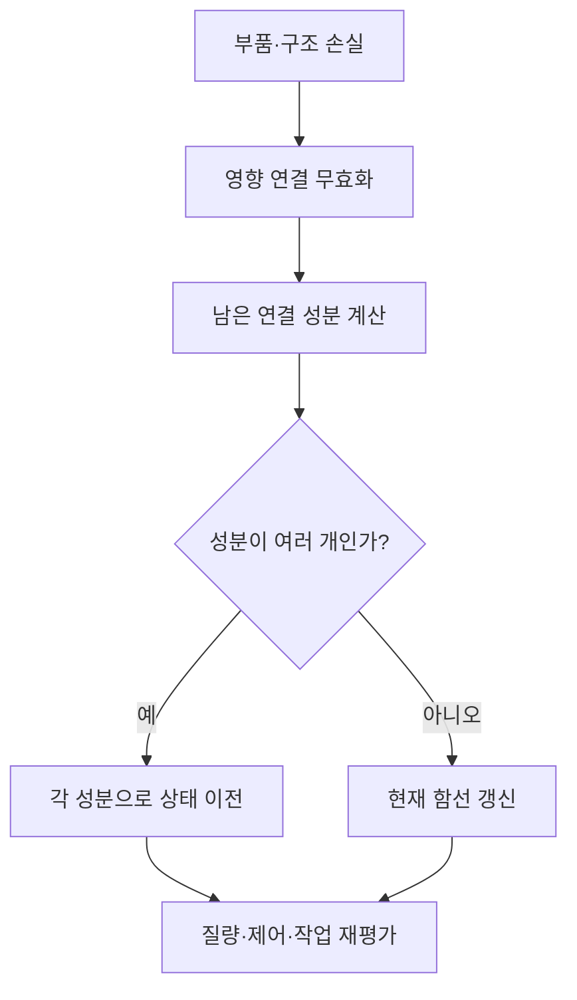

# 03. 모듈·연결 구조·함선 분리 시스템 역기획

[전체 목차](README.md)

| 항목 | 내용 |
| --- | --- |
| 문서 ID | SYS-03 |
| 대상·기준 | 상용 Cosmoteer 0.30.5a 공개 자료, 2026-11-13 |
| 검증 방식 | 문헌 기반 재구성. 실행·원본 코드 검증 없음 |
| 표기 | **[확인]** 문헌의 규칙, **[해석]** 설계 분석, **[제안]** 재구현 명세, **[검증 필요]** 추가 관찰 항목 |

## 1. 시스템 목적

**[해석]** 코스모티어의 함선은 하나의 HP와 장비 슬롯으로 표현되는 유닛보다, 기능 부품들이 공간적으로 결합한 구조물에 가깝다. 따라서 생존은 총 내구도만이 아니라 “어떤 연결을 잃으면 무엇이 떨어져 나가는가”라는 문제를 포함한다. 길게 돌출한 무기군, 얇은 연결부 뒤의 엔진, 중앙에 모인 지휘실은 서로 다른 실패 형태를 만든다.

이 시스템의 목적은 설계의 형상을 전투 결과와 직접 연결하는 것이다. 플레이어가 전투 전 배치한 구조는 전투 중 취약점이 되고, 상대의 연결부를 겨냥하는 선택은 직접 화력 제거와 다른 전술적 의미를 갖는다.

**[확인]** 공식 소개는 부품 단위로 조준·파괴할 수 있고 함선이 여러 조각으로 분리될 수 있다고 설명한다. [S-SC03-1] **[확인]** Structure는 함선 부품을 잇는 구조 계층이다. 다만 Structure에 대한 무기 충돌·피해 예외가 있으므로 단순한 장갑과 동일하게 취급해서는 안 된다. [S-SC03-2]

## 2. 서로 다른 연결을 구별한다

다음 분해는 **[제안]** 데이터 모델이며 실제 엔진이 같은 그래프를 사용하는지는 확인하지 않았다.

| 연결 종류 | 질문 | 연결이 끊어졌을 때 |
| --- | --- | --- |
| 구조 연결 | 같은 물리 함체로 유지되는가? | 별도 덩어리로 분리 가능 |
| 승무원 통행 연결 | 승무원이 작업 위치로 걸어갈 수 있는가? | 작업자·운반자 접근 불가 |
| 보급 허용 연결 | 이 공급원이 이 소비처에 공급하도록 지정됐는가? | 물리적 경로가 있어도 운반 대상에서 제외 가능 |
| 특수 모듈 연결 | 무장·추진 확장 부품의 전용 접점이 맞는가? | 해당 조합의 성능 또는 작동 변화 |
| 열 연결 | 열이 어떤 경로로 이동하는가? | 냉각 계통·열 피해 분포 변화 |
| 지휘 기여 | 가동 가능한 지휘 기능이 충분한가? | 명령 수행 가능 상태 변화 |

**[확인]** 문은 승무원이 부품 사이를 통과하게 하며 화재 확산 경로가 되기도 한다. [S-SC03-3] 따라서 구조 연결과 통행 연결을 한 데이터로 합치면, 장갑이나 구조물이 통로가 되는 오류 또는 문이 없다는 이유로 물리 함체가 분리되는 오류가 생긴다.

열 연결의 실제 규칙과 최신 변경은 [열·오버클럭](11_Heat_and_Overclocking.md)에서 다룬다. 이 문서에서는 열을 별도 의존 관계로 다루어야 한다는 설계 경계만 정한다.

## 3. 모듈의 책임과 공간 표현

**[제안]** 부품 정의와 부품 인스턴스를 분리한다.

| 계층 | 포함할 데이터 | 포함하지 않을 데이터 |
| --- | --- | --- |
| 부품 정의 | 셀 형상, 연결면, 문 가능 위치, 통행 마스크, 질량 기준, 기능 종류 | 현재 손상·현재 위치·현지 승무원 |
| 부품 인스턴스 | 정의 ID, 위치, 회전, HP, 내부 자원, 토글, 소속 함선 | 전역 부품 가격표의 사본 |
| 함선 인스턴스 | 부품 집합, 월드 변환, 명령, 소유자, 물리량 | 모든 부품의 구체 동작 코드 |
| 연결 캐시 | 구조 성분, 통행 영역, 특수 접점, 재계산 버전 | 영구적인 원본 설계 정보 |

격자 점유만으로 모든 연결을 추정하면 안 된다. 다중 셀 부품, 삼각형 부품, 겉보기에는 닿지만 연결하지 않는 면, 전용 접점이 필요한 부품을 표현해야 한다. **[검증 필요]** 모서리 접촉만으로 구조가 이어지는지, 부품마다 허용 접점이 어떻게 다른지는 실제 빌드의 배치 검사와 파괴 실험으로 확정한다. 본 문서는 모든 부품에 “상하좌우 셀 인접이면 무조건 연결”이라는 규칙을 적용하지 않는다.

## 4. 구조 손상과 분리의 처리 흐름



이 흐름 전체는 **[제안]**이다. 공개 자료가 확인해 주는 것은 함선 분리라는 결과이며, 어느 틱에서 어떤 탐색 알고리즘을 실행하는지는 확인하지 않았다.

### 4.1 분리 직전 유지해야 할 정보

**[제안]** 파괴 처리 중 부품을 곧바로 모든 시스템에서 삭제하면, 그 부품을 참조하던 작업·무기 목표·공급 예약이 유효하지 않은 객체를 가리킬 수 있다. 한 시뮬레이션 단계에서 손상 결과를 수집하고 안정적인 반영 지점에서 구조 변경을 적용하는 방식이 적합하다.

분리 작업은 다음 결과를 일관되게 만들어야 한다.

- 살아 있는 모든 부품은 정확히 한 새 함체에 속한다.
- 부품 내부 자원과 승무원은 복제되지 않는다.
- 제거된 부품을 목표로 한 작업은 취소되거나 다른 목표를 선택한다.
- 분리 전 운동 상태와 분리 후 운동 상태의 관계가 정의되어 있다.
- 사용자 선택·카메라·명령의 승계가 예측 가능하다.

이 중 어떤 조각을 원래 선택 대상으로 유지할지는 인터페이스 정책이다. 가장 큰 조각, 지휘실을 가진 조각, 플레이어가 현재 선택한 중요 부품을 포함한 조각 등 여러 선택이 가능하며, 실제 게임의 정책은 **[검증 필요]**다.

### 4.2 질량과 운동량

**[제안]** 2차원 강체 모델로 재구현한다면 각 조각의 질량중심을 다시 계산한다. 회전 중 떨어져 나간 조각의 선속도를 단순히 부모 함선의 질량중심 속도와 같게 두면 접선 운동이 사라진다.

분리 시각의 운동학 예시는 다음과 같다.

\[
\mathbf v_i=\mathbf v_{parent}+\omega\hat{z}\times(\mathbf c_i-\mathbf c_{parent})
\]

여기서 `c_i`는 새 조각의 질량중심, `ω`는 분리 전 각속도다. 이것은 일반적인 강체 운동학에서 얻은 **제안식**이며 코스모티어의 내부 물리식이라고 주장하지 않는다. 폭발 충격과 분리 시 부품 소실로 사라진 질량을 별도로 고려해야 하며, 회전·질량중심 갱신 후 갑작스러운 중복 충격이 들어가지 않게 한다.

## 5. 지휘 점수와 생존 상태

**[확인]** Command Points는 함선 제어 복잡도를 나타내며 지휘 부품이 공급하고 여러 기능 부품이 요구한다. 지휘실을 잃은 경우 일부 시스템을 끄는 방식으로 수요를 줄이는 대응이 가능하다. [S-SC03-4]

**[해석]** 따라서 “지휘 부품이 한 개 남았는가”와 “남은 지휘 능력으로 현재 함선을 통제할 수 있는가”는 다른 질문이다. 분리된 조각이 지휘 부품을 가지고 있어도 그것이 작동 중인지, 작업 인력·전원이 있는지, 남은 수요를 충족하는지를 함께 평가해야 한다.

**[제안]** 내부 상태를 다음 세 축으로 분리한다.

| 축 | 예시 상태 | 분리 이유 |
| --- | --- | --- |
| 구조 상태 | 단일 함체 / 여러 함체 / 제거 대기 | 물리 토폴로지 |
| 소유 상태 | 플레이어 / 적 / 중립 / 무주물 | 명령 권한·회수 규칙 |
| 운용 상태 | 정상 / 지휘 부족 / 전원 부족 / 인력 부족 | 현재 기능 가능성 |

소유자가 있다는 이유로 조종이 가능하다고 보지 않으며, 조종이 불가능하다는 이유로 즉시 소유권을 지우지도 않는다. 원작의 항복·폐선·점유 판정은 Career 및 전투 규칙과 함께 실측해야 한다.

## 6. 손상 설계의 전술적 의미

### 6.1 얇은 목 연결

**[해석]** 무장 블록을 얇은 연결부로 지지하면 초기 건조 비용과 질량을 절약할 수 있지만, 연결부에 집중 피해가 들어갈 때 큰 기능 묶음을 한 번에 잃을 수 있다. 연결부 자체의 HP가 낮다는 사실보다 그 뒤에 달린 기능 가치가 크다는 점이 취약점이다.

**[제안]** 취약점 평가에는 다음 같은 지표를 사용할 수 있다.

\[
Criticality(e)=\frac{SeparatedFunctionalValue(e)}{CostToDisable(e)+\varepsilon}
\]

분자에는 분리될 무기·추진·자원·지휘 가치를 넣고, 분모에는 방어와 접근 각도를 포함한 상대적 파괴 비용을 넣는다. 이는 실제 게임의 AI 목표 점수식이 아니라 설계 검토용 휴리스틱이다. 오히려 모든 취약점을 자동 계산해 알려주면 탐색 재미가 줄 수 있으므로 플레이어 UI보다는 개발 분석에 먼저 사용한다.

### 6.2 여러 연결 경로

**[해석]** 복수 연결은 한 지점 손상으로 분리되는 위험을 낮추지만, 질량·공간·재료를 소모한다. 승무원 통로를 함께 늘리면 운반 우회성이 좋아질 수 있으나 화재 경로도 늘어날 수 있다. 방어·동선·구조의 최적 배치는 같은 답으로 수렴하지 않는다.

### 6.3 의도적 분리

**[검증 필요]** 폭약 등으로 분리되는 함선 구성은 접점과 제어 자립성을 시험하는 좋은 관찰 사례다. 그러나 자립 전투가 가능한 분리 조각의 조건, 분리 후 명령 승계, 비용 계산을 확인하지 않은 상태에서 “도킹된 모함·함재기 시스템”으로 일반화해서는 안 된다. 실제로 제공되는 기능과 플레이어가 조합해 만든 응용 설계를 구분한다.

## 7. 연결 변경과 작업 시스템의 계약

**[제안]** 연결 변경 이벤트에는 단순한 `ShipChanged` 대신 영향 범위를 담는다.

```text
TopologyChanged:
    oldShipId
    newShipIds
    partToShipMapping
    removedPartIds
    invalidatedWalkRegions
    invalidatedSupplyEdges
    revision
```

승무원 시스템은 `partToShipMapping`을 받아 현재 서 있는 위치와 목표 작업의 소속을 다시 확인한다. 물류 시스템은 예약된 화물의 출발지·목적지가 같은 함체에서 접근 가능한지 검사한다. 전투 시스템은 목표 부품 ID가 살아 있다면 함선 ID가 바뀌어도 조준 관계를 유지할지 정책을 적용한다. UI는 사라진 선택 항목을 자동 제거하고 새 함체의 경고를 표시한다.

저장 시스템은 분리 처리가 절반만 적용된 순간을 저장하지 않는 편이 단순하다. 저장 직전 구조 변경 큐를 완료하거나, 이벤트 큐 자체를 재현할 수 있도록 버전과 순서를 보존하는 두 방법 중 하나를 선택한다.

## 8. 경계 사례와 위험

| 사례 | 실패 가능성 | 제안 처리 |
| --- | --- | --- |
| 같은 틱에 여러 연결부 파괴 | 조각 중복 생성 | 파괴 집합을 반영한 최종 그래프에서 한 번 계산 |
| 문만 제거 | 함체가 잘못 분리됨 | 구조·통행 그래프를 독립 갱신 |
| 승무원이 연결부 위에 있음 | 유실·복제·빈 좌표 | 소속·위치 이전 규칙을 명시 |
| 포탄 목표가 다른 조각으로 이전 | 존재하는 목표를 놓침 | 부품 ID와 현재 소속을 분리 |
| 연결 복구 건조 | 과거 캐시 재사용 | topology revision 증가와 관련 캐시 무효화 |
| 모드 부품의 비정형 접점 | 보이지 않는 연결·잘못된 분리 | 부품 정의에 연결 판정 데이터 포함 |
| 다수의 작은 파편 | 탐색·충돌·렌더 비용 증가 | 조종 가능 함체와 잔해 처리 등급 분리 검토 |

마지막 성능 최적화는 게임플레이를 바꾸지 않는 범위에서만 적용한다. 아직 회수 가능한 자원이나 재연결 가능한 부품을 단순 시각 파편으로 바꾸면 회수 경제와 건조 결과가 달라진다.

## 9. 수용·재현 테스트

아래는 **미실행 테스트 명세**다.

| ID | 구분 | 구성·행동 | 기대 또는 관찰 항목 |
| --- | --- | --- | --- |
| CON-01 | 재현 관찰 | 두 기능 블록을 한 구조 연결로 잇고 해당 연결 파괴 | 실제 분리 조건·새 조각 수 |
| CON-02 | 재현 관찰 | 모서리 접촉·면 접촉·삼각 접촉을 각각 구성 | 부품별 구조 인접 규칙 |
| CON-03 | 제안 검증 | 구조 유지 상태에서 문만 제거 | 물리 함체 유지, 승무원 경로만 변경 |
| CON-04 | 재현 관찰 | 두 지휘 구역을 가진 함선을 분리 | 지휘·인력·전원에 따른 각 조각의 제어 여부 |
| CON-05 | 제안 검증 | 회전 중 분리한 뒤 조각 속도 기록 | 정의된 강체 운동학과 일관성 |
| CON-06 | 제안 검증 | 화물 운반 중 연결부 파괴 | 화물·인력·예약의 총량 보존 |
| CON-07 | 제안 검증 | 같은 틱에 복수 연결 파괴 후 저장·불러오기 | 중복 부품·중복 함선·유령 작업 없음 |
| CON-08 | 재현 관찰 | 구조물 뒤 무기 또는 중요 연결부를 표적화 | 구조 대상 무기 판정과 최신 피해 규칙 |

## 10. 출처와 불확실성

| ID | 출처 | 근거 범위 |
| --- | --- | --- |
| S-SC03-1 | [Cosmoteer 공식 소개](https://cosmoteer.net/) | 부품별 조준·파괴와 함선 분리라는 제품 동작 |
| S-SC03-2 | [Structure — Official Cosmoteer Wiki](https://cosmoteer.wiki.gg/wiki/Structure) | 구조물의 연결 역할과 무기 상호작용 예외. 검색 색인 확인 |
| S-SC03-3 | [Door — Official Cosmoteer Wiki](https://cosmoteer.wiki.gg/wiki/Door) | 문에 의한 승무원·화재 통과. 검색 색인 확인 |
| S-SC03-4 | [Command Points — Official Cosmoteer Wiki](https://cosmoteer.wiki.gg/wiki/Command_Points) | 지휘 공급·요구와 기능 정지를 통한 수요 감소. 검색 색인 확인 |

연결 그래프의 정확한 내부 구성, 분리 조각의 소유권·식별자 승계, 파괴 이벤트 처리 순서는 공개 소개만으로 확정되지 않는다. 이 문서의 자료구조와 알고리즘은 관찰 가능한 결과를 재현하기 위한 별도 제안이다.

관련 문서: [건조](02_Ship_Construction_and_Blueprints.md) · [승무원](04_Crew_Roles_and_Task_AI.md) · [피해·파괴](10_Damage_Fire_and_Destruction.md) · [열](11_Heat_and_Overclocking.md) · [기술 구조](20_Technical_Architecture_and_Data_Model.md)

<!-- 문서 내 출처 링크 -->
[S-SC03-1]: https://cosmoteer.net/
[S-SC03-2]: https://cosmoteer.wiki.gg/wiki/Structure
[S-SC03-3]: https://cosmoteer.wiki.gg/wiki/Door
[S-SC03-4]: https://cosmoteer.wiki.gg/wiki/Command_Points
