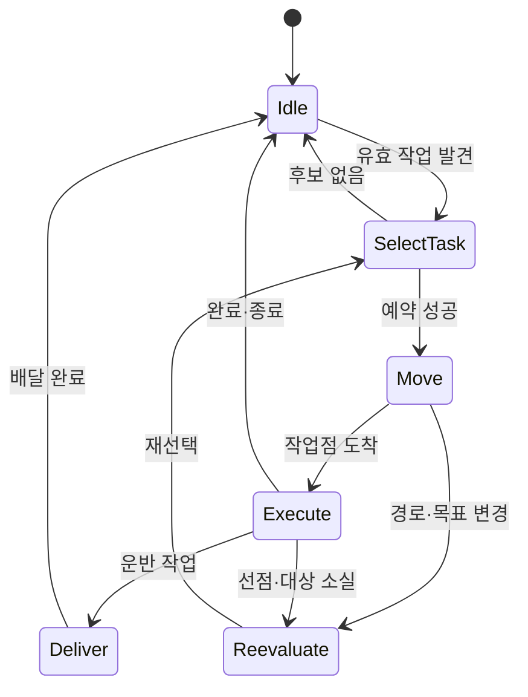

# 04. 승무원·역할·작업 AI 시스템 역기획

[전체 목차](README.md)

| 항목 | 내용 |
| --- | --- |
| 문서 ID | SYS-04 |
| 대상·기준 | 상용 Cosmoteer 0.30.5a 공개 자료, 2026-11-13 |
| 검증 방식 | 공개 문헌 확인. 게임 실행·AI 코드 분석 없음 |
| 표기 | **[확인]** 문헌 규칙, **[해석]** 설계 분석, **[제안]** 재구현 명세, **[검증 필요]** 실측 대상 |

## 1. 시스템의 역할

**[해석]** 승무원은 함선 성능을 공간과 시간에 연결하는 실행 자원이다. 부품을 설치하는 것만으로 성능이 보장되지 않게 만들고, 인력 배치·통로·작업 우선순위를 통해 같은 설계를 다르게 운용하게 한다. 플레이어는 개별 승무원의 매 순간 이동을 지정하기보다 역할과 할당 조건을 정하고 결과를 관찰한다.

**[확인]** 승무원은 부품 조작과 자원·전지 운반을 수행한다. 외형과 이름은 개별 능력 차이가 아니며, 같은 작업을 수행하는 기본 능력은 동등하다. [S-SC04-1] 따라서 역할은 RPG 직업이나 성장 스탯보다 “어떤 작업을 먼저 하도록 설정했는가”에 가깝다.

명성·고용 한도와 고용 비용의 상세 규칙은 [Career·명성](16_Career_Missions_Fame_and_Factions.md)에서 다룬다. 이 문서는 고용된 인력이 함선 내부와 주변에서 작업을 수행하는 방법을 중심으로 작성한다.

## 2. 플레이어가 조절하는 것

| 조절 대상 | 직접적인 효과 | 설계상 주의점 |
| --- | --- | --- |
| 승무원 수와 거주 공간 | 사용 가능한 작업 인력 | 침상 수와 실제 인원은 구별해야 함 |
| 역할별 작업 우선순위 | 인력이 선택하는 작업의 순서 | 중요 작업을 모두 최고로 두면 선택 의도가 흐려짐 |
| 특정 구역·부품 할당 | 가능한 작업 후보 범위 제한 | 손상 후 우회와 대체 인력 투입을 방해할 수 있음 |
| 거주 공간 위치 | 초기 배치·유휴 위치와 수요 구역의 관계 | 상시 조작자와 왕복 운반자의 공간 요구가 다름 |
| 통로·문·보행 설비 | 작업 사이 이동 시간 | 문이 많아지는 효과와 위험을 함께 검토 |
| 역할의 충원 우선순위 | 새 인력·전환 인력 배분 | 작업 우선순위와 같은 숫자라도 의미가 다름 |

**[확인]** 0.24.0 기록에는 역할별 Hiring Priority와 낮은 우선순위 역할에서의 자동 충원 옵션이 도입되었다고 명시한다. [S-SC04-2] 이것은 **고용·충원 정책**이며 현재 승무원이 수행할 작업을 고르는 정책과 분리해야 한다.

## 3. 확인된 이동 특성과 해석 한계

**[확인]** 위키는 승무원이 격자에서 직교 방향으로 이동하며, 통과하는 부품·이동 방향·화재 등의 영향을 받는다고 설명한다. 같은 타일의 승무원 혼잡은 속도 저하를 일으킨다. 이를 “두 사람이 마주치면 영구적으로 막힌다”는 물리 충돌 규칙으로 바꾸어 해석하지 않는다. 선외 활동에는 산소와 귀환이 관계된다. [S-SC04-1]

**[검증 필요]** 이동 속도 배율, 혼잡 하한, 화재와 혼잡의 적용 순서는 최신 빌드에서 재현하여 고정해야 한다. 여러 위키 표가 다른 시기의 값을 포함할 수 있으므로 본문 의사코드에는 수치를 박아 넣지 않는다. 승무원 이동과 통행 가능성은 [구조 연결](03_Modules_Connectivity_and_Ship_Splitting.md)에서 분리한 통행 그래프를 이용하는 방식으로 모델링한다.

**[해석]** 혼잡을 포함하는 이동 비용은 “직선상 가장 가까운 원자로”와 “가장 빨리 물건을 가져올 수 있는 원자로”를 다르게 만든다. 또한 조작 인력은 한번 작업 자리에 도착하면 계속 머물 수 있는 반면 공급 인력은 왕복을 반복한다. 두 역할을 같은 기준으로 최단 거리에 배치하면 거주 공간을 비효율적으로 사용할 수 있다.

## 4. 작업 유형과 생명주기

다음 분류와 필드명은 **[제안]**이다. 원작 내부 AI의 열거형을 복원한 것이 아니다.

| 작업 계열 | 시작 조건 | 완료·종료 조건 | 취소·재평가 원인 |
| --- | --- | --- | --- |
| 조작 | 기능 부품이 작업자를 요구 | 조작 유지 또는 작업 종료 | 부품 파괴, 명령·역할 변경, 가동 불능 |
| 전력 공급 | 소비처 에너지 수요 | 배달 완료 | 목적지 소실, 경로 단절, 수요 해소 |
| 탄약·자원 공급 | 소비처 입력 수요 | 배달 완료 | 예약 충돌, 입력 제한, 재고 소진 |
| 생산·건조 보조 | 작업 가능한 생산·건조 요청 | 처리량 또는 작업량 충족 | 선행 자원 부족, 취소·손상 |
| 소화 | 접근 가능한 화재 대응 요청 | 목표 소화 또는 임무 종료 | 접근 불가, 장비 불능, 더 위험한 상태 |
| 회수·선외 | 함선 외부의 자원·작업 대상 | 회수·복귀 | 산소 부족, 대상 소실, 함선 이동 |

실제 작업이 항상 이 순서로 예약되는지, 어떤 작업이 선점 가능한지는 **[검증 필요]**다. 재구현에서는 지속 조작과 단발 운반을 같은 “즉시 끝나는 행동”으로 표현하지 않아야 한다.



## 5. 우선순위와 할당의 명세

**[확인/역사]** 개발자의 이전 버전 공식 변경 기록은 역할의 작업 우선순위를 1~10 또는 비활성으로 구성하고, 높은 우선순위를 우선하며 같은 우선순위에서는 가까운 작업을 선택하는 설계를 설명한다. [S-SC04-3] 이 자료는 Classic 시기 기록이므로, **현재 상용판의 모든 동률 처리·선점 세부 규칙이 그대로라고 단정하지 않는다.**

**[제안]** 동작을 설명하기 쉬운 재구현은 다음 순서를 사용한다.

1. 역할에서 금지한 작업을 제외한다.
2. 부품·구역 할당과 소유권 조건을 적용한다.
3. 작업에 필요한 접근성과 자원·자리의 예약 가능성을 확인한다.
4. 작업 우선순위가 높은 후보를 고른다.
5. 같은 우선순위 안에서는 예상 완료 시간과 전환 비용을 비교한다.
6. 기존 작업을 바꿀 만큼 이득이 있는지 검사한다.

```text
제안: SelectJob(crew, taskSet)
    candidates = taskSet.Filter(roleAllows && assignmentAllows)
    candidates = candidates.Filter(reachable && reservable)
    candidates.SortBy(priority descending,
                      estimatedCompletionTime ascending,
                      stableTaskId ascending)
    selected = First(candidates)
    if ShouldKeepCurrentJob(crew.current, selected):
        return crew.current
    return Reserve(selected)
```

마지막의 안정적인 정렬 키는 결과를 재현하기 위한 제안이며 실제 게임의 동률 처리 규칙이 아니다. 또한 단순히 모든 조건을 점수 하나로 더하면, 멀리 있는 높은 우선순위 작업보다 가까운 낮은 우선순위 작업을 고를 수 있다. 플레이어가 “우선”을 엄격한 계층으로 이해한다면 사전식 비교가 설명하기 쉽다.

### 5.1 과도한 전환 방지

**[해석]** 무기가 조금 충전될 때마다 조작자가 공급자로 전환하고 다시 복귀하면 준비 시간만 반복할 수 있다. 다른 승무원이 이미 배달 중인데 같은 요청을 보고 여러 인원이 출발하는 문제도 생길 수 있다.

**[제안]** 작업 예약, 예상 도착 물량, 최소 유지 시간 또는 전환 비용을 도입한다. 다만 소화·산소 귀환 같은 대응을 무조건 지연시키면 안 된다. 작업 종류별로 `interruptible`, `reservationLifetime`, `minimumCommitTime`을 정의하고, 긴급 조건의 우선순위와 해제 조건을 함께 명세한다.

## 6. 역할 설계의 실제 의사결정

아래는 **[제안]** 역할 구성 예시다. 게임이 제공하는 고정 역할 목록이나 권장 최적 세팅이 아니다.

| 역할 예시 | 주 책임 | 설계 의도 | 위험 |
| --- | --- | --- | --- |
| 지휘·상시 조작 | 핵심 작업 자리 유지 | 이동으로 인한 지휘 공백 감소 | 인력이 손실되면 대체 어려움 |
| 전방 보급 | 전방 방어·무장 공급 | 가까운 운반 경로 집중 | 후방 비상 작업에 투입되지 못함 |
| 추진 보급 | 기관 구역의 전원 유지 | 이동 명령의 지속성 확보 | 화력 공급이 부족해도 인력 유휴 가능 |
| 생산·회수 | 평시 재료 처리·회수 | 전투 준비와 회복 속도 개선 | 선외 작업 중 전투 전환 위험 |
| 비상 대응 | 소화·공백 보충 | 손상 이후 복구력 | 평상시 효율만 보면 과잉 인력처럼 보임 |

**[해석]** 역할 세분화가 언제나 유리한 것은 아니다. 작은 함선에서는 다기능 인력이 수요 변화를 흡수하기 쉽다. 큰 함선에서는 먼 구역 사이를 왕복하는 손실이 커져 전문화와 구역 분리가 유리해질 수 있다. 어느 규모에서 전환하는지는 인원수 하나보다 각 작업의 서비스 시간과 동시 수요로 판단한다.

## 7. 인력 수요를 평가하는 모델

다음은 실제 게임 공식이 아닌 **[제안]** 분석 모델이다.

\[
N_{required}\approx N_{continuous}+\sum_j \lambda_j T_j+N_{reserve}
\]

- `N_continuous`: 동시에 자리를 지켜야 하는 인원.
- `λ_j`: 운반·건조 등 작업 종류 `j`의 초당 발생량.
- `T_j`: 이동·픽업·배달·복귀를 포함한 작업 1회의 점유 시간.
- `N_reserve`: 손상·화재·일시적 폭증을 흡수하는 여유 인력.

`λT`는 평균 점유 인원을 추정할 뿐, 짧은 구간의 집중 수요나 통로 혼잡을 완전히 설명하지 못한다. 특히 방어막이 집중 공격을 받는 순간과 전방 무기가 동시에 발사하는 순간이 겹치면 평균 수요가 같아도 결과가 달라진다.

**가정 예시:** 상시 조작에 6명, 초당 0.8회 발생하는 운반에 평균 10초가 필요하다면 평균 점유는 약 14명이다. 여기에 20%를 더해 17명으로 정하는 계산은 **설계 예시**일 뿐 실제 함선의 충분 인원 보증이 아니다. 배달 도중의 목적지 소실, 원자로 대기, 혼잡이 있으면 더 필요할 수 있다.

## 8. 피드백과 진단 화면

**[제안]** 단순한 “승무원이 부족합니다”보다 현재 인원이 어디에서 시간을 소비하는지 보여준다.

| 진단 값 | 해석 |
| --- | --- |
| 역할별 대기 인원 | 업무가 없거나 할당·접근 조건이 너무 제한적일 수 있음 |
| 역할별 장거리 이동 비율 | 구획 배치 또는 공급원 선택 문제 가능 |
| 자원 픽업 대기 | 생산량·충전 속도·공급원 재고 문제 가능 |
| 작동 자리 공석 시간 | 상시 조작과 운반의 우선순위 충돌 가능 |
| 완료되지 않는 예약 | 경로 단절·대상 소실 처리 문제 가능 |
| 선외 인원·귀환 가능성 | 출발·교전 전 전술 위험 |

작업의 원인을 설명할 때에는 “AI가 멍청해서 멈췄다”가 아니라 “이 승무원은 해당 부품에 할당되어 있지 않음”, “선택한 공급원이 비어 있음”, “문으로 연결된 경로 없음”을 구분한다. 이는 복잡한 자동화 시스템에 대한 신뢰를 형성하는 핵심 피드백이다.

## 9. 경계 사례

**[제안]** 침상이 파괴되었다고 해당 승무원을 자동 삭제하지 않는다. 생존 인원의 임시 소속과 유휴 위치를 별도로 관리하고, 재배치 가능한 침상이 생겼을 때 역할 정책을 적용한다. 원작의 침상 상실 후 상세 행동은 **[검증 필요]**다.

함선 분리 후에는 같은 부품 ID를 참조하는 작업이라도 다른 함체에 떨어질 수 있다. 내부 이동 작업을 선외 이동으로 자동 전환할지, 취소할지, 사용자 명령을 기다릴지 명시해야 한다. 선외 산소·함선 이동·목표 함선 소실을 하나의 경로 실패로만 처리하면 안전 복귀가 늦어질 수 있다.

역할 설정에서 모든 작업을 끄는 경우도 유효한 사용자 설정으로 다룬다. 인력 수는 충분하지만 아무 일도 하지 않는 원인을 UI에서 설명하고, 임의로 금지된 일을 시켜 사용자 의도를 무시하지 않는다.

## 10. 수용·재현 테스트

모두 **미실행 검증 명세**다.

| ID | 구분 | 절차 | 결과 확인 |
| --- | --- | --- | --- |
| CRW-01 | 재현 관찰 | 동일 경로의 다른 외형 승무원 비교 | 개인 외형에 따른 성능 차이 유무 |
| CRW-02 | 재현 관찰 | 먼 고우선 작업·가까운 저우선 작업 동시 생성 | 현재 버전의 우선순위·거리 비교 순서 |
| CRW-03 | 재현 관찰 | 좁은 통로와 병렬 통로에서 같은 인원을 반복 이동 | 혼잡의 속도 효과와 완전 차단 여부 |
| CRW-04 | 재현 관찰 | 역할별 충원 우선순위·자동 충원 설정 변경 | 고용·전환 인원의 배분 |
| CRW-05 | 제안 검증 | 같은 자원을 요구하는 작업 여러 개 생성 | 자원·목적지 중복 예약 방지 |
| CRW-06 | 제안 검증 | 배달 도중 목적지와 통로를 제거 | 무한 재탐색·화물 복제 없이 재평가 |
| CRW-07 | 재현 관찰 | 승무원 선외 활동 중 함선 이동·귀환 명령 | 산소·복귀·외부 인원 표시의 실제 동작 |
| CRW-08 | 제안 검증 | 작업 허용 항목을 모두 비활성화 | 설정 준수와 유휴 원인 표시 |

## 11. 출처

| ID | 출처 | 지원 범위 |
| --- | --- | --- |
| S-SC04-1 | [Crew — Official Cosmoteer Wiki](https://cosmoteer.wiki.gg/wiki/Crew) | 승무원의 기본 역할·개인 능력·이동·혼잡·선외 산소. 검색 색인 본문 확인, 직접 열람 403 |
| S-SC04-2 | [0.24.0 — Official Cosmoteer Wiki](https://cosmoteer.wiki.gg/wiki/0.24.0) | 역할별 고용·자동 충원 우선순위 도입 기록. 현재 수치 전부를 보증하는 자료로 사용하지 않음 |
| S-SC04-3 | [Cosmoteer 공식 과거 변경 기록](https://cosmoteer.net/history.html) | Classic 시기 작업 우선순위 설계. 현재 상용판의 세부 AI를 직접 증명하지 않음 |

관련 문서: [내부 물류](05_Internal_Logistics_and_Supply.md) · [전력](06_Power_Generation_and_Distribution.md) · [피해·화재](10_Damage_Fire_and_Destruction.md) · [명성·고용](16_Career_Missions_Fame_and_Factions.md)

<!-- 문서 내 출처 링크 -->
[S-SC04-1]: https://cosmoteer.wiki.gg/wiki/Crew
[S-SC04-2]: https://cosmoteer.wiki.gg/wiki/0.24.0
[S-SC04-3]: https://cosmoteer.net/history.html
